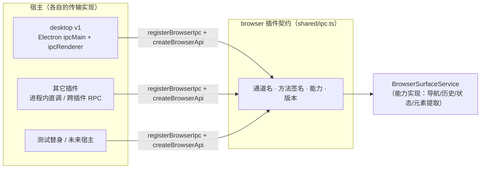

# browser 插件 IPC 契约（v1.0）

> **契约归插件，不归宿主。** 通道名、方法签名、能力声明与版本号由
> [`innate-dogic/plugins/browser/src/shared/ipc.ts`](../innate-dogic/plugins/browser/src/shared/ipc.ts)
> 单一定义；桌面（任意版本）与其他插件都按这份清单接入，不复制映射。
>
> 解决的问题：本仓的 browser 插件不是只被一个宿主消费——同一份插件代码要跑在
> 不同 desktop 版本上，也可能被别的插件复用。若通道名散落在各宿主源码里，
> 插件升级与宿主升级就会互相踩。契约把「插件暴露什么、参数与返回是什么、
> 需要什么能力、版本如何协商」固定成一份可核查的清单。

## 1. 契约清单

| 方法 | 通道 | 请求体 | 返回 | 能力 |
| --- | --- | --- | --- | --- |
| `navigate` | `innate:browserNavigate` | `{ url }` | `{ ok, url?, detail? }` | `network:navigate` |
| `back` | `innate:browserBack` | — | `{ ok, url?, detail? }` | `network:navigate` |
| `forward` | `innate:browserForward` | — | `{ ok, url?, detail? }` | `network:navigate` |
| `reload` | `innate:browserReload` | — | `{ ok, url?, detail? }` | `network:navigate` |
| `stop` | `innate:browserStop` | — | `{ ok, detail? }` | `network:navigate` |
| `state` | `innate:browserState` | — | `BrowserSessionState \| null` | `surface:read` |
| `extractList` | `innate:browserExtractList` | `{ limit? }` | `{ ok, page?, elements[], detail? }` | `element:extract` |
| `extractDetail` | `innate:browserExtractDetail` | `{ ref }` | `{ ok, element?, detail? }` | `element:extract` |
| （事件推送） | `innate:browser-event` | — | `BrowserSurfaceEvent` | — |

契约版本：`1.0`。版本号语义化 `major.minor`：

- **新增方法** = 向后兼容 = 契约 `minor` +1；
- **改名或改签名** = 不兼容 = 契约 `major` +1。

### 红线

契约内**不含任何页面脚本执行通道**——没有 `executeJavaScript`、没有 `eval`、
没有 `Runtime.*`、没有 CDP 方法名入口。元素提取只经 `extractList` /
`extractDetail` 两条只读通道（纯 CDP 只读域）。该约束由
`assertNoScriptChannel()` 在**注册时**与**单测中**双重强制。

## 2. 三种接入姿势



三侧都只做两件事，签名完全一致：

```ts
// 主进程侧：把契约方法注册到宿主的注册机制
registerBrowserIpc(host, createBrowserIpcHandlers(service))

// 渲染侧：用契约构造 renderer 可见的 API
const api = createBrowserApi(transport)
```

- **desktop**（`apps/desktop/src/main/browser-ipc.ts`）：
  `host.handle` 适配 Electron `ipcMain.handle`；`transport` 适配
  `ipcRenderer.invoke` / `ipcRenderer.on`。
- **另一个插件（同一进程）**：`createBrowserApiFromHandlers(handlers)`——
  进程内直调，不绕 IPC，走的仍是同一份契约。
- **另一个插件（跨进程）**：`createBrowserApiFromInvoker(invoker)`——
  按方法名而非通道名分发，远端只认契约方法。
- **测试替身**：直接实现 `BrowserIpcHost` 与 `BrowserIpcTransport`。

## 3. 版本协商（fail closed）

宿主必须声明自己实现的契约版本：

```ts
// apps/desktop/src/main/browser-ipc.ts
export const DESKTOP_BROWSER_IPC_VERSION = '1.0'
```

判定规则（`isBrowserIpcVersionCompatible`）：

| 宿主版本 | 契约 `1.0` | 结论 |
| --- | --- | --- |
| `1.0` / `1.7` | 兼容 | 同 major 且宿主 minor ≥ 契约 minor |
| `0.9` | **不兼容** | 宿主太旧，缺契约方法 |
| `2.0` | **不兼容** | 宿主 major 更高，通道语义未知 |
| `x` / 空 | **不兼容** | 版本不可解析 |

不兼容时 `registerBrowserIpc` **直接抛错**，不做「部分通道降级」——
降级会让不同宿主行为不一致，比整体拒绝更难排查。契约 `minor` 提升时，
桌面确认支持后同步提升 `DESKTOP_BROWSER_IPC_VERSION`。

宿主还可以用 `allow` 裁剪暴露面（例如只开导航、不开元素提取）：

```ts
registerBrowserIpc(host, handlers, { allow: ['navigate', 'state'] })
```

## 4. 安全边界（不变）

契约化**不放宽** W5/W6 立下的红线：

- renderer 只提交安全字段（会话 id、规范化 URL、条数上限、清单引用）；
  不持有 `webContents` / `session` / cookie 对象。
- URL 一律经协议白名单（仅 http/https）与内嵌凭据检查；认证 URL 不得入普通导航。
- 元素引用的 `ref` 由主进程签发，只认**本会话最近一次清单**里的 ref，
  导航后作废——renderer 不能自造 id，也不能跨会话引用。
- 契约里没有脚本执行通道；`BrowserSurfaceView` 依旧不提供 `executeJavaScript`。

## 5. 验收

| 项 | 位置 | 覆盖 |
| --- | --- | --- |
| 契约单测 | `plugins/browser/src/shared/ipc.test.ts` | 清单固定、通道唯一、能力声明、版本矩阵、注册面、渲染侧出口、跨宿主接入、红线断言（18 项） |
| 处理器工厂单测 | `plugins/browser/src/main/ipc.test.ts` | 方法↔能力映射、不可信输入透传、`state` 的 null 语义（3 项） |
| 桌面接线单测 | `apps/desktop/src/main/ipc.test.ts` | 版本兼容、契约通道全部注册且不新增、提取通道转发、红线复核（4 项） |
| 真实桌面冒烟 | `tools/smoke-browser.ts` | 渲染壳 `window.innate` 的 browser 窄通道集合 = 契约方法集（无漂移） |
