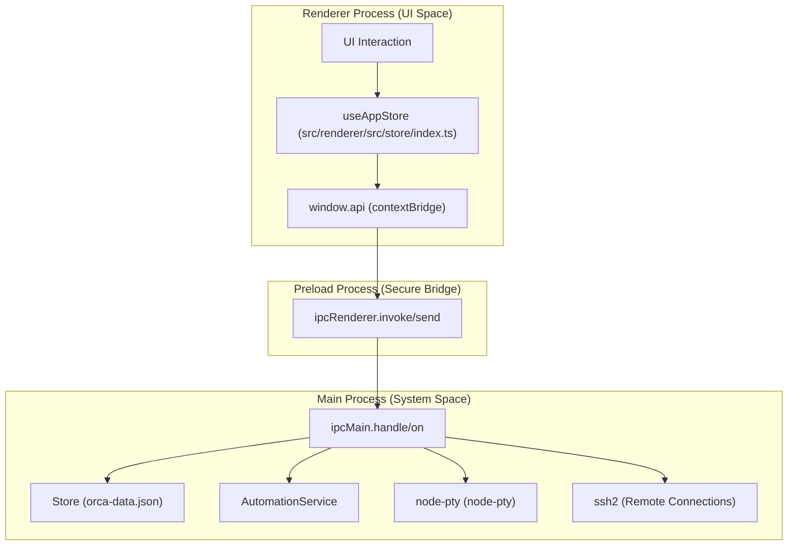
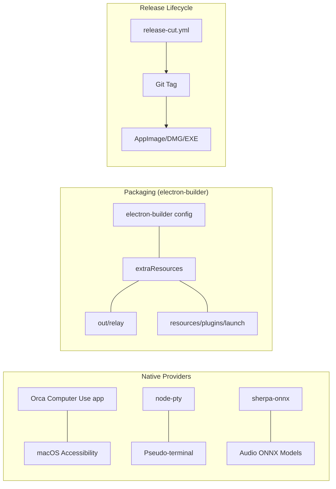

# Orca Overview

Orca is a cross-platform AI Orchestrator and IDE designed for developers to manage complex workflows across multiple git repositories and worktrees [README.md:19-21](). It provides a unified interface for running AI coding agents (such as Codex, ClaudeCode, OpenCode, or Pi) side-by-side—each within its own isolated git worktree environment—enabling comparison, merging, and seamless parallel feature development [README.md:19-21]().

The application spans multiple product surfaces, including a desktop Electron app (`package.json`) [README.md:11](), a React Native mobile companion app [src/renderer/src/components/settings/MobileSettingsPane.tsx:23-28](), and a cloud relay infrastructure. This page serves as a high-level introduction to Orca's architecture and maps out the various subsystems detailed in child pages.

---

## Core Value Proposition

- **Worktree-Native Workflow**: Orca provides a first-class experience for managing multiple parallel git worktrees without the friction of manual CLI commands [README.md:49-54]().
- **AI Orchestration**: Designed for simultaneous multi-agent workflows, Orca runs AI agents side-by-side in dedicated terminals, tracks their status, and surfaces unread activity markers [README.md:19-21](), [README.md:166-167]().
- **Multi-Surface Control**: Seamlessly connect your desktop environment to mobile companion apps and remote SSH runtimes [README.md:35-39](), [README.md:105-114]().
- **Unified Context**: Deep integration with GitHub PRs, CI checks, and source control presents a consolidated interface that reduces context switching for code review [README.md:91-96]().

Sources: [README.md:19-114](), [src/renderer/src/components/settings/MobileSettingsPane.tsx:23-28]()

---

## Technology Stack

| Layer | Technology | Purpose |
|---|---|---|
| **Desktop Shell** | Electron | Cross-platform native desktop container [README.md:11]() |
| **Frontend UI** | React + TypeScript | Component-based, type-safe UI framework |
| **Terminal Emulator** | xterm.js + node-pty | High-performance terminal emulation with native pseudo-terminals [README.md:65-66]() |
| **Code Editor** | Monaco Editor | VS Code-based code editing experience [README.md:135-136]() |
| **Mobile App** | React Native / Expo | Cross-platform mobile companion app for remote agent monitoring |
| **Cloud Relay** | Node.js / WebSocket | Cloud/push relay infrastructure connecting mobile apps to desktop hosts |

Sources: [README.md:11](), [README.md:65-66](), [README.md:135-136]()

---

## System Map: Bridging Natural Language Concepts to Code Entities

### 1. Process & Communication Flow
This diagram maps high-level UI actions to specific IPC handlers and persistent storage layers in the codebase.

Sources: [README.md:19-21](), [src/renderer/src/components/settings/MobileSettingsPane.tsx:18-20]()

### 2. Native Runtime & Build Contract
This diagram associates native runtimes and packaging configurations with their respective system components.

Sources: [README.md:11-12](), [README.md:165-166]()

---

## Subsystems & Child Pages Reference

For a granular breakdown of each subsystem, consult the following child pages:

1. **[Getting Started](#1.1)** — Prerequisites (`Node.js`, `pnpm`, `gh` CLI), installation, dev mode, production builds, and native dependency rebuilding. For details, see [Getting Started](#1.1).
2. **[Architecture Overview](#1.2)** — Three-process Electron model, IPC communication via `contextBridge`, shared types layer, and disk persistence flow. For details, see [Architecture Overview](#1.2).
3. **Main Process & Services** — Lifecycle management, IPC routing, persistence layer (`orca-data.json`), Git utilities, GitHub integration, auto-updater, SSH connections, CLI runtime RPC, automations, and plugin systems.
4. **Renderer & State Management** — Zustand store architecture, worktree lifecycle, UI components, and localization catalogs (`en`, `zh`, `ko`, `ja`, `es`, `fr`, `pt`).
5. **Terminal & Agent Systems** — `Terminal.tsx` orchestration, PTY layer, tab management, xterm.js addons, native chat interfaces, and IME/keyboard link handling.
6. **Editor & Right Sidebar** — Monaco editor view modes, file explorer, source control slices, checks panel, rich markdown, and integrations (Linear, Jira).
7. **Settings & Browser Pane** — General, terminal, agent, and speech settings alongside integrated Chromium browser panes and Design Mode.
8. **Mobile Companion & Cloud Relay** — React Native companion app, WebSocket pairing transport, terminal streaming, and cloud relay infrastructure.
9. **Build, Packaging & Release** — CI/CD workflows, test suites, agent skills governance, telemetry gates, and documentation asset management.

Sources: [README.md:1-168](), [package.json:1-75]()
