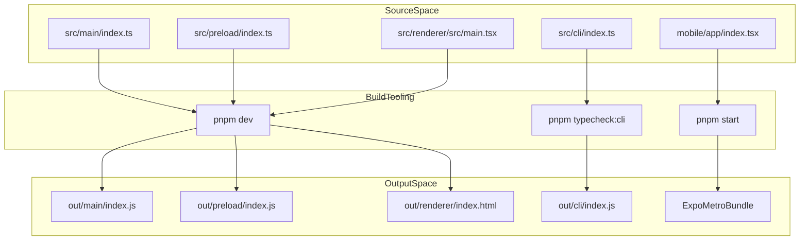
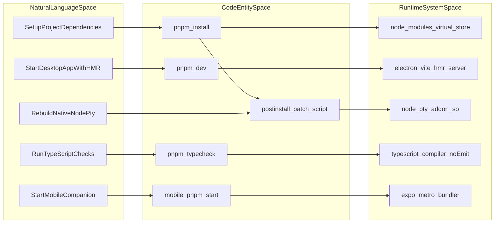

# Getting Started

This page provides the technical setup instructions for developers contributing to Orca. It covers environment prerequisites, dependency management, native dependency rebuilding via patches, the `electron-vite` based development workflow, pnpm scripts, and production build processes for both the desktop app and the mobile companion.

## Prerequisites

Orca requires the following toolchain to be installed on the host system:

*   **Node.js**: The runtime environment for Electron processes and build tooling. Node.js version 24 is specified for local development and build operations [.github/CONTRIBUTING.md:19-22]().
*   **pnpm**: The canonical package manager for the workspace. Orca enforces `pnpm` version 12.8.1 [pnpm-lock.yaml:9-11]().
*   **GitHub CLI (`gh`)**: Required for core integrations such as fetching pull requests, issues, and managing CI checks.
*   **Platform-specific build tools**: Required for compiling native addons (e.g., `build-essential` and `python3` on Linux, or Xcode Command Line Tools on macOS).
*   **Expo & React Native Toolchain**: Required for developing the mobile companion app located in the `mobile/` directory [mobile/package.json:28-49]().

Sources: [.github/CONTRIBUTING.md:19-22](), [pnpm-lock.yaml:9-11](), [mobile/package.json:28-49]()

## Repository Setup and Native Dependency Rebuilding

Clone the repository and run the workspace installation command using `pnpm`:

```bash
git clone https://github.com/stablyai/orca.git
cd orca
pnpm install
```

### Workspace Configuration & Patches
The workspace layout is defined in `pnpm-workspace.yaml`, which explicitly pins workspace roots and managed native packages such as `native/windows-registry` and `native/windows-security` [pnpm-workspace.yaml:10-14](). 

Orca relies on native modules like `node-pty` for terminal emulation [config/patches/node-pty@1.1.0.patch:1-10]() and manages them via patched dependencies [pnpm-workspace.yaml:58-71](). 
*   **`node-pty` Patches**: The patch file `config/patches/node-pty@1.1.0.patch` adjusts C++ standard definitions (`-std=gnu++2a`) for GCC compatibility on older environments, forces `libutil` and `libpthread` linking on Linux, and adds robustness handling to `conpty_console_list_agent` on Windows [config/patches/node-pty@1.1.0.patch:12-75]().
*   **Release Installs**: For cross-architecture builds or release targets, developers run `pnpm install:release` to fetch CPU-specific variants [package.json:13](), [.github/CONTRIBUTING.md:29-31]().

Sources: [pnpm-workspace.yaml:10-14,58-71](), [config/patches/node-pty@1.1.0.patch:1-75](), [package.json:13](), [.github/CONTRIBUTING.md:29-31]()

## Development Workflow and `electron-vite`

Orca uses `electron-vite` to coordinate compilation, bundling, and Hot Module Replacement (HMR) across the Electron main, preload, and renderer processes.

### Running in Development Mode
To launch the desktop application in development mode with HMR enabled:

```bash
pnpm dev
```

### Mobile Companion Development
The mobile companion app uses Expo and React Native [mobile/package.json:32-62]() with a custom `postinstall` build step for embedded webview engines [mobile/package.json:10](). To start the mobile development server:

```bash
cd mobile
pnpm start
```

### Build and Compilation Flow

**Title: Orca Build and Execution Pipeline**

Sources: [package.json:8-11](), [mobile/package.json:5-10,32-62]()

## Production Scripts and pnpm Task Reference

The root `package.json` defines various verification, build, and test tasks utilized by both local workflows and continuous integration pipelines [package.json:12-75]().

| Script Name | Command / Target | Description |
| :--- | :--- | :--- |
| `pnpm dev` | `electron-vite dev` | Starts desktop app with HMR. |
| `pnpm test` | `vitest run` | Runs test suites across node and web runners [package.json:32](). |
| `pnpm lint` | `oxlint && ...` | Executes comprehensive linter and reliability gate checks [package.json:17](). |
| `pnpm typecheck` | Parallel tsc execution | Runs type checking across `node`, `cli`, and `web` tsconfigs [package.json:68-72](). |
| `pnpm format` | `oxfmt --write .` | Formats codebase files [package.json:16](). |

Sources: [package.json:12-75]()

## Natural Language Space to Code Entity Mapping

**Title: Developer Intent to Code Entity Mapping**

Sources: [package.json:12-75](), [mobile/package.json:5-10](), [pnpm-workspace.yaml:1-71]()
