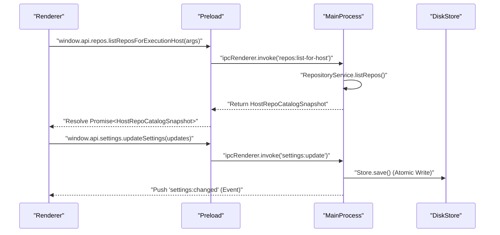
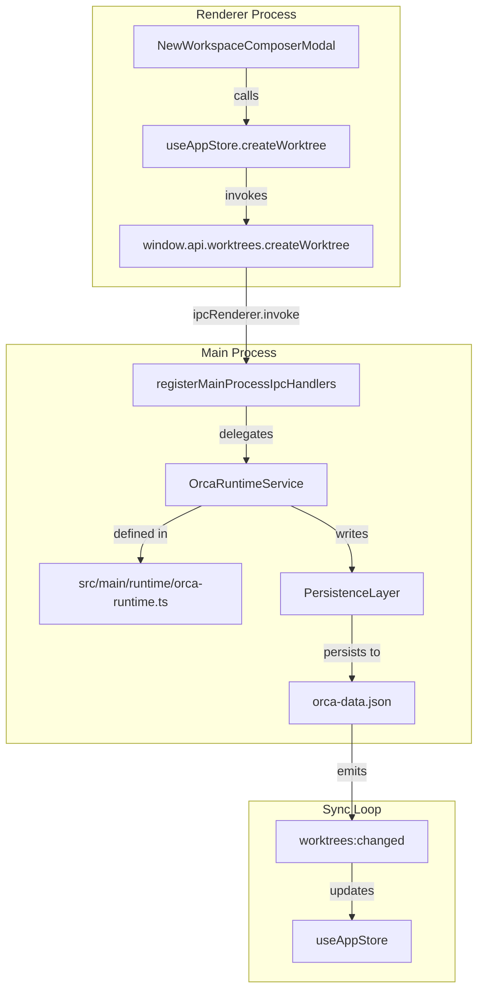

# Architecture Overview

 Orca is built on the Electron framework, utilizing a multi-process architecture to separate the user interface, system-level operations, and secure communication. This page details the responsibilities of the Main, Preload, and Renderer processes, their communication via Inter-Process Communication (IPC) and `contextBridge`, the shared types layer, and the data flow from UI interactions to disk persistence.

## Process Model

Orca follows the standard Electron security model, splitting the application into three distinct execution environments.

### 1. Main Process
The **Main Process** runs in a Node.js environment and has full access to the operating system. It is responsible for the application lifecycle, window management, and hosting heavy-duty services.
- **Entry Point**: `src/main/index.ts` [src/main/index.ts:1-125]().
- **Responsibilities**:
    - Initializing the persistence layer and managing the application data path.
    - Managing the `BrowserWindow` instance and its associated services via `openMainWindowController` [src/main/index.ts:9-9]().
    - Registering IPC handlers for system operations via `registerMainProcessIpcHandlers` [src/main/index.ts:122-122]().
    - Hosting the `OrcaRuntimeService` [src/main/runtime/orca-runtime.ts:32-35]() for various runtime operations.

Sources: [src/main/index.ts:1-125](), [src/main/runtime/orca-runtime.ts:32-35]()

### 2. Preload Script
The **Preload Script** acts as a secure bridge between the privileged Main process and the unprivileged Renderer process. It uses `contextBridge` to expose a limited, type-safe API to the UI.
- **Implementation**: `src/preload/index.ts` [src/preload/index.ts:1-156]().
- **Responsibilities**:
    - Exposing the `window.api` object to the renderer, providing access to namespaces like `repos`, `worktrees`, `pty`, and `settings` [src/preload/api-types.ts:73-165]().
    - Facilitating type-safe IPC communication defined in `src/preload/api-types.ts` [src/preload/api-types.ts:73-165]().

Sources: [src/preload/index.ts:1-156](), [src/preload/api-types.ts:73-165]()

### 3. Renderer Process
The **Renderer Process** is the React-based frontend where the UI is rendered. It cannot access the file system or shell directly; it must request these actions via the `window.api` provided by the preload script.
- **Responsibilities**:
    - Managing UI state via Zustand stores and slices.
    - Synchronizing local state with the Main process on startup and responding to IPC events.

Sources: [src/preload/api-types.ts:73-165]()

---

## Communication & Data Flow

### IPC Architecture & contextBridge
Communication between the Renderer and Main process is strictly governed by IPC. The `PreloadApi` and other type definitions in `src/preload/api-types.ts` ensure a type-safe contract across the boundary.

Title: "IPC Request and Response Cycle"

Sources: [src/preload/api-types.ts:73-165](), [src/preload/index.ts:1-156]()

### Shared Types Layer
To ensure consistency across process boundaries, Orca uses a shared types layer (`src/preload/api-types.ts` and related shared contracts). This serves as the source of truth for data structures passed over IPC.
- **Key Entities**:
    - `WorktreeApi`: Worktree metadata and CRUD operations.
    - `SettingsApi`: Global user preferences and configuration.
    - `PreloadApi`: Consolidated bridge interface.

Sources: [src/preload/api-types.ts:73-165]()

---

## Technical Data Flow: UI Action to Persistence

This diagram bridges natural language actions and code entities involved in worktree management and state persistence.

Title: "Worktree Creation and State Persistence Data Flow"

Sources: [src/main/index.ts:122-122](), [src/main/runtime/orca-runtime.ts:32-35](), [src/preload/api-types.ts:73-165]()
