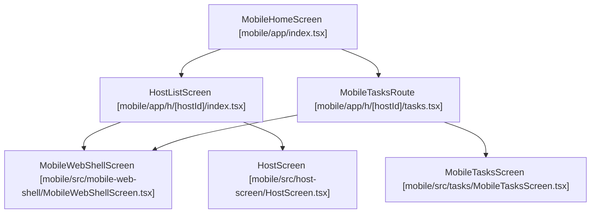
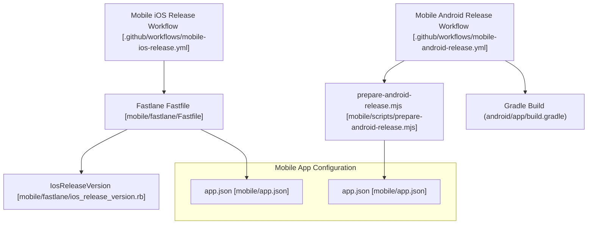

# Mobile Companion App

The **Mobile Companion App** is a React Native (Expo) application located in `mobile/` [mobile/app.json:1-10]() that serves as a mobile "second screen" and control plane for the Orca desktop environment. It enables real-time monitoring and interaction with AI agents, worktrees, and terminals on desktop hosts via an authenticated WebSocket/RPC connection.

For detailed implementations, refer to the child pages:
- **[Mobile Transport & Pairing](#10.1)** — WebSocket/RPC transport, QR/deep-link pairing, authorization grants, and credential storage.
- **[Mobile Terminal & UI](#10.2)** — TerminalWebView/xterm bridge, session screens, streaming subscription protocol, settings, and notifications.
- **[Mobile Source Control & Tasks](#10.3)** — Mobile source control surfaces, diff review workflows, and task provider integrations (GitHub, Linear, Jira).

---

## Architecture Overview

The mobile application acts as an RPC client communicating with the desktop main process runtime server, handling deep-link URLs, push notifications, and local storage preferences. The core application entry point is `mobile/app/index.tsx` [mobile/app/index.tsx:1-3](), which renders the `MobileHomeScreen`. Navigation within the app, including host-specific screens like `HostListScreen` [mobile/app/h/[hostId]/index.tsx:22-59]() and `MobileTasksRoute` [mobile/app/h/[hostId]/tasks.tsx:15-49](), is managed by `expo-router`.

### Diagram 1: Mobile Companion Component Topology

Sources: [mobile/app/index.tsx:1-3](), [mobile/app/h/[hostId]/index.tsx:22-59](), [mobile/app/h/[hostId]/tasks.tsx:15-49](), [mobile/src/mobile-web-shell/MobileWebShellScreen.tsx](), [mobile/src/host-screen/HostScreen.tsx](), [mobile/src/tasks/MobileTasksScreen.tsx]().

---

## Core Subsystems

### 1. Transport & Pairing

The app handles secure host onboarding via QR code scanning or deep-link uniform resource locators (`orca://pair?...`). Once a pairing offer is confirmed, the client establishes a persistent connection. The `MobileHostCard` component [mobile/src/components/MobileHostCard.tsx:13-41]() displays the connection status and provides actions for paired hosts.

For detailed pairing flow logic, QR code deep-linking, authorization grant handling, and host registry storage, see **[Mobile Transport & Pairing](#10.1)**.

Sources: [mobile/src/components/MobileHostCard.tsx:13-41]().

---

### 2. Terminal Streaming & UI

Terminal sessions are rendered via web-based terminal bridges supporting custom font scales, auto-restore fit timers, and terminal autocomplete preferences. The `TerminalWebView.tsx` file is explicitly configured in `mobile/.oxlintrc.json` to allow a higher line count due to its complexity [mobile/.oxlintrc.json:21-25]().

For comprehensive coverage of the terminal streaming protocol, `TerminalWebView`, viewport refitting, and notification channels, see **[Mobile Terminal & UI](#10.2)**.

Sources: [mobile/.oxlintrc.json:21-25]().

---

### 3. Source Control & Tasks

The mobile app surfaces source control diff review screens and integrates with remote task trackers to give developers full visibility into active work items while away from their primary workstations. The `MobileTasksRoute` [mobile/app/h/[hostId]/tasks.tsx:15-49]() handles navigation to task-related screens, potentially rendering a `MobileWebShellScreen` or a native `MobileTasksScreen`.

For full details on diff navigation and task provider integrations, see **[Mobile Source Control & Tasks](#10.3)**.

Sources: [mobile/app/h/[hostId]/tasks.tsx:15-49]().

---

## Release Pipeline & CI/CD

The mobile application utilizes Fastlane and GitHub Actions to automate multi-platform builds and releases. The `mobile` directory's `pnpm-lock.yaml` and `src/shared` dependencies are critical for CI checks [mobile/.github/workflows/mobile.yml:10-17]().

### iOS and Android Release Workflows

- **iOS Releases:** Managed via `.github/workflows/mobile-ios-release.yml` [mobile/.github/workflows/mobile-ios-release.yml:1-33]() and Fastlane [mobile/fastlane/Fastfile:1-35](). It provisions distribution certificates in an ephemeral keychain [mobile/.github/workflows/mobile-ios-release.yml:112-142](), builds the workspace via Xcode, and uploads the binary to TestFlight [mobile/.github/workflows/mobile-ios-release.yml:155-158]() with closed-train validation guards [mobile/fastlane/Fastfile:86-120]().
- **Android Releases:** Managed via `.github/workflows/mobile-android-release.yml` [mobile/.github/workflows/mobile-android-release.yml:1-35](), executing Gradle build tasks (`assembleRelease`) [mobile/.github/workflows/mobile-android-release.yml:89-91]() and publishing APK artifacts to GitHub Releases [mobile/.github/workflows/mobile-android-release.yml:145-158](). Both iOS and Android builds can be configured to mount either native screens or a web page delivered over-the-air via the `EXPO_PUBLIC_MOBILE_SHELL` environment variable [mobile/.github/workflows/mobile-ios-release.yml:153-154](), [mobile/.github/workflows/mobile-android-release.yml:85-86]().

### Diagram 2: Release Pipeline Code Entities

Sources: [mobile/.github/workflows/mobile-ios-release.yml:1-33](), [mobile/fastlane/Fastfile:1-35](), [mobile/fastlane/ios_release_version.rb](), [mobile/app.json:1-119](), [mobile/.github/workflows/mobile-android-release.yml:1-35](), [mobile/scripts/prepare-android-release.mjs]().

---

## Related Child Pages

- [Mobile Transport & Pairing](#10.1)
- [Mobile Terminal & UI](#10.2)
- [Mobile Source Control & Tasks](#10.3)

Sources: [mobile/app.json:1-119](), [mobile/.github/workflows/mobile-ios-release.yml:1-169](), [mobile/.github/workflows/mobile-android-release.yml:1-171](), [mobile/fastlane/Fastfile:1-166]().
