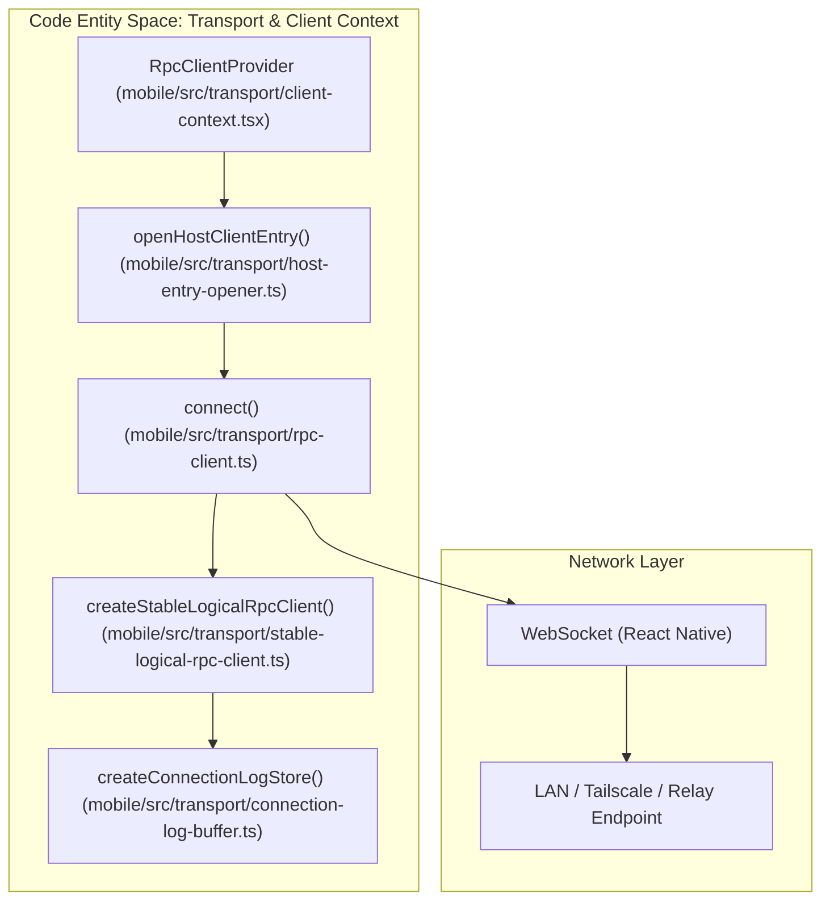
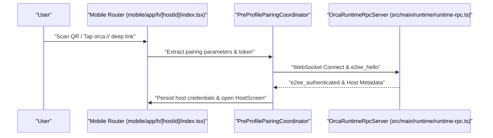
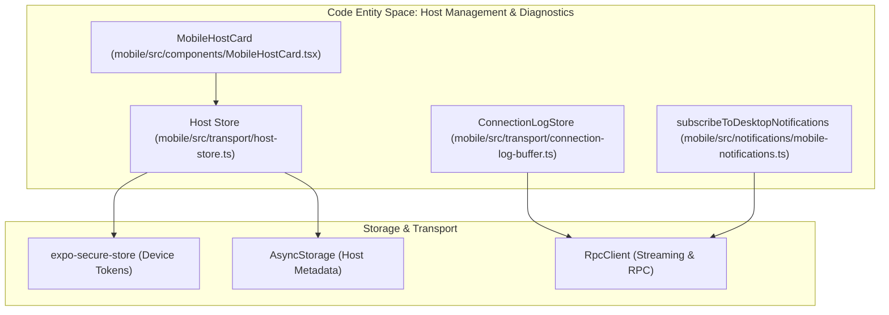

# Mobile Transport & Pairing

This page provides a comprehensive technical overview of the mobile companion app’s transport, pairing, authorization, and credential management subsystems in Orca. It details the WebSocket/RPC transport layer (`RpcClient`, `StableLogicalRpcClient`), QR and deep-link pairing workflows, logical session cutovers, protocol versioning, connection log buffers, and host registry storage.

---

## Transport Architecture & Logical Cutovers

The mobile companion app communicates with the desktop or relay server via a secure, encrypted WebSocket transport carrying a JSON-RPC protocol. To provide seamless network transitions (e.g., switching between LAN, Tailscale, and cloud relay), Orca implements a stable logical RPC layer (`StableLogicalRpcClient`) that wraps physical WebSocket sessions.

### WebSocket RPC Client (`RpcClient` & `StableLogicalRpcClient`)

The mobile-side transport client architecture is split into physical transports (`DirectRpcClient` / WebSocket) and logical multiplexers (`createStableLogicalRpcClient` in `mobile/src/transport/stable-logical-rpc-client.ts`) [mobile/src/transport/stable-logical-rpc-client.ts:68-71]():

- **Physical Connection Establishment:**
  `connect()` in `mobile/src/transport/rpc-client.ts` establishes a secure WebSocket connection using device tokens and public keys [mobile/src/transport/rpc-client.ts:67-78](). It enforces an authentication and E2EE ready handshake timeout [mobile/src/transport/rpc-client.test.ts:127-145]().
- **Logical Cutovers (`migrateTo`):**
  When a better connection path (such as LAN over Relay) becomes available, `migrateTo()` provisions a replacement physical session, authenticates it, replays active subscriptions (such as terminal and tab streams), and cleanly retires the old session [mobile/src/transport/stable-logical-rpc-client.test.ts:88-122]().
- **Delivery Ambiguity & Request Projection:**
  In-flight requests interrupted by a migration throw a `LogicalClientCutoverError` that preserves delivery ambiguity (`isRpcDeliveryUnknown` / `markRpcDeliveryUnknown`) [mobile/src/transport/stable-logical-rpc-client.ts:15-22]() so mutations are not blindly retried when the desktop might have already executed them. Parameters are projected via `projectMobileRpcRequestParams` [mobile/src/transport/stable-logical-rpc-client.ts:98]().
- **Context Provider & Shared Client Registry:**
  `RpcClientProvider` in `mobile/src/transport/client-context.tsx` maintains a single shared client per host using `HostClientOpenRegistry` and acquisition counters, preventing per-screen WebSocket proliferation [mobile/src/transport/client-context.tsx:51-62]().

#### Transport & Logical Cutover Architecture

Sources:
[mobile/src/transport/rpc-client.ts:67-78](), [mobile/src/transport/stable-logical-rpc-client.ts:68-71](), [mobile/src/transport/client-context.tsx:51-62](), [mobile/src/transport/connection-log-buffer.ts:29-32]()

---

## Pairing Flow & Deep-Link Authorization

Orca establishes trust between a mobile device and a desktop Orca runtime through secure cryptographic pairing offers encoded in URIs and QR codes.

### Pairing Sequence & Confirmation

- **Deep Link Reception:**
  The mobile app intercepts `orca://pair?...` URIs via deep-linking handlers (`mobile/app/h/[hostId]/index.tsx`) [mobile/app/h/[hostId]/index.tsx:32-38]() and extracts pairing codes.
- **Pre-Profile Pairing:**
  The pairing confirmation screen coordinates with `pre-profile-pairing-coordinator.ts` to open a temporary WebSocket connection, exchange E2EE handshake frames, authenticate using the temporary device token, and register the host profile.
- **Credential Storage:**
  Upon successful authorization, the host profile and secure device token are committed to persistent storage, allowing subsequent automatic reconnections from the home screen (`MobileHostCard` in `mobile/src/components/MobileHostCard.tsx`) [mobile/src/components/MobileHostCard.tsx:13-25]().

#### Pairing & Authorization Sequence

Sources:
[mobile/app/h/[hostId]/index.tsx:32-38](), [mobile/src/components/MobileHostCard.tsx:13-25](), [src/main/runtime/runtime-rpc.ts:1-23]()

---

## Host Registry, Diagnostics & Credential Storage

The mobile app maintains a robust host registry and diagnostics logging subsystem to track connectivity health and persist credentials securely.

### Connection Log Buffer & Persistence

- **`ConnectionLogStore` (`mobile/src/transport/connection-log-buffer.ts`):**
  Retains recent lifecycle and reconnection events per host (bounded to `MAX_ENTRIES_PER_HOST = 200`) so diagnostic screens can display connection failures without requiring a debug build [mobile/src/transport/connection-log-buffer.ts:11-32]().
- **Async Persistence & Flushing:**
  Supports batched asynchronous persistence (`ConnectionLogPersistence`) with automatic retry delays and backpressure handling for robust crash reporting [mobile/src/transport/connection-log-buffer.ts:70-135]().

#### Host Registry & Diagnostics Architecture

Sources:
[mobile/src/transport/connection-log-buffer.ts:11-35](), [mobile/src/components/MobileHostCard.tsx:13-25](), [mobile/src/notifications/mobile-notifications.ts:18-37]()

---

## Protocol Compatibility & Subscriptions

To ensure backward and forward compatibility between mobile clients and desktop runtimes, Orca implements strict subscription managers and protocol gates.

- **Notification Subscriptions:**
  `subscribeToDesktopNotifications` manages `notifications.subscribe` streams, handling ready acknowledgments (`SubscribeResult`), catchup reconciliation, and push dismissals (`dismissHostPushNotification`) [mobile/src/notifications/mobile-notifications.ts:18-37]().
- **Stream Registry:**
  `RpcClientStreamRegistry` manages multiplexed RPC streams across physical session reconnections without losing subscriber callbacks or viewport states.
- **Runtime Capabilities:**
  The `src/shared/protocol-version.ts` file defines various runtime capabilities, such as `MOBILE_RELAY_RUNTIME_CAPABILITIES` [src/shared/protocol-version.ts:62](), which are used to negotiate features and ensure compatibility between the mobile client and the desktop runtime. These capabilities allow the client to assert whether the connected runtime supports specific functionalities, for example, `JIRA_STATUS_FILTER_RUNTIME_CAPABILITY` [src/shared/protocol-version.ts:2](), which is checked before filtering Jira issues by status [src/renderer/src/runtime/runtime-jira-client.ts:178-184]().

Sources:
[mobile/src/notifications/mobile-notifications.ts:18-37](), [mobile/src/transport/rpc-client.ts:19-24](), [src/shared/protocol-version.ts:2](), [src/shared/protocol-version.ts:62](), [src/renderer/src/runtime/runtime-jira-client.ts:178-184]()
