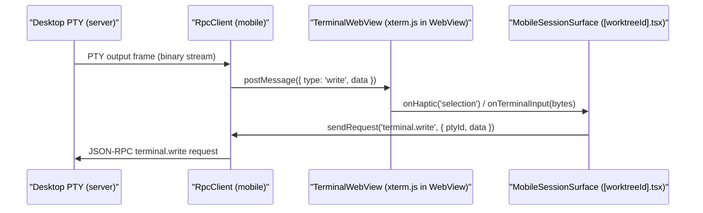
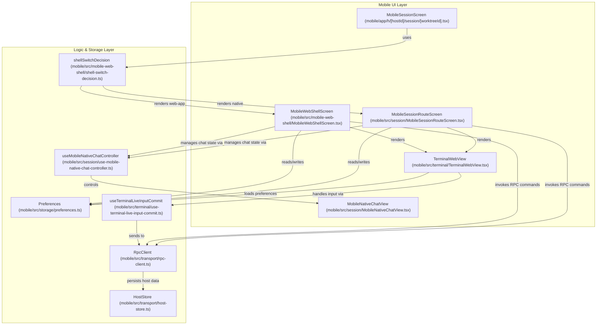

# Mobile Terminal & UI

The Orca Mobile Companion app provides a fully integrated terminal experience optimized for iOS and Android. The mobile terminal runs inside a React Native WebView containing an `xterm.js` emulator, maintaining consistency with the desktop's terminal UX while adapting interactions and viewport layout for mobile devices.

This page covers the following key areas in technical detail:

- The `TerminalWebView` component and its communication bridge with the `xterm.js` terminal emulator
- The terminal streaming subscription protocol between mobile and desktop hosts
- Session UI screens including worktree selection and presence locking
- Viewport refitting strategies for responsive terminal layout amid screen and keyboard changes
- Mobile native chat features, settings, and notification system integrations

---

## TerminalWebView & xterm.js Bridge

### Overview

The mobile terminal is realized through the React Native component `TerminalWebView`, which wraps a React Native `WebView` hosting an embedded `xterm.js` terminal. This approach reuses the desktop-level terminal rendering engine on mobile, preserving appearance and functionality while adapting to mobile interaction paradigms.

### Implementation Details

- `TerminalWebView` is defined as a React component using `forwardRef` that exposes imperative methods controlling terminal state: `write`, `init`, `resize`, `reflow`, `measureFitDimensions`, and others for external manipulation of the terminal instance [mobile/src/terminal/TerminalWebView.tsx:15-102]().

- The WebView loads a large, concatenated HTML bundle (`XTERM_HTML`), constructed from modular script and style fragments in `terminal-webview-html.ts`. This bundle implements terminal initialization, write queueing, mouse mode scanning, scroll handling, and input routing inside the WebView context, tightly coupling with `xterm.js` [mobile/src/terminal/terminal-webview-html.ts:18-22](). The `xtermWebViewSource` function injects initial `textScale` and `shown` values into the HTML before loading [mobile/src/terminal/terminal-webview-html.ts:27-40]().

- To handle the extremely high write rate (~200 stream frames/second), `TerminalWebView` implements a write-coalescer to batch writes before sending them to the WebView via `postMessage`. This throttling dramatically improves performance and energy use on mobile devices [mobile/src/terminal/terminal-webview-scroll-routing.test.ts:131-141](). The `MAX_PENDING_WEB_WRITE_BYTES` and `MAX_PENDING_WEB_WRITE_MESSAGES` constants define the limits for this queue [mobile/src/terminal/terminal-webview-scroll-routing.test.ts:131-132]().

- Incoming messages from the WebView (e.g., selection events, terminal input, haptic requests, URL taps) are routed to callbacks via `dispatchTerminalWebViewNotification`, enabling the mobile React app to respond to user interaction and runtime conditions such as on-haptic feedback requests or `onTerminalTap` events [mobile/src/terminal/TerminalWebView.tsx:45-56]().

- The WebView enforces a fixed `textZoom={100}` to disable Android system font scaling which would break terminal cell grid alignment, ensuring pixel-perfect layout equivalence across devices [mobile/src/terminal/TerminalWebView.tsx:86-87]().

- An engine error state is tracked internally to detect and recover from WebView rendering engine failures; an error overlay is shown if the terminal fails to initialize correctly, with automatic retries and an error callback hook [mobile/src/terminal/TerminalWebView.tsx:96-98](). `onContentProcessDidTerminate` handles WKWebView content process loss by resetting readiness and reloading [mobile/src/terminal/TerminalWebView.tsx:63-69]().

#### `TerminalWebView` Data Flow Example


Sources:
- [mobile/src/terminal/TerminalWebView.tsx:15-102]()
- [mobile/src/terminal/terminal-webview-html.ts:18-22]()
- [mobile/src/terminal/terminal-webview-html.ts:27-40]()
- [mobile/src/terminal/terminal-webview-scroll-routing.test.ts:131-141]()
- [mobile/src/terminal/terminal-webview-scroll-routing.test.ts:131-132]()
- [mobile/src/terminal/TerminalWebView.tsx:45-56]()
- [mobile/src/terminal/TerminalWebView.tsx:86-87]()
- [mobile/src/terminal/TerminalWebView.tsx:96-98]()
- [mobile/src/terminal/TerminalWebView.tsx:63-69]()

---

## Terminal Streaming Subscription Protocol

The mobile terminal subscribes to a streaming protocol delivering PTY output frames from the desktop host with minimal latency and overhead:

- Mobile opens a `terminal.subscribe` RPC subscription over the paired WebSocket RPC transport to receive live PTY output frames [mobile/src/session/mobile-session-startup-source.test.ts:101-102](). The `useMobileSessionTabsReconciliation` hook handles this subscription [mobile/src/session/mobile-session-startup-source.test.ts:98]().

- The protocol uses raw binary frames to avoid costly base64 or string encoding, crucial for responsive terminal updates over mobile networks.

- The mobile client periodically issues `terminal.updateViewport` RPCs reporting current terminal dimensions (rows and columns), measured dynamically by viewport refitting hooks to inform the desktop PTY window size.

- The desktop adjusts the pseudo-terminal window on receipt of viewport updates, which triggers a reflow of the terminal output and line wrapping on the host [mobile/src/terminal/terminal-viewport-refit.ts:100-160]().

- Initial subscription includes detection of server capabilities such as `TERMINAL_QUERY_REPLY_INPUT_RUNTIME_CAPABILITY` to enable advanced input and query-reply features [mobile/app/h/[hostId]/session/[worktreeId].tsx:120-121]().

Sources:
- [mobile/src/session/mobile-session-startup-source.test.ts:101-102]()
- [mobile/src/session/mobile-session-startup-source.test.ts:98]()
- [mobile/src/terminal/terminal-viewport-refit.ts:100-160]()
- [mobile/app/h/[hostId]/session/[worktreeId].tsx:120-121]()

---

## Session Screen & UI Components

The core terminal session UI on mobile is implemented in the route component:

```tsx
// mobile/app/h/[hostId]/session/[worktreeId].tsx
export default function MobileSessionScreen() {
  // ...
  const native = <MobileSessionRouteScreen />
  // ...
  return (
    <MobileWebShellScreen
      // ...
      fallback={native}
      // ...
    />
  )
}
```
[mobile/app/h/[hostId]/session/[worktreeId].tsx:29-104]()

This screen manages:

- Session lifecycle, including terminal tab list, active terminal, input gating, and session metadata [mobile/app/h/[hostId]/session/[worktreeId].tsx:1-7](). The `MobileSessionRouteScreen` component is the native screen for the terminal and chat [mobile/app/h/[hostId]/session/[worktreeId].tsx:3]().

- Terminal input is gated and throttled to avoid saturating the native bridge (`isTerminalLiveInputWithinByteLimit`) with excessive input bursts [mobile/src/terminal/use-terminal-live-input-commit.ts:138-162](). The `handleLiveInputChange` callback processes input events [mobile/src/terminal/use-terminal-live-input-commit.ts:138]().

- The terminal tabs list on mobile mirrors the desktop side by extracting terminal records from subscribed session tabs and merging with already known terminals to maintain input focus and scrollback consistency [mobile/src/session/mobile-session-startup-source.test.ts:84-85](). The `useWorktreeSessionTabsLoaded` hook is used to check if session tabs are loaded [mobile/src/session/mobile-session-startup-source.test.ts:84]().

- Foreground recovery is implemented by listening to app lifecycle events; it triggers resynchronization and terminal state recovery on returning from background, using `recoverActiveTerminalAfterForeground` [mobile/src/session/mobile-session-startup-source.test.ts:103-104](). The `AppState.addEventListener` is used for this [mobile/src/session/mobile-session-startup-source.test.ts:108]().

Sources:
- [mobile/app/h/[hostId]/session/[worktreeId].tsx:29-104]()
- [mobile/app/h/[hostId]/session/[worktreeId].tsx:1-7]()
- [mobile/app/h/[hostId]/session/[worktreeId].tsx:3]()
- [mobile/src/terminal/use-terminal-live-input-commit.ts:138-162]()
- [mobile/src/terminal/use-terminal-live-input-commit.ts:138]()
- [mobile/src/session/mobile-session-startup-source.test.ts:84-85]()
- [mobile/src/session/mobile-session-startup-source.test.ts:84]()
- [mobile/src/session/mobile-session-startup-source.test.ts:103-104]()
- [mobile/src/session/mobile-session-startup-source.test.ts:108]()

---

## Presence Lock & Viewport Fit-Override

To prevent terminal viewport races and input conflicts between the desktop and mobile clients, mobile sessions acquire a **presence lock** on the desktop terminal viewport during active use:

| Feature | Description | Code Entity / Hook |
|---|---|---|
| Presence Lock | Locks the desktop terminal viewport size while the mobile session is active | Managed internally in session screens and subscription lifecycle |
| Viewport Fit-Override | Overrides desktop viewport to match mobile terminal's rows and columns | Implemented via `useTerminalViewportRefit` hook |
| Viewport Refit | Reactively recalculates terminal viewport size when window size, text scale, keyboard or tab changes | `useTerminalViewportRefit` schedules debounced refits |

The presence lock guarantees consistent sizing of terminal content, and the fit override enforces that the desktop proxy PTY reflects the mobile viewport for optimal user experience.

Sources:
- [mobile/src/terminal/terminal-viewport-refit.ts:46-159]()

---

## Viewport Refit Strategy

The hook `useTerminalViewportRefit` contains the core logic for responsive terminal layout adaptation:

- Inputs monitored include current active terminal handle, terminal WebView refs, viewport sizing state, keyboard visibility, device token, connection state, text scale, and tab strip visibility [mobile/src/terminal/terminal-viewport-refit.ts:46-159]().

- It manages a debounced timer that asynchronously measures the terminal WebView’s optimal rows and columns to fit current frame height and width using `measureFitDimensions()` [mobile/src/terminal/terminal-viewport-refit.ts:120-170]().

- Upon detecting viewport size changes, it issues a `terminal.updateViewport` RPC to the desktop host and updates internal viewport state [mobile/src/terminal/terminal-viewport-refit.ts:120-170]().

- The refit mechanism defers if a native chat overlay covers the terminal to avoid sending viewport sizes to a PTY unseen by the user, saving resources.

- It implements safety guards to avoid terminal resizing mid-keystroke by examining keyboard open state transitions and delays [mobile/src/terminal/terminal-viewport-refit.ts:80-150]().

Sources:
- [mobile/src/terminal/terminal-viewport-refit.ts:46-159]()
- [mobile/src/terminal/terminal-viewport-refit.ts:120-170]()
- [mobile/src/terminal/terminal-viewport-refit.ts:80-150]()

---

## Mobile Native Chat Features

Orca’s Mobile Terminal includes a native chat capability integrated with the terminal session for AI agent conversations:

- `useMobileNativeChatController` composes multiple hooks handling chat session state, draft management, streaming data, prompts, permission requests, and user input lifecycle outside the main terminal session route [mobile/src/session/use-mobile-native-chat-controller.ts:29-63](). The `MobileNativeChatController` type defines the contract for this controller [mobile/src/session/mobile-native-chat-controller-contract.ts:1-10]().

- The `MobileNativeChatView` renders chat transcripts with bubble styling, message folding, live typing indicators, streaming bubbles, and interactive cards for questions and permissions [mobile/src/session/MobileNativeChatView.tsx:60-134]().

- Chat input locking prevents typing when transport is disconnected or lease on terminal input is not yet granted, ensuring consistent input state [mobile/src/session/MobileNativeChatView.tsx:56-59]().

- Message sending is implemented in `useMobileNativeChatMessageSend`, which handles composing, syncing, clearing drafts, healing stale inputs, and dispatching to the RpcClient [mobile/src/session/use-mobile-native-chat-message-send.ts:50-73]().

Sources:
- [mobile/src/session/use-mobile-native-chat-controller.ts:29-63]()
- [mobile/src/session/mobile-native-chat-controller-contract.ts:1-10]()
- [mobile/src/session/MobileNativeChatView.tsx:60-134]()
- [mobile/src/session/MobileNativeChatView.tsx:56-59]()
- [mobile/src/session/use-mobile-native-chat-message-send.ts:50-73]()

---

## Mobile Settings & Notifications

### Terminal Settings Persistence

User preferences on mobile terminal appearance and behavior are persisted and loaded through AsyncStorage-backed utilities:

| Setting | Description | Functions |
|---|---|---|
| Text Scale | User preference for terminal font scaling | `loadTerminalTextScale()`, `saveTerminalTextScale()` |
| Autocomplete Enabled | Enables or disables terminal autocomplete | `loadTerminalAutocompleteEnabled()` |
| Terminal Link Open Mode | Chooses between in-app link handling or external browser | `loadTerminalLinkOpenMode()` |

The web-app bundle uses an alias for `@react-native-async-storage/async-storage` to `PAGE_ASYNC_STORAGE_MODULE` to ensure storage is handled over the bridge, as the WebView does not have `window.localStorage` [config/scripts/build-mobile-web-app-bundle.mjs:91-95]().

### Notifications & Deep Linking

- Notifications generated by the host or the terminal subsystem are delivered through Expo’s notification subsystem, even while the app is in the foreground, enhancing awareness of terminal activity.

- Notification taps trigger deep linking to route users directly to the correct terminal session screen within the mobile app [mobile/app/h/[hostId]/session/[worktreeId].tsx:21-27](). The `paneKey` parameter is used for tab switching within an already open session [mobile/app/h/[hostId]/session/[worktreeId].tsx:21-27]().

Sources:
- [config/scripts/build-mobile-web-app-bundle.mjs:91-95]()
- [mobile/app/h/[hostId]/session/[worktreeId].tsx:21-27]()

---

## Web-App Bundle

The mobile companion app can also render certain routes as a web-app bundle within a `MobileWebShellScreen`. This allows for a flexible approach where some parts of the UI can be served directly from the desktop's bundle or from the mobile app's own bundle [mobile/app/h/[hostId]/session/[worktreeId].tsx:9-11]().

### Bundle Generation

The web-app bundle is built using `esbuild` and includes several shims to bridge React Native and web environments [config/scripts/build-mobile-web-app-bundle.mjs:7-108](). Key shims include:
- `react-native-web-alias`: Aliases `react-native` to `react-native-web` [config/scripts/build-mobile-web-app-bundle.mjs:45-48]().
- `js-as-jsx`: Configures `.js` files to be loaded as `jsx` to handle untranspiled JSX in React Native packages [config/scripts/build-mobile-web-app-bundle.mjs:49-52]().
- `global-as-globalthis`: Replaces `global` with `globalThis` for browser compatibility [config/scripts/build-mobile-web-app-bundle.mjs:53-56]().
- `async-storage-over-the-bridge`: Redirects `@react-native-async-storage/async-storage` to a module that communicates with the shell over the bridge, as `localStorage` is unavailable in the WebView [config/scripts/build-mobile-web-app-bundle.mjs:91-95]().
- `route-manifest`: Generates and injects the route tree, as `esbuild` does not support `require.context` [config/scripts/build-mobile-web-app-bundle.mjs:105-108]().

The bundle also includes a root reset stylesheet (`MOBILE_WEB_APP_ROOT_RESET`) to ensure consistent layout behavior across platforms, particularly for `flex: 1` containers [config/scripts/build-mobile-web-app-bundle.mjs:131-133]().

### Route Switching

The `MobileSessionScreen` component uses `shellSwitchDecision` to determine whether to render the native `MobileSessionRouteScreen` or the `MobileWebShellScreen` for a given route [mobile/app/h/[hostId]/session/[worktreeId].tsx:88-89](). This decision is based on the `shellScreenRoute` which includes the pathname and parameters [mobile/app/h/[hostId]/session/[worktreeId].tsx:73-77]().

### Bundle Size Considerations

The inclusion of the terminal (`xterm.js`) significantly impacts the web-app bundle size. Scripts are in chunks, and routes are loaded dynamically to optimize initial load times [config/scripts/build-mobile-web-app-bundle.test.mjs:127-136](). The `mobileWebAppRouteClosure` utility is used to measure the module count and byte size of the session route, ensuring that changes to the terminal implementation do not inadvertently increase the bundle size beyond acceptable limits [config/scripts/mobile-web-app-session-terminal-closure.test.mjs:17-24]().

Sources:
- [mobile/app/h/[hostId]/session/[worktreeId].tsx:9-11]()
- [config/scripts/build-mobile-web-app-bundle.mjs:7-108]()
- [config/scripts/build-mobile-web-app-bundle.mjs:45-48]()
- [config/scripts/build-mobile-web-app-bundle.mjs:49-52]()
- [config/scripts/build-mobile-web-app-bundle.mjs:53-56]()
- [config/scripts/build-mobile-web-app-bundle.mjs:91-95]()
- [config/scripts/build-mobile-web-app-bundle.mjs:105-108]()
- [config/scripts/build-mobile-web-app-bundle.mjs:131-133]()
- [mobile/app/h/[hostId]/session/[worktreeId].tsx:88-89]()
- [mobile/app/h/[hostId]/session/[worktreeId].tsx:73-77]()
- [config/scripts/build-mobile-web-app-bundle.test.mjs:127-136]()
- [config/scripts/mobile-web-app-session-terminal-closure.test.mjs:17-24]()

---

## Mobile UI Architecture Diagram

This diagram maps the key mobile UI components, their interactions, transport, and storage layers together to illustrate their relationships in the mobile terminal and session UI implementation.


Sources:
- [mobile/app/h/[hostId]/session/[worktreeId].tsx:9-11]()
- [mobile/app/h/[hostId]/session/[worktreeId].tsx:88-89]()
- [mobile/app/h/[hostId]/session/[worktreeId].tsx:3]()
- [mobile/src/terminal/TerminalWebView.tsx:15-102]()
- [mobile/src/session/MobileNativeChatView.tsx:1-476]()
- [mobile/src/terminal/use-terminal-live-input-commit.ts:56-67]()
- [mobile/src/transport/rpc-client.ts:18-29]()
- [mobile/src/storage/preferences.ts:49-60]()
- [mobile/src/transport/host-store.web.ts:1-22]()
- [mobile/src/mobile-web-shell/shell-switch-decision.ts:1-19]()
- [mobile/src/session/use-mobile-native-chat-controller.ts:29-63]()

---

## Summary

The Orca Mobile Terminal & UI subsystem integrates a React Native WebView-hosted `xterm.js` terminal emulator for high-fidelity terminal rendering on mobile devices. A streaming subscription RPC protocol efficiently relays PTY output from the desktop host, ensuring timely and bandwidth-efficient updates.

Mobile session UI components manage terminal presence locks and viewport fit overrides to synchronize terminal viewport sizing and input focus with the desktop host. Responsive viewport refitting strategically adapts to screen changes and keyboard visibility, ensuring optimal layout and user experience.

The native chat controller adds AI assistant messaging tightly integrated with the terminal session, including structured prompts and streaming statuses. User preferences for terminal scaling and interaction are persisted and synchronized, while notifications and deep linking enhance mobile session accessibility. The web-app bundle mechanism provides flexibility in rendering UI components, allowing for a mix of native and web-based experiences.

This modular architecture cleanly separates UI rendering, transport protocol handling, session logic, and persistence, providing a robust platform for mobile terminal interaction within Orca.

---

Sources:
- [mobile/src/terminal/TerminalWebView.tsx:15-102]()
- [mobile/src/terminal/terminal-webview-html.ts:18-22]()
- [mobile/src/terminal/terminal-webview-scroll-routing.test.ts:131-141]()
- [mobile/src/terminal/TerminalWebView.tsx:45-56]()
- [mobile/src/terminal/TerminalWebView.tsx:86-87]()
- [mobile/src/terminal/TerminalWebView.tsx:63-69]()
- [mobile/src/session/mobile-session-startup-source.test.ts:101-102]()
- [mobile/src/session/mobile-session-startup-source.test.ts:98]()
- [mobile/src/terminal/terminal-viewport-refit.ts:100-160]()
- [mobile/app/h/[hostId]/session/[worktreeId].tsx:120-121]()
- [mobile/app/h/[hostId]/session/[worktreeId].tsx:29-104]()
- [mobile/app/h/[hostId]/session/[worktreeId].tsx:1-7]()
- [mobile/app/h/[hostId]/session/[worktreeId].tsx:3]()
- [mobile/src/terminal/use-terminal-live-input-commit.ts:138-162]()
- [mobile/src/terminal/use-terminal-live-input-commit.ts:138]()
- [mobile/src/session/mobile-session-startup-source.test.ts:84-85]()
- [mobile/src/session/mobile-session-startup-source.test.ts:84]()
- [mobile/src/session/mobile-session-startup-source.test.ts:103-104]()
- [mobile/src/session/mobile-session-startup-source.test.ts:108]()
- [mobile/src/terminal/terminal-viewport-refit.ts:46-159]()
- [mobile/src/terminal/terminal-viewport-refit.ts:120-170]()
- [mobile/src/terminal/terminal-viewport-refit.ts:80-150]()
- [mobile/src/session/use-mobile-native-chat-controller.ts:29-63]()
- [mobile/src/session/mobile-native-chat-controller-contract.ts:1-10]()
- [mobile/src/session/MobileNativeChatView.tsx:60-134]()
- [mobile/src/session/MobileNativeChatView.tsx:56-59]()
- [mobile/src/session/use-mobile-native-chat-message-send.ts:50-73]()
- [config/scripts/build-mobile-web-app-bundle.mjs:91-95]()
- [mobile/app/h/[hostId]/session/[worktreeId].tsx:21-27]()
- [mobile/app/h/[hostId]/session/[worktreeId].tsx:9-11]()
- [config/scripts/build-mobile-web-app-bundle.mjs:7-108]()
- [config/scripts/build-mobile-web-app-bundle.mjs:45-48]()
- [config/scripts/build-mobile-web-app-bundle.mjs:49-52]()
- [config/scripts/build-mobile-web-app-bundle.mjs:53-56]()
- [config/scripts/build-mobile-web-app-bundle.mjs:105-108]()
- [config/scripts/build-mobile-web-app-bundle.mjs:131-133]()
- [mobile/app/h/[hostId]/session/[worktreeId].tsx:88-89]()
- [mobile/app/h/[hostId]/session/[worktreeId].tsx:73-77]()
- [config/scripts/build-mobile-web-app-bundle.test.mjs:127-136]()
- [config/scripts/mobile-web-app-session-terminal-closure.test.mjs:17-24]()
