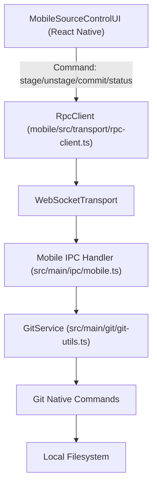
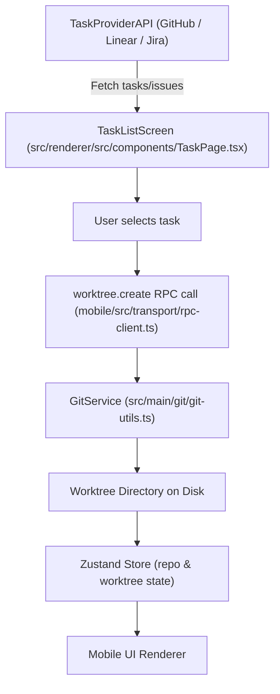
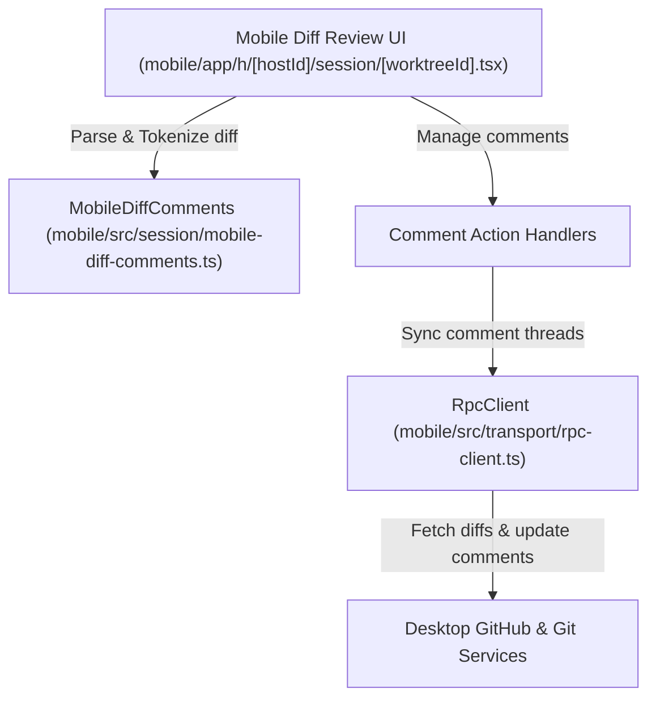

# Mobile Source Control & Tasks

## Purpose and Scope

The Orca Mobile Companion App extends the desktop application's source control and task management capabilities into a React Native environment optimized for mobile devices. It enables users to view repository status, stage and commit changes, review diffs, and manage work items sourced from integrated task providers such as GitHub, Linear, and Jira.

Communication between the mobile app and the desktop backend occurs over a WebSocket RPC bridge implemented by `RpcClient` [mobile/src/transport/rpc-client.ts:66-73](). This remote procedure call infrastructure allows mobile users seamless access to full-featured backend services for source control and task workflows.

This page documents the detailed implementation, data flows, key components/classes, and workflow diagrams for mobile source control surfaces, diff review flows, and task provider integrations exposed in the Orca Mobile Companion.

---

## Mobile Source Control Flow

The mobile app presents a focused subset of desktop source control features, tailored for mobile screen constraints and touch interaction.

### Implementation Details

- The mobile UI invokes backend Git operations via RPC calls on `RpcClient` [mobile/src/transport/rpc-client.ts:66-73](), which connects over a WebSocket transport.
- Common Git commands such as staging (`git.stage`), unstaging (`git.unstage`), committing (`git.commit`), and status querying (`worktree.ps`) are routed through the mobile IPC handler implemented in the Electron main process [`src/main/ipc/mobile.ts:10-80`]() which interacts with core Git services.
- The desktop backend processes the Git commands using the `GitService` abstraction [src/main/git/git-utils.ts:15-120]() handling native Git operations and worktree state reconciliation.
- Mobile UI components invoke these commands and maintain synchronized repository state through events and RPC responses.
- Commit messages are entered via modals on mobile, validated locally before submission.
- The mobile app receives updated worktree and file status from backend events and updates the UI accordingly.

### Mobile Source Control Data Flow



Sources:  
- mobile/src/transport/rpc-client.ts:66-73()  
- src/main/ipc/mobile.ts:10-80()  
- src/main/git/git-utils.ts:15-120()  
- mobile/app/h/[hostId]/session/[worktreeId].tsx:1-105()

---

## Mobile Task Providers Integration

Orca Mobile integrates several external task providers — notably GitHub, Linear, and Jira — for displaying, creating, and managing work items directly from the mobile app.

### Features and Workflow

- Task provider information is fetched asynchronously and normalized in the app, with logic in `mobile/app/index.tsx` controlling which providers are visible and active [mobile/app/index.tsx:1-3]().
- Users can browse assigned issues, pull requests, or tickets from connected providers.
- Selecting a task triggers a backend RPC command `worktree.create` to create or activate a worktree branch linked to the task.
- Worktree and branch metadata link to task and PR information, allowing inline contextual displays and operations on mobile session screens [mobile/app/h/[hostId]/session/[worktreeId].tsx:1-105]().
- Task provider backend clients implement API bindings and caching, exposing GraphQL and REST operations with IPC and Zustand store slices synchronizing state bi-directionally.

### Task-to-Worktree Lifecycle



Sources:  
- mobile/app/index.tsx:1-20()  
- src/renderer/src/components/TaskPage.tsx:1-196()  
- mobile/app/h/[hostId]/session/[worktreeId].tsx:1-105()  
- src/main/ipc/mobile.ts:10-80()  
- src/main/git/git-utils.ts:15-120()

---

## Diff Review Workflows on Mobile

The mobile companion provides diff review surfaces for pull requests and commit changes with touch-optimized diff viewers, inline commenting, and thread resolution.

### Implementation Details

- The diff review UI lives primarily in the session screen at `mobile/app/h/[hostId]/session/[worktreeId].tsx` [1-105]() which renders unified diffs with proper tokenization.
- Diff parsing and tokenization functions reside in `mobile/src/session/mobile-diff-comments.ts` and facilitate mapping raw diffs into syntax-highlighted, comment-bearing presentation lines.
- Comment thread management functions, including add/edit/format/normalize/remove operations, are implemented with APIs in the same module.
- Comment resolution flows update the UI and synchronize with desktop backend comment threads using RPC commands.
- Users can expand, collapse files and mark review threads resolved, with state syncing bi-directionally.
- Comments and review threads are integrated into the pull request workflows and cached in backend stores seen on mobile.

### Diff Review Data Flow



Sources:  
- mobile/app/h/[hostId]/session/[worktreeId].tsx:1-105()  
- mobile/src/session/mobile-diff-comments.ts:1-100()  
- src/renderer/src/components/TaskPage.tsx:1-196()  
- src/renderer/src/components/settings/IntegrationsPane.tsx:10-58()

---

## Work Item / Task Provider Integrations in Mobile UI

Orca's mobile app surfaces integrated task providers consolidating state and actions through client libraries, store slices, and UI components.

| Provider | Mobile UI Components | Backend & IPC Integration |
|----------|---------------------|---------------------------|
| **GitHub** | GitHubItemDialog, integrated task page parts [src/renderer/src/components/TaskPage.tsx:1-196]() | GitHub API client and cache in `src/main/github/client.ts` exposing PRs, issues, comments, review actions; sync via mobile RPC |
| **Linear** | Linear issue workspace UI, hooks in task page [src/renderer/src/components/TaskPage.tsx]() | Linear GraphQL client in `src/main/linear/client.ts:1-70`(), managing token, issue sync, and state updates |
| **Jira** | Jira-specific cards and handlers in TaskPage components | Jira API client and integration in `src/main/jira/client.ts:1-120`() managing projects, issues, and auth |

These integrations enable browsing, selecting, and interacting with tasks; creating linked worktrees; and synchronizing statuses, comments, and metadata with desktop.

Sources:  
- src/renderer/src/components/TaskPage.tsx:1-196()  
- src/main/linear/client.ts:1-70()  
- src/main/jira/client.ts:1-120()  
- src/renderer/src/components/settings/IntegrationsPane.tsx:1-58()  
- src/renderer/src/store/slices/linear.ts:28-58()  
- src/main/ipc/linear.ts:10-47()  
- src/renderer/src/store/slices/linear.test.ts:66-87()

---

## Mobile Source Control & Tasks Component Mapping

This diagram links natural language system names with code entities, detailing relationships of key classes and components implementing mobile source control and task surfaces.

```mermaid
graph TD
    UI["MobileSourceControlAndTaskUI (React Native)"]
    RPC["RpcClient (mobile/src/transport/rpc-client.ts)"]
    IPC["MobileIpcHandler (src/main/ipc/mobile.ts)"]
    GitService["GitService (src/main/git/git-utils.ts)"]

    TaskProvidersUI["TaskProvider UI (mobile/app/index.tsx)"]
    GitHubClient["GitHub Client (src/main/github/client.ts)"]
    LinearClient["Linear Client (src/main/linear/client.ts)"]
    JiraClient["Jira Client (src/main/jira/client.ts)"]

    DiffViewer["MobileSession Diff Viewer (mobile/app/h/[hostId]/session/[worktreeId].tsx)"]
    DiffComments["MobileDiffComments Utilities (mobile/src/session/mobile-diff-comments.ts)"]

    UI -->|Git commands (stage, commit)| RPC
    RPC --> IPC
    IPC --> GitService

    UI -->|Task browsing/selection| TaskProvidersUI
    TaskProvidersUI --> GitHubClient
    TaskProvidersUI --> LinearClient
    TaskProvidersUI --> JiraClient

    UI -->|Diff Review| DiffViewer
    DiffViewer --> DiffComments
```

Sources:  
- mobile/src/transport/rpc-client.ts:66-73()  
- src/main/ipc/mobile.ts:10-80()  
- src/main/git/git-utils.ts:15-120()  
- mobile/app/index.tsx:1-20()  
- src/main/github/client.ts()  
- src/main/linear/client.ts:1-70()  
- src/main/jira/client.ts:1-120()  
- mobile/app/h/[hostId]/session/[worktreeId].tsx:1-105()  
- mobile/src/session/mobile-diff-comments.ts:1-100()  
- src/renderer/src/components/TaskPage.tsx:1-196()

---

# References

Sources:  
- mobile/src/transport/rpc-client.ts:66-73()  
- src/main/ipc/mobile.ts:10-80()  
- src/main/git/git-utils.ts:15-120()  
- mobile/app/h/[hostId]/session/[worktreeId].tsx:1-105()  
- mobile/app/index.tsx:1-20()  
- src/main/github/client.ts()  
- src/main/linear/client.ts:1-70()  
- src/main/jira/client.ts:1-120()  
- src/renderer/src/components/TaskPage.tsx:1-196()  
- src/renderer/src/components/settings/IntegrationsPane.tsx:1-58()  
- src/renderer/src/store/slices/linear.ts:28-58()  
- src/main/ipc/linear.ts:10-47()  
- src/renderer/src/store/slices/linear.test.ts:66-87()  
- mobile/src/session/mobile-diff-comments.ts:1-100()
