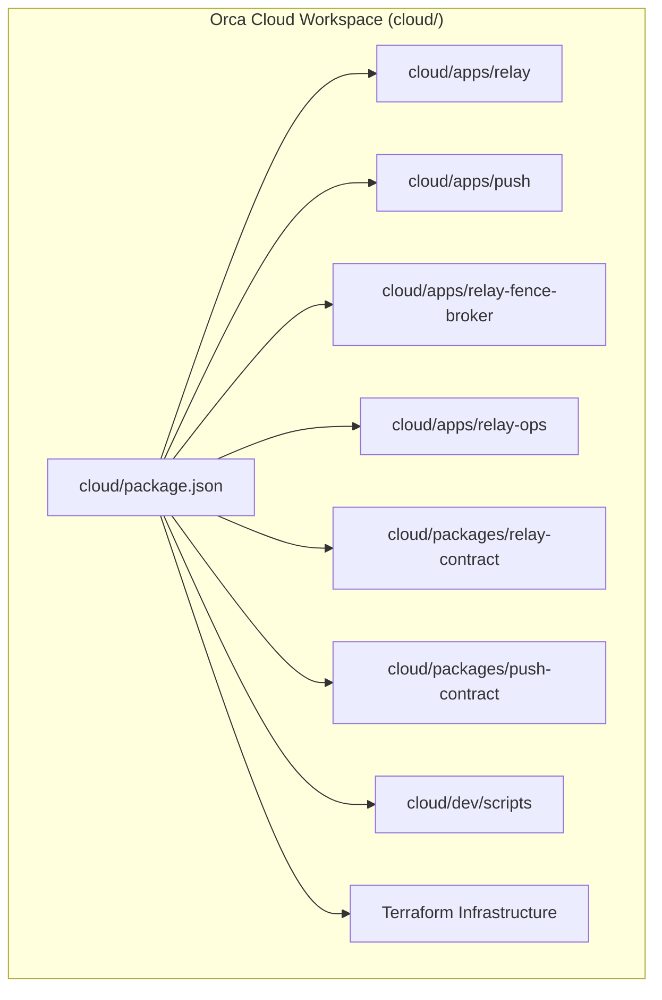
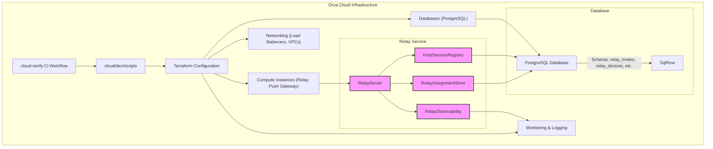

# Cloud Relay & Push Infrastructure

This page provides a high-level overview of the cloud-based components within the Orca ecosystem, specifically focusing on the `cloud/` pnpm workspace. This workspace encompasses the Relay service, which facilitates WebSocket session splicing between mobile and desktop clients, the Push Gateway for delivering notifications, shared wire contracts that define communication protocols, operational tooling, and the underlying Terraform infrastructure.

The cloud infrastructure is critical for enabling seamless interaction between Orca's desktop and mobile applications, as well as for delivering timely notifications. Each major component is designed for scalability, security, and reliability.

## Cloud Workspace Structure

The `cloud/` pnpm workspace [cloud/package.json:1-33]() is a monorepo containing several applications and packages that form the backbone of Orca's cloud services, including the core relay service [cloud/apps/relay/package.json:1-36]() and operations console [cloud/apps/relay-ops/package.json:1-29]().

Sources:
- [cloud/package.json:1-33]()
- [cloud/apps/relay/package.json:1-36]()

## Relay Service & Wire Contract

The Relay service is a core component responsible for splicing WebSocket sessions between Orca's mobile companion app and the desktop application [cloud/apps/relay/src/assignment-store.ts:1-35](). It acts as an intermediary, enabling real-time communication and data exchange. The Relay operates with distinct roles, such as director and cell, managing connections and traffic efficiently using SQLite or PostgreSQL persistence layers [cloud/apps/relay/src/database.ts:71-84](). It handles pairing and splicing state machines, admission budgets to control resource usage [cloud/apps/relay/src/assignment-store.ts:26-27](), and defines specific close codes [cloud/apps/relay-server.ts:9](). Communication between clients and the Relay is governed by shared wire contracts defined in `packages/relay-contract`. The `RelayAssignmentStore` [cloud/apps/relay/src/assignment-store.ts:143]() manages host assignments to cells, while `HostSessionRegistry` [cloud/apps/relay/src/host-session-registry.ts:183]() tracks active host sessions.

For a detailed explanation of the Relay's architecture, its roles, state machines, and the wire contract, see [Relay Service & Wire Contract](#11.1).

Sources:
- [cloud/apps/relay/src/assignment-store.ts:1-35]()
- [cloud/apps/relay/src/assignment-store.ts:26-27]()
- [cloud/apps/relay/src/assignment-store.ts:143]()
- [cloud/apps/relay/src/database.ts:71-84]()
- [cloud/apps/relay/src/host-session-registry.ts:183]()
- [cloud/apps/relay/src/relay-server.ts:9]()

## Push Gateway

The Push Gateway, implemented in `cloud/apps/push`, is responsible for delivering notifications to mobile devices. It integrates with platform-specific push notification services like Apple Push Notification service (APNs) and Firebase Cloud Messaging (FCM). Security is paramount, with host authentication handled via X25519 cryptography. The gateway manages push token registration, enforces quotas to prevent abuse, and ensures the persistence of notification events. The communication protocol and data structures for push notifications are defined in `packages/push-contract`.

For more information on push token registration, authentication, and delivery mechanisms, see [Push Gateway](#11.2).

Sources:
- [cloud/packages/push-contract/package.json]()

## Relay Ops, Fence Broker & Infrastructure

This section covers the operational aspects of the Relay service, including monitoring, incident response, and infrastructure management [cloud/docs/orca-relay-operations.md:1-21](). The `relay-ops` console provides tools for incident monitoring and pre-flight checks. The `relay-fence-broker` manages mutation leases and implements an IAM model for secure operations. The entire cloud infrastructure is defined and managed using Terraform, ensuring consistent and reproducible deployments [cloud/docs/orca-relay-operations.md:3-5](). Development scripts in `cloud/dev/scripts` and the `cloud-verify` CI workflow are used for testing and validating cloud deployments.

For an in-depth look at the operational tools, the fence broker's role, and the Terraform infrastructure, see [Relay Ops, Fence Broker & Infrastructure](#11.3).

Sources:
- [cloud/docs/orca-relay-operations.md:1-21]()

## Cloud Infrastructure Overview

The cloud infrastructure for Orca is managed through Terraform, ensuring that all resources are provisioned and configured consistently. This includes compute instances for the Relay and Push Gateway, networking components, databases, and monitoring services. The `cloud/dev/scripts` directory contains various scripts for managing and testing this infrastructure.

The `RelayObservability` class [cloud/apps/relay/src/relay-observability.ts:10]() is central to monitoring the Relay service, collecting metrics on runtime counts, database pool pressure, and host pre-authentication latencies [cloud/apps/relay/src/relay-observability.ts:119]().

Sources:
- [cloud/docs/orca-relay-operations.md:1-21]()
- [cloud/apps/relay/src/relay-observability.ts:10]()
- [cloud/apps/relay/src/relay-observability.ts:119]()
- [cloud/apps/relay/src/relay-server.ts:137]()
- [cloud/apps/relay/src/assignment-store.ts:143]()
- [cloud/apps/relay/src/host-session-registry.ts:183]()
- [cloud/apps/relay/src/database.ts:47]()
- [cloud/apps/relay/src/database.ts:126-149]()
