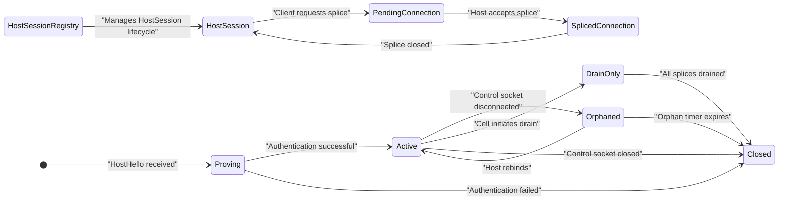
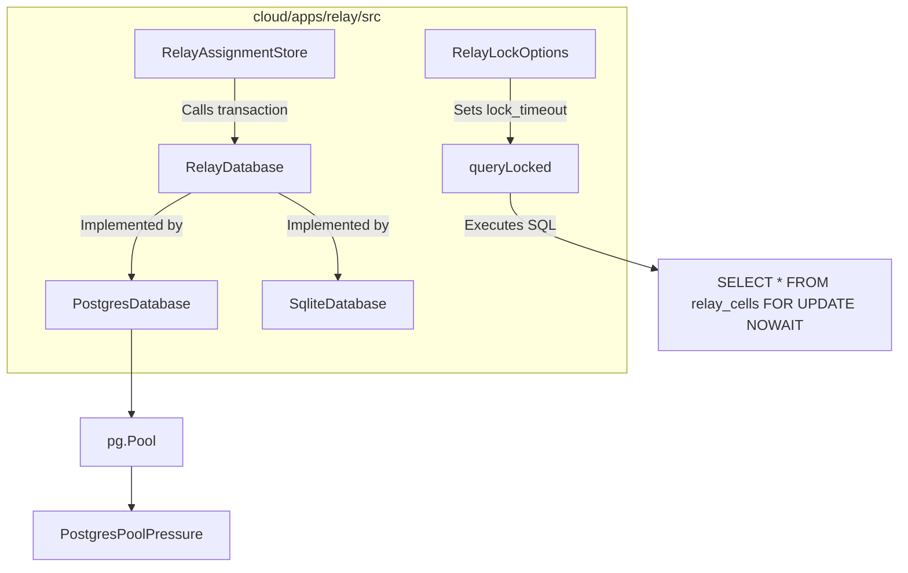

# Relay Service & Wire Contract

This page documents the Relay Service, its database and assignment orchestration layer, and its Wire Contract within the Orca codebase (`cloud/apps/relay` and `@orca-cloud/relay-contract`). It covers the director vs. cell roles (`ORCA_RELAY_ROLE`), the pairing/splice state machine, `RelayAssignmentStore` state management, database concurrency controls (`RelayDatabase`), admission budgets, close codes, and shared frame shapes.

This is a leaf page focusing on the full technical details of the cloud relay service implementation, data flows, key classes, and protocol structure.

---

## 1. Relay Service Roles: Director vs. Cell

The Relay Service runs in two distinct roles, referred to as **director** and **cell**, controlled by the environment variable `ORCA_RELAY_ROLE`:

- **Director**: Acts as the central orchestrator and router of WebSocket connections between paired clients (e.g., desktop and mobile apps). It manages authentication, pairing sessions, admission budgets, and forwarding of data frames.
- **Cell**: Represents an endpoint or agent instance in the relay ecosystem. A cell connection pairs with a director session for message relay and forwarding.

Role configuration is used primarily within the cloud's relay app (`cloud/apps/relay/src/assignment-store.ts`), controlling node behavior, heartbeats, and cluster assignment synchronization.

### Diagram: Relay Role Code Entities Mapping

```mermaid
graph TD
    subgraph cloud/apps/relay/src
      A["RelayAssignmentStore"] -->|Manages| B[RelayAssignment]
      A -->|Tracks| C[CellHeartbeat]
      D[DirectorRole] -->|Orchestrates| A
      E[CellRole] -->|Registers| C
    end

    subgraph @orca-cloud/relay-contract
      F[RelayRegion]
      G[ASSIGNMENT_LIMITS]
      H[RELAY_ADMISSION_BUDGETS]
    end

    D -.->|Configured via| I["ORCA_RELAY_ROLE='DIRECTOR'"]
    E -.->|Configured via| J["ORCA_RELAY_ROLE='CELL'"]
```

Sources: [cloud/apps/relay/src/assignment-store.ts:106-122](), [cloud/apps/relay/src/assignment-store.ts:28-38](), [cloud/apps/relay/src/relay-server.ts:6-14]()

---

## 2. Pairing, Splice State Machine & Assignment Store

The relay's core functionality revolves around pairing two WebSocket peers—a director session and a cell session—into a **splice** connection, allowing them to exchange messages securely over a controlled channel.

The `RelayAssignmentStore` class ([cloud/apps/relay/src/assignment-store.ts:29]()) administers client assignments, migration leases, and cell capacity budgets across the fleet.

### State Machine Lifecycle
- **Proving**: Initial handshake and authentication phase for a host connection [cloud/apps/relay/src/host-session-registry.ts:65]().
- **Active**: The host connection is authenticated and ready to handle splices.
- **Orphaned**: The host's control connection is lost, but its assignment might still be valid for a short period, allowing re-connection.
- **Drain-Only**: The host is in a state where it will not accept new splices and is actively draining existing ones.
- **Closed**: The host session is terminated.
- **Spliced**: The two connections are linked, allowing bidirectional message forwarding.
- **Unsplicing**: Tear-down phase triggered by disconnection, migration, or protocol error.

### Diagram: Splice State Machine and Assignment Flow



Sources: [cloud/apps/relay/src/host-session-registry.ts:65](), [cloud/apps/relay/src/host-session-registry.ts:100-126](), [cloud/apps/relay/src/host-session-registry.ts:130-147]()

---

## 3. Database Abstraction & Concurrency Control

Persistence and concurrency are managed through the `RelayDatabase` interface, supporting SQLite for testing (`openInMemoryRelayDatabase`) and PostgreSQL (`openRelayDatabase`) for production operations ([cloud/apps/relay/src/database.ts:78]()).

### Key Database Mechanics
- **`RelayDatabase` Interface**: Defines `query`, `queryPriority`, `queryLocked`, `transaction`, and `commitWithFinal` methods [cloud/apps/relay/src/database.ts:78-95]().
- **Inventory Locking**: Fleet operations acquire locks on `relay_cells` using `lockCellInventory` or `lockGeneralCellInventory` with bounded timeouts (`POSTGRES_LOCK_TIMEOUT_MS = 1_000`) to avoid deadlocks and cascading transaction failures [cloud/apps/relay/src/database.ts:30]().
- **Schema & Migrations**: Schema creation statements include tables for `relay_invites`, `relay_devices`, `relay_connection_bases`, `relay_direct_authorizations`, `relay_assignment_region_preferences`, `relay_region_rehome_attempts`, `relay_cell_runtime`, `relay_cell_connection_runtime`, `relay_cell_connection_snapshots`, `relay_cell_fences`, `relay_cell_committed_fences`, `relay_cell_legacy_fence_adoptions`, `relay_cell_fence_attempts`, `relay_cell_fence_apply_invocations`, `relay_cell_drain_attempt_states`, `relay_control_connection_reservations`, `relay_rate_windows`, `relay_assignment_migrations`, `relay_post_drain_migration_pins`, `relay_audit_events`, `relay_region_decisions`, and `relay_region_rehome_control` [cloud/apps/relay/src/database.ts:125-149](), [cloud/apps/relay/src/relay-schema-lock-targets.test.ts:18-149]().
- **PostgreSQL Timeouts**: Configurable `statement_timeout`, `query_timeout`, `lock_timeout`, and `idle_in_transaction_session_timeout` to prevent long-running queries or transactions from blocking the database [cloud/apps/relay/src/database-postgres-timeout.test.ts:89-98]().

### Diagram: Database Abstraction and Lock Control Flow



Sources: [cloud/apps/relay/src/database.ts:78-95](), [cloud/apps/relay/src/database.ts:30](), [cloud/apps/relay/src/database.ts:125-149](), [cloud/apps/relay/src/relay-schema-lock-targets.test.ts:18-149](), [cloud/apps/relay/src/database-postgres-timeout.test.ts:89-98]()

---

## 4. Admission Budgets & Resource Control

The relay enforces **admission budgets** as quotas and membership limits controlling:
- Maximum allowed connections per cell and aggregate capacity requests, defined by `RELAY_ADMISSION_BUDGETS` [cloud/apps/relay/src/relay-server.ts:7](), [cloud/apps/relay/src/app.ts:8]().
- Regional admission states via selectors (`RelayCellAdmissionSelector`) and heartbeat monitoring (`CellHeartbeat`) [cloud/apps/relay/src/assignment-store.ts:43-52](), [cloud/apps/relay/src/assignment-store.ts:106-122]().
- Headroom calculation for regional rehomes and migration assignments (`ASSIGNMENT_CONNECTION_HEADROOM_QUERY`) [cloud/apps/relay/src/assignment-store.ts:58-59]().
- `RelayCellAdmissionSelector` manages the state of cells (e.g., `db`, `reserve`, `roll-isolated`) and their eligibility for assignments [cloud/apps/relay/src/assignment-store.ts:43-52]().
- `RelayAssignmentStore` uses `RELAY_PROTOCOL_LIMITS` and `ASSIGNMENT_LIMITS` to manage connection and activity lease durations [cloud/apps/relay/src/assignment-store.ts:32-38]().

Budgets are updated dynamically during splice session lifecycles and reduce on connection errors or client disconnects.

Sources: [cloud/apps/relay/src/relay-server.ts:7](), [cloud/apps/relay/src/app.ts:8](), [cloud/apps/relay/src/assignment-store.ts:43-52](), [cloud/apps/relay/src/assignment-store.ts:106-122](), [cloud/apps/relay/src/assignment-store.ts:58-59](), [cloud/apps/relay/src/assignment-store.ts:32-38]()

---

## 5. Close Codes & Disconnection Semantics

When WebSocket connections in the relay close, specific **close codes** and reasons are communicated:
- Regular close (`1000`) indicates normal closure.
- Protocol errors or handshake mismatches use custom internal codes (e.g., `RELAY_CLOSE_CODE.PROTOCOL_ERROR`, `RELAY_CLOSE_CODE.AUTH_FAILED`, `RELAY_CLOSE_CODE.ASSIGNMENT_EXPIRED`, `RELAY_CLOSE_CODE.CELL_DRAINING`, `RELAY_CLOSE_CODE.CELL_FULL`) [cloud/apps/relay/src/relay-server.ts:9](), [cloud/apps/relay/src/host-session-registry.ts:20]().
- Connection loss or relay shutdown propagates errors to paired sessions and multiplexers.
- `closeRelayWebSocket` function ensures consistent closing behavior across the relay service [cloud/apps/relay/src/relay-server.ts:48](), [cloud/apps/relay/src/host-session-registry.ts:52]().

Sources: [cloud/apps/relay/src/relay-server.ts:9](), [cloud/apps/relay/src/host-session-registry.ts:20](), [cloud/apps/relay/src/relay-server.ts:48](), [cloud/apps/relay/src/host-session-registry.ts:52]()

---

## 6. Relay Wire Contract & Frame Shapes

The wire contract (`@orca-cloud/relay-contract`) defines JSON-RPC message frame shapes, message types, and encoding schemes for communication over relay WebSocket or SSH multiplexed transports.

- **Message Types**: Regular requests, keep-alives, cancellations, and notifications.
- **Frames**: Encapsulated payloads containing JSON-RPC 2.0 structures with method names, params, IDs, and result or error responses.
- **KeepAlive Frames**: Regular heartbeat frames sent to ensure connection freshness, with intervals defined by `RELAY_PROTOCOL_LIMITS.controlPingIntervalMs` [cloud/apps/relay/src/host-session-registry.ts:19]().
- **Control Messages**: Defined in `cloud/packages/relay-contract/src/control-messages.ts` and include `HostHelloSchema`, `HostChallengeAckSchema`, `AuthRefreshSchema`, `DeviceCredentialInstallSchema`, `DeviceResumeConfirmSchema`, `DeviceRevokeSchema`, `InviteCreateSchema`, `IdleRegionalRehomeCommit`, `IdleRegionalRehomeDeferReason`, `IdleRegionalRehomeResult`, `RelayHostCloseReason`, `RelayRegion` [cloud/apps/relay/src/host-session-registry.ts:5-26]().

Sources: [cloud/apps/relay/src/host-session-registry.ts:5-26](), [cloud/apps/relay/src/host-session-registry.ts:19]()

---

## 7. Implementation Details & Data Flow

### SSH-Based Relay Deployment and Launch
- The `deployAndLaunchRelay()` function executes remote shell commands to prepare the relay binary, install/update it, and launch it [src/main/ssh/ssh-relay-deploy.ts:139-191]().
- Sentinel waiting confirms relay readiness before establishing the `MultiplexerTransport` [src/main/ssh/ssh-relay-deploy-helpers.ts:4-180]().

### Multiplexer Transport & Request Handling
- Outgoing requests are assigned sequential IDs with timeout and cancellation support.
- Incoming frames pass through `FrameDecoder` to extract JSON-RPC objects [src/main/ssh/ssh-channel-multiplexer.ts:92-684]().

### Assignment Store and Regional Rehoming
The `RelayAssignmentStore` ([cloud/apps/relay/src/assignment-store.ts:29]()) is central to managing host assignments and regional rehoming.
- **`assign`**: Assigns a host to a cell, considering admission budgets, regional preferences, and rehoming policies. It can place fresh assignments or re-assign existing ones [cloud/apps/relay/src/assignment-store.ts:144-149]().
- **`activateControl`**: Activates a control connection for a host, updating its assignment epoch and lease [cloud/apps/relay/src/assignment-store.ts:172-179]().
- **`idleRegionalRehome`**: Initiates a regional rehome for idle hosts, moving them to a more optimal region based on `IdleRegionalRehomeCandidate` selection [cloud/apps/relay/src/assignment-store.ts:6-9](). This process involves `RegionalRehomePollTelemetry` and `RegionCorrectionPreview` [cloud/apps/relay/src/assignment-store.ts:11-23]().
- **`RELAY_ADMISSION_BUDGETS`**: Defines the maximum number of connections and capacity units for different types of relay traffic (e.g., `control`, `splice`, `regional-rehome`) [cloud/apps/relay/src/assignment-store.ts:29]().
- **`RELAY_PROTOCOL_LIMITS`**: Specifies protocol-level limits such as `controlPingIntervalMs` [cloud/apps/relay/src/assignment-store.ts:32]().
- **`RELAY_DEFAULT_REGION`**: The default region for relay operations [cloud/apps/relay/src/assignment-store.ts:30]().

### Reserve Assignment (Step 5)
The `ReserveAssignment` class ([cloud/apps/relay/src/reserve-assignment.ts]()) and `ReservePlacer` ([cloud/apps/relay/src/reserve-placement.ts]()) implement a new assignment strategy (referred to as "Step 5" in comments) for directors.
- **`ReserveAssignment`**: Orchestrates the booking and demotion of host assignments in "reserve mode" [cloud/apps/relay/src/reserve-assignment.ts](). It interacts with `ShadowSeatDirectory` to get cell information and `CellReserveClient` to make reservations [cloud/apps/relay/src/reserve-assignment.test.ts:67-76]().
- **`ReservePlacer`**: Manages the pacing and budgeting of reserve assignments, ensuring that cells are not overloaded [cloud/apps/relay/src/reserve-placement.ts](). It uses a token bucket algorithm for intake control [cloud/apps/relay/src/reserve-placement.ts]().
- **`admitModeEffective` / `admitModeRaw`**: Cells report their effective and raw admission modes, allowing directors to distinguish between a cell that is truly in reserve mode and one that is transitioning [cloud/apps/relay/src/shadow-seat-directory.ts:95-98](), [cloud/apps/relay/src/reserve-assignment.test.ts:118-136]().

Sources: [src/main/ssh/ssh-channel-multiplexer.ts:92-684](), [src/main/ssh/ssh-relay-deploy.ts:139-191](), [src/main/ssh/ssh-relay-deploy-helpers.ts:4-180](), [cloud/apps/relay/src/assignment-store.ts:29](), [cloud/apps/relay/src/assignment-store.ts:144-149](), [cloud/apps/relay/src/assignment-store.ts:172-179](), [cloud/apps/relay/src/assignment-store.ts:6-9](), [cloud/apps/relay/src/assignment-store.ts:11-23](), [cloud/apps/relay/src/assignment-store.ts:29](), [cloud/apps/relay/src/assignment-store.ts:32](), [cloud/apps/relay/src/assignment-store.ts:30](), [cloud/apps/relay/src/reserve-assignment.ts](), [cloud/apps/relay/src/reserve-placement.ts](), [cloud/apps/relay/src/reserve-assignment.test.ts:67-76](), [cloud/apps/relay/src/shadow-seat-directory.ts:95-98](), [cloud/apps/relay/src/reserve-assignment.test.ts:118-136]()

---

## 8. Summary Table of Key Classes and Functions

| Name | Location | Role / Description |
| :--- | :--- | :--- |
| `RelayAssignmentStore` | `cloud/apps/relay/src/assignment-store.ts` | Manages assignments, migrations, cell heartbeats, and regional rehoming state |
| `RelayDatabase` | `cloud/apps/relay/src/database.ts` | Database abstraction interface supporting transactions and locked queries across dialects |
| `HostSessionRegistry` | `cloud/apps/relay/src/host-session-registry.ts` | Manages the lifecycle of host control sessions, including authentication, state transitions, and splice management |
| `RelayObservability` | `cloud/apps/relay/src/relay-observability.ts` | Collects and reports metrics for relay operations, including connection counts, SQL latencies, and assignment outcomes |
| `ShadowSeatDirectory` | `cloud/apps/relay/src/shadow-seat-directory.ts` | Director-side cache of cell seat feeds, used for placement decisions and regional rehoming |
| `ReserveAssignment` | `cloud/apps/relay/src/reserve-assignment.ts` | Implements the "reserve mode" assignment logic for directors, handling bookings and demotions |
| `ReservePlacer` | `cloud/apps/relay/src/reserve-placement.ts` | Manages pacing and budgeting for reserve assignments to prevent cell overload |
| `SshChannelMultiplexer` | `src/main/ssh/ssh-channel-multiplexer.ts` | Core JSON-RPC over multiplexed transport handler; manages requests, notifications, and timeouts |
| `deployAndLaunchRelay` | `src/main/ssh/ssh-relay-deploy.ts` | Deploys relay binary remotely via SSH and establishes active communication transport |
| `waitForSentinel` | `src/main/ssh/ssh-relay-deploy-helpers.ts` | Awaits relay readiness sentinel on channel startup |

Sources: [cloud/apps/relay/src/assignment-store.ts:29](), [cloud/apps/relay/src/database.ts:78](), [cloud/apps/relay/src/host-session-registry.ts:25](), [cloud/apps/relay/src/relay-observability.ts:10](), [cloud/apps/relay/src/shadow-seat-directory.ts:14](), [cloud/apps/relay/src/reserve-assignment.ts](), [cloud/apps/relay/src/reserve-placement.ts](), [src/main/ssh/ssh-channel-multiplexer.ts:92-684](), [src/main/ssh/ssh-relay-deploy.ts:139-191](), [src/main/ssh/ssh-relay-deploy-helpers.ts:4-180]()
