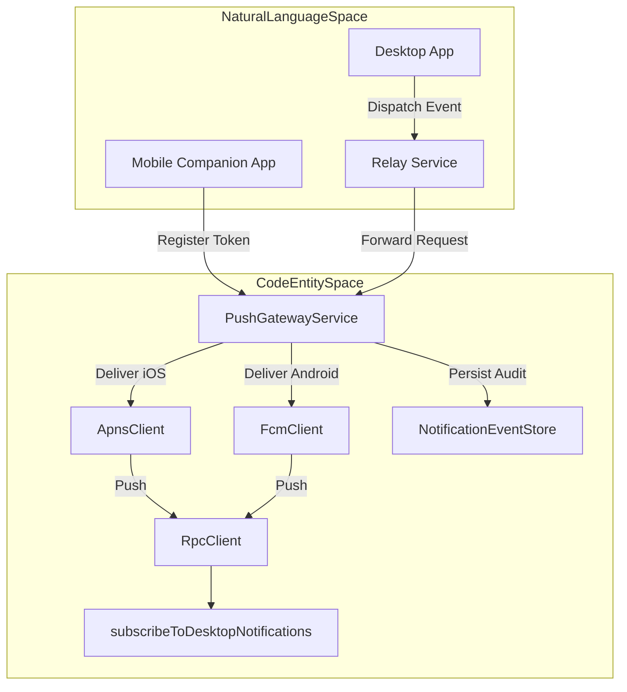
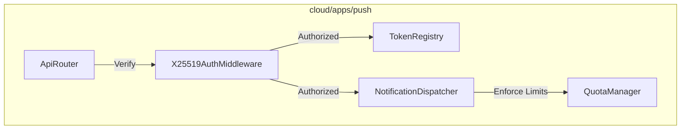
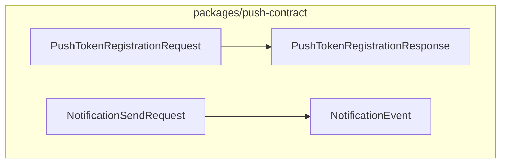

# Push Gateway

The Push Gateway is a core component of the Orca cloud infrastructure, handling mobile notification delivery, X25519 host authentication, push token registration, and APNs/FCM dispatches. It also enforces usage quotas and persists notification events. This page details its implementation, data flow, and key components across `cloud/apps/push` and `packages/push-contract`.

## Purpose and Scope

The Push Gateway (`cloud/apps/push`) acts as the central ingestion and routing nexus for push notifications targeted at the Orca mobile companion app. It relies on `packages/push-contract` for shared wire schemas and utilizes cryptographic primitives to verify communication between desktop hosts, relay services, and mobile clients.

Key responsibilities include:
*   **X25519 Host Authentication**: Securing payload routing via public-key cryptography.
*   **Push Token Registration**: Managing APNs (Apple) and FCM (Firebase) tokens submitted by devices.
*   **APNs/FCM Delivery**: Interfacing with downstream notification services.
*   **Quotas & Rate Limiting**: Preventing notification floods and managing resource consumption.
*   **Notification Event Persistence**: Recording delivery states and dispatch history.

Sources:
*   [cloud/apps/push/package.json]()
*   [cloud/packages/push-contract/package.json]()
*   [mobile/package.json]()

## Architecture and Data Flow

The Push Gateway interacts with the mobile companion app, the desktop host via the Relay Service, and external notification push networks.

### High-Level Data Flow and Code Mapping

1.  **Push Token Registration**: The mobile companion app registers its APNs or FCM token with the Push Gateway upon establishing credentials.
2.  **Notification Dispatches**: When a desktop instance triggers an alert, the request travels through the Relay Service into the Push Gateway.
3.  **Delivery & Persistence**: The gateway routes the payload to either `ApnsClient` or `FcmClient` and records the transition using `NotificationEventStore`.

Sources:
*   [mobile/src/transport/rpc-client.ts:62-73]()
*   [mobile/src/notifications/mobile-notifications.ts:18-37]()

## Key Components and Implementation Details

### `cloud/apps/push`

The `cloud/apps/push` workspace implements the gateway server logic, handling token state machines, authorization gates, and payload translation.

*   **`ApiRouter`**: Exposes HTTP endpoints for token registration and notification dispatch.
*   **`X25519AuthMiddleware`**: Validates request signatures using `tweetnacl` [package.json:189]() and shared keys.
*   **`TokenRegistry`**: Stores associations between `hostId`, `deviceToken`, and target operating systems.
*   **`NotificationDispatcher`**: Determines whether to target APNs or FCM based on registered tokens.
*   **`QuotaManager`**: Tracks host-level rates to drop excessive outbound notifications.

Sources:
*   [package.json:189-191]()
*   [cloud/apps/push/package.json]()

### `packages/push-contract`

The `packages/push-contract` workspace defines standard structures shared across services for request/response serialization.

*   **`PushTokenRegistrationRequest`**: Carries device-specific tokens and host identifiers.
*   **`NotificationSendRequest`**: Contains payload fields (`title`, `body`, `source`) routed from the desktop host.
*   **`NotificationEvent`**: Schema governing database write-backs for audit trails.

Sources:
*   [cloud/packages/push-contract/package.json]()

### Mobile Client Integration & Subscriptions

The mobile companion app listens for notification state changes through `RpcClient` subscriptions and manages lifecycle cleanup.

*   **`connect`**: Initializes transport parameters and sets up cryptographic keys [mobile/src/transport/rpc-client.ts:62-73]().
*   **`subscribeToDesktopNotifications`**: Manages incoming notification streams and handles server unsubscriptions [mobile/src/notifications/mobile-notifications.ts:18-37]().

Sources:
*   [mobile/src/transport/rpc-client.ts:62-73]()
*   [mobile/src/notifications/mobile-notifications.ts:18-37]()
