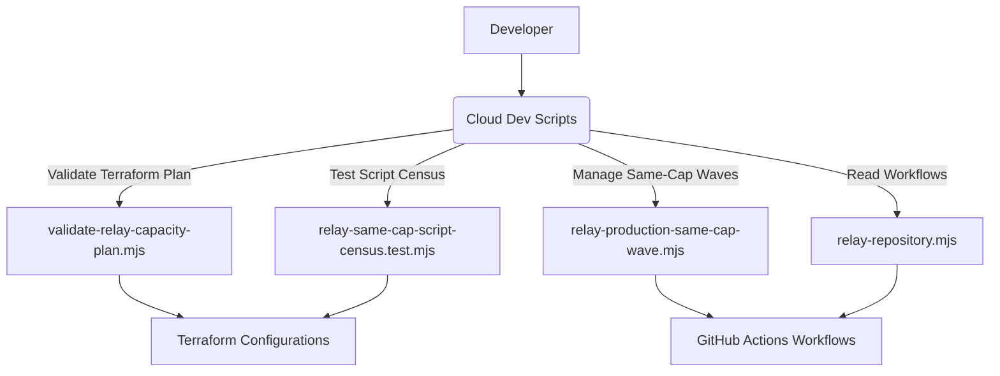

# Relay Ops, Fence Broker & Infrastructure

This page details the operational aspects of the Orca cloud infrastructure, focusing on the `relay-ops` console, the `relay-fence-broker` for mutation leasing and IAM, the underlying Terraform infrastructure, cloud development scripts, and the `cloud-verify` CI workflow. It covers how these components ensure the reliability, security, and manageability of the Orca cloud relay and push services.

## Relay Ops Console and Incident Monitor

The `relay-ops` console is a critical tool for monitoring and managing the Orca cloud relay service. It provides visibility into the health and performance of the relay infrastructure, enabling operators to quickly identify and respond to incidents.

The incident monitor, implemented in `cloud/apps/relay-ops/src/incident-monitor.ts` and `cloud/apps/relay-ops/src/incident-live-preflight-cli.ts` [cloud/apps/relay-ops/src/incident-monitor.ts](), is a read-only tool that probes Relay endpoints, reads Cloud Monitoring data, Compute inventory, and authenticated aggregate director status [cloud/docs/relay-incident-monitor.md:3-5](). It does not perform any mutations like draining, restarting, resizing, deploying, or changing admission [cloud/docs/relay-incident-monitor.md:8-9]().

The monitor operates in two primary modes:
*   `dry-run`: A 15-minute pre-drain gate [cloud/docs/relay-incident-monitor.md:13]().
*   `monitor`: A 90-minute incident watch [cloud/docs/relay-incident-monitor.md:14]().

It supports `strict` and `recover-forward` migration policies [cloud/docs/relay-incident-monitor.md:18-19](). The monitor polls every 60 seconds and records private aggregate evidence at specific intervals (0, 5, 15, 30, 45, 60, 75, and 90 minutes) [cloud/docs/relay-incident-monitor.md:36-37](). It uploads state JSON, checkpoint JSONL, and Markdown for 14 days, ensuring no sensitive data like tokens, request bodies, user IDs, or host IDs are recorded [cloud/docs/relay-incident-monitor.md:38-39]().

Reruns of the monitor restore previous artifacts, verify provenance, and can restart with `--restart` [cloud/docs/relay-incident-monitor.md:40-41](). A missing or mismatched artifact causes the run to fail [cloud/docs/relay-incident-monitor.md:42](). The monitor tolerates up to two consecutive missing, stale, or collector-failed samples before resetting the active window [cloud/docs/relay-incident-monitor.md:43-45](). A pre-drain dry run must reach a verdict within 35 minutes [cloud/docs/relay-incident-monitor.md:45-46]().

The monitor uses `INCIDENT_MONITOR_THRESHOLDS` [cloud/apps/relay-ops/src/incident-monitor.ts:8-112]() to evaluate the health of the system, covering metrics like:
*   `activeProbeMaxAgeMs`: Freshness of active probes [cloud/apps/relay-ops/src/incident-monitor.ts:9]().
*   `cloudDataMaxAgeMs`: Freshness of Cloud Monitoring data [cloud/apps/relay-ops/src/incident-monitor.ts:16]().
*   `directorAdminMaxAgeMs`: Freshness of director admin API data [cloud/apps/relay-ops/src/incident-monitor.ts:25]().
*   `cloudSqlCpuUtilization`, `cloudSqlMemoryUtilization`, `cloudSqlBackends`, `cloudSqlLockWaits`, `cloudSqlDeadlocks`: Cloud SQL health [cloud/apps/relay-ops/src/incident-monitor.ts:43-59]().
*   `relayPoolWaiting`, `relayPoolWaitMs`, `relayPostgresRetries`, `relayPostgresRetryExhausted`: Relay database connection pool health [cloud/apps/relay-ops/src/incident-monitor.ts:68-99]().
*   `directorInstancesMin`, `directorInstancesMax`, `directorCpuUtilization`, `directorMemoryUtilization`, `directorConcurrency`, `directorErrors`: Director service health [cloud/apps/relay-ops/src/incident-monitor.ts:103-110]().
*   `cellEndpointLatencyMs`: Per-region latency thresholds for cell endpoints [cloud/apps/relay-ops/src/incident-monitor.ts:40-42]().

The `Deploy Relay Production Same-Cap` workflow does not consume the monitor's dry-run. Instead, each `apply` wave samples the fleet itself before isolating its cell, using the monitor's evaluator, thresholds, and tolerances. This sample window is sized to the number of hosts the drain will replace (3, 5, or 8 minutes) and includes lookback rules for container exits, director 503s, and director concurrency [cloud/docs/relay-incident-monitor.md:53-61](). The break-glass override that previously skipped this gate for same-cap rolls has been removed [cloud/docs/relay-incident-monitor.md:62]().

### Relay Ops Data Flow

```mermaid
graph TD
    subgraph "Orca Cloud Infrastructure"
        A[Relay Instances]
        B[Director Service]
        C[Auth Service]
        D[Cloud SQL]
        E[Cloud Monitoring]
        F[Relay Logs]
    end

    subgraph "Relay Ops Monitor"
        G[Incident Monitor CLI (incident-monitor-cli.ts)]
        H[Incident Sample Collector (incident-monitor-sources.ts)]
        I[Incident Monitor Evaluator (incident-monitor.ts)]
        J[Live Preflight CLI (incident-live-preflight-cli.ts)]
    end

    A -- "Probes" --> H
    B -- "Probes, Admin API" --> H
    C -- "Probes" --> H
    E -- "Metrics" --> H
    F -- "Logs" --> H
    H -- "Collects IncidentSample" --> I
    I -- "Evaluates against INCIDENT_MONITOR_THRESHOLDS" --> G
    G -- "Writes State/Checkpoints" --> K[Local Filesystem (.relay-incidents/)]
    G -- "Outputs Verdict" --> L[Console/GitHub Actions]
    K -- "Reads State" --> J
    J -- "Performs Live Recheck" --> L

    style A fill:#f9f,stroke:#333,stroke-width:2px
    style B fill:#f9f,stroke:#333,stroke-width:2px
    style C fill:#f9f,stroke:#333,stroke-width:2px
    style D fill:#f9f,stroke:#333,stroke-width:2px
    style E fill:#f9f,stroke:#333,stroke-width:2px
    style F fill:#f9f,stroke:#333,stroke-width:2px
    style G fill:#bbf,stroke:#333,stroke-width:2px
    style H fill:#bbf,stroke:#333,stroke-width:2px
    style I fill:#bbf,stroke:#333,stroke-width:2px
    style J fill:#bbf,stroke:#333,stroke-width:2px
```
Sources:
*   `cloud/apps/relay-ops/src/incident-monitor.ts`
*   `cloud/apps/relay-ops/src/incident-live-preflight-cli.ts`
*   `cloud/apps/relay-ops/src/incident-monitor-sources.ts`
*   `cloud/docs/relay-incident-monitor.md`

## Relay Fence Broker and IAM Model

The `relay-fence-broker` is a crucial component for managing access and mutations within the relay infrastructure. It implements a mutation leasing and Identity and Access Management (IAM) model to ensure secure and controlled operations.

The `relay-fence-broker` likely handles:
*   **Mutation Leasing**: Granting temporary, revocable permissions for specific operations or resource modifications. This prevents conflicting changes and ensures data integrity.
*   **IAM**: Authenticating and authorizing users and services that interact with the relay. This includes managing roles, permissions, and access policies.

The `cloud/infra/terraform/relay.tf` defines the `google_cloud_run_v2_service.relay_fence_broker` [cloud/infra/terraform/relay.tf](), confirming its deployment as a Cloud Run service. The `cloud/docs/relay-workflows.md` mentions `PRODUCTION_GCP_RELAY_FENCE_WORKLOAD_IDENTITY_PROVIDER` and `PRODUCTION_GCP_RELAY_FENCE_SERVICE_ACCOUNT` [cloud/docs/relay-workflows.md:66-67](), indicating its role in production IAM. The `cloud/dev/fixtures/terraform-root-partition/families.json` also lists `google_cloud_run_v2_service.relay_fence_broker` as a resource owned by the `relay` Terraform root [cloud/dev/fixtures/terraform-root-partition/families.json:101]().

### Fence Broker Interaction Model

```mermaid
graph TD
    A[Client/Service] --> B{Relay Fence Broker}
    B -- "Request Mutation Lease" --> C[IAM Service (GCP)]
    C -- "Grant/Deny Access" --> B
    B -- "Issue Lease Token" --> A
    A -- "Perform Mutating Operation (with Lease)" --> D[Relay Infrastructure]
    D -- "Validate Lease" --> B
    B -- "Revoke/Expire Lease" --> A
```
Sources:
*   `cloud/infra/terraform/relay.tf`
*   `cloud/docs/relay-workflows.md`
*   `cloud/dev/fixtures/terraform-root-partition/families.json`

## Terraform Infrastructure

The Orca cloud infrastructure is provisioned and managed using Terraform. This allows for infrastructure as code (IaC), ensuring consistency, repeatability, and version control for all cloud resources.

The `cloud/infra/terraform` directory contains the Terraform configurations [cloud/infra/terraform/README.md](). These configurations define:
*   **Cloud Resources**: Virtual machines, networking, databases, load balancers, and other services required for the relay and push components.
*   **Deployment Pipelines**: How these resources are deployed, updated, and scaled.
*   **Security Policies**: Network access controls, IAM roles, and encryption settings.

The `cloud/docs/relay-workflows.md` extensively details the GitHub Actions workflows that interact with Terraform to deploy and manage Relay services in staging and production environments [cloud/docs/relay-workflows.md:1-119](). It specifies the use of `terraform -chdir=infra/terraform output` to retrieve workload identity providers and service accounts [cloud/docs/relay-workflows.md:29-30, 81-82]().

The `cloud/dev/scripts/relay-same-cap-script-census.test.mjs` file reads `production.tfvars` to extract configuration details like `relay_region_rehome_source_cell_ids` [cloud/dev/scripts/relay-same-cap-script-census.test.mjs:17-37]() and `database_pool_max` [cloud/dev/scripts/relay-same-cap-script-census.test.mjs:41-43](), demonstrating how Terraform variables influence runtime behavior. Environment-specific configurations are found in `cloud/infra/terraform/environments/staging.tfvars` [cloud/infra/terraform/environments/staging.tfvars:1-138]() and `cloud/infra/terraform/environments/production.tfvars` [cloud/infra/terraform/environments/production.tfvars:1-142](). These files define project IDs, regions, service names, and detailed cell configurations including machine types, boot images, and connection caps.

### Terraform Infrastructure Overview

```mermaid
graph TD
    A[Developer] --> B(Terraform Configuration Files)
    B --> C[Version Control (Git)]
    C --> D[Terraform CLI]
    D -- "Apply Plan" --> E[Cloud Provider API (GCP)]
    E --> F[Orca Cloud Infrastructure]
    F -- "Hosts Relay Service" --> G[Relay Service]
    F -- "Hosts Push Gateway" --> H[Push Gateway]
    F -- "Hosts Fence Broker" --> I[Relay Fence Broker]
    F -- "Hosts Director Service" --> J[Director Service]
    F -- "Hosts Auth Service" --> K[Auth Service]
    F -- "Hosts Cloud SQL" --> L[Cloud SQL]
```
Sources:
*   `cloud/infra/terraform/README.md`
*   `cloud/docs/relay-workflows.md`
*   `cloud/dev/scripts/relay-same-cap-script-census.test.mjs`
*   `cloud/infra/terraform/environments/staging.tfvars`
*   `cloud/infra/terraform/environments/production.tfvars`

## Cloud Development Scripts

The `cloud` workspace includes various development scripts to facilitate local development, testing, and deployment of cloud components. These scripts streamline common tasks and ensure a consistent development environment.

Examples of such scripts include:
*   **Capacity Plan Validation**: `cloud/dev/scripts/validate-relay-capacity-plan.mjs` validates Terraform plans related to relay cell capacity, including hard caps, unobserved bounds, image digests, and regional rehome protocols [cloud/dev/scripts/validate-relay-capacity-plan.mjs:39-99]().
*   **Same-Cap Wave Management**: `cloud/dev/scripts/relay-production-same-cap-wave.mjs` handles the validation and authorization for rolling out changes to "same-cap" relay cells, including defining `SAME_CAP_CELLS` and `SAME_CAP_MIGRATION_ONLY_CELLS` [cloud/dev/scripts/relay-production-same-cap-wave.mjs:7-16](), and managing drain pace windows [cloud/dev/scripts/relay-production-same-cap-wave.mjs:28-60]().
*   **Relay Workflow Reading**: `cloud/dev/scripts/relay-repository.mjs` provides utilities to read GitHub Actions workflow files, used in tests to verify workflow structure [cloud/dev/scripts/relay-staging-c4-refresh-workflow.test.mjs:4]().
*   **Relay Same-Cap Script Census**: `cloud/dev/scripts/relay-same-cap-script-census.test.mjs` tests the consistency between Terraform configurations and the scripts that derive cell shapes and startup scripts [cloud/dev/scripts/relay-same-cap-script-census.test.mjs:1-171]().

These scripts are often invoked within GitHub Actions workflows, as seen in `.github/workflows/cloud-deploy-relay-production-same-cap-job.yml`, which uses `node dev/scripts/relay-production-same-cap-wave.mjs` to resolve cell admission classes and selector wave deltas [cloud/.github/workflows/cloud-deploy-relay-production-same-cap-job.yml:130-132](). The `cloud/package.json` defines various `pnpm` scripts for `infra:apply`, `infra:plan`, `ops:relay`, and `incident:relay` which wrap these development scripts [cloud/package.json:11-18]().

### Cloud Development Scripts Overview


Sources:
*   `cloud/dev/scripts/validate-relay-capacity-plan.mjs`
*   `cloud/dev/scripts/relay-production-same-cap-wave.mjs`
*   `cloud/dev/scripts/relay-repository.mjs`
*   `cloud/dev/scripts/relay-same-cap-script-census.test.mjs`
*   `.github/workflows/cloud-deploy-relay-production-same-cap-job.yml`
*   `cloud/package.json`

## Cloud-Verify CI Workflow

The `cloud-verify` CI workflow is a critical part of the Orca development process, ensuring the correctness and reliability of cloud-related changes before they are deployed. This workflow likely runs automated tests, linting, and deployment checks.

The `.github/workflows/cloud-deploy-relay-production-same-cap-job.yml` workflow serves as a concrete example of a cloud verification and deployment process. It's a reusable workflow (`workflow_call`) that takes various inputs like `mode` (verify, apply, rollback), `target-cell-id`, `target-image-digest`, and `expected-selector-generation` [cloud/.github/workflows/cloud-deploy-relay-production-same-cap-job.yml:4-21]().

Key steps in this workflow include:
*   **Input Validation**: Strict checks on all input parameters to ensure they conform to expected formats and values [cloud/.github/workflows/cloud-deploy-relay-production-same-cap-job.yml:78-95]().
*   **Git Checkout**: Fetches the repository [cloud/.github/workflows/cloud-deploy-relay-production-same-cap-job.yml:92]().
*   **Node.js and pnpm Setup**: Installs dependencies for running Node.js-based scripts [cloud/.github/workflows/cloud-deploy-relay-production-same-cap-job.yml:94-101]().
*   **Terraform Setup**: Configures Terraform for subsequent plan and apply operations [cloud/.github/workflows/cloud-deploy-relay-production-same-cap-job.yml:103-104]().
*   **Cell Admission Class Resolution**: Uses `relay-production-same-cap-wave.mjs` to determine the cell's admission class and selector wave delta [cloud/.github/workflows/cloud-deploy-relay-production-same-cap-job.yml:109-125]().
*   **Authentication**: Uses `google-github-actions/auth@v2` to authenticate with GCP using Workload Identity Federation [cloud/.github/workflows/cloud-deploy-relay-production-same-cap-job.yml:127-134]().
*   **Cloud SQL Rollout Lease**: Utilizes a custom action `cloud-sql-rollout-lease` to manage a lease for Cloud SQL rollouts [cloud/.github/workflows/cloud-deploy-relay-production-same-cap-job.yml:139-145]().

The `cloud/docs/relay-workflows.md` also outlines the extensive set of GitHub environment variables required for staging and production deployments, including workload identity providers and service accounts for deploy, monitor, and fence broker roles, emphasizing a strong IAM model for CI/CD [cloud/docs/relay-workflows.md:9-75]().

### Cloud-Verify CI Workflow Diagram

```mermaid
graph TD
    A[Code Commit to main] --> B{GitHub Actions Workflow Call}
    B -- "Inputs: mode, cell-id, image-digest, selector-gen, etc." --> C[cloud-deploy-relay-production-same-cap-job.yml]

    subgraph "Job: rollout"
        C --> D{Require exact reusable-workflow configuration}
        D -- "Validates inputs" --> E[Checkout Repository]
        E --> F[Setup pnpm & Node.js]
        F --> G[Install Dependencies]
        G --> H[Setup Terraform]
        H --> I[Resolve cell's admission class & wave selector delta (relay-production-same-cap-wave.mjs)]
        I --> J[Authenticate to GCP (Workload Identity)]
        J --> K[Acquire Cloud SQL Rollout Lease]
        K --> L[Proceed with deployment steps (e.g., Terraform apply, drain, restore)]
    end

    style C fill:#bbf,stroke:#333,stroke-width:2px
    style D fill:#f9f,stroke:#333,stroke-width:2px
    style J fill:#f9f,stroke:#333,stroke-width:2px
```
Sources:
*   `.github/workflows/cloud-deploy-relay-production-same-cap-job.yml`
*   `cloud/docs/relay-incident-monitor.md`
*   `cloud/docs/relay-workflows.md`
*   `cloud/dev/scripts/relay-production-same-cap-wave.mjs`
