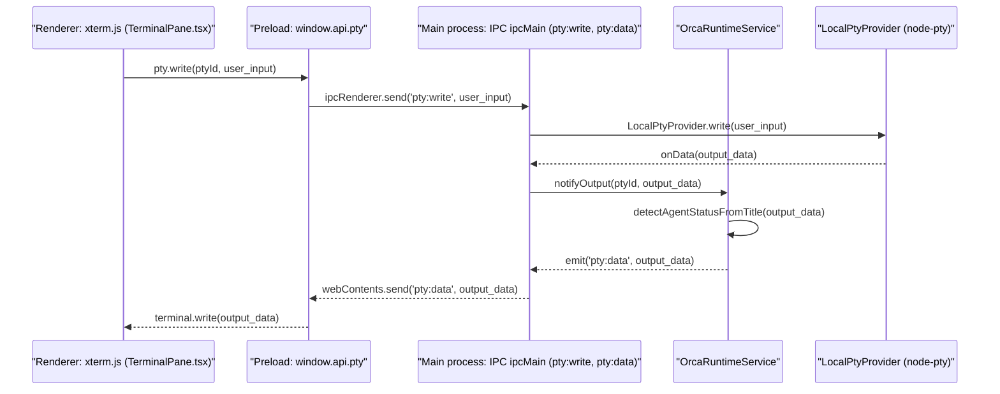
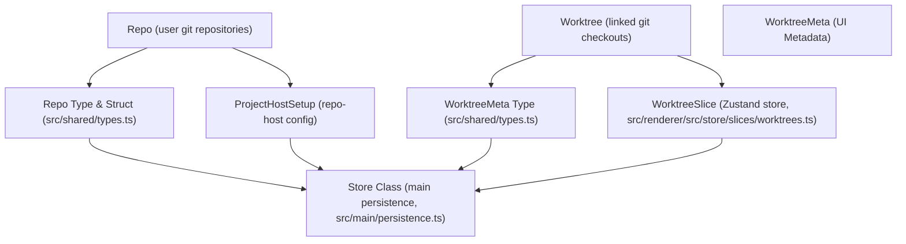
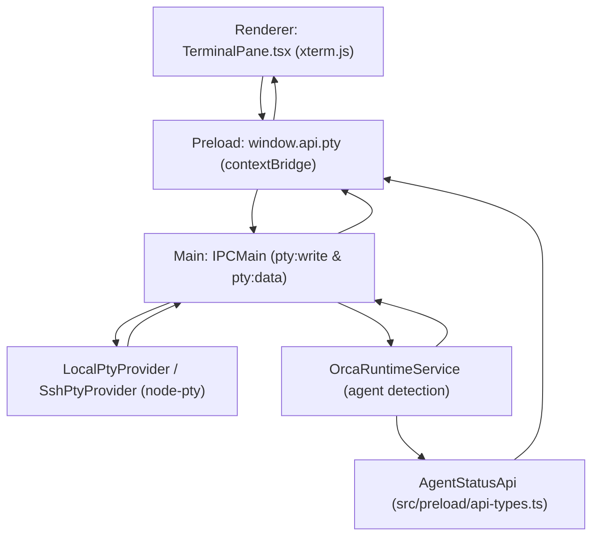

# Glossary

This page provides a comprehensive reference for codebase-specific terminology, domain concepts, and technical abstractions used within Orca. It serves as a bridge between high-level functional requirements and the underlying implementation details in the Electron and React layers. The definitions here include relevant code files and implementation notes to aid onboarding engineers in locating and understanding key concepts.

---

## Core Domain Entities

### Repo (Repository)
In Orca, a **Repo** represents a registered base or parent Git repository, the foundational unit for managing source code.

- **Definition**: Contains metadata such as `id`, `path`, `badgeColor`, and optional `gitRemoteIdentity`. Supports remote attributes like `executionHostId` for SSH/WSL remote hosts.
- **Implementation**: Defined in TypeScript types, notably in `src/shared/types.ts` lines 81–123.
- **Persistence**: Stored persistently in the global state JSON file (`orca-data.json`) managed by the `Store` class.

Sources:
[src/shared/types.ts:81-123]()

### Worktree
A **Worktree** is a Git worktree—an isolated checkout directory linked to a parent `Repo` sharing the same Git history.

- **Identification**: Uses composite IDs encoding repository and worktree context. Includes the floating terminal worktree ID for synthetic terminals.
- **Metadata**: `WorktreeMeta` holds UI-related data such as display name, badge colors, linked GitHub PR/issue info, last checked timestamps, and unread markers.
- **Lifecycle**: Managed client-side in a Zustand store slice (`WorktreeSlice`), with synchronization provided by `OrcaRuntimeService` in the main process.
- **Relevant Types**: `Worktree`, `WorktreeMeta`, `WorktreeLineage`.
- **Key files**: [src/shared/types.ts:220-250](), [src/renderer/src/store/slices/worktrees.ts:20-60](), [src/main/runtime/orca-runtime.ts:47-53]().

Sources:
[src/shared/types.ts:220-250](), [src/renderer/src/store/slices/worktrees.ts:20-60](), [src/main/runtime/orca-runtime.ts:47-53]()

### PTY (Pseudo-Terminal)
The process abstraction used to spawn and interact with shell processes, enabling terminal emulation.

- **Implementation**: Managed by `node-pty` in the main process, wrapped by providers such as `LocalPtyProvider`, `SshPtyProvider`, and `DaemonPtyProvider`.
- **IPC Transport**: PTY commands and streaming data are exchanged over IPC channels (`pty:write`, `pty:data`) between main and renderer.
- **Control and Lifecycle**: PTY lifecycle management includes spawn, write, resize, and kill commands, and various health checks.
- **Relevant Files**: [src/main/ipc/pty.ts:1-39](), [src/main/runtime/orca-runtime.ts:47-53](), [src/renderer/src/components/terminal-pane/pty-connection.ts:1-4]().

Sources:
[src/main/ipc/pty.ts:1-39](), [src/main/runtime/orca-runtime.ts:47-53](), [src/renderer/src/components/terminal-pane/pty-connection.ts:1-4]()

---

## Architecture & Communication

### Electron IPC & ContextBridge
Electron follows a three-process model: Main (backend logic), Preload (secure IPC exposure), Renderer (UI).

- **ContextBridge**: The preload script exposes defined IPC APIs on `window.api` for safe interaction between renderer and main process.
- **IPC Channels**: Used extensively for commands related to repos, worktrees, PTYs, Git/GitHub operations, settings, and more.
- **Key files**: API registrations in preload [src/preload/index.ts:1-156]() and IPC handlers in main [src/main/ipc/pty.ts:1-39]().

Sources:
[src/preload/index.ts:1-156](), [src/main/ipc/pty.ts:1-39]()

### Runtime RPC & Automation
Orca exposes an RPC server (`OrcaRuntimeRpcServer`) to enable CLI tools and AI agents to perform programmatic control of worktrees, terminals, and sessions.

- **OrcaRuntimeService**: Core main-process service managing mutable live graph of worktrees, PTYs, agent activity, and automation.
- **AutomationService**: Embedded in `OrcaRuntimeService`, it manages scheduled and triggered headless workspace creation and task orchestration.
- **Key files**: [src/main/runtime/orca-runtime.ts:5-11](), [src/main/runtime/orca-runtime.ts:16-18]().

Sources:
[src/main/runtime/orca-runtime.ts:5-11](), [src/main/runtime/orca-runtime.ts:16-18]()

---

## Code Entity Mapping: Natural Language to Implementation

### Overview diagram from User Concepts to Code Entities

```mermaid
graph TD
  subgraph "Natural Language Space"
    NL_Repo["Repo (Repository)"]
    NL_Worktree["Worktree (Git Worktree)"]
    NL_PTY["PTY (Pseudo-Terminal)"]
    NL_Agent["AI Agent / Activity"]
    NL_Automation["Automation (Scheduled Tasks)"]
    NL_Storage["Persistent Storage / State"]
    NL_Relay["Relay (Cloud Service)"]
    NL_NativeChat["Native Chat (AI Conversation UI)"]
    NL_AIVault["AI Vault (Session Scanning)"]
    NL_ReliabilityGate["Reliability Gate (Feature Validation)"]
  end

  subgraph "Code Entity Space"
    CE_RepoData["Repo Type & ProjectHostSetup (src/shared/types.ts)"]
    CE_WorktreeMeta["WorktreeMeta (UI Metadata, src/shared/types.ts)"]
    CE_PTYProvider["LocalPtyProvider / SshPtyProvider (src/main/providers/local-pty-provider.ts)"]
    CE_RuntimeService["OrcaRuntimeService (src/main/runtime/orca-runtime.ts)"]
    CE_AgentStatus["Agent Status Detection (OrcaRuntimeService)"]
    CE_AutomationSvc["AutomationsApi (src/preload/api-types.ts)"]
    CE_Store["Store – persistence to orca-data.json (src/main/persistence.ts)"]
    CE_IPCPreload["Preload Context Bridge (src/preload/index.ts)"]
    CE_RelayService["Relay Service (cloud/apps/relay)"]
    CE_NativeChatApi["NativeChatApi (src/preload/api-types.ts)"]
    CE_AIVaultApi["AiVaultApi (src/preload/api-types.ts)"]
    CE_ReliabilityGatesConfig["reliability-gates.jsonc (config/reliability-gates.jsonc)"]
  end

  NL_Repo --> CE_RepoData
  NL_Worktree --> CE_WorktreeMeta
  NL_PTY --> CE_PTYProvider
  NL_Agent --> CE_AgentStatus
  NL_Automation --> CE_AutomationSvc
  NL_Storage --> CE_Store
  NL_Relay --> CE_RelayService
  NL_NativeChat --> CE_NativeChatApi
  NL_AIVault --> CE_AIVaultApi
  NL_ReliabilityGate --> CE_ReliabilityGatesConfig

  CE_Store --> CE_RepoData
  CE_Store --> CE_WorktreeMeta
  CE_IPCPreload --> CE_PTYProvider
  CE_IPCPreload --> CE_Store
  CE_IPCPreload --> CE_RuntimeService
  CE_IPCPreload --> CE_AutomationSvc
  CE_IPCPreload --> CE_NativeChatApi
  CE_IPCPreload --> CE_AIVaultApi
```

Sources:
[src/shared/types.ts:81-250](), [src/main/persistence.ts:1-8](), [src/main/providers/local-pty-provider.ts](), [src/main/runtime/orca-runtime.ts:5-11](), [src/main/runtime/orca-runtime.ts:16-18](), [src/main/runtime/orca-runtime.ts:35](), [src/preload/index.ts:1-156](), [src/preload/api-types.ts:1-172](), [config/reliability-gates.jsonc:1-106]()

---

## Technical Terms & Abbreviations

| Term | Definition | File Reference |
|---|---|---|
| **Agent Hook** | A mechanism for AI agents to interact with the Orca environment, often through terminal output or specific commands. | [src/preload/api-types.ts:10]() |
| **Agent Status** | Tracks AI agent activity in terminal sessions by detecting specific terminal titles and OSC data. | [src/main/runtime/orca-runtime.ts:35]() |
| **AI Vault** | A subsystem for scanning and parsing agent session data across various AI products, extracting information for activity surfaces. | [src/preload/api-types.ts:20](), [src/preload/index.ts:69]() |
| **Automation** | Headless workflow and task orchestration system for scheduled or triggered automations. | [src/preload/api-types.ts:22](), [src/preload/index.ts:82]() |
| **Base Ref** | Default branch name (e.g., `main`) from which new worktrees branch. | [src/shared/types.ts:104-112]() |
| **Cell/Director (Relay)**| Roles within the cloud relay service. A "director" manages connections and routes traffic to "cells" which handle the actual data splicing. | [cloud/apps/relay/src/assignment-store.ts]() |
| **Context Bridge** | Electron pattern exposing secure IPC APIs from main/preload to renderer (`window.api`). | [src/preload/index.ts:1-2](), [src/preload/api-types.ts:73-75]() |
| **Daemon** | Out-of-process helper service used for PTY, FS, and Git operations, for remote or headless usage. | [src/main/daemon/daemon-server.ts]() |
| **Execution Host** | Abstracts runtime environment where worktrees execute: local, SSH, WSL, or remote runtime. | [src/shared/types.ts:110-130]() |
| **Hydration** | Process of loading persisted state from disk into memory, syncing worktrees and sessions. | [src/renderer/src/store/slices/worktrees.ts:77-78]() (initial state) |
| **IPC (Inter-Process Communication)** | Electron communication channels between main, preload, and renderer. | [src/preload/index.ts:1-2]() |
| **Native Chat** | An overlay rendering AI agent conversations as structured messages directly within terminal tabs. | [src/preload/api-types.ts:41](), [src/preload/index.ts:70]() |
| **Pane Key** | Stable internal identifier referencing a terminal pane, used for reconciliations and state sync. | [src/main/ipc/pty.ts:9]() |
| **PTY Provider** | Interface for spawning/managing PTYs; supports local, SSH, and daemon backends. | [src/main/providers/local-pty-provider.ts](), [src/main/providers/ssh-pty-provider.ts](), [src/main/daemon/daemon-pty-adapter.ts]() |
| **ProjectHostSetup** | Configuration linking a Repo to an execution environment (local or remote), including path & state.| [src/shared/types.ts:140-170]() |
| **Relay** | A cloud service that splices mobile and desktop WebSocket sessions, enabling remote access and functionality. | [cloud/apps/relay/src/assignment-store.ts]() |
| **Reliability Gate** | A configuration entry defining criteria and evidence for promoting features, ensuring stability and performance. | [config/reliability-gates.jsonc:1-106]() |
| **Runtime RPC** | RPC interface enabling CLI & AI agents to interact with Orca programmatically. | [src/main/runtime/orca-runtime.ts:3-11]() |
| **Shell-Ready Barrier** | A mechanism to ensure a shell is fully initialized and ready to accept commands before further interaction. | [src/main/ipc/pty.ts:1]() (related to `getBashShellReadyRcfileContent`) |
| **Worktree Lineage** | Parent-child relationships among worktrees for nested workspace organization. | [src/renderer/src/store/slices/worktrees.ts:10-12]() |
| **WorktreeMeta** | Persistent metadata per worktree for UI such as display names, linked PRs/issues, unread flags. | [src/shared/types.ts:220-250]() |

Sources:
[src/shared/types.ts:81-250](), [src/main/persistence.ts:1-8](), [src/main/ipc/pty.ts:1-39](), [src/main/runtime/orca-runtime.ts:3-11](), [src/main/runtime/orca-runtime.ts:16-18](), [src/main/runtime/orca-runtime.ts:35](), [src/main/runtime/orca-runtime.ts:47-53](), [src/preload/index.ts:1-156](), [src/preload/api-types.ts:10](), [src/preload/api-types.ts:20](), [src/preload/api-types.ts:22](), [src/preload/api-types.ts:41](), [src/renderer/src/store/slices/worktrees.ts:10-12](), [src/renderer/src/store/slices/worktrees.ts:77-78](), [config/reliability-gates.jsonc:1-106](), [cloud/apps/relay/src/assignment-store.ts](), [src/main/daemon/daemon-server.ts](), [src/main/providers/local-pty-provider.ts](), [src/main/providers/ssh-pty-provider.ts](), [src/main/daemon/daemon-pty-adapter.ts]()

---

## System Data Flow

### Terminal Data Flow & Agent Status Detection

This sequence diagram describes the data flow of terminal input/output and AI agent status detection.

- The `OrcaRuntimeService` analyzes terminal output streams to detect agent status by looking for known terminal title patterns and OSC sequences.
- Supports local and remote (e.g., SSH) PTYs through provider abstractions.
- Unread marker states and agent activity are synchronized to the renderer for UI badges and notifications.

Sources:
[src/renderer/src/components/terminal-pane/TerminalPane.tsx:7](), [src/preload/index.ts:116](), [src/main/ipc/pty.ts:37](), [src/main/runtime/orca-runtime.ts:35]()

---

## Specialized Components

### Agent Activity Tracking
- Detects AI agent status from terminal title changes and OSC data, tracking states like working, idle, or stale.
- Updates agent status state via IPC payloads to frontend.
- Centralized in `OrcaRuntimeService` which maintains live agent state graphs [src/main/runtime/orca-runtime.ts:35]().

Sources:
[src/main/runtime/orca-runtime.ts:35]()

### Automation Service & Orchestration
- Provides headless orchestration for scheduled and trigger-based automation tasks within workspaces.
- Manages dispatching multi-agent directed acyclic graphs (DAGs) of tasks.
- Embedded inside the runtime service, integrating with worktree lifecycle and agent sessions [src/main/runtime/orca-runtime.ts:16-18]().

Sources:
[src/main/runtime/orca-runtime.ts:16-18]()

### Desktop Native Bridge & Computer Use Features
- Offers OS-native service bridges for accessibility, input simulation, screen capture, and related desktop automation.
- Integration through `DesktopRelayService`, combined with runtime RPC server.
- Supports AI-driven automation scenarios and telemetry for AI platforms like Claude/Codex [src/preload/index.ts:147-148]().

Sources:
[src/preload/index.ts:147-148]()

---

## Summary Table of Core Terms

| Term | Description | File Locations / Lines |
|---|---|---|
| Repo | Registered Git repository base entity with metadata and remote host info | [src/shared/types.ts:81-123]() |
| Worktree | Linked git checkout with UI metadata tracked separately | [src/shared/types.ts:220-250](), [src/renderer/src/store/slices/worktrees.ts:20-60]() |
| PTY | Pseudo-terminal process backend managed with providers (local, SSH, daemon) | [src/main/ipc/pty.ts:1-39](), [src/main/runtime/orca-runtime.ts:47-53]() |
| Agent Hook | Mechanism for AI agents to interact with the Orca environment. | [src/preload/api-types.ts:10]() |
| Agent Status | AI activity detection from terminal titles, used for activity badges and unread indication | [src/main/runtime/orca-runtime.ts:35]() |
| AI Vault | Subsystem for scanning and parsing agent session data. | [src/preload/api-types.ts:20](), [src/preload/index.ts:69]() |
| Automation | Headless workflow and task orchestration system for scheduled or triggered automations | [src/main/runtime/orca-runtime.ts:16-18]() |
| Cell/Director | Roles within the cloud relay service for managing and routing connections. | [cloud/apps/relay/src/assignment-store.ts]() |
| Execution Host | Abstract runtime environment for deployments (local, SSH, WSL, remote) | [src/shared/types.ts:110-130]() |
| IPC | Inter-process communication via Electron’s contextBridge between main, preload, renderer | [src/preload/index.ts:1-2]() |
| Native Chat | Overlay rendering AI agent conversations as structured messages in terminal tabs. | [src/preload/api-types.ts:41](), [src/preload/index.ts:70]() |
| Reliability Gate | Configuration defining criteria and evidence for feature promotion. | [config/reliability-gates.jsonc:1-106]() |
| Relay | Cloud service splicing mobile and desktop WebSocket sessions. | [cloud/apps/relay/src/assignment-store.ts]() |
| Runtime RPC | RPC interface enabling CLI & AI agents to control Orca | [src/main/runtime/orca-runtime.ts:3-11]() |
| Shell-Ready Barrier | Ensures a shell is fully initialized before interaction. | [src/main/ipc/pty.ts:1]() |
| Worktree Lineage | Parent-child relations among worktrees for organization and inheritance | [src/renderer/src/store/slices/worktrees.ts:10-12]() |
| WorktreeMeta | UI metadata model tracked for each worktree, including linked PRs, labels, and unread states | [src/shared/types.ts:220-250]() |

---

## Additional Diagrams for Natural Language to Code Entity Mapping

### Diagram 1: Worktree and Repo Domain Mapping to Code Entities

Sources:
[src/shared/types.ts:81-250](), [src/main/persistence.ts:1-8](), [src/renderer/src/store/slices/worktrees.ts:1-112]()

### Diagram 2: Terminal & Agent Activity Data Flow

Sources:
[src/renderer/src/components/terminal-pane/TerminalPane.tsx:7](), [src/preload/index.ts:116](), [src/main/ipc/pty.ts:37](), [src/main/runtime/orca-runtime.ts:35](), [src/preload/api-types.ts:11](), [src/preload/index.ts:162]()
