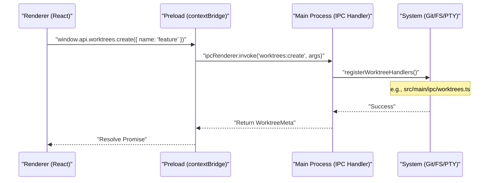

# Main Process

The **Main Process** is the backbone of the Orca application. It is responsible for managing the application lifecycle, orchestrating window creation, hosting core services (Git, GitHub, PTY, SSH, and AI Runtime), and persisting user data to disk. It acts as the privileged layer that interacts with the operating system, exposing secure APIs to the renderer process via a structured IPC bridge.

## Application Lifecycle & Startup

The entry point for the main process is `src/main/index.ts` [src/main/index.ts:1-1](). Upon startup, it performs critical environment configuration and initializes various components.

The application follows a standard Electron lifecycle:
1.  **Preflight**: `runMainProcessPreflight` is executed to handle single-instance locks and initial command-line arguments [src/main/index.ts:90-93]().
2.  **IPC Handler Registration**: `registerMainProcessIpcHandlers` sets up the communication channels between the main and renderer processes [src/main/index.ts:120-120]().
3.  **Ready**: Once the Electron `app` is ready, `initializeMainProcessReady` is called to open the main window and handle macOS app activation [src/main/index.ts:122-127]().
4.  **Deep Links & File Handling**: The main process registers handlers for `open-url` (for skill share deep links) and `open-file` (for OS-opened markdown files) [src/main/index.ts:97-115]().
5.  **Shutdown**: `installMainProcessQuitHandlers` ensures proper cleanup when the application exits [src/main/index.ts:123-123]().

### Main Process Entity Map

The following diagram maps high-level system responsibilities to the specific code entities in the main process.

```mermaid
graph TD
    subgraph "Main Process Lifecycle"
        Entry["src/main/index.ts"] -- "runs preflight" --> Preflight["runMainProcessPreflight"]
        Entry -- "registers IPC" --> IpcHandlers["registerMainProcessIpcHandlers"]
        Entry -- "on app.whenReady()" --> InitReady["initializeMainProcessReady"]
        Entry -- "handles deep links" --> SkillShare["state.skillShareDeepLinks"]
        Entry -- "handles OS files" --> OsFiles["state.osOpenedDocuments"]
        Entry -- "installs quit handlers" --> QuitHandlers["installMainProcessQuitHandlers"]
    end

    subgraph "Core Services"
        IpcHandlers -- "registers" --> CoreIpc["Core IPC Handlers"]
        InitReady -- "opens" --> MainWindow["openMainWindow"]
        MainWindow -- "creates" --> CreateWin["createMainWindow"]
        CreateWin -- "attaches" --> WindowServices["attachMainWindowServices"]
        WindowServices -- "hosts" --> OrcaRuntime["OrcaRuntimeService"]
        WindowServices -- "hosts" --> PtyManagement["registerPtyHandlers"]
    end

    classDef fileNode stroke-dasharray: 5 5
    classDef classNode font-weight:bold

    Preflight:::fileNode IpcHandlers:::fileNode InitReady:::fileNode SkillShare:::fileNode OsFiles:::fileNode QuitHandlers:::fileNode
    CoreIpc:::fileNode MainWindow:::fileNode CreateWin:::fileNode WindowServices:::fileNode OrcaRuntime:::classNode PtyManagement:::fileNode

    CoreIpc["src/main/startup/main-process-ipc-bootstrap.ts"]
    MainWindow["src/main/startup/main-window-controller.ts"]
    CreateWin["src/main/window/createMainWindow.ts"]
    WindowServices["src/main/window/attach-main-window-services.ts"]
    OrcaRuntime["OrcaRuntimeService (src/main/runtime/orca-runtime.ts)"]
    PtyManagement["src/main/ipc/pty/register-handlers.ts"]
```
Sources: [src/main/index.ts:1-174](), [src/main/startup/main-process-ipc-bootstrap.ts](), [src/main/window/createMainWindow.ts:60-143](), [src/main/startup/main-process-ready.ts](), [src/main/startup/main-process-state.ts](), [src/main/startup/main-process-ready-foundation.ts:57-140]()

## Window Management

Window creation and service attachment are coordinated across startup controllers and window modules. The primary window controller opens the main `BrowserWindow` [src/main/index.ts:31-33](), while Orca-specific logic and IPC services are injected via `attachMainWindowServices` [src/main/window/attach-main-window-services.ts:50-72]().

Key window responsibilities include:
*   **Window Creation**: `createMainWindow` [src/main/window/createMainWindow.ts:60-63]() initializes the `BrowserWindow` with specific dimensions, styling, and `webPreferences` such as sandboxing and preload script [src/main/window/createMainWindow.ts:134-143]().
*   **Security & Permissions**: Configures permission request handlers for media access (camera/microphone) and pointer lock, essential for the integrated browser and AI features [src/main/window/attach-main-window-services.ts:132-143]().
*   **Lifecycle Sync**: Tracks window state and handles graceful shutdown procedures.
*   **Browser Management**: The `browserManager` is configured to handle dictation shortcut forwarding [src/main/window/createMainWindow.ts:91-94]().
*   **Shortcut Routing**: Manages global keyboard shortcuts, ensuring they are handled correctly by the main process or passed to the renderer [src/main/window/createMainWindow.ts:21-21]().

Sources: [src/main/index.ts:31-35](), [src/main/window/createMainWindow.ts:60-145](), [src/main/window/createMainWindow.test.ts:59-182](), [src/main/window/attach-main-window-services.ts:50-143]()

## IPC Handler Registration

Orca uses a tiered registration system for IPC handlers to separate global services from window-specific services. The `registerMainProcessIpcHandlers` function is the central point for global registration [src/main/index.ts:122-122]().

| Registration Function | File | Scope |
| :--- | :--- | :--- |
| `registerMainProcessIpcHandlers` | `src/main/startup/main-process-ipc-bootstrap.ts` | Global services: App, Platform, Settings, Telemetry, etc. |
| `attachMainWindowServices` | `src/main/window/attach-main-window-services.ts` | Window-specific: Repos, Worktrees, PTY, and Auto-Updater. |
| `registerPtyHandlers` | `src/main/ipc/pty/register-handlers.ts` | PTY-specific operations like spawning, writing, and resizing. |
| `registerWorktreeHandlers` | `src/main/ipc/worktrees.ts` | Detailed worktree CRUD, hooks, and metadata management. |

The `preload` script (`src/preload/index.ts`) acts as the secure bridge, exposing these handlers to the renderer via the `contextBridge` which populates the `window.api` surface [src/preload/index.ts:1-2]().

Sources: [src/main/index.ts:120-122](), [src/main/startup/main-process-ipc-bootstrap.ts](), [src/main/window/attach-main-window-services.ts:73-130](), [src/main/ipc/worktrees.ts](), [src/preload/index.ts:1-2]()

## Core Subsystems

The main process hosts several critical subsystems that provide the functionality for the Orca UI.

### IPC API Reference
The `window.api` surface, defined by `PreloadApi`, provides namespaces for `repos`, `worktrees`, `pty`, `gh`, `fs`, `git`, `ssh`, and more [src/preload/api-types.ts:69-153](). Each namespace maps directly to an IPC `invoke` or `send` call.
For details, see [IPC API Reference](#2.1).

Sources: [src/preload/api-types.ts:69-153]()

### Persistence Layer
The `Store` class manages `orca-data.json`. It handles atomic writes, debounced saves, and schema migrations to ensure user settings and workspace sessions are preserved [src/main/persistence.ts:1-6]().
For details, see [Persistence Layer](#2.2).

Sources: [src/main/persistence.ts:1-6]()

### Git & GitHub Integration
This subsystem wraps local `git` operations (like worktree management) and GitHub CLI integration. It handles `git worktree add`, base ref resolution, and push target configuration. It also manages the hooks system for `orca.yaml` [src/shared/constants.ts:142-152]().
For details, see [Git & GitHub Integration](#2.3).

Sources: [src/shared/constants.ts:142-152]()

### Auto-Updater
Orca integrates `electron-updater` via the updater module (`attachMainWindowServices` / `main-window-updater`). It handles background update checks, download progress, and the "Quit and Install" flow [src/main/window/attach-main-window-services.ts:39-39]().
For details, see [Auto-Updater](#2.4).

Sources: [src/main/window/attach-main-window-services.ts:39-39]()

### SSH & Remote Connections
Manages SSH target lifecycles and the Relay daemon. It provides a provider dispatch system that allows PTY, FS, and Git operations to work transparently over remote SSH connections [src/main/ipc/ssh.ts]().
For details, see [SSH & Remote Connections](#2.5).

Sources: [src/main/ipc/ssh.ts]()

### CLI & Runtime RPC
Hosts the runtime RPC server which allows external AI agents and the `orca` CLI tool to control the IDE via a local socket transport managed by `OrcaRuntimeService` [src/main/window/attach-main-window-services.ts:50-53]().
For details, see [CLI & Runtime RPC](#2.6).

Sources: [src/main/window/attach-main-window-services.ts:50-53]()

### Automations & Orchestration
The automation subsystem manages scheduled or triggered headless workspace creation and multi-agent task orchestration [src/main/window/attach-main-window-services.ts:50-70]().
For details, see [Automations & Orchestration](#2.7).

Sources: [src/main/window/attach-main-window-services.ts:50-70]()

### Daemon, Relay, and Provider Abstractions
This covers the out-of-process daemon/relay model for PTY, FS, and Git, defining provider interfaces and session management for local vs SSH vs remote-runtime providers [src/main/ipc/pty-management.ts]().
For details, see [Daemon, Relay, and Provider Abstractions](#2.8).

Sources: [src/main/ipc/pty-management.ts]()

### Plugin System
The main process manages the plugin system, including loading plugin manifests, enforcing capability gates, and providing a host API for plugins to interact with Orca's core functionalities.
For details, see [Plugin System](#2.9).

Sources: [src/main/window/attach-main-window-services.ts:1-100]()

### IPC Communication Flow

The following diagram illustrates how a UI action in the Renderer travels through the Preload bridge to be executed by a Main Process handler.


Sources: [src/preload/index.ts:1-156](), [src/preload/api-types.ts:69-153](), [src/main/ipc/worktrees.ts]()
