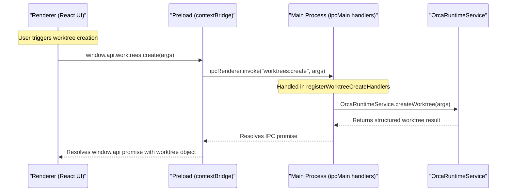
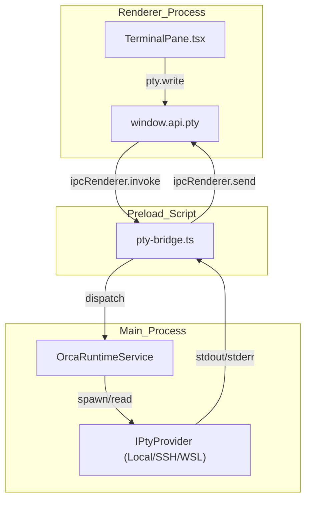

# IPC API Reference

The IPC (Inter-Process Communication) API is the critical conduit enabling communication between Electron's **Main Process** (running with Node.js privileges) and the **Renderer Process** (which presents the React UI). This communication is securely layered through a `contextBridge` implemented in the preload script (`[src/preload/index.ts:1-3]()`), which exposes a rich, type-safe, and curated `window.api` object adhering to the `PreloadApi` type definition (`[src/preload/api-types.ts:73-165]()`). This setup enforces security boundaries, minimizes type drift, and centralizes the IPC contract for the entire application.

Sources: `[src/preload/index.ts:1-3]()`, `[src/preload/api-types.ts:73-165]()`

---

## 1. Architecture Overview

Orca organizes IPC primarily through two Electron IPC patterns:
- `ipcRenderer.invoke`: Enables asynchronous request/response calls from Renderer to Main (`[src/preload/index.ts:90-97]()`).
- `ipcRenderer.send`: Supports event/notification sending without immediate response.

The preload script serves as the gatekeeper defining the IPC API surface exposed as `window.api` namespaces (`[src/preload/api-types.ts:73-165]()`). Corresponding Main Process handlers implement the backend logic, registering under channels that match the various domain bridges (`[src/preload/index.ts:100-164]()`).

### Data Flow: Renderer to Main

Below is the data flow for an IPC request, bridging high-level UI actions to specific code entities in the preload script and main process runtime (`[src/main/runtime/orca-runtime.ts:32-93]()`).

*Figure 1: Worktree creation IPC flow mapping renderer calls to runtime services.*

Sources: `[src/preload/index.ts:1-5]`, `[src/preload/api-types.ts:73-165]()`, `[src/main/runtime/orca-runtime.ts:32-93]()`

---

## 2. IPC `window.api` Namespace Reference

The `window.api` object is partitioned into domain-specific namespaces defined in `[src/preload/api-types.ts:73-165]()`. Each namespace encapsulates a specific subsystem of the application:

### `repos` & `worktrees` — Repository and Worktree Management
- **`repos` (`RepositoryApi`)**: Manages repository registration, listing, and removal (`[src/preload/api-types.ts:78-80]()`).
- **`worktrees` (`WorktreeApi`)**: Manages Git worktree creation, removal, branch conflict updates, lineage assignment, and scanning (`[src/preload/api-types.ts:83-83]()`, `[src/renderer/src/store/slices/worktrees.ts:71-112]()`).

| API Namespace | Key Methods | Description |
| --- | --- | --- |
| `repos` | `list()`, `add(args)`, `remove(args)` | Repository registration and lifecycle catalog. |
| `worktrees` | `create(args)`, `remove(args)`, `updateMeta(args)`, `listDetected(args)` | Worktree provisioning and filesystem reconciliation. |

Sources: `[src/preload/api-types.ts:78-83]`, `[src/renderer/src/store/slices/worktrees.ts:71-112]()`

### `pty` — Pseudoterminal Session Management
Managed via `PtyApi` (`[src/preload/api-types.ts:87-87]()`), this namespace handles spawning, writing to, resizing, and listening to data streams for local shells, SSH connections, and WSL instances.

Sources: `[src/preload/api-types.ts:87-87]()`

### Integrations and Cloud Subsystems
- **`gh`, `hostedReview`, `gl`, `bitbucket`**: GitHub PRs, issues, GitLab, and Bitbucket hosted code review APIs (`[src/preload/api-types.ts:91-94]()`).
- **`linear`, `jira`**: Task tracker integrations (`[src/preload/api-types.ts:95-96]()`).
- **`mobile`, `automations`**: Companion app pairing, transport, and headless automated workspace dispatch (`[src/preload/api-types.ts:157-163]()`).

Sources: `[src/preload/api-types.ts:91-163]()`

---

## 3. PTY Subsystem Architecture & Dispatch

The terminal and PTY subsystem relies heavily on IPC event streaming and command execution routing managed by `OrcaRuntimeService` (`[src/main/runtime/orca-runtime.ts:32-93]()`).

*Figure 2: PTY subsystem routing and execution architecture.*

Sources: `[src/preload/index.ts:116-116]()`, `[src/main/runtime/orca-runtime.ts:32-93]`, `[src/preload/api-types.ts:87-87]()`

---

## 4. Security & Validation Practices

Orca enforces strict security and architectural guardrails across all IPC endpoints:
1. **Context Isolation:** Node.js integration is disabled in the renderer; all communication is channeled via `contextBridge` exposing `window.api` (`[src/preload/index.ts:1-3]()`, `[src/preload/api-types.ts:73-165]()`).
2. **Type Safety:** The `PreloadApi` type definition enforces strict contract guarantees between main process handlers and renderer callers (`[src/preload/api-types.ts:73-165]()`).
3. **Execution Gating:** Filesystem and PTY operations are gated by runtime checks and authorization helpers in `OrcaRuntimeService` (`[src/main/runtime/orca-runtime.ts:32-93]()`).

Sources: `[src/preload/index.ts:1-3]`, `[src/preload/api-types.ts:73-165]`, `[src/main/runtime/orca-runtime.ts:32-93]()`
