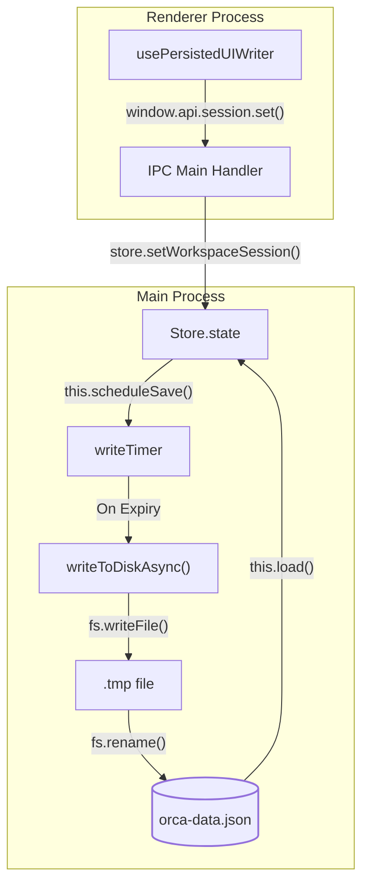
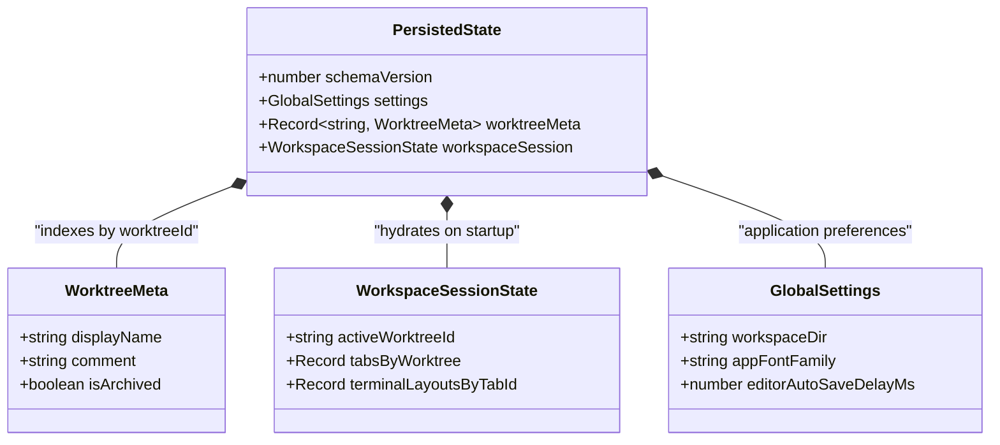
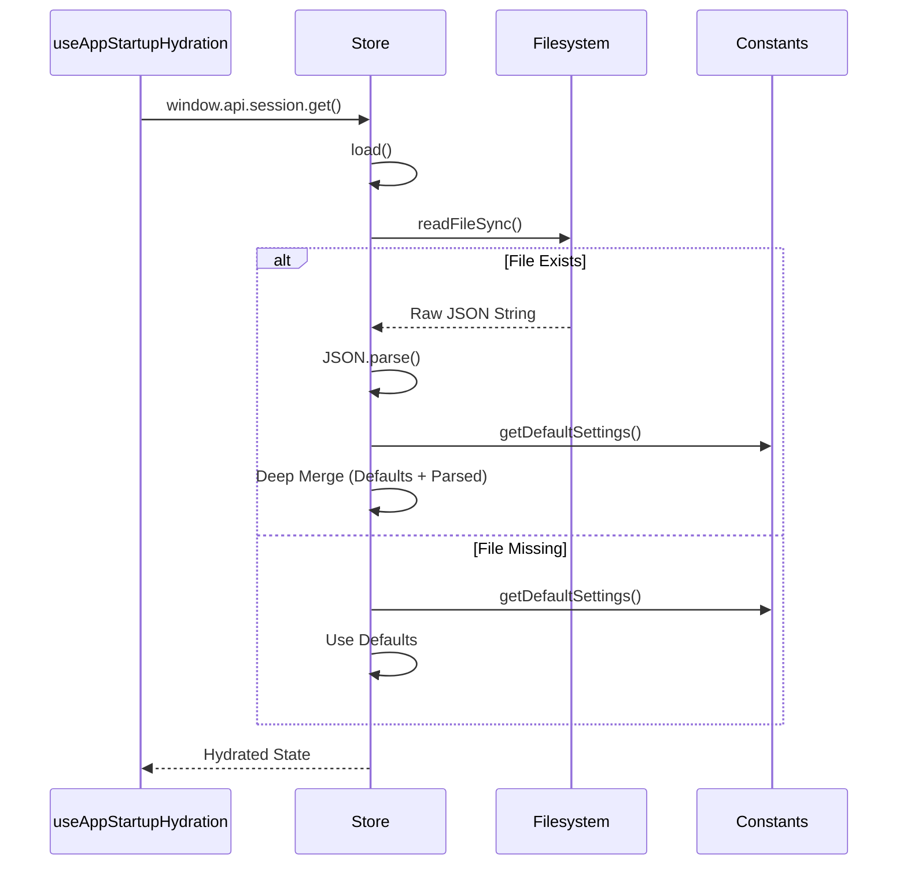

# Persistence Layer

The persistence layer in Orca manages application state on disk. It centers around a single JSON file, `orca-data.json`, which stores repository configurations, worktree metadata, user preferences, and session states. The system ensures high reliability through an atomic write strategy, debounced saves to minimize I/O overhead, and structured initialization.

Sources: [src/main/persistence.ts:1-6](), [src/shared/constants.ts:37-37]()

---

## The Store Class

The `Store` class in the main process serves as the central authority for data persistence [src/main/persistence.ts:1-1](). It manages the lifecycle of the application state, including loading from disk, providing accessors for data slices, and scheduling updates.

### Implementation and Data Flow

The `Store` initializes by loading the data file from the Electron `userData` path, handled by `getCanonicalUserDataPath()` and `initDataPath()` [src/main/persistence.ts:3-4]().

**Key Responsibilities:**
- **State Management**: Holds the `PersistedState` object in memory for synchronous reads.
- **Debounced Writing**: Batches updates via a timer to prevent excessive disk writes.
- **Hydration**: Enriches raw persisted data with runtime-calculated values.
- **PTY Source Binding**: Manages expectations for PTY sources during session restoration [src/main/persistence.ts:1-1]().

### Atomic Write Strategy

To prevent corruption during crashes, the `Store` uses an atomic write-then-rename flow:
1. **Write to Temporary**: Data serializes to a unique temporary file.
2. **Generation Check**: Validates the write generation before finalizing.
3. **Rename**: Replaces the target `orca-data.json` via a transactional file rename.
4. **Flush**: Executes a synchronous write during application shutdown.

Title: "Persistence Data Flow"

Sources: [src/main/persistence.ts:1-6](), [src/shared/constants.ts:37-37]()

---

## Data Schema

The persistence layer relies on a strictly typed schema shared between the main and renderer processes.

### Schema Versioning
The `SCHEMA_VERSION` constant tracks the data structure version [src/shared/constants.ts:37-37](). The system uses version `1`, deep-merging loaded data with defaults from `getDefaultPersistedState()` [src/shared/constants.ts:154-168]().

### Core Entities

| Entity | Type | Description |
| :--- | :--- | :--- |
| **GlobalSettings** | `GlobalSettings` | App-wide preferences (themes, fonts, workspace directories) [src/shared/constants.ts:1-1]() |
| **PersistedState** | `PersistedState` | Root object containing all persistent data [src/shared/constants.ts:3-3]() |
| **WorktreeMeta** | `WorktreeMeta` | User metadata for worktrees (comments, linked PRs) |
| **WorkspaceSessionState** | `WorkspaceSessionState` | Current UI session state (active tabs, layouts) [src/shared/constants.ts:6-6]() |

Title: "Code Entity Relationship"

Sources: [src/shared/constants.ts:1-168]()

---

## Schema Migration and Normalization

Orca performs deep merges with default state generators during startup to handle missing or legacy fields.

### Normalization Logic
- **UI Selection**: Normalized to prevent invalid tab references [src/main/persistence.ts:7-7]().
- **Onboarding State**: Sanitized for flow versioning [src/main/persistence.ts:8-8]().
- **Worktree Properties**: Card properties normalized using default generators [src/shared/constants.ts:11-35]().

Title: "Store Initialization Sequence"

Sources: [src/main/persistence.ts:1-6](), [src/shared/constants.ts:110-168]()

---

## Runtime Home & Account Persistence

In addition to `orca-data.json`, Orca manages isolated state for AI agent runtimes:
- **Managed Homes**: `CodexAccountService` organizes isolated home directories per account [src/main/codex-accounts/service.ts:80-145]().
- **Runtime Sync**: Mirrors active account configurations into PTY execution environments.

Sources: [src/main/codex-accounts/service.ts:80-145](), [src/main/codex-accounts/service.test.ts:38-75]()
