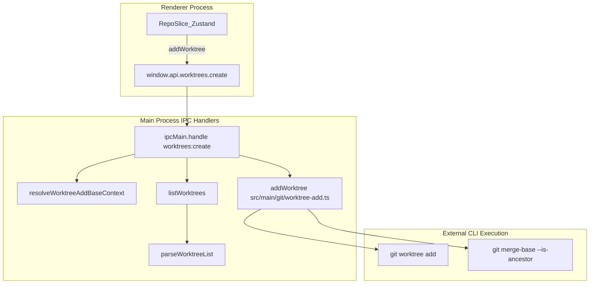
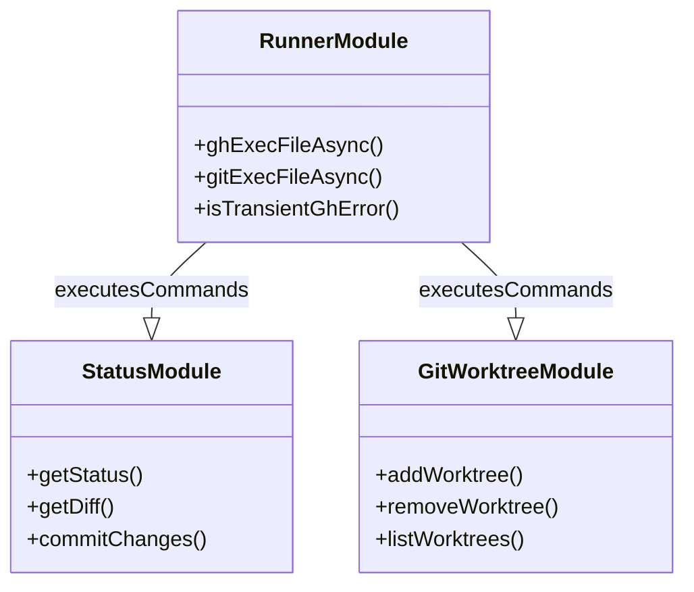

# Git & GitHub Integration

Orca provides a deep integration with Git and GitHub, centered around the management of multiple worktrees, high-performance status scanning, concurrency-limited GitHub CLI (`gh`) execution, and a repository-specific hooks system. The system combines low-level Git CLI utilities with robust cross-platform runner abstractions.

Sources: [src/main/git/runner.ts:1-10](), [src/main/git/worktree.ts:1-21]()

---

## Git Infrastructure & Command Runner

The Git integration is split between core utilities in the main process and IPC handlers that manage the lifecycle of repositories and worktrees via `src/main/git/runner.ts` and `src/main/git/worktree.ts`.

### Centralized Command Runner and WSL Support
All subprocess execution for `git`, `gh`, and auxiliary commands is centralized through `src/main/git/runner.ts` [src/main/git/runner.ts:1-10](). When a repository resides on a WSL filesystem on Windows, native Windows binaries are bypassed or substituted by routing execution through `wsl.exe -d <distro>` with automatic path translation [src/main/git/runner.ts:1-10]().
- **Execution APIs**: Functions like `gitExecFileAsync`, `gitExecFileAsyncBuffer`, and `gitExecFileSync` provide safe async and sync process spawning with standard environment configurations [src/main/git/runner.ts:29-33]() like `untranslatedGitOutputEnv` and `promptGuardGitEnv` [src/main/git/runner.ts:22-28]().
- **Timeout and Retries**: Long-running or blocked commands trigger `GitCommandTimeoutError` [src/main/git/runner.ts:20-20](), while transient GitHub errors are handled via retry policies [src/main/git/runner.ts:41-41]().

### Repository and Worktree Management
Orca treats repositories as primary containers for worktrees. Worktree creation and removal utilities (`addWorktree`, `removeWorktree`, `moveWorktree`, `addSparseWorktree`) are exposed via `src/main/git/worktree.ts` [src/main/git/worktree.ts:1-39]().
- **Preflight & Porcelain Parsing**: Worktree lists are parsed reliably using `parseWorktreeList` over porcelain output [src/main/git/worktree.ts:8-8](), supporting strict caching and invalidation generations (`bumpWorktreeScanGeneration`) [src/main/git/worktree.ts:38-38]().
- **Background Preparation**: Worktree creation can be prepared asynchronously in the background via `prepareWorktreeCreateForRepo` to minimize latency when users trigger workspace creation [src/main/worktree-create-preparation.ts:104-113]().

### Worktree Lifecycle Data Flow
The following diagram illustrates the flow from a UI request to create a worktree down to the Git CLI execution, bridging natural language intent to code entities.

**Title: Worktree Creation Logic Flow**

Sources: [src/main/git/runner.ts:1-47](), [src/main/git/worktree.ts:1-39](), [src/main/worktree-create-preparation.ts:104-113]()

---

## Git Status and Diffing

Orca implements a comprehensive source-control surface in `src/main/git/status.ts` [src/main/git/status.ts:1-4](), which aggregates status reads, file diffs, stashing, staging, and conflict operations.

### Status Refresh and Caching
To maintain UI responsiveness during frequent terminal or file modifications, Git status checks are heavily optimized:
- **Status Read & Porcelain Parsing**: `getStatus` reads porcelain output to classify modified, untracked, and staged files [src/main/git/status.ts:4-4]().
- **Cache Invalidation**: Read caches are managed via `invalidateGitReadCaches` and `runWithGitReadCacheInvalidation` to ensure atomic updates following mutations [src/main/git/status.ts:14-17]().
- **Submodule Resolution**: Submodules are tracked and resolved via `listSubmodulePaths` and `resolveSubmoduleWorktreePath` [src/main/git/status.ts:11-12]().

### Conflict Detection and Resolution
The system detects ongoing merge or rebase conflicts via `detectConflictOperation`, `abortMerge`, and `abortRebase` [src/main/git/status.ts:25-28](). Unmerged entries are parsed directly from porcelain records without redundant filesystem probing [src/main/git/status.test.ts:134-148]().

Sources: [src/main/git/status.ts:1-48](), [src/main/git/status.test.ts:87-176]()

---

## GitHub CLI Client

GitHub integration is powered by the `gh` CLI wrapper exposed through `src/main/git/runner.ts` [src/main/git/runner.ts:41-43]().

### Concurrency and Host Scoping
- **Scoped Execution**: `ghExecFileAsync` and `ghExecFileWithScopeAsync` ensure that host configurations and auth tokens are correctly applied via `applyGhHostToArgs` [src/main/git/runner.ts:42-43]().
- **Transient Error Detection**: `isTransientGhError` evaluates network or rate-limit failures to drive backoff and retry behavior [src/main/git/runner.ts:41-41]().

### GitHub Integration Entity Map
This diagram bridges natural language concepts to specific code entities used for GitHub operations.

**Title: GitHub Integration Entity Map**

Sources: [src/main/git/runner.ts:30-47](), [src/main/git/status.ts:4-48](), [src/main/git/worktree.ts:1-39]()

---

## Hooks System (orca.yaml)

Orca supports a repository-specific hooks system defined via an `orca.yaml` configuration file located at the repository root.
- **Automation Hooks**: Executes setup scripts on worktree creation and cleanup scripts upon worktree archiving or deletion [orca.yaml:1-1]().
- **UI & Service Integration**: Managed by backend hook services and exposed in repository settings panels for custom workflow automation.

Sources: [orca.yaml:1-1]()

---

## SSH & Remote Git

When operating across remote development hosts or SSH relay environments, Git commands and worktree operations are proxied through remote RPC handlers.
- **Relay Dispatch**: Remote sessions execute git status, worktree CRUD, and diff operations matching local porcelain behaviors [src/relay/git-handler.ts:1-28]().
- **Provider Abstraction**: The main process dispatches requests using remote providers that translate local calls into structured wire protocol frames.

Sources: [src/relay/git-handler.ts:1-28]()
