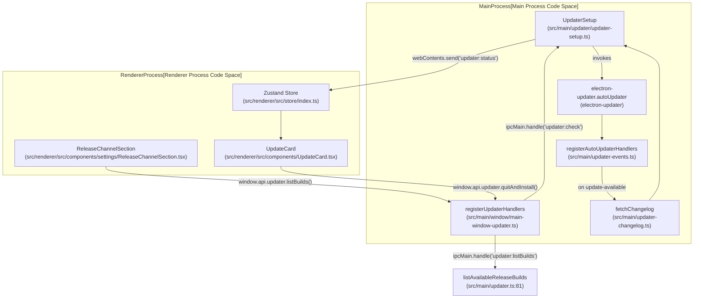

# Auto-Updater

The Auto-Updater subsystem in Orca manages the application lifecycle regarding software updates, utilizing `electron-updater` for multi-platform delivery and integrating with native frameworks like macOS `Squirrel.Mac` to ensure reliable installations. It exposes a reactive state machine over IPC, synchronizing Main process updater events with the Renderer UI, supporting multi-channel release feeds, prerelease mining, and specialized Linux recovery.

Sources: [src/main/updater.ts:1-101](), [src/main/updater-events.ts:1-63]()

## Update State Machine

The updater's runtime behavior is governed by a state machine tracking the `UpdateStatus` type [`src/shared/update-status-types.ts`](). The Main process (`UpdaterSetup`) manages transitions and broadcasts state changes to the Renderer.

| State | Description | Code Symbol / Handler |
| :--- | :--- | :--- |
| `idle` | No update activity in progress. | `UpdaterSetup` default state |
| `checking` | Querying update feeds (GitHub Releases or Atom feeds). | `autoUpdater.on('checking-for-update')` [src/main/updater-events.ts:76-87]() |
| `available` | A new version is detected but not yet downloaded (includes changelog). | `autoUpdater.on('update-available')` [src/main/updater-events.ts:89-124]() |
| `downloading` | Update package is transferring (includes transfer progress percentage). | `autoUpdater.on('download-progress')` |
| `downloaded` | Update artifact is fully staged and ready for application install. | `autoUpdater.on('update-downloaded')` |
| `not-available` | Running build is confirmed up to date. | `autoUpdater.on('update-not-available')` |
| `error` | Check or download failure (includes error message and recovery metadata). | `autoUpdater.on('error')` |

### Implementation Details
- **Service Container**: All public API calls and event listeners are centralized in the `UpdaterSetup` class instantiated in `src/main/updater.ts` [src/main/updater.ts:18]().
- **Broadcast Mechanism**: The `sendStatus()` function pushes state changes via `webContents.send('updater:status', status)` to the renderer [src/main/updater-events.ts:56]().
- **Polling Intervals**: Automatic background checks fire every 24 hours (`AUTO_UPDATE_CHECK_INTERVAL_MS = 24 * 60 * 60 * 1000`), with hourly retries (`AUTO_UPDATE_RETRY_INTERVAL_MS = 60 * 60 * 1000`) upon transient failures [src/main/updater-events.ts:20-21]().

Sources: [src/main/updater.ts:17-28](), [src/main/updater-events.ts:20-87](), [src/shared/update-status-types.ts:1-6]()

## Process Architecture & Data Flow

The Auto-Updater bridges the Electron Main process and Renderer process through an IPC bridge registered via `registerUpdaterHandlers` [src/main/window/main-window-updater.ts:130-141]().

### Diagram: Updater Code Entity Mapping
The following diagram maps natural language system components to their precise code file paths and function symbols across the IPC boundary.


Sources: [src/main/updater.ts:53-101](), [src/main/updater-events.ts:23-63](), [src/main/window/main-window-updater.ts:130-178](), [src/renderer/src/components/settings/ReleaseChannelSection.tsx:119-153]()

## Prerelease & Fallback Logic

Orca supports multiple release channels and fallback handling for network anomalies or feed gaps.

### Release Channels
Managed via `src/shared/release-channel.ts`, channels include `stable`, `rc`, `hourly`, `daily`, and `adhoc` [src/shared/release-channel.ts:3]().
- **Dedicated Repositories**: Dev channels (`hourly`, `daily`, `adhoc`) publish to dedicated GitHub repositories (`stablyai/orca-hourly`, `stablyai/orca-daily`, `stablyai/orca-adhoc`) to prevent evicting stable releases from the primary 10-entry atom feed [src/shared/release-channel.ts:24-27]() [src/main/updater-release-builds.test.ts:36-38]().
- **Manual Dev Install Gate**: On Windows, switching from a signed stable build to an unsigned dev build requires manual installation due to `electron-updater` Authenticode verification rules enforced by `requiresManualDevChannelInstall()` [src/shared/release-channel.ts:101-112]().

### Benign Failure Handling
When background update checks fail due to temporary network drops or publishing delays, `isBenignCheckFailure()` suppresses disruptive UI error states, silently scheduling retry cadences [src/main/updater-fallback.ts:62-106](). User-initiated checks always surface errors directly.

Sources: [src/shared/release-channel.ts:3-40](), [src/shared/release-channel.ts:101-112](), [src/main/updater-fallback.ts:62-106](), [src/main/updater-release-builds.test.ts:36-38]()

## Platform Specifics

### macOS (Squirrel.Mac) Readiness
On macOS, `electron-updater` coordinates with the native `Squirrel.Mac` framework. Orca intercepts the `update-downloaded` event, holding the update status until `handleMacInstallerReady()` verifies Squirrel staging completion [src/main/updater-mac-install.ts:25-34](). If the user attempts to quit during staging, `deferMacQuitUntilInstallerReady()` prevents premature termination [src/main/updater-mac-install.ts:134-174]().

### Linux Package Recovery
On Linux targets, package manager issues or missing external permissions are diagnosed via `src/main/linux-package-update-recovery.ts`. The UI surfaces manual recovery instructions and allows revealing downloaded artifacts via `showLinuxPackage()` [src/main/updater.ts:77-79]().

Sources: [src/main/updater.ts:73-79](), [src/main/updater-mac-install.ts:25-34](), [src/main/updater-mac-install.ts:134-174](), [src/main/linux-package-update-recovery.ts:1-20]()

## Shutdown & Installation Procedure

When an update is staged and the user initiates installation, `quitAndInstall()` performs teardown sequences before handing off to the native installer.

### Diagram: Shutdown and Installation Flow
```mermaid
sequenceDiagram
    participant Renderer as UpdateCard
    participant UpdaterModule as updater.ts
    participant UpdaterSetup as UpdaterSetup
    participant PTY as PTY Manager
    participant AutoUpdater as electron-updater

    Renderer->>UpdaterModule: window.api.updater.quitAndInstall()
    UpdaterModule->>UpdaterSetup: updater.quitAndInstall()
    UpdaterSetup->>UpdaterSetup: markMacQuitAndInstallInFlight()
    UpdaterSetup->>PTY: killAllPty()
    Note over UpdaterSetup: Arm update install exit watchdog
    UpdaterSetup->>AutoUpdater: autoUpdater.quitAndInstall(false, true)
    AutoUpdater--->NativeInstaller: Native Application Replacement
```
Sources: [src/main/updater.ts:65-67](), [src/main/updater-mac-install.ts:98-101](), [src/main/updater.mac-install.test.ts:108-110]()

## IPC Bridge Reference

The preload script exposes the `window.api.updater` surface, routing calls to Main process handlers:

| IPC Channel | Main Process Function | Description |
| :--- | :--- | :--- |
| `updater:getStatus` | `getUpdateStatus()` | Returns the current `UpdateStatus` snapshot [src/main/window/main-window-updater.ts:142]() |
| `updater:getVersion` | `app.getVersion()` | Returns running application version string [src/main/window/main-window-updater.ts:143]() |
| `updater:check` | `checkForUpdatesFromMenu(options)` | Triggers an immediate update check [src/main/window/main-window-updater.ts:144-147]() |
| `updater:download` | `downloadUpdate()` | Downloads available update artifact [src/main/window/main-window-updater.ts:148]() |
| `updater:quitAndInstall` | `quitAndInstall()` | Tears down PTYs and launches native installer [src/main/window/main-window-updater.ts:149]() |
| `updater:listBuilds` | `listAvailableReleaseBuilds(channel, options)` | Lists GitHub release builds for channel selection [src/main/window/main-window-updater.ts:162-177]() |

Sources: [src/main/window/main-window-updater.ts:130-178](), [src/main/updater.ts:1-101]()
