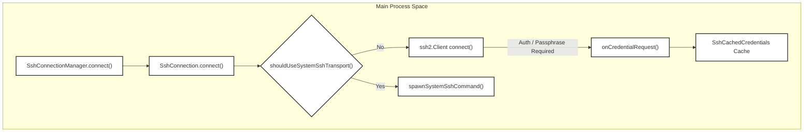
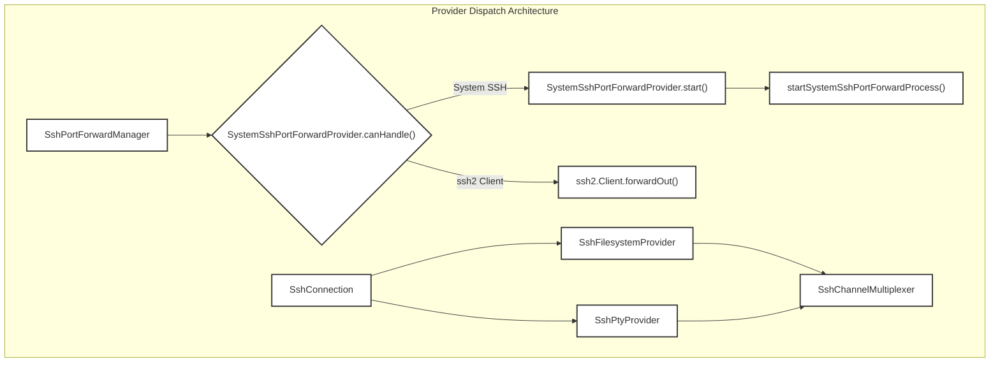

# SSH & Remote Connections

The SSH subsystem in Orca provides robust infrastructure for connecting to remote environments, extending the application's core capabilities (Filesystem, Git, and PTY) to remote hosts. It employs a hybrid architecture utilizing the `ssh2` Node.js library for primary protocol handling, a system SSH fallback for advanced security keys or GSSAPI environments [src/main/ssh/ssh-connection.ts:37-43](), and a custom "Relay" daemon deployed to remote hosts for high-performance JSON-RPC execution.

Sources:
[src/main/ssh/ssh-connection.ts:37-43]()

## SSH Connection Lifecycle

The `SshConnection` class (`[src/main/ssh/ssh-connection.ts:161]()`) manages the state, transport selection, and connectivity of a remote target. It coordinates with `SshConnectionManager` (`[src/main/ssh/ssh-connection-manager.ts:16]()`) to track connection states (`disconnected`, `connecting`, `connected`, `reconnecting`, `disposed`).

### Connect & Reconnect Strategy

- **Initial Connection:** Established via an `ssh2` client instance with configurable timeouts (`CONNECT_TIMEOUT_MS = 30_000`, `INITIAL_RETRY_DELAY_MS = 2000`) [src/main/ssh/ssh-connection-utils.ts:36-40](). TCP keepalives and `TCP_NODELAY` are explicitly enabled on ready state [src/main/ssh/ssh-connection.test.ts:47-53]().
- **Backoff & Reconnect Ladder:** Network drops or transient failures trigger exponential backoff managed by `SshReconnectLadder` [src/main/ssh/ssh-connection.ts:81]() using predefined intervals (`RECONNECT_BACKOFF_MS`) [src/main/ssh/ssh-connection-utils.ts:38]().
- **System SSH Fallback:** If transient network errors like `EHOSTUNREACH` or `ENETUNREACH` occur, or if security keys (FIDO/U2F) and GSSAPI authentication are required, Orca evaluates whether to fall back to the host system SSH binary (`spawnSystemSshCommand`) [src/main/ssh/ssh-connection.ts:26-42](), [src/main/ssh/ssh-transport-selection.ts:81-83]().

### Credential Flow & Caching

- When authentication prompts or passphrases are required (`isPassphraseError`, `isAuthError`), `SshConnection` triggers the asynchronous credential request callback `onCredentialRequest` [src/main/ssh/ssh-connection-utils.ts:16-29]().
- `SshConnectionManager` caches valid sign-in credentials (`SshCachedCredentials`) in memory per target endpoint, avoiding repeated prompts during background reconnections [src/main/ssh/ssh-connection-manager.ts:11-23]().
- If a user explicitly declines credentials or cancels the prompt, `isSshCredentialDeclined` short-circuits subsequent retries to prevent authentication loops [src/main/ssh/ssh-connection-manager.ts:49-51]().

**Diagram Title: SSH Connection Dispatch and Credential Flow**
Sources:
[src/main/ssh/ssh-connection.ts:161-180](), [src/main/ssh/ssh-connection-manager.ts:11-51](), [src/main/ssh/ssh-connection-utils.ts:16-40](), [src/main/ssh/ssh-transport-selection.ts:81-83]()

## The Relay Daemon & Multiplexing

To execute remote file operations, Git commands, and terminal PTY sessions efficiently, Orca deploys a lightweight Node.js relay daemon (`relay.ts`) to remote hosts.

### Deployment & Lifecycle

1. **Platform Detection:** `detectRemoteHostPlatform` inspects remote OS and architecture parameters [src/main/ssh/ssh-remote-platform.ts:1-10]().
2. **Transfer & Toolchain Resolution:** The relay files are uploaded, and remote Node.js toolchains are located via path probes and version managers (nvm, fnm, mise, asdf) in `resolveRemoteNodePath` [src/main/ssh/ssh-remote-node-resolution.ts:34-42]().
3. **Execution & Multiplexing:** The relay is launched over an SSH exec channel, communicating via JSON-RPC frames multiplexed by `SshChannelMultiplexer` [src/main/ssh/ssh-channel-multiplexer.ts:93-108]().

Sources:
[src/main/ssh/ssh-remote-platform.ts:1-10](), [src/main/ssh/ssh-remote-node-resolution.ts:34-42](), [src/main/ssh/ssh-channel-multiplexer.ts:93-108]()

## Provider Dispatch & Port Forwarding

Orca abstracts local and remote capabilities through polymorphic provider interfaces.

- **Filesystem & Git Providers:** `SshFilesystemProvider` and related handlers map remote file search (`fs.search`) and file listing (`fs.listFiles`) over the relay transport, prioritizing `ripgrep` (`rg`) with git-ignore fallbacks [src/main/providers/ssh-filesystem-provider.ts:1-10](), [src/relay/fs-handler.ts:48-127]().
- **PTY Provider:** `SshPtyProvider` manages remote terminal spawning and data stream re-attachment [src/main/providers/ssh-pty-provider.ts:33-64]().
- **Port Forwarding:** `SshPortForwardManager` coordinates TCP forwarding. For system SSH targets without active `ssh2` clients, `SystemSshPortForwardProvider` spawns managed OpenSSH port forward processes (`startSystemSshPortForwardProcess`) and monitors stderr channels for connection failures [src/main/ssh/system-ssh-port-forward-provider.ts:20-83](), [src/main/ssh/ssh-port-forward.ts:1-69]().

**Diagram Title: Provider Dispatch and Port Forwarding Architecture**
Sources:
[src/main/ssh/system-ssh-port-forward-provider.ts:20-83](), [src/main/ssh/ssh-port-forward.ts:1-69](), [src/main/providers/ssh-pty-provider.ts:33-64](), [src/main/providers/ssh-filesystem-provider.ts:1-10](), [src/main/ssh/ssh-channel-multiplexer.ts:93-108]()
