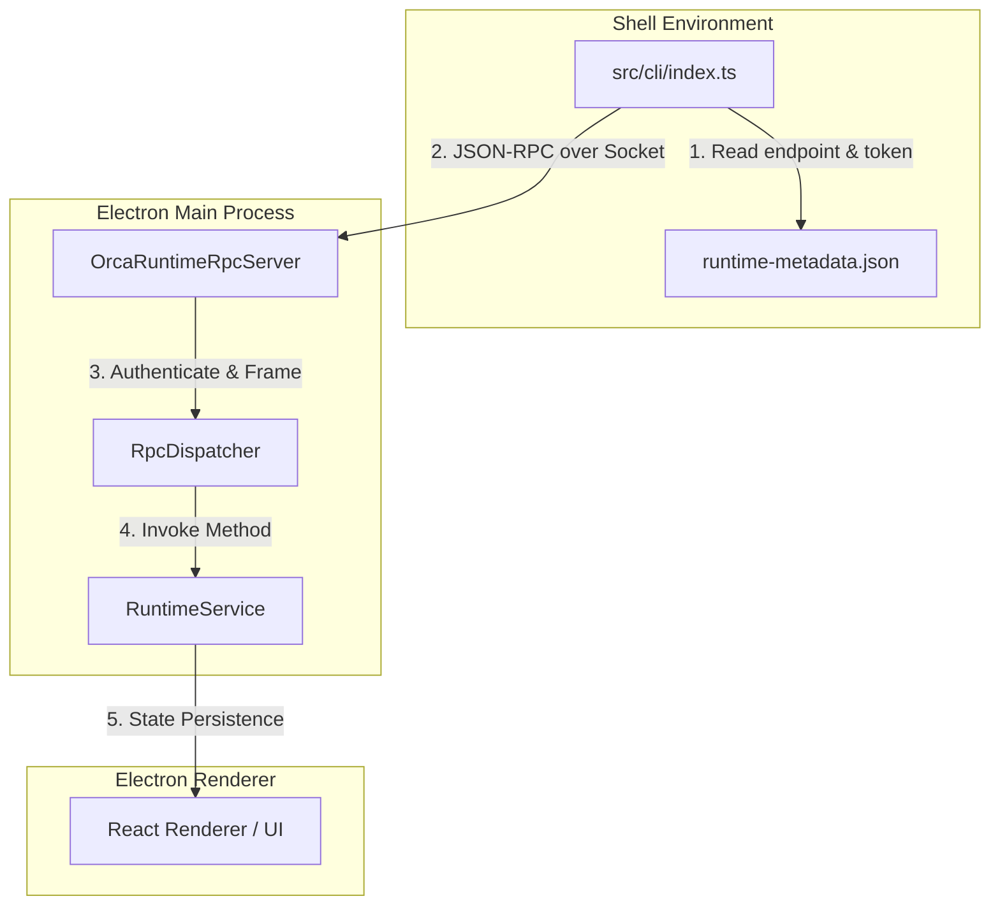
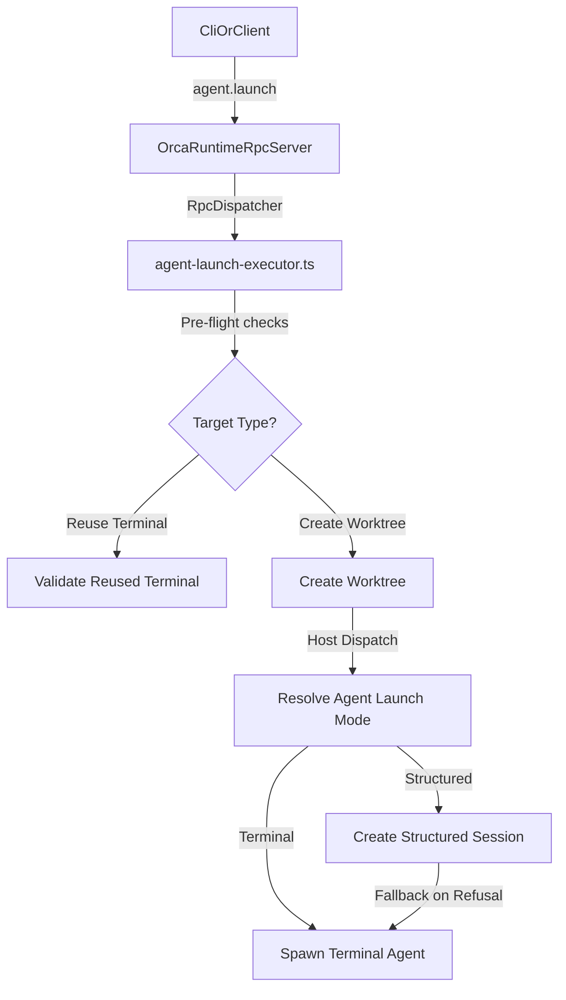
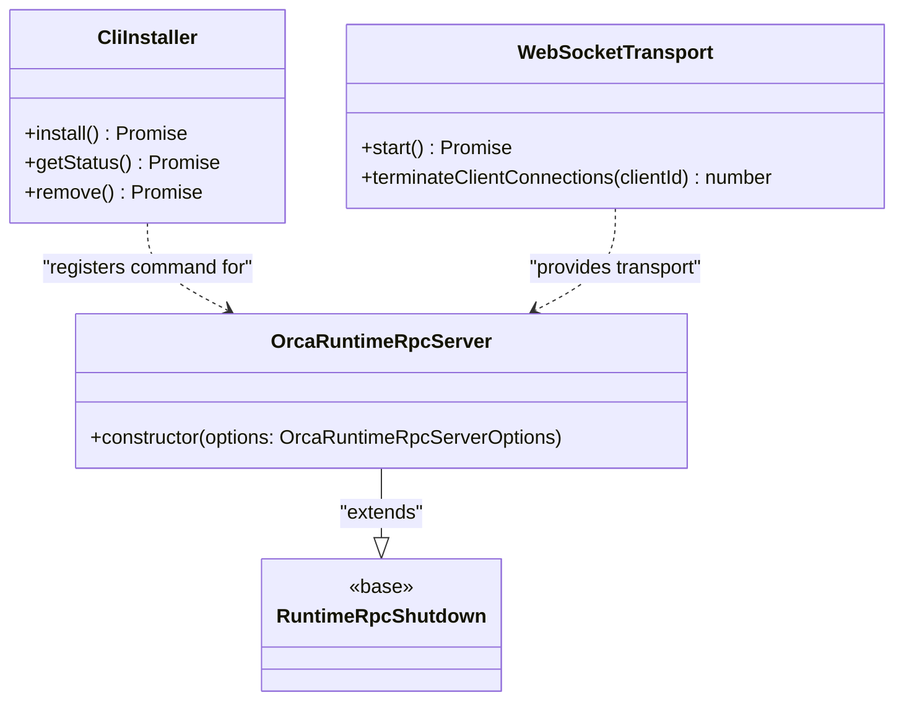

# CLI & Runtime RPC

The Orca CLI and Runtime RPC system provide a live control plane that allows external tools and AI agents to orchestrate the IDE. This architecture bridges the gap between the local shell environment and the running Electron application, enabling programmatic management of worktrees, repositories, terminal sessions, and the integrated browser.

## System Architecture & Purpose

The system operates across three distinct layers to expose a unified control surface:
1. **Orca CLI (`orca`)**: A Node.js-based command-line interface that discovers running instances and dispatches JSON-RPC requests [src/cli/index.ts:108-113]().
2. **Runtime RPC Server (`OrcaRuntimeRpcServer`)**: A socket-based server hosted in the Electron main process that authenticates and routes requests [src/main/runtime/runtime-rpc.ts:13-17]().
3. **Runtime & Terminal Methods**: Authoritative handlers (`TERMINAL_METHODS`, worktree managers) that execute actions against persistent storage and local processes [src/main/runtime/rpc/methods/terminal.ts:13-21]().

### Data Flow: CLI to IDE Runtime

**Sources:** [src/main/runtime/runtime-rpc.ts:1-17](), [src/cli/index.ts:108-113]()

---

## Orca CLI & Command Specifications

The `orca` CLI tool is the primary entry point for developers and AI coding agents. It supports machine-readable outputs via `--json` flags [src/cli/format.ts:71-76]().

### Binary Resolution and Environment Handling
Depending on the host platform and build mode, the CLI executable name resolves differently to avoid system conflicts:
- **Development builds**: Uses `orca-dev` [src/main/cli/cli-installer.test.ts:143-144]().
- **Linux packaged builds**: Uses `orca-ide` to avoid namespace collisions with the GNOME screen reader (`/usr/bin/orca`) [skills/orca-cli/SKILL.md:24-26]().
- **Standard packaged builds**: Uses `orca` [skills/orca-cli/SKILL.md:27]().

### Core Commands
Defined under `CORE_COMMAND_SPECS` [src/cli/specs/core.ts:8-140](), the CLI covers major orchestration areas:
- `open`: Launches Orca and waits for the runtime socket to become reachable [src/cli/specs/core.ts:10-15]().
- `status`: Reports readiness of the application, runtime, and graph [src/cli/specs/core.ts:18-23]().
- `repo`: Manages registered repositories (`list`, `add`, `show`, `set-base-ref`) [src/cli/specs/core.ts:37-65]().
- `worktree`: Controls worktree lifecycles, lineage paths, and agent spawning (`list`, `show`, `current`, `create`, `rm`) [src/cli/specs/core.ts:67-139]().

**Sources:** [src/cli/specs/core.ts:1-140](), [skills/orca-cli/SKILL.md:17-28](), [src/main/cli/cli-installer.test.ts:143-144]()

---

## Runtime RPC Transport & Security

Communication between external clients (CLI, mobile companions) and the Electron main process relies on structured socket endpoints managed by `OrcaRuntimeRpcServer` [src/main/runtime/runtime-rpc.ts:13-17]() and `WebSocketTransport` [src/main/runtime/rpc/ws-transport.ts:50-100]().

### Metadata Publication and Authentication
- **Metadata Files**: Upon boot, transport details (socket path or port, and `authToken`) are written via `createRuntimeTransportMetadata` to a secure user-data path [src/main/runtime/runtime-rpc/runtime-rpc-socket-metadata.ts:20-23]().
- **Socket Sweeping**: `sweepOrphanedRuntimeSockets` cleans up stale listener sockets left behind by unclean process exits [src/main/runtime/runtime-rpc/runtime-rpc-socket-metadata.ts:20-23]().
- **WebSocket Security**: Remote and paired mobile clients connect via authenticated WebSockets managed by `WebSocketTransport`, enforcing strict admission limits (`WEBSOCKET_TRANSPORT_MAX_CONNECTIONS`) and periodic heartbeat sweeps to prune half-open dead sessions [src/main/runtime/rpc/ws-transport.ts:18-28]().

**Sources:** [src/main/runtime/runtime-rpc.ts:1-23](), [src/main/runtime/runtime-rpc/runtime-rpc-socket-metadata.ts:1-23](), [src/main/runtime/rpc/ws-transport.ts:1-100]()

---

## RPC Dispatch and Terminal Methods

Methods exposed over the runtime RPC contract are assembled into distinct registries. For instance, terminal operations are organized via `TERMINAL_METHODS`, which aggregates query, send, lifecycle, multiplexing, subscription, and viewport strategies [src/main/runtime/rpc/methods/terminal.ts:13-21]().

### Agent Launch and Execution Flow

**Sources:** [src/main/runtime/runtime-rpc.ts:13-17](), [src/main/runtime/rpc/methods/terminal.ts:13-21]()

---

## CLI Installation & PATH Management

The `CliInstaller` class (inheriting from `CliPathRegistration`) handles platform-specific wrapper creation and shell PATH configuration [src/main/cli/cli-installer.ts:18-30]().

- **macOS & Linux Symlinks**: Creates lightweight shell wrappers or symlinks pointing back to the internal application launcher [src/main/cli/cli-installer.test.ts:60-121]().
- **AppImage Handling on Linux**: Automatically unpacks and extracts AppImage squashfs payloads via `ensureAppImageExtractedRoot` to guarantee reliable CLI execution independent of FUSE mount state [src/main/cli/appimage-extracted-root.ts:139-168](), alongside `installLinuxBareOrcaDispatcher` for managed terminal PATH bridging [src/main/cli/linux-bare-orca-dispatcher.ts:59-80]().
- **Windows User PATH**: Manages user-level environment wrappers (`orca.exe`) inside `%LOCALAPPDATA%` without requiring administrator privileges [src/main/cli/cli-installer.ts:140-151]().

**Sources:** [src/main/cli/cli-installer.ts:18-165](), [src/main/cli/cli-installer.test.ts:60-176](), [src/main/cli/appimage-extracted-root.ts:139-168](), [src/main/cli/linux-bare-orca-dispatcher.ts:59-80]()

---

## Entity Mapping

**Sources:** [src/main/runtime/runtime-rpc.ts:13-17](), [src/main/cli/cli-installer.ts:18-30](), [src/main/runtime/rpc/ws-transport.ts:50-100]()
