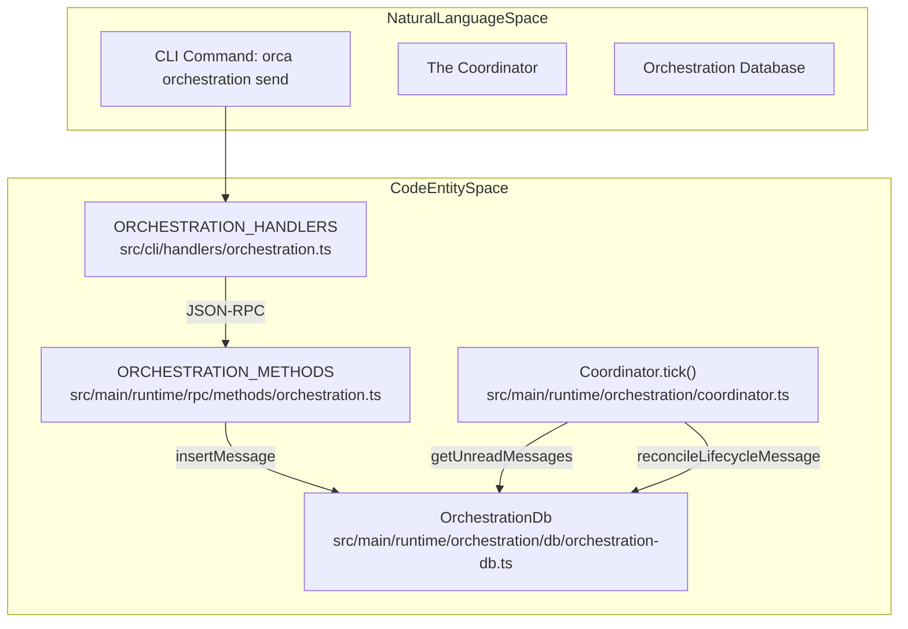
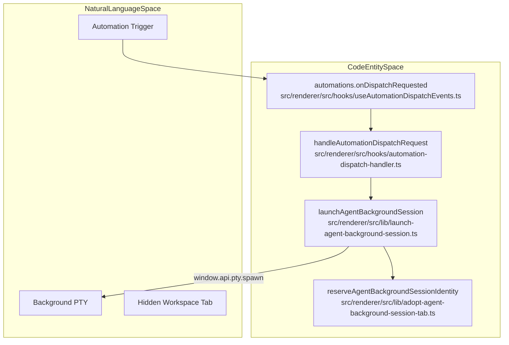

# Automations & Orchestration

This section covers the mechanisms Orca uses for headless task execution and multi-agent coordination. Orca distinguishes between **Automations** (scheduled or recurring headless workspace creation) and **Orchestration** (structured, multi-agent DAG dispatch and message-passing via `OrchestrationDb` and the `Coordinator`).

---

## 1. Automation System

The Automation system enables scheduled, headless execution of persistent or ad-hoc workflows in Orca, primarily for codebase maintenance, CI-like runs, or automated agent-driven audits.

### AutomationService & Dispatch Logic

Automations are triggered via the `AutomationService` which communicates with the renderer to handle workspace creation and agent launching. The renderer-side logic is managed by `handleAutomationDispatchRequest` [src/renderer/src/hooks/automation-dispatch-handler.ts](), which is registered via the `useAutomationDispatchEvents` hook [src/renderer/src/hooks/useAutomationDispatchEvents.ts:4-10]().

**Implementation & Data Flow:**
- **Triggering**: Automations can be triggered via the `automations.onDispatchRequested` IPC channel [src/renderer/src/hooks/useAutomationDispatchEvents.ts:6-6]().
- **Workspace Management**: The system can create new worktrees for a run or reuse existing ones. `automation-dispatch-workspace.ts` handles the `createWorktree` logic, while `automation-session-reuse.ts` attempts to find existing sessions [src/renderer/src/hooks/automation-dispatch-workspace.ts](), [src/renderer/src/lib/automation-session-reuse.ts]().
- **Agent Execution**: Headless sessions are launched using `launchAgentBackgroundSession`, which spawns a PTY and creates a hidden tab bound to that PTY [src/renderer/src/lib/launch-agent-background-session.ts:47-101]().
- **Persistence**: Automation runs and their outputs are tracked, with terminal snapshots captured via `createAutomationRunOutputSnapshotBuffer` [src/renderer/src/components/automations/automation-run-output-snapshot.ts]().

Sources: [src/renderer/src/hooks/useAutomationDispatchEvents.ts:4-10](), [src/renderer/src/lib/launch-agent-background-session.ts:47-101](), [src/renderer/src/components/automations/automation-run-output-snapshot.ts](), [src/renderer/src/hooks/automation-dispatch-handler.ts](), [src/renderer/src/hooks/automation-dispatch-workspace.ts](), [src/renderer/src/lib/automation-session-reuse.ts]()

### Automation Scheduling

Automations can be scheduled using cron expressions or RRULEs. The `AutomationService` evaluates due runs periodically [src/main/automations/service.ts:117-118]().

- **Cron Expressions**: Supported for custom schedules. The `classifyAutomationCronSchedule` function [src/shared/automation-schedules.ts:137-145]() parses and classifies cron strings into human-readable labels.
- **RRULEs**: Used for predefined schedules like hourly, daily, weekly, and weekdays. Functions like `buildAutomationRrule` and `parseAutomationRrule` [src/shared/automation-schedules.test.ts:8-12]() handle their creation and parsing.
- **Occurrence Calculation**: `latestAutomationOccurrenceAtOrBefore` and `nextAutomationOccurrenceAfter` [src/shared/automation-schedules.test.ts:10-11]() determine when an automation should run.

**Example Schedule Classification:**

| Schedule Expression        | `kind`     | `label` (example)         |
| :------------------------- | :--------- | :------------------------ |
| `15 * * * *`               | `hourly`   | `Hourly at :15`           |
| `15 9 * * *`               | `daily`    | `Daily at 9:15 AM`        |
| `15 9 * * 1-5`             | `weekdays` | `Weekdays at 9:15 AM`     |
| `15 9 * * 0`               | `weekly`   | `Sundays at 9:15 AM`      |
| `0 0 1 * *`                | `custom`   | `Custom schedule`         |
| `invalid-cron`             | `invalid`  | `Invalid schedule`        |

Sources: [src/main/automations/service.ts:117-118](), [src/shared/automation-schedules.ts:137-145](), [src/shared/automation-schedules.test.ts:8-12]()

### Automations vs. Full Handoffs

| Aspect | Automations | Full Handoffs |
| :--- | :--- | :--- |
| Managed by | `AutomationService` (headless runs) | User-triggered CLI e.g. `orca worktree create --agent` |
| Execution model | Scheduled or manual headless runs | Interactive with UI-attached agent terminal |
| Lifecycle tracking | `AutomationRun` entities with history | Immediate ownership transfer; agent owns terminal |
| Typical use case | Recurring maintenance, audits, automated tests | Explicit task delegation or agent role switching |

Sources: [src/renderer/src/hooks/useAutomationDispatchEvents.ts:4-10](), [src/renderer/src/lib/launch-agent-background-session.ts:47-101](), [src/renderer/src/hooks/automation-dispatch-handler.ts]()

---

## 2. Orchestration Coordinator & Database

Orchestration manages multi-agent workflows, message passing, and task dependency graphs (DAG) to enable structured coordination via `OrchestrationDb` [src/main/runtime/orchestration/db.ts:1-60]() and the `Coordinator` execution loop [src/main/runtime/orchestration/coordinator.ts:38-66]().

### Core Components

| Entity | Role | Code Reference |
| :--- | :--- | :--- |
| **OrchestrationDb** | SQLite database managing messages, tasks, dispatches, and runs | [src/main/runtime/orchestration/db.ts:1-60]() |
| **Coordinator** | Class that executes the tick loop, dispatches tasks, and monitors convergence | [src/main/runtime/orchestration/coordinator.ts:38-66]() |
| **Task** | Unit of work with states: `pending`, `ready`, `dispatched`, `completed`, `failed`, `blocked` | [src/main/runtime/orchestration/db.ts:35]() |
| **DispatchContext** | Maps a `Task` to a specific `assignee_handle` (terminal) | [src/main/runtime/orchestration/db.ts:41]() |

Sources: [src/main/runtime/orchestration/db.ts:1-60](), [src/main/runtime/orchestration/coordinator.ts:38-66]()

### Task Lifecycle & Reconciliation

The `Coordinator` class [src/main/runtime/orchestration/coordinator.ts:38-66]() manages the execution loop:
1.  **Decomposition**: Identifies tasks in the DAG [src/main/runtime/orchestration/coordinator.ts:147-157]().
2.  **Ticking**: Processes messages, escalations, and decision gates [src/main/runtime/orchestration/coordinator.ts:159-166]().
3.  **Dispatching**: Assigns `ready` tasks to available worker terminals via `dispatchTaskToWorker` [src/main/runtime/orchestration/coordinator-task-dispatch.ts]() and constructs worker preambles via `buildDispatchPreamble` [src/main/runtime/orchestration/preamble.ts:51-124]().
4.  **Reconciliation**: `reconcileLifecycleMessage` updates task status (e.g., to `completed` or `failed`) based on `worker_done` or `heartbeat` signals [src/main/runtime/orchestration/lifecycle-reconciliation.ts]().

Sources: [src/main/runtime/orchestration/coordinator.ts:38-166](), [src/main/runtime/orchestration/preamble.ts:51-124](), [src/main/runtime/orchestration/lifecycle-reconciliation.ts]()

### Inter-Agent Messaging & RPC

The `ORCHESTRATION_METHODS` RPC module defines the communication protocol [src/main/runtime/rpc/methods/orchestration.ts:14-27]():

-   **`orchestration.send`**: Routes messages between agents. It enforces that lifecycle signals like `worker_done` cannot target group addresses (e.g., `@all`) because they must belong to one exact dispatch [src/cli/specs/orchestration.ts:76-79]().
-   **`orchestration.check`**: Allows terminals to poll or wait for messages. The `--wait` flag blocks until a message arrives or a timeout occurs [src/cli/specs/orchestration.ts:91-97]().
-   **`orchestration.taskCreate`**: Adds a task to the `OrchestrationDb` with optional dependencies (`deps`).

Sources: [src/main/runtime/rpc/methods/orchestration.ts:14-27](), [src/cli/specs/orchestration.ts:76-121]()

---

## 3. System Mapping: Natural Language to Code

### Diagram: Orchestration Data Flow

Sources: [src/cli/handlers/orchestration.ts:19-34](), [src/main/runtime/rpc/methods/orchestration.ts:14-27](), [src/main/runtime/orchestration/coordinator.ts:159-166](), [src/main/runtime/orchestration/db.ts:1]()

### Diagram: Automation Launch Sequence

Sources: [src/renderer/src/hooks/useAutomationDispatchEvents.ts:4-10](), [src/renderer/src/lib/launch-agent-background-session.ts:47-101](), [src/renderer/src/lib/adopt-agent-background-session-tab.ts]()

---

## 4. Orchestration CLI Commands

The CLI handlers in `src/cli/handlers/orchestration.ts` map flags to the RPC methods defined in `src/main/runtime/rpc/methods/orchestration.ts`.

| Command Group | Command | Purpose |
| :--- | :--- | :--- |
| **Runs** | `run-create` | Initialize a new `CoordinatorRun` [src/cli/specs/orchestration.ts:6-16]() |
| | `run-use` | Bind a terminal to an existing run [src/cli/specs/orchestration.ts:18-27]() |
| **Messages** | `send` | Send inter-agent mail (supports `--task-id`, `--outcome`) [src/cli/specs/orchestration.ts:48-86]() |
| | `check` | Retrieve messages (supports `--wait`, `--ack`, `--peek`) [src/cli/specs/orchestration.ts:88-122]() |
| **Tasks** | `task-create` | Define a unit of work in the DAG [src/cli/specs/orchestration.ts]() |
| | `task-list` | View task statuses [src/cli/specs/orchestration.ts]() |
| **Workers** | `worker-start` | Spawn a supervised worker on a connected server or Run home [src/cli/specs/orchestration-worker-specs.ts:3-50]() |

**Structured Payloads:**
When using `orca orchestration send`, the CLI automatically serializes task-specific flags (like `--files-modified` or `--outcome`) into a JSON `payload` string before sending it to the RPC server [src/cli/handlers/orchestration.test.ts:69-106]().

Sources: [src/cli/handlers/orchestration.ts:19-34](), [src/cli/specs/orchestration.ts:5-135](), [src/cli/specs/orchestration-worker-specs.ts:3-50](), [src/cli/handlers/orchestration.test.ts:69-106](), [src/main/runtime/rpc/methods/orchestration.ts:14-27]()
