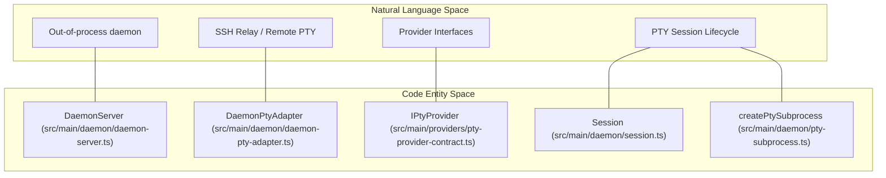
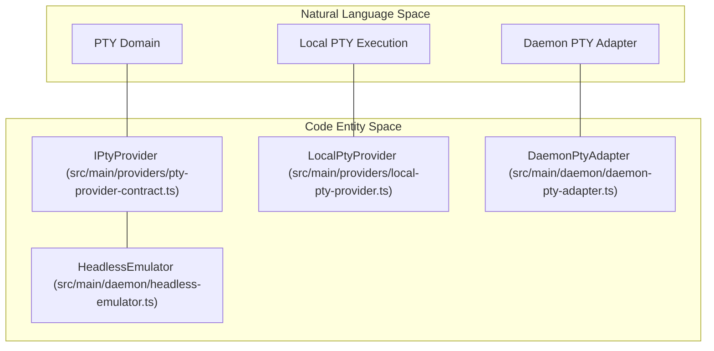
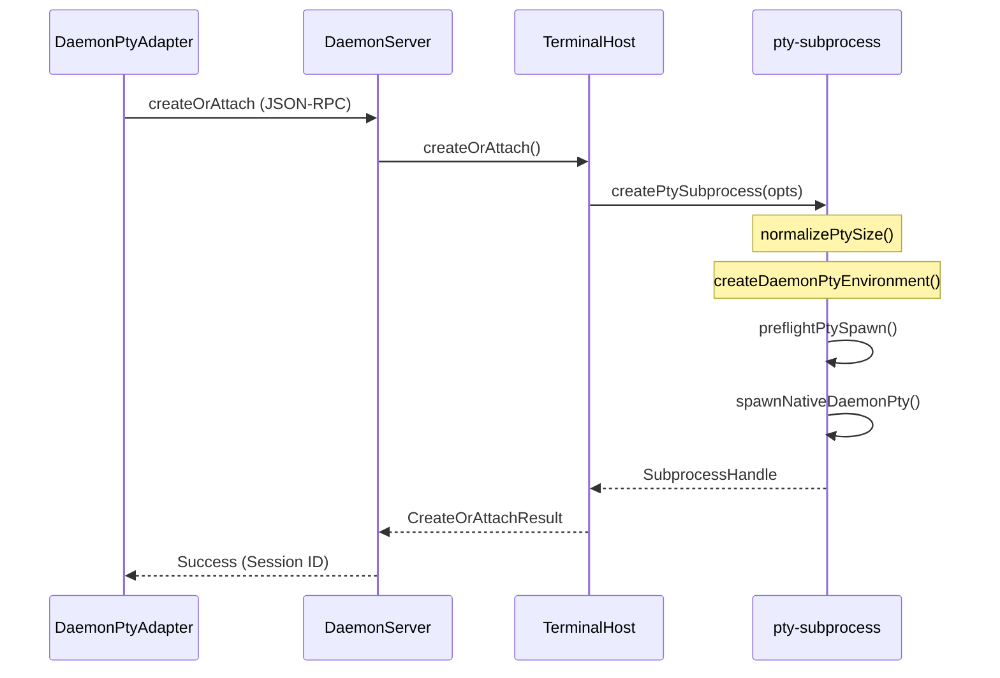

# Daemon, Relay, and Provider Abstractions

This page details the out-of-process daemon and relay architectural model in Orca, which underpins PTY (pseudo-terminal), filesystem, Git integration, and headless capabilities. It covers the key provider interfaces, session management strategies, reliability gates, and the selection logic between local, SSH, and remote-runtime providers.

---

## Overview

Orca splits core OS-interfacing capabilities into long-lived out-of-process services called **daemons** (local) and **relays** (remote). These processes expose stable JSON-RPC/NDJSON endpoints for terminal management (PTYs), virtual filesystem access, and Git operations. This decoupling supports headless operation via `orcad`, smooth desktop/mobile UI integration, and reliable session persistence.

**Key components:**

- **Daemon (local)**: Electron main process or standalone invocation spawns and communicates with a long-lived local daemon process (`DaemonServer`) that handles PTY and filesystem/Git operations off the main thread [src/main/daemon/daemon-server.ts:32-73]().
- **Relay (remote)**: A lightweight daemon-like relay runs on remote machines accessed over SSH. It proxies similar PTY, FS, and Git abstractions over SSH exec/stderr/stdout multiplexing, exposing JSON-RPC [src/relay/pty-handler.ts:1-145]().
- **Providers**: Abstract interfaces implemented by different subsystems that encapsulate PTY (`IPtyProvider`), Git, and FS functionality [src/main/providers/local-pty-provider.ts:64-64](), [src/main/daemon/daemon-pty-adapter.ts:17-17]().
- **Session Management**: The system manages session lifecycles robustly through `TerminalHost` and `Session` to reconnect broken channels, track live terminals, and clean up stale sessions [src/main/daemon/terminal-host.ts:40-75](), [src/main/daemon/session.ts:24-97]().
- **Reliability Gates**: Critical lifecycle aspects are guarded by health probes such as `checkPtySpawnHealth` and recovery logic to ensure daemon survivability and recovery [src/main/daemon/pty-subprocess.ts:41-61]().

Sources: [src/main/daemon/daemon-server.ts:32-73](), [src/main/daemon/daemon-pty-adapter.ts:17-65](), [src/main/providers/local-pty-provider.ts:64-64](), [src/main/daemon/terminal-host.ts:40-75](), [src/main/daemon/session.ts:24-97](), [src/main/daemon/pty-subprocess.ts:41-61]()

---

## 1. Daemon and Relay Model

### 1.1 Daemon

The local daemon runs as a separate Node.js process (`daemon-entry.ts`) providing key capabilities asynchronously. It manages PTYs, filesystem, and Git/GitHub operations with the following features:

- **IPC Communication**: The daemon exposes a Unix domain socket (or a Windows named pipe) endpoint authenticated via a token file (`daemon-entry.ts`). Clients connect and communicate using a framed NDJSON protocol [src/main/daemon/daemon-server.ts:105-154](), [src/main/daemon/daemon-entry.ts:1-50]().
- **PTY Management**: The `TerminalHost` within the daemon manages `Session` objects that own the lifecycle of `node-pty` subprocesses [src/main/daemon/terminal-host.ts:40-75](), [src/main/daemon/session.ts:24-97]().
- **Headless Runtime (`orcad`)**: The runtime can be served without Electron via `orcad`, establishing identical RPC and PTY control semantics for headless or remote container deployments [src/main/orcad/orcad-entry.ts:1-70]().
- **Resilience**: The system includes health probes for both the macOS system resolver and PTY spawn health to detect "wedged" states [src/main/daemon/pty-subprocess.ts:41-61]().

Sources: [src/main/daemon/daemon-server.ts:105-154](), [src/main/daemon/daemon-entry.ts:1-50](), [src/main/daemon/terminal-host.ts:40-75](), [src/main/daemon/session.ts:24-97](), [src/main/orcad/orcad-entry.ts:1-70](), [src/main/daemon/pty-subprocess.ts:41-61]()

### 1.2 Relay

The relay runs as a remote JSON-RPC server over SSH exec channels, allowing consistent APIs for remote terminal access:

- **PTY Adapter & Handlers**: The `DaemonPtyAdapter` tracks PTY incarnation IDs, initial working directories, and buffers output to handle reconnection without data loss [src/main/daemon/daemon-pty-adapter.ts:17-65]().
- **Flow Control**: Implements producer-side flow control (`pauseProducer`/`resumeProducer`) to prevent remote PTYs from flooding the SSH transport [src/main/daemon/types.ts:138-156](), [src/main/daemon/session.ts:170-173]().
- **Replay & Recovery**: Supports recovery protocols to allow a client to resume a session by specifying the last accepted state or incarnation identity [src/main/daemon/daemon-pty-adapter.ts:126-164]().

Sources: [src/main/daemon/daemon-pty-adapter.ts:17-164](), [src/main/daemon/types.ts:138-156](), [src/main/daemon/session.ts:170-173]()

---

## 2. Provider Selection and Mapping

### Natural Language to Code Entity Mapping (Subsystem Architecture)

This diagram associates high-level system concepts with the specific classes and files that implement them.

Sources: [src/main/daemon/daemon-server.ts:32-48](), [src/main/daemon/daemon-pty-adapter.ts:17-65](), [src/main/daemon/session.ts:24-97](), [src/main/daemon/pty-subprocess.ts:70-116]()

### Natural Language to Code Entity Mapping (Domain Abstractions)

This diagram links provider abstractions to their respective interface contracts.

Sources: [src/main/providers/local-pty-provider.ts:64-64](), [src/main/daemon/daemon-pty-adapter.ts:17-17](), [src/main/daemon/headless-emulator.ts:63-63]()

### Provider Selection Logic

Orca dynamically selects the appropriate implementation of the domain interfaces based on the target environment.

| Context | Selected Provider | Description |
| :--- | :--- | :--- |
| **Local (Direct)** | `LocalPtyProvider` | Uses `node-pty` directly in the local process space [src/main/providers/local-pty-provider.ts:64-83](). |
| **Local (Daemon)** | `DaemonPtyAdapter` | Proxies requests to the out-of-process `DaemonServer` via NDJSON socket transport [src/main/daemon/daemon-pty-adapter.ts:17-65](). |
| **Remote (SSH / Runtime)** | `DaemonPtyAdapter` / Relay | Manages PTYs and runtime operations on a remote host over SSH or runtime RPC [src/main/daemon/daemon-pty-adapter.ts:17-17](), [src/main/orcad/orcad-entry.ts:1-70](). |

Sources: [src/main/providers/local-pty-provider.ts:64-83](), [src/main/daemon/daemon-pty-adapter.ts:17-65](), [src/main/orcad/orcad-entry.ts:1-70]()

---

## 3. PTY Subprocess Lifecycle and Headless Emulator

The creation of a PTY involves environment normalization, shell launch planning, and health preflights.

Sources: [src/main/daemon/pty-subprocess.ts:70-116](), [src/main/daemon/terminal-host.ts:69-126](), [src/main/daemon/daemon-server.ts:32-158](), [src/main/daemon/daemon-pty-adapter.ts:17-65]()

### Key Functions in Spawn and Emulation Flow
- `createDaemonPtyEnvironment`: Prepares the environment object, including specialized Orca variables [src/main/daemon/pty-subprocess.ts:72-72]().
- `preflightPtySpawn`: Validates the working directory and checks for cancellation before the native spawn occurs [src/main/daemon/pty-subprocess.ts:75-80]().
- `spawnNativeDaemonPty`: The platform-specific call to `node-pty.spawn` [src/main/daemon/pty-subprocess.ts:87-96]().
- `HeadlessEmulator`: Wraps `@xterm/headless` and serialize addons on the daemon side to maintain session snapshots, cursor attributes, and replay states without a GUI renderer [src/main/daemon/headless-emulator.ts:63-109]().

Sources: [src/main/daemon/pty-subprocess.ts:70-116](), [src/main/daemon/headless-emulator.ts:63-109]()

---

## 4. Reliability, Session Recovery, and Health Monitoring

### 4.1 Health Monitoring
The daemon periodically runs `checkPtySpawnHealth` which executes a probe to ensure the native PTY system is still capable of spawning new processes, allowing for retries before throwing a terminal error [src/main/daemon/pty-subprocess.ts:41-61](). Additionally, adapters query async IO health via `getAsyncIoHealth` [src/main/daemon/daemon-pty-adapter.ts:18-42]().

Sources: [src/main/daemon/pty-subprocess.ts:41-61](), [src/main/daemon/daemon-pty-adapter.ts:18-42]()

### 4.2 Session Continuity
The `TerminalHost` class in the daemon acts as the coordinator for terminal instances, handling lifecycle management, command execution, and reaps [src/main/daemon/terminal-host.ts:40-75]().
- **Output Pipeline & Batching**: Buffers and batches data to the client efficiently via `DaemonStreamDataBatcher` [src/main/daemon/daemon-server.ts:38-109]().
- **Session Controller**: Manages state transitions (`created`, `spawning`, `running`, `exiting`, `exited`) and handles cleanup via `Session` [src/main/daemon/session.ts:24-97]().
- **Startup Ingress**: Manages authority over the PTY during the initial shell prompt sequence [src/main/daemon/daemon-pty-adapter.ts:117-127]().

Sources: [src/main/daemon/terminal-host.ts:40-75](), [src/main/daemon/daemon-server.ts:38-109](), [src/main/daemon/session.ts:24-97](), [src/main/daemon/daemon-pty-adapter.ts:117-127]()

### 4.3 Flow Control
To prevent overwhelming the transport layer, Orca implements `pauseProducer` and `resumeProducer`. When paused, the daemon stops reading from the PTY file descriptor, causing the child process to block once its own output buffers are full [src/main/daemon/types.ts:138-156](), [src/main/daemon/session.ts:170-173]().

Sources: [src/main/daemon/types.ts:138-156](), [src/main/daemon/session.ts:170-173]()

---

## 5. Implementation Summary

| Interface / Class | File Path | Key Role |
| :--- | :--- | :--- |
| `IPtyProvider` | `src/main/providers/pty-provider-contract.ts` | The core aggregate contract for all PTY implementations [src/main/providers/local-pty-provider.ts:64-64]() |
| `LocalPtyProvider` | `src/main/providers/local-pty-provider.ts` | Main-process direct implementation using local `node-pty` [src/main/providers/local-pty-provider.ts:64-83]() |
| `DaemonPtyAdapter` | `src/main/daemon/daemon-pty-adapter.ts` | Client-side adapter connecting to the local daemon or remote relay [src/main/daemon/daemon-pty-adapter.ts:17-65]() |
| `DaemonServer` | `src/main/daemon/daemon-server.ts` | The JSON-RPC/NDJSON server for the local daemon process [src/main/daemon/daemon-server.ts:32-73]() |
| `TerminalHost` | `src/main/daemon/terminal-host.ts` | Manages PTY sessions, attachments, and tombstones in daemon [src/main/daemon/terminal-host.ts:40-75]() |
| `Session` | `src/main/daemon/session.ts` | Owns terminal process execution state, pipelines, and readiness [src/main/daemon/session.ts:24-97]() |
| `HeadlessEmulator` | `src/main/daemon/headless-emulator.ts` | Headless terminal model using `@xterm/headless` for state tracking [src/main/daemon/headless-emulator.ts:63-109]() |
| `createPtySubprocess` | `src/main/daemon/pty-subprocess.ts` | Logic for spawning native PTY processes with preflight checks [src/main/daemon/pty-subprocess.ts:70-116]() |

Sources: [src/main/providers/local-pty-provider.ts:64-83](), [src/main/daemon/daemon-pty-adapter.ts:17-65](), [src/main/daemon/daemon-server.ts:32-73](), [src/main/daemon/terminal-host.ts:40-75](), [src/main/daemon/session.ts:24-97](), [src/main/daemon/headless-emulator.ts:63-109](), [src/main/daemon/pty-subprocess.ts:70-116]()
