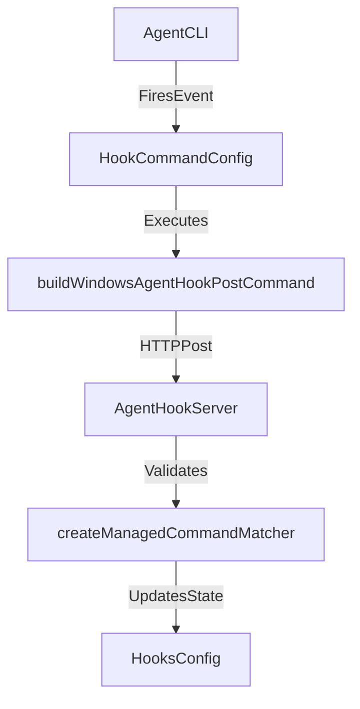
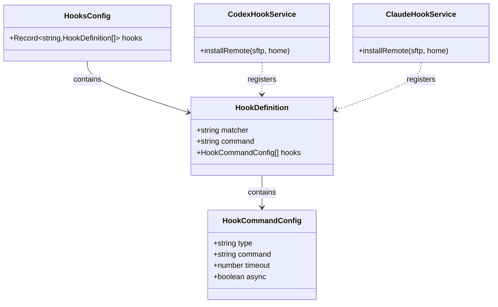

# Plugin System

This document provides a detailed technical overview of the Orca plugin and agent hook architecture. It covers the plugin manifest format, capability gating mechanisms, the plugin worker process lifecycle, panel sandboxing strategies, marketplace installation and trust pipelines, the internal event bus, and the host API surface. Additionally, it references sample plugins and hook implementations used as reference implementations and security fixtures.

---

## 1. Plugin Manifest Format

Plugins and agent integrations in Orca declare their metadata, hooks, and requirements in configuration manifests (`HooksConfig`, `HookDefinition`, and `HookCommandConfig`). This manifest serves as the authoritative declaration of what an extension or hook can execute:

*   **Identity & Structure**: Mappings of events to structured hook definitions (`HooksConfig` records event labels to arrays of `HookDefinition`) [src/main/agent-hooks/installer-utils.ts:43-46]().
*   **Entry Points & Commands**: Direct command strings, bash scripts, PowerShell commands, or nested command arrays (`HookCommandConfig`) specifying execution timeouts and behaviors [src/main/agent-hooks/installer-utils.ts:24-42]().
*   **Capability Gates**: Requested permissions embedded in command runner configurations and timeout parameters (`MANAGED_HOOK_TIMEOUT_SECONDS`) [src/main/agent-hooks/installer-utils.ts:48-51]().

Sources: [src/main/agent-hooks/installer-utils.ts:24-46](), [src/main/agent-hooks/installer-utils.ts:48-51]()

---

## 2. Capability Gates and Security Model

Orca enforces strict access control on plugin and hook functionality through **capability gates** and trust boundaries:

*   **Command Matcher Validation**: The function `createManagedCommandMatcher(scriptFileName: string)` builds matchers to verify that registered hooks correspond to authorized managed scripts, sweeping stale entries across platforms [src/main/agent-hooks/installer-utils.ts:73-98]().
*   **Sanitized Configuration Writes**: Configuration writes pass through atomic and validated serializers (`writeHooksJson`) that preserve symbolic links, prevent backup target hijacking, and enforce JSON formatting [src/main/agent-hooks/installer-utils.ts:100-195]().
*   **Trust Boundaries**: For remote and SSH-backed agent hooks, configuration entries (such as Codex `config.toml` hook trust approvals) are normalized and filtered to prevent host-level code execution escapes [src/main/codex/config-toml-trust.ts:116-168]().

Sources: [src/main/agent-hooks/installer-utils.ts:73-98](), [src/main/agent-hooks/installer-utils.ts:100-195](), [src/main/codex/config-toml-trust.ts:116-168]()

---

## 3. Worker Process Lifecycle

Plugin and hook workers follow a tightly regulated lifecycle managed by the main process:

1.  **Discovery & Read**: The host reads hook manifests and raw JSON configurations using `readHooksJsonWithRaw` [src/main/agent-hooks/installer-utils.test.ts:52-96]() and `readHooksJson` [src/main/agent-hooks/installer-utils.ts:67]().
2.  **Spawning & Script Writing**: Managed scripts are written to shared runtime directories (`getSharedManagedScriptPath`) to ensure parallel or dev/prod instances write unified entries [src/main/agent-hooks/installer-utils.ts:112-115]().
3.  **Execution & Timeouts**: Commands run with constrained timeouts (`MANAGED_HOOK_TIMEOUT_SECONDS`) and pipe communication via `curl` or native wrappers [src/main/agent-hooks/installer-utils.ts:48-58](), [src/main/agent-hooks/installer-utils.ts:135-174]().
4.  **Teardown**: Stale hooks and orphaned command lines are removed via `removeManagedCommands` during application shutdown or reinstall cycles [src/main/agent-hooks/installer-utils.ts:176-181]().

Sources: [src/main/agent-hooks/installer-utils.ts:48-58](), [src/main/agent-hooks/installer-utils.ts:112-115](), [src/main/agent-hooks/installer-utils.ts:135-174](), [src/main/agent-hooks/installer-utils.ts:176-181](), [src/main/agent-hooks/installer-utils.test.ts:52-96]()

---

## 4. Panel Sandboxing

Plugin UI panels and overlays render within isolated execution contexts:

*   **Context Isolation**: Panels interact with the core application exclusively through the preload context bridge (`window.api`), preventing direct access to Node.js primitives or arbitrary host files.
*   **Safe Path Resolution**: Windows and POSIX path safety checks (`isSafeUnicodeWindowsBatchHookPath`, `WINDOWS_CMD_SAFE_PATH`) ensure that script execution paths do not contain command injection characters or unsafe environment overrides [src/main/agent-hooks/installer-utils.ts:125-129]().

Sources: [src/main/agent-hooks/installer-utils.ts:125-129](), [src/main/window/attach-main-window-services.ts:50-143]()

---

## 5. Event Bus and Hook System

The **Agent Hook System** acts as the primary event bus for AI-related plugins, managing bi-directional communication between CLI agents (Claude, Codex, Grok, etc.) and the Orca UI.

### Data Flow: Hook Execution to Host Ingestion
1.  **Trigger**: An AI agent executes a lifecycle event (e.g., `Stop`, `PreToolUse`), invoking the managed wrapper script [src/main/agent-hooks/installer-utils.test.ts:124-126]().
2.  **Payload Dispatch**: The wrapper dispatches an HTTP POST request to the local agent hook server endpoint containing environment tokens and worktree metadata [src/main/agent-hooks/installer-utils.ts:135-174]().
3.  **Normalization & Routing**: The main process hook services (`CodexHookService`, `ClaudeHookService`, etc.) ingest the payload, validate token authentication, and update application state [src/main/codex/hook-service.ts:1-28](), [src/main/claude/hook-service.ts:28-31]().

### Diagram: Hook Event Pipeline to Code Entities

Sources:
- [src/main/agent-hooks/installer-utils.ts:24-32]()
- [src/main/agent-hooks/installer-utils.ts:73-98]()
- [src/main/agent-hooks/installer-utils.ts:135-174]()
- [src/main/codex/hook-service.ts:1-28]()
- [src/main/claude/hook-service.ts:28-31]()

---

## 6. Host API Surface

Plugins interact with core Orca capabilities through specialized host services exposed via main process controllers and IPC modules.

| Service Module | Responsibility | Code Reference |
| :--- | :--- | :--- |
| **Agent Hook Services** | Managing lifecycle hooks for Claude, Codex, Grok, and other LLM runtimes. | [src/main/codex/hook-service.ts:1-28](), [src/main/claude/hook-service.ts:28-31]() |
| **Installer Utilities** | Writing and auditing `hooks.json` configurations and secure script wrappers. | [src/main/agent-hooks/installer-utils.ts:24-46]() |
| **Config Trust Manager** | Validating and upserting TOML trust entries for agent configurations. | [src/main/codex/config-toml-trust.ts:116-168]() |
| **Main Window Services** | Attaching IPC handlers and window lifecycle listeners. | [src/main/window/attach-main-window-services.ts:50-74]() |

Sources: [src/main/codex/hook-service.ts:1-28](), [src/main/claude/hook-service.ts:28-31](), [src/main/agent-hooks/installer-utils.ts:24-46](), [src/main/codex/config-toml-trust.ts:116-168](), [src/main/window/attach-main-window-services.ts:50-74]()

---

## 7. Reference Implementations and Test Fixtures

Orca maintains rigorous test suites and reference implementations that validate plugin and hook compliance:

*   **Installer Unit Tests**: `src/main/agent-hooks/installer-utils.test.ts` exercises JSON configuration reading, BOM parsing, backup file creation (`.bak`), and symlink protection [src/main/agent-hooks/installer-utils.test.ts:52-195]().
*   **Hook Lifecycle Tests**: `src/main/claude/hook-service.test.ts` verifies remote and local hook registration accuracy, command escaping, and safe path resolution [src/main/claude/hook-service.test.ts:49-100]().
*   **Config Trust Test Suites**: `src/main/codex-accounts/service.test.ts` ensures secure synchronization of canonical configurations into managed account homes without leaking host hook trust grants [src/main/codex-accounts/service.test.ts:38-130]().

### Diagram: Plugin and Hook Service Classes

Sources:
- [src/main/agent-hooks/installer-utils.ts:24-46]()
- [src/main/codex/hook-service.ts:1-19]()
- [src/main/claude/hook-service.ts:28-31]()
- [src/main/agent-hooks/installer-utils.test.ts:52-195]()
- [src/main/claude/hook-service.test.ts:49-100]()
