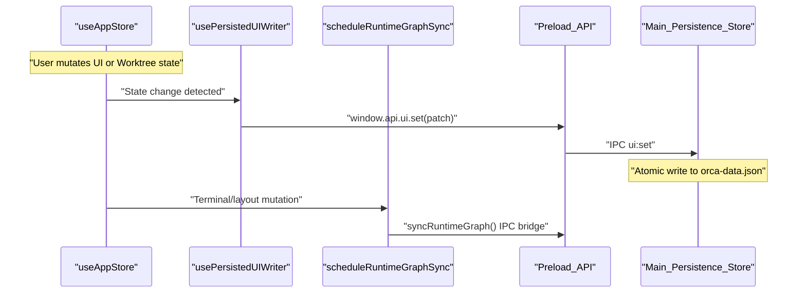

# Renderer Process & State Management

The Renderer process is a React-based single-page application (SPA) that serves as the primary user interface for Orca. It manages a broad and complex state, including persistent user settings, ephemeral UI aspects such as sidebar widths, and deeply nested session data like terminal layouts, editor tabs, and browser sessions.

To facilitate reactivity and performance, the Renderer uses **Zustand** as a centralized state container [src/renderer/src/store/index.ts:78-137](). It also maintains a robust IPC synchronization loop to ensure that state changes made in the Renderer are durably persisted to disk by the Main process and synchronized across connected clients.

Sources: [src/renderer/src/store/index.ts:78-137]()

---

## App Shell & Layout

The root of the Renderer UI begins by mounting the top-level `App` component. This component orchestrates the main user interface structure and dynamically controls the rendering and visibility of core UI regions based on application state.

The primary regions of the app shell are:

- **Sidebar**: Provides navigation for repositories and worktrees.
- **Terminal/Editor Area**: A unified tab system hosting PTY terminals, Monaco editors, and integrated browser workspace panels.
- **Right Sidebar**: Contains utility panels such as File Explorer, Search, Source Control, Checks, and Workspace Ports.
- **Landing & Settings**: Specialized views shown when no worktree is selected or for user configuration.

The layout adapts dynamically using specialized hooks and store subscriptions. Styling extensively leverages CSS variables for flexible theming and platform adaptation, particularly for handling window controls on different OSs.

### App Shell to Code Entity Mapping

```mermaid
graph TD
    subgraph "React Renderer ("src/renderer/src/App.tsx")"
        App["App"] --> AppWorkspaceShell["AppWorkspaceShell"]
        App --> AppRootSurfaces["AppRootSurfaces"]
        App --> AppBackgroundServices["AppBackgroundServices"]

        App -- "useAppStartupHydration" --> Hydrate["Hydration Logic"]
        App -- "useRuntimeGraphSync" --> Sync["Runtime Graph Sync"]
    end

    subgraph "Zustand Store ("src/renderer/src/store/index.ts")"
        useAppStore["useAppStore"] --> createRepoSlice["createRepoSlice"]
        useAppStore --> createWorktreeSlice["createWorktreeSlice"]
        useAppStore --> createTerminalSlice["createTerminalSlice"]
        useAppStore --> createUISlice["createUISlice"]
    end

    App -.-> useAppStore
    AppWorkspaceShell -.-> useAppStore
```
Sources: [src/renderer/src/store/index.ts:78-137](), [src/renderer/src/store/slices/terminals.ts:26-91]()

---

## State Hydration, Persistence & IPC Sync Loop

On startup, the Renderer populates its Zustand store using coordinated hydration steps to restore critical state components. 

1. **Core Domain Hydration**: Repository and worktree metadata are asynchronously fetched from the Main process via IPC, ensuring the Renderer loads the latest persisted data.
2. **UI State Restoration**: Persistent UI preferences—such as sidebar dimensions, panel selections, and theme settings—are restored and validated.
3. **IPC & Runtime Graph Synchronization**: Renderer state changes are backed by debounced synchronization mechanisms. The UI writer hook ensures that updates to UI states are sent to the Main process `Store`, while the runtime graph loop coordinates terminal layout projections and mobile sync keys.

### IPC State Sync & Runtime Graph Flow


Sources: [src/renderer/src/store/index.ts:78-137](), [src/renderer/src/hooks/useIpcEvents.ts:5-7]()

---

## Global Keybindings & Focus Management

Responsiveness and accessibility are maintained through a structured system of hooks and event listeners:

- **IPC Event Subscriptions**: Installs the bridge for the application lifetime via `useIpcEvents` [src/renderer/src/hooks/useIpcEvents.ts:5-7]().
- **Global Keybindings**: Manages app-wide shortcuts while respecting focus context in terminals and editors.
- **Window Visibility**: Handles state adjustments when the application window gains or loses focus.
- **Appearance Sync**: Synchronizes light/dark mode and system fonts to the DOM.

Sources: [src/renderer/src/hooks/useIpcEvents.ts:5-7]()

---

## Child Pages

This page provides a high-level view of the Renderer process structure and state management. For in-tech depth, refer to the child pages:

- **[Zustand Store Architecture](#3.1)** — Slice composition across `AppState`, cross-slice cascades on deletion, session hydration/validation, selectors, runtime status slice.
- **[Worktree Lifecycle in the Renderer](#3.2)** — Worktree lifecycle: creation composer, switching context, metadata editing, deletion cascades, archiving, sleeping/resume, renderer↔main reconciliation.
- **[Internationalization & Localization](#3.3)** — i18n catalogs (en/zh/ko/ja/es/fr/pt), translate helper usage, locale key override scripts, localization coverage/mistranslation test gates.

Sources: [src/renderer/src/store/index.ts:78-137](), [src/renderer/src/store/slices/terminals.ts:26-91]()
