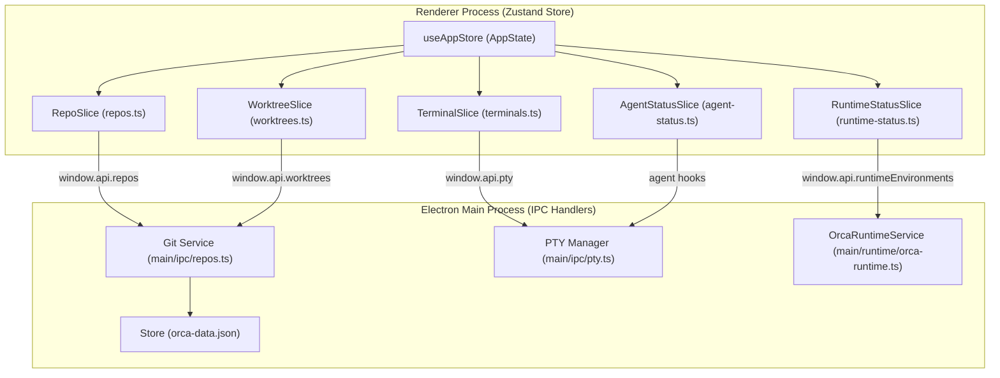
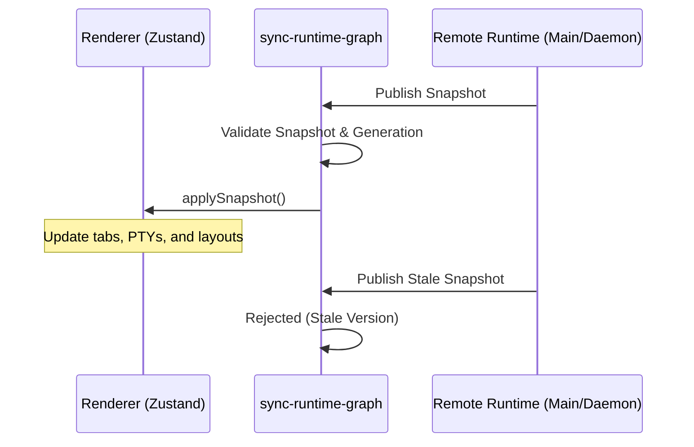
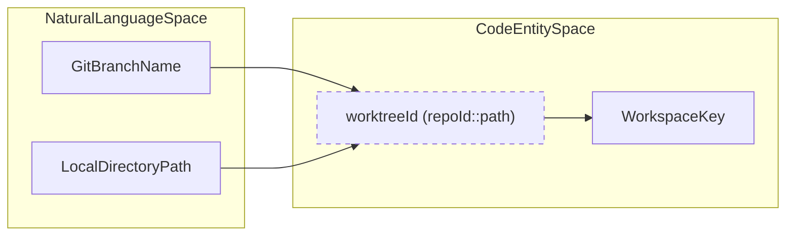
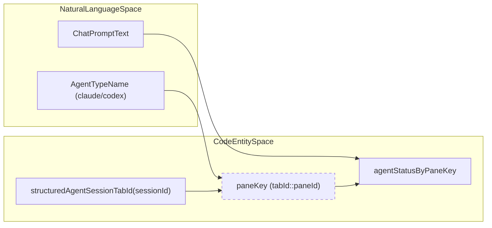
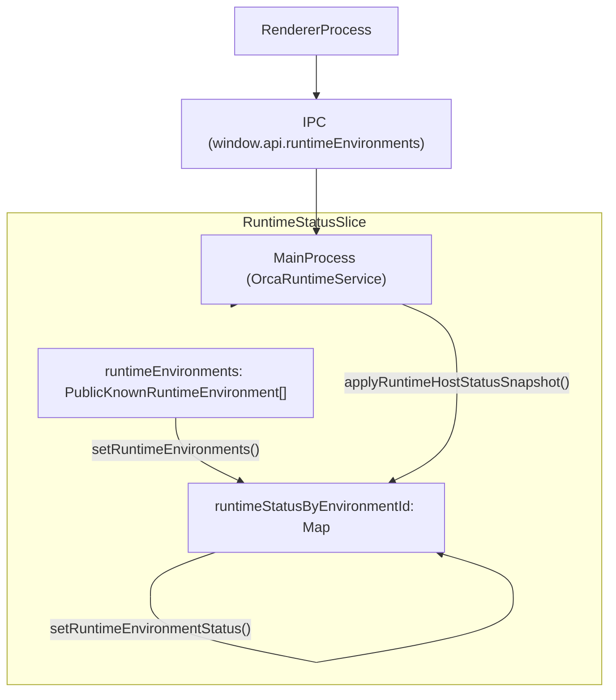

# Zustand Store Architecture

Orca leverages Zustand for efficient and modular state management in the renderer process. This architecture enables live UI state management with persistence and orchestration deferred to the main process services via IPC. The store serves as the canonical client-side UI state repository, synchronizing with Electron main process persistence.

## Purpose and Scope

This document specifies the architecture of the renderer-process Zustand store (`useAppStore`), detailing its slice composition, cross-slice cascade behaviors upon entity deletion, session hydration and remote runtime synchronization mechanisms, advanced selector patterns, and the runtime status slice.

---

## Slice Composition

The Zustand store employs a slice-based architecture where the complete application state (`AppState`) is the union of multiple domain-specific slices. Each slice defines a cohesive segment of state and related actions but merges into one global store accessed via the `useAppStore` hook [src/renderer/src/store/index.ts:78-137]().

### Key Store Slices and Their Responsibilities

| Slice | Responsibilities | Key Code Entities |
| :--- | :--- | :--- |
| **Repos** | Manages repository registrations, project groups, and folder workspaces. | `RepoSlice` [src/renderer/src/store/index.ts:86]() |
| **Worktrees** | Tracks Git worktrees lifecycle, metadata, lineage, and deletion state. | `WorktreeSlice` [src/renderer/src/store/index.ts:88]() |
| **Terminals** | Manages PTY sessions, tab navigation, layout serialization, and reconnection. | `TerminalSlice` [src/renderer/src/store/index.ts:89]() |
| **Agent Status** | Tracks real-time AI agent progress, TUI session resumes, and retained completions. | `AgentStatusSlice` [src/renderer/src/store/index.ts:112]() |
| **Runtime Status** | Monitors remote runtime environment connectivity and versioning. | `RuntimeStatusSlice` [src/renderer/src/store/slices/runtime-status.ts:43-51]() |

### Store Composition and IPC Interaction

The store acts as the coordinator between the UI and the Main Process services. Actions in the store often invoke IPC methods exposed via the `window.api` bridge.

Title: Store Composition and IPC Interaction
Sources: [src/renderer/src/store/index.ts:78-137](), [src/renderer/src/store/slices/runtime-status.ts:43-51]()

---

## Cross-Slice Cascades on Deletion

Maintaining consistency on entity removals requires coordinated cascades across multiple slices because of the hierarchical relationships: repositories own worktrees; worktrees own tabs and terminals.

### Worktree Removal Cascade
When a worktree is removed via `removeWorktree`, the store ensures that all ephemeral and persistent data associated with that worktree is purged [src/renderer/src/store/slices/worktrees.ts:76-112]().

1.  **PTY Session Termination:** The store triggers PTY kills for all tabs associated with the worktree.
2.  **State Purge:** The `removeProject` and `removeWorktree` logic clears tabs, PTY maps, and terminal layout trees.
3.  **Cleanup of One-Shot Guards:** Ephemeral flags and guards are deleted to prevent memory leaks.

### Repository Deletion Cascade
Removing a repository triggers a broad sweep:
- It clears the repository entry from the `repos` array.
- It removes all associated worktrees and their terminal/tab state.
- It resets the active repository state if the deleted repository was currently selected.

Sources: [src/renderer/src/store/slices/repos.ts:3-5](), [src/renderer/src/store/slices/worktrees.ts:76-112]()

---

## Session Hydration and Validation

Upon renderer startup, the store hydrates state from disk persistence. However, because the environment (files on disk, PTYs) may have changed while the app was closed, Orca performs validation during hydration.

### Web Session Syncing
For remote runtimes (e.g., SSH or Cloud), session synchronization utilities reconcile the local store with the remote host's authoritative state.

- **Snapshot Versioning:** The store uses versioning to ignore stale or duplicate updates from the runtime.
- **Orphan Recovery:** The system ensures that terminal tabs aren't lost during rapid reconnection cycles.
- **Agent Handoffs:** Structured agent sessions are projected as native unified tabs, ensuring AI progress is visible even if the specific PTY is in a transition state.

Title: Web Session Snapshot Reconciliation Sequence
Sources: [src/renderer/src/runtime/sync-runtime-graph.ts:1-36](), [src/renderer/src/store/slices/runtime-status.ts:53-60]()

---

## The Selectors Layer

Orca uses a selector pattern to derive complex UI state from raw slice data. This prevents redundant state and ensures the UI remains reactive to deep changes.

### Workspace & Worktree Lookups
The `WorktreeSlice` provides lookups to resolve worktrees across mapped structures.

- **`allWorktrees`**: Flattens the repository-grouped map into a single list for global search.
- **`getKnownWorktreeById`**: A fast lookup for worktree metadata.
- **`activeWorkspaceKey`**: Normalizes the currently focused context, whether it is a Git worktree or a standard folder workspace.

### Identity Normalization: Workspaces

Title: Workspace Identity Normalization: Natural Language to Code Entity Space
Sources: [src/renderer/src/store/slices/worktrees.ts:76-112]()

### Identity Normalization: Agent Sessions

Title: Agent Session Identity Resolution: Natural Language to Code Entity Space
Sources: [src/renderer/src/store/slices/agent-status.ts:1-10](), [src/renderer/src/store/slices/runtime-status.ts:43-51]()

---

## Runtime Status Slice

The `RuntimeStatusSlice` [src/renderer/src/store/slices/runtime-status.ts:43-51]() is responsible for managing the connection status and metadata of remote runtime environments. This includes tracking their availability, compatibility, and any associated connection generations.

-   **`runtimeEnvironments`**: An array of `PublicKnownRuntimeEnvironment` objects, representing all known remote environments [src/renderer/src/store/slices/runtime-status.ts:47]().
-   **`runtimeStatusByEnvironmentId`**: A map storing the `RuntimeEnvironmentStatus` for each environment, keyed by `environmentId` [src/renderer/src/store/slices/runtime-status.ts:50]().
-   **`setRuntimeEnvironments`**: This action updates the list of known runtime environments, handling diffing against previous states, removing statuses for environments that no longer exist, and advancing the `connectionGeneration` for environments that have been re-paired or replaced [src/renderer/src/store/slices/runtime-status.ts:62-137]().
-   **`setRuntimeEnvironmentStatus`**: Updates the status for a specific runtime environment, ensuring the `runtimeStatusByEnvironmentId` map reference updates to trigger UI reactivity [src/renderer/src/store/slices/runtime-status.test.ts:150-170]().
-   **`applyRuntimeHostStatusSnapshot`**: Processes incoming snapshots of runtime host status originating from the main process via IPC [src/renderer/src/store/slices/runtime-status.ts:53-60]().
-   **`connectionGeneration`**: A critical counter that advances when an environment's connection identity changes (e.g., re-pairing), invalidating cached session mirrors and ensuring fresh data subscriptions [src/renderer/src/store/slices/runtime-status.ts:87]().

Title: Runtime Status Slice Architecture and IPC Data Flow
Sources: [src/renderer/src/store/slices/runtime-status.ts:43-60](), [src/renderer/src/store/slices/runtime-status.ts:87](), [src/renderer/src/store/slices/runtime-status.test.ts:150-170]()

---

## Memory Management & Diagnostics

Because the Zustand store can grow significantly in long-running sessions, Orca includes built-in memory profiling and state tracking hooks [src/renderer/src/store/index.ts:59-66]().

- **Collection Size Summaries:** Registers contributors to track the size and entry counts of major state collections [src/renderer/src/store/index.ts:65]().
- **Byte Estimation:** Estimates memory footprints of store slices to identify heavy allocations [src/renderer/src/store/index.ts:67]().
- **Listener Census:** Tracks subscriber counts across store partitions to diagnose excessive re-renders [src/renderer/src/store/index.ts:84]().

Sources: [src/renderer/src/store/index.ts:59-68](), [src/renderer/src/store/index.ts:84]()
