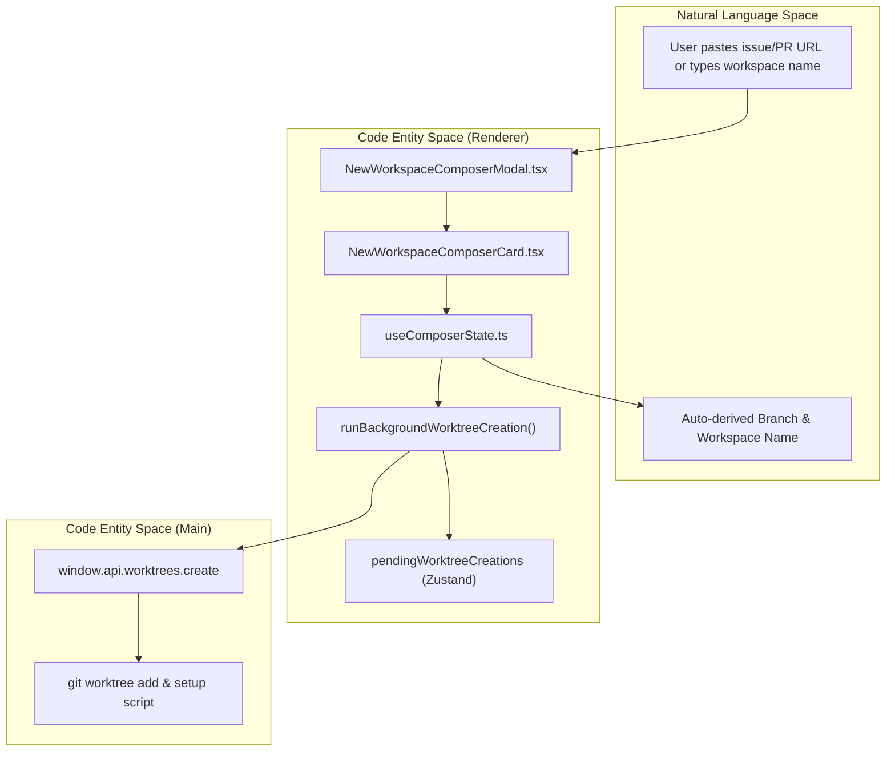
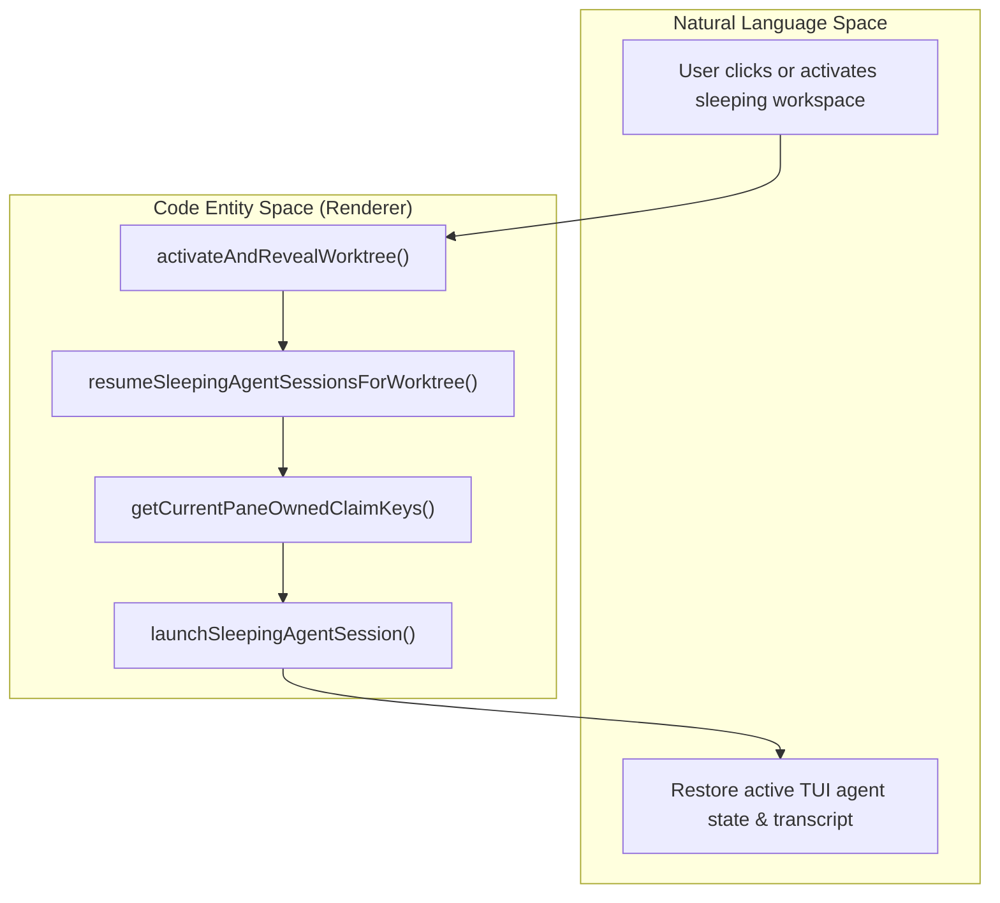
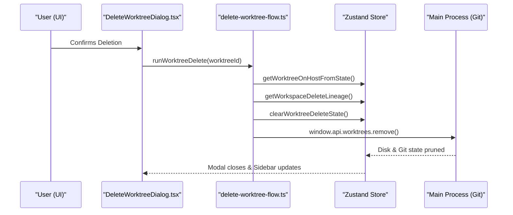

# Worktree Lifecycle in the Renderer

This page details the lifecycle of a Git worktree from the perspective of the React renderer in Orca. It covers the entire process including the creation composer, context switching, metadata editing, deletion cascades, archiving, sleeping/resume mechanisms, and reconciliation between the renderer and main process.

---

## 1. Creation Composer & Submission Flow

Worktree creation is initiated through modal and card composers, primarily `NewWorkspaceComposerCard` [src/renderer/src/components/NewWorkspaceComposerCard.tsx:57-147]() and `NewWorkspaceComposerModal` [src/renderer/src/components/NewWorkspaceComposerModal.tsx:60-156](), backed by the `useComposerState` hook [src/renderer/src/hooks/useComposerState.ts:90-109](). The renderer coordinates asynchronous preflight, smart naming from work items (GitHub/Linear), and background execution handles via `runBackgroundWorktreeCreation` [src/renderer/src/lib/worktree-creation-flow.ts:67-85]().

### Background Creation Pipeline
When a user submits a creation request, Orca hands execution off to background workers via `runBackgroundWorktreeCreation` [src/renderer/src/lib/worktree-creation-flow.ts:67-85](). This registers a pending entity in `pendingWorktreeCreations` so the UI remains interactive while the Main process provisions disk space, sanitizes worktree names [src/main/ipc/worktree-logic.ts:36-62](), and runs setup hooks.

**Sources:**
[src/renderer/src/components/NewWorkspaceComposerCard.tsx:57-147](),
[src/renderer/src/components/NewWorkspaceComposerModal.tsx:60-156](),
[src/renderer/src/hooks/useComposerState.ts:90-109](),
[src/renderer/src/lib/worktree-creation-flow.ts:67-85](),
[src/main/ipc/worktree-logic.ts:36-62]().

---

## 2. Context Switching & Activation

Switching context between active worktrees is managed by the worktree activation module and repository store slices [src/renderer/src/store/slices/repos.ts:36-88](). When a worktree or folder workspace is selected, activation routines update the store state and trigger associated PTY or terminal views.

### Activation Side Effects
1. **View Transition**: Ensures the active view switches to terminal if not already active.
2. **Visit Tracking**: Marks the workspace visited and updates visit history in the Zustand store.
3. **Agent Activation Gating**: Evaluates whether sleeping agent sessions need revival or if an empty workspace needs initial terminal seeding.

| Activation Step | Description | Code Entity / Function |
| :--- | :--- | :--- |
| **Path Validation** | Checks if folder workspace path status is blocked or valid. | `folderWorkspaceActivationBlocked()` [src/renderer/src/store/slices/repos.ts:36-88]() |
| **State Assignment** | Sets active folder workspace or active worktree ID in store. | `state.setActiveRepo()` [src/renderer/src/store/slices/repos.ts:86-86]() |
| **History Recording** | Records worktree visit for back/forward navigation. | `state.recordWorktreeVisit()` |

**Sources:**
[src/renderer/src/store/slices/repos.ts:36-88]().

---

## 3. Sleeping Sessions & Agent Resume

When worktrees are suspended, background agent sessions are recorded as sleeping session metadata. Upon awakening or context activation, Orca restores these sessions.

### Resume Pipeline
The system evaluates sleeping agent records and spawns or re-attaches PTY processes. It filters out completed or duplicate claims using pane-owned claim keys and active record selectors.

**Sources:**
[src/renderer/src/lib/worktree-creation-flow.ts:67-85]().

---

## 4. Deletion Cascades & Lineage Cleanup

Deleting a worktree is a destructive multi-step process managed by dialog components and orchestrated via deletion flows.

### Deletion Workflow Steps
1. **Host and Instance Validation**: Verifies expected host IDs and ensures main worktrees are routed to folder removal confirmations rather than raw `git worktree remove`.
2. **Lineage Analysis**: Computes descendant worktrees via workspace lineage utilities to warn users if child workspaces exist.
3. **Terminal and PTY Purging**: Clears terminal layouts, active tab records, and terminates underlying PTY processes.
4. **Main Process Invocation**: Instructs the main process (`repos:removeForHost` or worktree removal IPC handlers) to execute file-system level worktree removal [src/main/ipc/repos.ts:18-78]().

**Sources:**
[src/main/ipc/repos.ts:18-78]().

---

## 5. Renderer↔Main Reconciliation

Reconciliation bridges the gap between state cached in the renderer's Zustand stores and the authoritative disk / Git state managed by the Electron main process via repository and worktree IPC channels [src/main/ipc/repos.ts:18-78]().

- **Hydration & Polling**: The renderer performs initial synchronization and listens for background file-system or Git status changes.
- **Drift Detection**: Base branch drift, uncommitted changes, and remote branch conflicts are synchronized continuously through IPC event bridges.
- **State Cleanup**: Orphaned records resulting from external terminal closures or manual disk modifications are pruned during periodic store re-evaluations.

**Sources:**
[src/main/ipc/repos.ts:18-78]().
