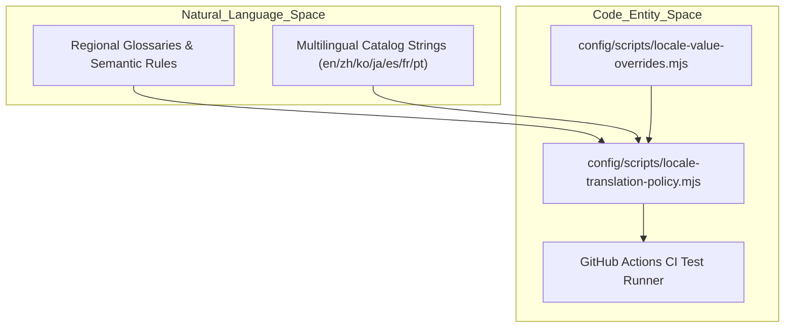

# Internationalization & Localization

This page details Orca's internationalization (i18n) and localization (l10n) subsystem. It covers the structure of translation catalogs (`en`, `zh`, `ko`, `ja`, `es`, `fr`, `pt`), `translate` helper usage in both React components and background logic, locale key override scripts, and automated test gates for translation coverage and mistranslation prevention.

Sources:
- `src/renderer/src/i18n/locales/en.json`
- `src/renderer/src/i18n/locales/zh.json`
- `src/renderer/src/i18n/locales/ko.json`
- `src/renderer/src/i18n/locales/ja.json`
- `src/renderer/src/i18n/locales/es.json`
- `src/renderer/src/i18n/locales/fr.json`

## Translation Catalogs

Orca supports multiple languages, with translation catalogs stored as structured JSON files under `src/renderer/src/i18n/locales/` [src/renderer/src/i18n/locales/en.json:1-136](). Each file corresponds to a target locale: `en.json` (English), `zh.json` (Simplified Chinese), `ko.json` (Korean), `ja.json` (Japanese), `es.json` (Spanish), `fr.json` (French), and implicitly via coverage pipelines for Portuguese (`pt`).

These JSON files map hierarchical keys or auto-generated hashes to localized strings supporting ICU-style placeholders (e.g., `{{percent}}`, `{{column}}`, `{{value0}}`). For instance, the English catalog `en.json` defines system prompts and error messages:

```json
{
  "csv": {
    "detectingDelimiter": "Detecting delimiter…",
    "indexProgress": "Indexing CSV… {{percent}}%",
    "loadingCell": "Loading…"
  },
  "app": {
    "recoverableError": {
      "rootTitle": "Orca hit a renderer error.",
      "rootDescription": "The app shell could not finish rendering. Retry to remount it, or relaunch Orca if the error persists."
    }
  }
}
```
[src/renderer/src/i18n/locales/en.json:1-12]()

Corresponding regional catalogs, such as `zh.json`, provide local terminology mappings:

```json
{
  "app": {
    "recoverableError": {
      "rootTitle": "Orca 遇到渲染器错误。",
      "rootDescription": "应用 shell 无法完成渲染。重试以重新挂载，如果错误仍然存在，请重新启动 Orca。"
    }
  }
}
```
[src/renderer/src/i18n/locales/zh.json:2-10]()

Sources:
- `src/renderer/src/i18n/locales/en.json`
- `src/renderer/src/i18n/locales/zh.json`
- `src/renderer/src/i18n/locales/ko.json`
- `src/renderer/src/i18n/locales/ja.json`
- `src/renderer/src/i18n/locales/es.json`
- `src/renderer/src/i18n/locales/fr.json`

## Translate Helper Usage

The `translate` helper function resolves localization keys at runtime. It accepts a unique localization key, a fallback string, and an optional parameters object for string interpolation.

### Usage in React Components

Components invoke `translate` to render localized labels, tooltips, and status messages:

```typescript
  const moreActionsLabel =
    review.provider === 'gitlab'
      ? translate('auto.components.right.sidebar.ChecksPanel.gitlabMoreActions', 'More MR actions')
      : translate('auto.components.right.sidebar.ChecksPanel.653c105ecc', 'More PR actions')
  const openTitle = translate(
    'auto.components.right.sidebar.ChecksPanel.5c88c6db07',
    'Open on {{value0}}',
    { value0: reviewHostLabel }
  )
```
[src/renderer/src/components/right-sidebar/ChecksPanel.tsx:67-74]()

### Usage in Non-React Logic

The helper is also consumed by helper modules and dropdown state factories (e.g., `source-control-dropdown-items.ts`) to produce localized UI descriptors outside component render trees:

```typescript
  return entries.map((entry) =>
    entry.kind === 'separator'
      ? entry
      : {
          ...entry,
          title: translate(
            'auto.components.right.sidebar.source.control.dropdown.items.7aad2c0240',
            'Hosted review operation in progress…'
          ),
          disabled: true
        }
  )
```
[src/renderer/src/components/right-sidebar/source-control-dropdown-items.ts:55-67]()

### Diagram: Natural Language Space to Code Entity Space (Catalog Resolution)

```mermaid
graph TD
    subgraph "Natural_Language_Space"
        NL_PR_ACTIONS[""More PR actions""]
        NL_OPEN_ON[""Open on {{value0}}""]
        NL_REVIEW_PROGRESS[""Hosted review operation in progress…""]
    end

    subgraph "Code_Entity_Space"
        C_CHECKS_PANEL["src/renderer/src/components/right-sidebar/ChecksPanel.tsx"]
        C_DROPDOWN_ITEMS["src/renderer/src/components/right-sidebar/source-control-dropdown-items.ts"]
        C_I18N["src/renderer/src/i18n/i18n.ts"]
        C_EN_JSON["src/renderer/src/i18n/locales/en.json"]
        C_ZH_JSON["src/renderer/src/i18n/locales/zh.json"]

        C_CHECKS_PANEL -->|"translate()"| C_I18N
        C_DROPDOWN_ITEMS -->|"translate()"| C_I18N
        C_I18N -->|"lookupCatalogKey()"| C_EN_JSON
        C_I18N -->|"lookupCatalogKey()"| C_ZH_JSON

        NL_PR_ACTIONS -->|"key lookup"| K1["auto.components.right.sidebar.ChecksPanel.653c105ecc"]
        NL_OPEN_ON -->|"key lookup"| K2["auto.components.right.sidebar.ChecksPanel.5c88c6db07"]
        NL_REVIEW_PROGRESS -->|"key lookup"| K3["auto.components.right.sidebar.source.control.dropdown.items.7aad2c0240"]
    end
```

Sources:
- `src/renderer/src/components/right-sidebar/ChecksPanel.tsx`
- `src/renderer/src/components/right-sidebar/source-control-dropdown-items.ts`
- `src/renderer/src/i18n/i18n.ts`
- `src/renderer/src/i18n/locales/en.json`

## Locale Key Override Scripts

To correct mistranslations or tailor specific regional terms without altering the source generation pipelines directly, Orca maintains explicit key override maps and configuration scripts. 

Override maps such as `config/scripts/locale-ko-key-overrides.json` intercept specific hash keys and substitute authoritative translations for given target locales:

```json
{
  "auto.App.03a14f6b5b": {
    "ko": "페이지를 다시 시도하거나 다른 Orca 화면으로 이동하세요."
  },
  "auto.App.8d1e160ed1": {
    "ko": "사이드바를 다시 시도하거나 탭을 전환해 이 화면을 다시 불러오세요."
  }
}
```
[config/scripts/locale-ko-key-overrides.json:2-7]()

These overrides are orchestrated during build and test verification via scripts like `config/scripts/locale-translation-policy.mjs`, `config/scripts/locale-key-overrides.mjs`, and `config/scripts/locale-value-overrides.mjs`.

Sources:
- `config/scripts/locale-ko-key-overrides.json`
- `config/scripts/locale-translation-policy.mjs`
- `config/scripts/locale-key-overrides.mjs`
- `config/scripts/locale-value-overrides.mjs`

## Localization Coverage and Mistranslation Test Gates

To prevent regressions, broken interpolation strings, or literal machine-translation artifacts, the test harness runs strict localization coverage and mistranslation validation gates.

### Test Gate Architecture

Verification rules are enforced through dedicated test files and policy scripts (e.g., `config/scripts/locale-translation-policy.mjs`). These gates scan catalog parity against `en.json`, verify placeholder matching across templates, and check for prohibited literal strings.

### Diagram: Natural Language Space to Code Entity Space (Test Gate Validation)



Sources:
- `config/scripts/locale-translation-policy.mjs`
- `config/scripts/locale-value-overrides.mjs`
