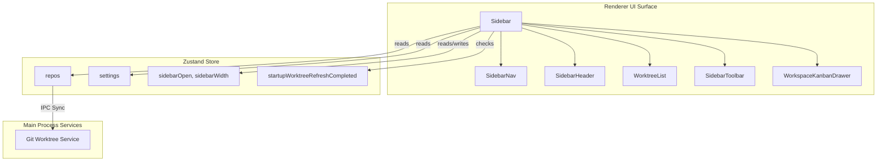
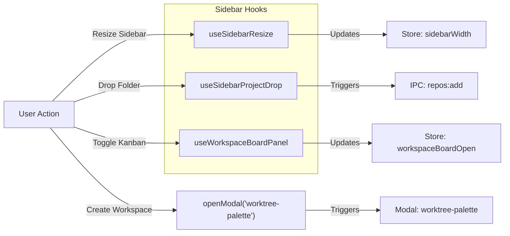

# Sidebar

The Sidebar is the primary navigation surface for Orca, providing a centralized interface to manage repositories and git worktrees. It serves as the entry point for switching contexts between different feature branches, monitoring AI agent activity, and organizing work via a virtualized list or a Kanban-style board.

For detailed information on the inner workings of individual worktrees, see [Worktree List & Cards](#4.1). For controls, filters, grouping/sorting, and toolbar functions, see [Sidebar Controls & Toolbar](#4.2).

## Overview & Architecture

The sidebar component (`Sidebar`) is composed of several functional layers that interact with the global Zustand store (`useAppStore`) to provide real-time updates on PR status, terminal activity, and worktree metadata [src/renderer/src/components/sidebar/index.tsx:1-51](). It handles responsive width adjustments, layout caching, and asynchronous project loading.

### Core Components

- **SidebarNav**: Provides top-level navigation buttons for switching between main views including the workspace list, Automations, Agents (Activity), and the Orca Mobile companion app [src/renderer/src/components/sidebar/index.tsx:6]().
- **SidebarHeader**: Contains primary actions for creating new workspaces and provides a menu for the Workspace Board (Kanban) [src/renderer/src/components/sidebar/index.tsx:5](), [src/renderer/src/components/sidebar/index.tsx:118]().
- **WorktreeList**: A virtualized scrolling container managing efficient rendering of worktree rows, filtering, and grouping [src/renderer/src/components/sidebar/index.tsx:8](). For details, see [Worktree List & Cards](#4.1).
- **SidebarToolbar**: Fixed at the bottom, providing profile switching, settings menus, and toggles [src/renderer/src/components/sidebar/index.tsx:9](). For details, see [Sidebar Controls & Toolbar](#4.2).
- **WorkspaceKanbanDrawer**: A slide-out drawer displaying worktrees organized by status lanes, managed via `useWorkspaceBoardPanel` [src/renderer/src/components/sidebar/index.tsx:10](), [src/renderer/src/components/sidebar/index.tsx:100-111]().

Sources:
[src/renderer/src/components/sidebar/index.tsx:1-127]()

## Data Flow & Store Interaction

The Sidebar leverages `useAppStore` to react to state modifications across the application. During startup, it guards against premature repository scans by verifying `startupWorktreeRefreshCompleted` before triggering `fetchAllWorktrees` when repository counts change [src/renderer/src/components/sidebar/index.tsx:56](), [src/renderer/src/components/sidebar/index.tsx:119-126]().

Sources:
[src/renderer/src/components/sidebar/index.tsx:48-126](),
[src/renderer/src/components/sidebar/Sidebar.test.tsx:184-206]()

## Mapping Natural Language Features to Code Entities

The following diagram bridges natural language feature requests in the sidebar to their implementing hooks and store actions (`useSidebarResize`, `useSidebarProjectDrop`, `useWorkspaceBoardPanel`).

Sources:
[src/renderer/src/components/sidebar/index.tsx:98-111](),
[src/renderer/src/components/sidebar/index.tsx:140-146]()

---

## Related Child Pages

- [Worktree List & Cards](#4.1)
- [Sidebar Controls & Toolbar](#4.2)
