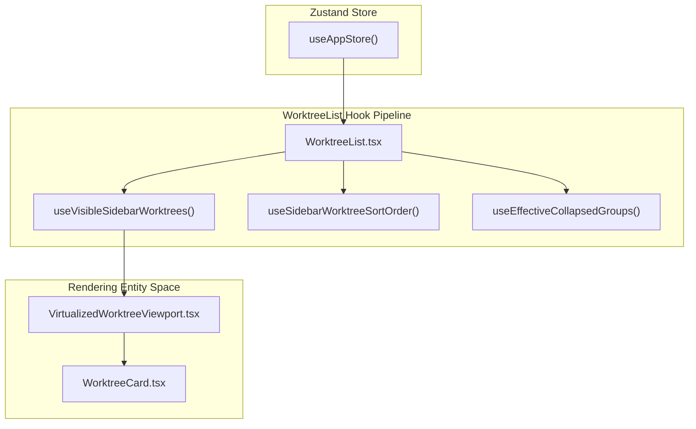
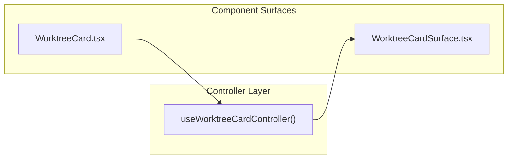

# Worktree List & Cards

This page details the implementation, data flow, virtualization, and interactive components of the Worktree List and Worktree Cards within Orca's sidebar navigation.

---

## WorktreeList Implementation

`WorktreeList` is a performant, virtualized list component designed for scalability. It utilizes granular selectors from the Zustand store to minimize unnecessary re-renders while managing a complex pipeline of filtering, sorting, and grouping [src/renderer/src/components/sidebar/WorktreeList.tsx:51-138]().

### Data Pipeline & Filtering

The rendering pipeline of `WorktreeList` flows through several key stages:

1.  **Visibility Computation**
    The list determines which worktrees to display based on `filterState` and the current `activeWorkspaceKey` [src/renderer/src/components/sidebar/WorktreeList.tsx:109-124](). The `useVisibleSidebarWorktrees` hook filters the universe of worktrees while preserving lineage: if a child worktree passes the filter, its ancestors remain visible to maintain the structural nesting [src/renderer/src/components/sidebar/WorktreeList.tsx:116-124]().

2.  **Grouping Strategy**
    Worktrees are grouped based on the `groupBy` state [src/renderer/src/components/sidebar/WorktreeList.tsx:75](). Supported modes include grouping by repository, workspace status, PR status, or project collections.

3.  **Sorting Pipeline**
    The `useSidebarWorktreeSortOrder` hook applies sorting logic based on the `sortBy` preference (e.g., `lastActivityAt`, `displayName`). Sorting respects grouping boundaries to ensure that items remain within their designated sections [src/renderer/src/components/sidebar/WorktreeList.tsx:111]().

### Virtualization & Scroll Management

To handle lists with hundreds of entries, Orca uses a virtualized viewport:
*   **VirtualizedWorktreeViewport**: Wraps the rendering logic to only mount components currently in view [src/renderer/src/components/sidebar/WorktreeList.tsx:22]().
*   **Scroll Anchors**: The `useVirtualizedScrollAnchor` hook allows the list to maintain or programmatically adjust scroll position, such as when a "Reveal in Sidebar" request is triggered for a specific worktree [src/renderer/src/components/sidebar/WorktreeList.tsx:19-43]().

Sources: [src/renderer/src/components/sidebar/WorktreeList.tsx:1-138]()

---

## WorktreeCard & Data Integration

`WorktreeCard` is the core React component representing an individual workspace row. It acts as a controller that aggregates multiple data signals into a unified surface via `useWorktreeCardController` [src/renderer/src/components/sidebar/WorktreeCard.tsx:10-79]().

### Status Indicators & Unread Markers

The card reflects the real-time state of the worktree through status indicators and slots managed by `WorktreeCardStatusSlot` and `AgentStateDot`:
*   **Status Indicators**: Reflect whether a worktree is active, working, interrupted, or awaiting permission [src/renderer/src/components/sidebar/WorktreeCardStatusSlot.tsx:118-120](), [src/renderer/src/components/AgentStateDot.tsx:22-47]().
*   **Unread Marker**: Unread status toggles trigger quick-action indicators that preserve sidebar state [src/renderer/src/components/sidebar/WorktreeCard.quick-actions.test.tsx:151-158](), rendering an unread alert badge on the status lane in new card styles [src/renderer/src/components/sidebar/WorktreeCardStatusSlot.tsx:145-168]().
*   **PR Display**: Linked Pull Requests and GitLab MRs are fetched and cached via review caches (`hostedReviewCache`, `prCache`), displaying check statuses directly on or alongside the card metadata [src/renderer/src/components/sidebar/WorktreeCard.pr-display.test.tsx:20-48](), [src/renderer/src/components/sidebar/WorktreeCardStatusSlot.tsx:126-148]().

Sources: [src/renderer/src/components/sidebar/WorktreeCard.tsx:1-82](), [src/renderer/src/components/sidebar/WorktreeCardStatusSlot.tsx:1-195](), [src/renderer/src/components/AgentStateDot.tsx:1-178](), [src/renderer/src/components/sidebar/WorktreeCard.quick-actions.test.tsx:1-158](), [src/renderer/src/components/sidebar/WorktreeCard.pr-display.test.tsx:1-206]()

---

## Diagrams

### Worktree List Data Flow (Natural Language to Code Entity Space)

This diagram bridges natural language workspace concepts to the actual Zustand selectors, hooks, and virtualized components in the codebase.

Sources: [src/renderer/src/components/sidebar/WorktreeList.tsx:51-138](), [src/renderer/src/components/sidebar/WorktreeCard.tsx:10-82]()

### WorktreeCard Component Architecture

This diagram maps card controller logic and data signals to their rendering components.

Sources: [src/renderer/src/components/sidebar/WorktreeCard.tsx:10-82]()

---

## Quick Actions & Context Menus

The card surface supports several immediate interactions:
*   **Quick Actions**: Inline buttons such as unread toggles are marked with attributes like `data-workspace-board-preserve-open` to ensure board states remain consistent during mutations [src/renderer/src/components/sidebar/WorktreeCard.quick-actions.test.tsx:151-158]().
*   **Context Menu**: Right-clicking a `WorktreeCard` triggers `WorktreeContextMenu` which evaluates policies to display relevant actions (opening in browser, renaming, copying links, managing lineage) [src/renderer/src/components/sidebar/WorktreeCard.quick-actions.test.tsx:77-81]().

Sources: [src/renderer/src/components/sidebar/WorktreeCard.quick-actions.test.tsx:1-158]()

---

## Delete Flows & Lineage Nesting

### Lineage & Nesting
Orca supports **workspace lineage**, where worktrees maintain parent-child relationships (e.g., a feature branch spawned from a main branch).
*   Recursion is handled by passing `lineageChildren` and `lineageChildCount` properties through `WorktreeCard` [src/renderer/src/components/sidebar/WorktreeCard.tsx:36-40]().
*   Indentation and nested rows are rendered with proper spacing and padding constraints to reflect tree depth [src/renderer/src/components/sidebar/WorktreeList.lineage-child-card.test.ts:74-84]().

### Deletion Flows
*   When a worktree or its child is undergoing deletion, the card transitions into an `aria-busy="true"` state displaying deletion progress indicators [src/renderer/src/components/sidebar/WorktreeList.lineage-child-card.test.ts:86-98]().
*   The store maintains delete state maps (`deleteStateByWorktreeId`) to track active deletions across parent and nested lineage nodes [src/renderer/src/components/sidebar/WorktreeCard.quick-actions.test.tsx:30]().

Sources: [src/renderer/src/components/sidebar/WorktreeCard.tsx:10-82](), [src/renderer/src/components/sidebar/WorktreeList.lineage-child-card.test.ts:45-129](), [src/renderer/src/components/sidebar/WorktreeCard.quick-actions.test.tsx:1-48]()
