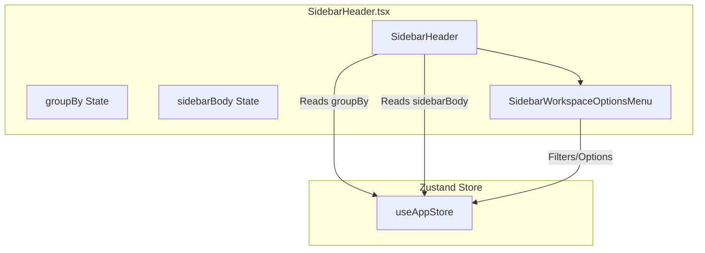
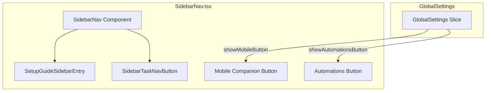
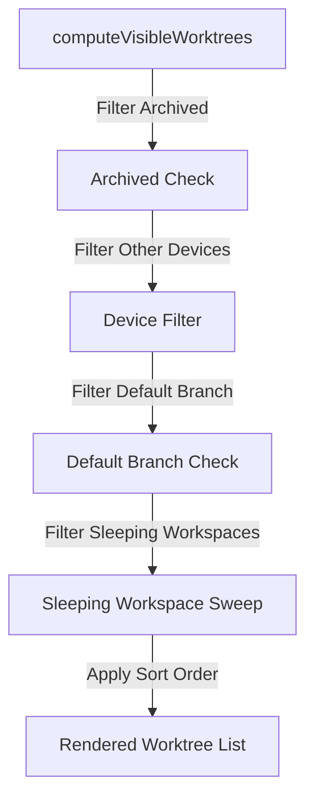
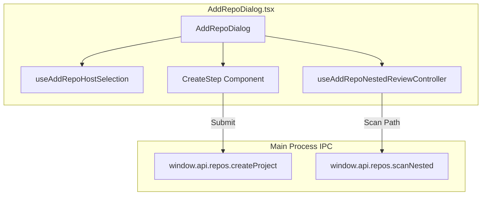
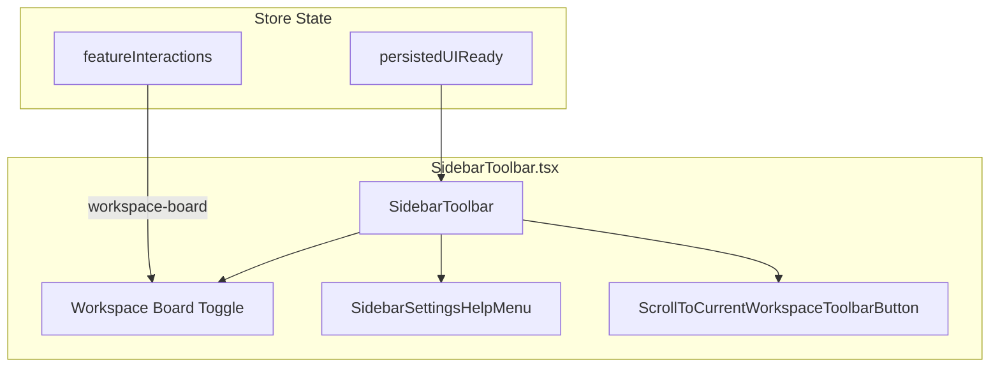
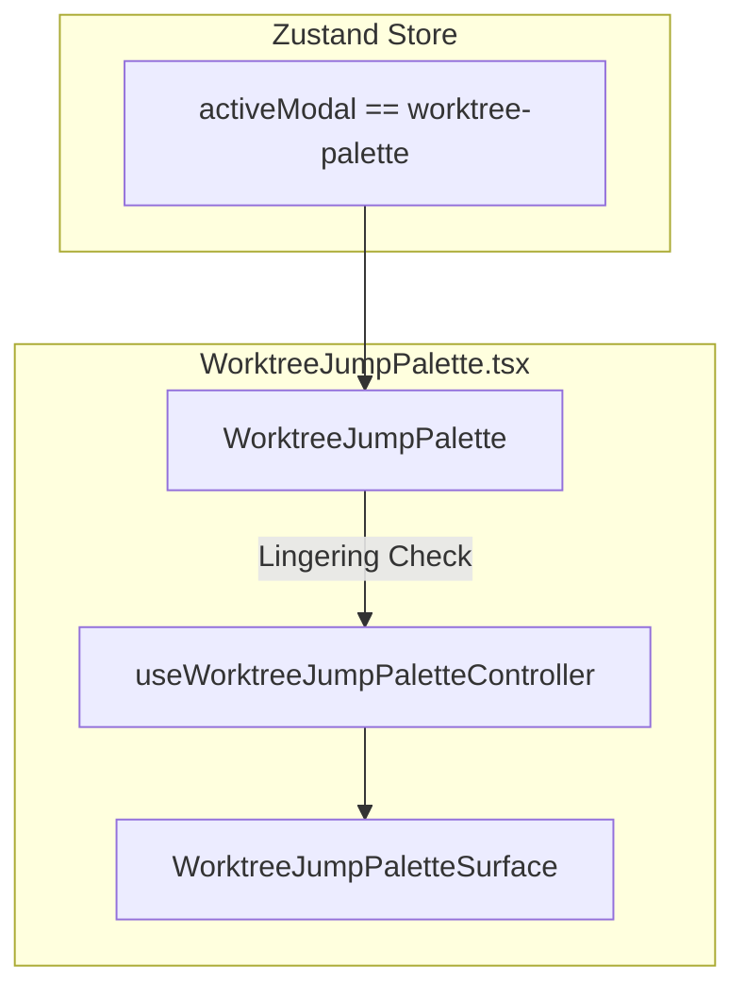

# Sidebar Controls & Toolbar

The sidebar controls and toolbar provide key interactive elements within Orca’s primary navigation interface (`SidebarNav.tsx`, `SidebarToolbar.tsx`). They handle workspace grouping and sorting, filtration, search, navigation links to auxiliary views, onboarding indicators, add-repository workflows, and integration with the quick jump palette (`WorktreeJumpPalette.tsx`).

## Sidebar Header & Workspace Creation

The `SidebarHeader` component anchors the top of the sidebar UI and offers workspace/project creation and grouping controls.

- **Dynamic Title:** Depending on the current grouping mode (`groupBy` in Zustand), the header title toggles between "Projects" (repository grouped) and "Workspaces" (flat list). It determines this title by observing the slicing state from the store and applying localization keys [src/renderer/src/components/sidebar/SidebarHeader.tsx:20-22]().
- **Activity & Notification Popover:** Integrates a notification/activity toggle button with an intro popover for migrated experimental views (`agentsSidebarMigratedFromExperimental`) [src/renderer/src/components/sidebar/SidebarHeader.tsx:28-36]().
- **Options Menu:** The `SidebarWorkspaceOptionsMenu` component exposes filtering, sorting, and display toggles with badges tracking active filters [src/renderer/src/components/sidebar/SidebarWorkspaceOptionsMenu.tsx:21-35]().

Title: "Sidebar Header Component Layout and State Flow"

Sources: [src/renderer/src/components/sidebar/SidebarHeader.tsx:1-137](), [src/renderer/src/components/sidebar/SidebarWorkspaceOptionsMenu.tsx:1-92]()

## Sidebar Navigation Links

The `SidebarNav` component presents primary navigation buttons that lead to various functional views of Orca.

- **Global Search Button:** Triggers the worktree jump palette modal (`worktree-palette`) and displays keyboard shortcut badges [src/renderer/src/components/sidebar/SidebarNav.tsx:93-121]().
- **Feature-Gated Buttons:** Conditionally renders artifact, skills, automations, and mobile companion views based on global settings (`shouldShowArtifactsButton`, `shouldShowAutomationsButton`, `shouldShowMobileButton`) [src/renderer/src/components/sidebar/SidebarNav.tsx:21-49]().
- **Setup Guide & Tasks:** Embeds `SetupGuideSidebarEntry` and `SidebarTaskNavButton` for onboarding progress tracking [src/renderer/src/components/sidebar/SidebarNav.tsx:122-123]().

Title: "Sidebar Navigation and Feature-Gate Logic"

Sources: [src/renderer/src/components/sidebar/SidebarNav.tsx:1-291]()

## Sidebar Filters & Visible Worktrees

The sidebar relies on visibility computation functions to filter and order worktrees based on user preferences and environmental contexts.

- **`computeVisibleWorktrees`:** Evaluates archived states, device filters (`isWorkspaceFromOtherDevice`), default branch inclusion, automation-generated tags, detached HEAD checks, and execution host scopes [src/renderer/src/components/sidebar/visible-worktrees.ts:91-140]().
- **Sleeping Workspaces Sweep:** Automatically filters out inactive workspaces unless exempted by `isSleepingSweepExemptWorkspace` or user options [src/renderer/src/components/sidebar/visible-worktrees.ts:143]().

Title: "Visible Worktree Filtering Pipeline"

Sources: [src/renderer/src/components/sidebar/visible-worktrees.ts:1-143]()

## Add Repository Flow

The add repository modal (`AddRepoDialog`) manages a multi-step user flow supporting local folders, clone URLs, remote SSH paths, and project creation.

- **Host Selection:** `useAddRepoHostSelection` handles switching between local, SSH, and runtime-hosted environments [src/renderer/src/components/sidebar/AddRepoDialog.tsx:52]().
- **Project Creation (`CreateStep`):** Validates workspace names, parent paths, and Git availability (`CreateStep`) before triggering project creation IPC calls [src/renderer/src/components/sidebar/AddRepoCreateStep.tsx:41-71]().
- **Nested Repositories:** Scans for nested Git repositories using `useAddRepoNestedReviewController` [src/renderer/src/components/sidebar/AddRepoDialog.tsx:77-87]().

Title: "Add Repository Dialog State Machine"

Sources: [src/renderer/src/components/sidebar/AddRepoDialog.tsx:1-406](), [src/renderer/src/components/sidebar/AddRepoCreateStep.tsx:1-271]()

## Sidebar Toolbar & Workspace Board

The `SidebarToolbar` component anchors the bottom of the sidebar, providing quick access to settings, help, workspace scrolling, and the Kanban workspace board.

- **Workspace Board Toggle:** Controls the visibility of the workspace Kanban board. It supports drag preview states (`workspaceBoardDragPreviewOpen`) and migration hint timeouts (`WORKSPACE_BOARD_MOVED_HINT_STORAGE_KEY`) [src/renderer/src/components/sidebar/SidebarToolbar.tsx:15-65]().
- **Settings & Help Menu:** Renders `SidebarSettingsHelpMenu` for accessing user preferences and documentation links [src/renderer/src/components/sidebar/SidebarToolbar.tsx:76]().

Title: "Sidebar Toolbar Component Integration"

Sources: [src/renderer/src/components/sidebar/SidebarToolbar.tsx:1-126]()

## Worktree Jump Palette Integration

The `WorktreeJumpPalette` component provides global quick navigation (`Cmd+J`).

- **Visibility & Lingering State:** Controlled by `activeModal === 'worktree-palette'` in Zustand, using a lingering timer (`PALETTE_CLOSE_LINGER_MS`) to ensure smooth animation teardowns [src/renderer/src/components/WorktreeJumpPalette.tsx:9-18]().
- **Controller & Surface:** Uses `useWorktreeJumpPaletteController` and `WorktreeJumpPaletteSurface` to render fuzzy search results across worktrees, browser tabs, and recent documents [src/renderer/src/components/WorktreeJumpPalette.tsx:43-48]().

Title: "Jump Palette Activation and Surface Flow"

Sources: [src/renderer/src/components/WorktreeJumpPalette.tsx:1-49]()
