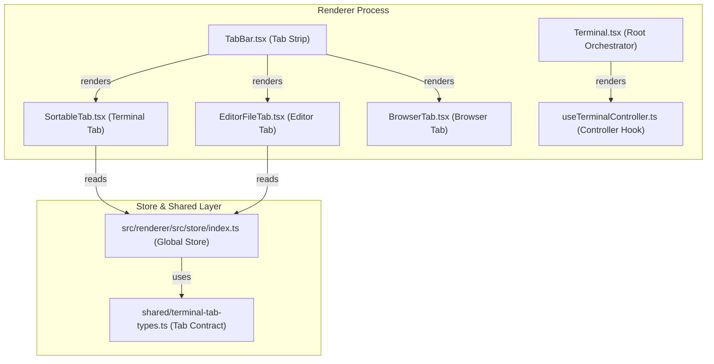
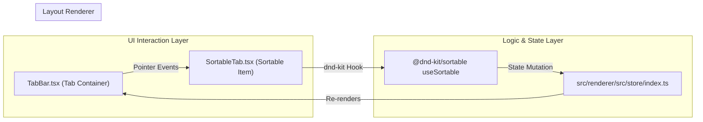

# Terminal System

The **Terminal System** is Orca’s integrated terminal interface that orchestrates PTY sessions, terminal tabs, and pane layouts within the renderer process [src/renderer/src/components/Terminal.tsx:5-7](). It provides a high-performance environment for managing terminals alongside editor and browser panes, supporting flexible layouts, multi-pane splits, and advanced tab interactions [src/renderer/src/components/tab-bar/TabBar.tsx:14-114]().

At its core, the `Terminal` component serves as the root orchestrator, managing terminal lifecycle, tab state, and pane layout interactions [src/renderer/src/components/Terminal.tsx:5-9](). This component works alongside background rendering layers like `TerminalPaneOverlayLayer` to manage memory, mounting only active or explicitly requested worktree terminals [src/renderer/src/components/terminal-pane/use-terminal-tab-cold-parking.ts:59-78]().

---

## System Orchestration Overview

Orca’s terminal orchestration follows a **worktree-first** strategy. Instead of spawning PTY sessions for all known worktrees immediately, only active worktrees or those requested through background mount events are rendered.

Terminals, editors, and browsers share a **unified tab model** managed via the tabs store and tab components like `SortableTab` and `EditorFileTab` [src/renderer/src/components/tab-bar/SortableTab.tsx:39-77](), [src/renderer/src/components/tab-bar/EditorFileTab.tsx:37-75](). This shared model enables consistent drag-drop, reorder, and pane split functionality across different content types.

### Diagram: Terminal System - Natural Language to Code Entity Mapping

*Sources:*
[src/renderer/src/components/Terminal.tsx:1-9](),
[src/renderer/src/components/tab-bar/TabBar.tsx:14-114](),
[src/renderer/src/components/tab-bar/SortableTab.tsx:39-77](),
[src/renderer/src/components/tab-bar/EditorFileTab.tsx:37-75](),
[src/renderer/src/components/tab-bar/BrowserTab.tsx:73-107]()

---

## Component Hierarchy and Responsibilities

The terminal system UI comprises several interrelated components forming a hierarchy that supports flexible pane configurations and quick command palettes:

| Component | Responsibility | File Reference |
| :--- | :--- | :--- |
| `Terminal` | Root orchestrator for worktree activation and global terminal state. | [src/renderer/src/components/Terminal.tsx:1-9]() |
| `TabBar` | Manages tab strips, overflow scrolling, drag-and-scroll handlers, and entry menus. | [src/renderer/src/components/tab-bar/TabBar.tsx:14-114]() |
| `SortableTab` | Individual terminal or AI chat tab row supporting drag-and-drop, rename, and activity badges. | [src/renderer/src/components/tab-bar/SortableTab.tsx:39-77]() |
| `EditorFileTab` | Tab row for file editing views, supporting dirty indicators, diff modes, and renaming. | [src/renderer/src/components/tab-bar/EditorFileTab.tsx:37-75]() |
| `BrowserTab` | Tab row for integrated browser pages, managing live URL descriptors and context actions. | [src/renderer/src/components/tab-bar/BrowserTab.tsx:73-107]() |
| `TabBarCreateEntry` | Omnibox-style search and create modal for opening files, terminals, and agent actions. | [src/renderer/src/components/tab-bar/TabBarCreateEntry.tsx:39-56]() |

*Sources:*
[src/renderer/src/components/Terminal.tsx:1-9](),
[src/renderer/src/components/tab-bar/TabBar.tsx:14-114](),
[src/renderer/src/components/tab-bar/SortableTab.tsx:39-77](),
[src/renderer/src/components/tab-bar/EditorFileTab.tsx:37-75](),
[src/renderer/src/components/tab-bar/BrowserTab.tsx:73-107](),
[src/renderer/src/components/tab-bar/TabBarCreateEntry.tsx:39-56]()

---

## Major Subsystems

Each major subsystem is encapsulated in dedicated modules, documented in detail in child pages.

### 1. PTY Layer & Tab Management
This subsystem establishes PTY sessions via transports and dispatchers. It handles PTY spawning, writing, and data reading workflows, supporting local, SSH, and remote daemon backends. It manages the terminal tab lifecycle, including graceful shutdown per-worktree, remote/daemon adapters, and dead-session reconciliation.
*For details, see [PTY Layer & Tab Management](#5.1).*

### 2. Pane Manager & Terminal Pane Lifecycle
Terminal panes are managed via split and merge primitives, drag reordering, and layout serialization. This layer coordinates xterm.js addons, output scheduling, visibility resume, and recovery workflows across worktree transitions.
*For details, see [Pane Manager & Terminal Pane Lifecycle](#5.2).*

### 3. Terminal Themes & Appearance
The theming system resolves effective color schemes and font styles. It applies terminal CSS, geometry utilities, and supports importing Ghostty and Warp theme definitions.
*For details, see [Terminal Themes & Appearance](#5.3).*

### 4. Agent Completion & Notifications
Orca monitors PTY output and hooks for agent completion patterns. This subsystem manages process inspection queues, notification dispatch, and floating terminal attention UX.
*For details, see [Agent Completion & Notifications](#5.4).*

### 5. Native Chat Interface
For agent-enabled workflows, Orca provides a native chat overlay rendering AI agent conversations as structured messages, supporting message windowing, a composer, tool runs, and interactive question cards.
*For details, see [Native Chat Interface](#5.5).*

### 6. Keyboard, IME & Terminal Links
This subsystem handles custom keyboard shortcut policies, xterm bypass rules, Input Method Editor (IME) composition events, and terminal link detection and routing.
*For details, see [Keyboard, IME & Terminal Links](#5.6).*

---

## Tab Dragging and Layout Interaction

The system supports advanced drag-and-drop interactions using `@dnd-kit/sortable` [src/renderer/src/components/tab-bar/SortableTab.tsx:2-2](), [src/renderer/src/components/tab-bar/EditorFileTab.tsx:2-2](). Tabs maintain stable anchoring while sorting and dropping across pane groups.

### Diagram: Tab Drag Interaction to Layout Update Flow

*Sources:*
[src/renderer/src/components/tab-bar/TabBar.tsx:14-114](),
[src/renderer/src/components/tab-bar/SortableTab.tsx:2-140](),
[src/renderer/src/components/tab-bar/EditorFileTab.tsx:2-88]()

---

**Sources:**
[src/renderer/src/components/Terminal.tsx:1-9](),
[src/renderer/src/components/tab-bar/TabBar.tsx:14-114](),
[src/renderer/src/components/tab-bar/SortableTab.tsx:2-140](),
[src/renderer/src/components/tab-bar/EditorFileTab.tsx:2-88](),
[src/renderer/src/components/tab-bar/BrowserTab.tsx:73-107](),
[src/renderer/src/components/tab-bar/TabBarCreateEntry.tsx:39-56](),
[src/renderer/src/components/terminal-pane/use-terminal-tab-cold-parking.ts:59-78]()
