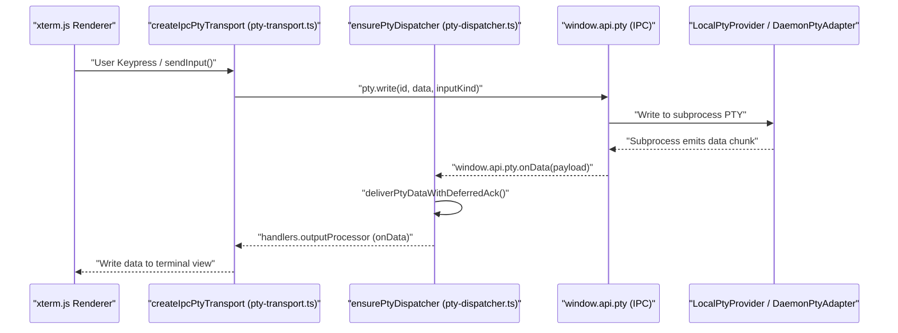
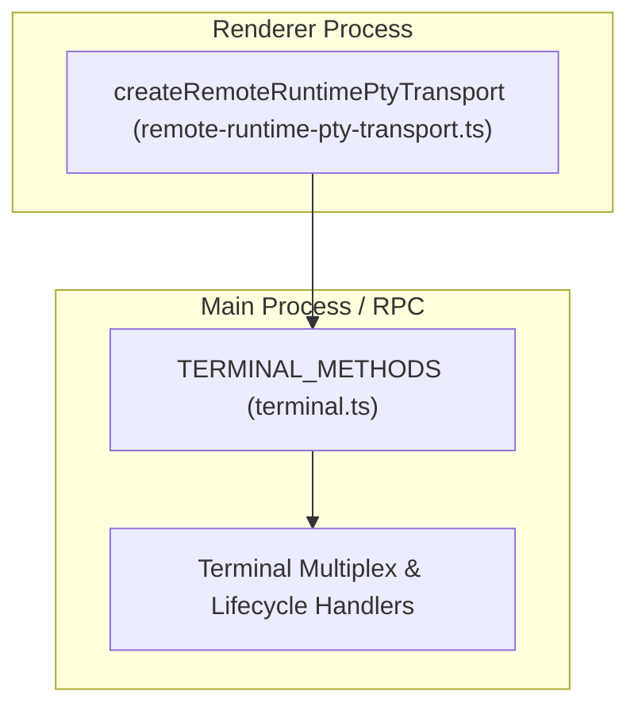
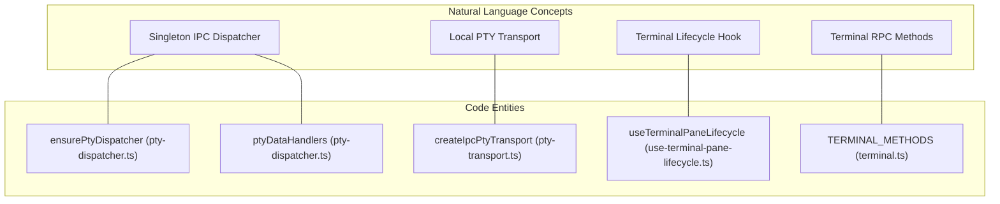

# PTY Layer & Tab Management

The PTY Layer and Tab Management subsystem orchestrates terminal PTY process spawning, bidirectional data streaming, terminal tab lifecycle management, transports and dispatchers, shutdown per worktree, remote/daemon adapters, and dead-session reconciliation. It bridges native or remote shell processes to the Renderer UI (`xterm.js`) while maintaining stable tab configurations and robust recovery pipelines.

---

## PTY Spawn, Write & Data Flow

Orca's PTY subsystem handles the creation and lifetime of terminal sessions across local and remote environments. The core renderer transport interface is defined by `PtyTransport` [src/renderer/src/components/terminal-pane/pty-transport-types.ts:1-143](), with local IPC transport implemented in `createIpcPtyTransport` [src/renderer/src/components/terminal-pane/pty-transport.ts:11-121]() and remote runtimes handled via `createRemoteRuntimePtyTransport` [src/renderer/src/components/terminal-pane/remote-runtime-pty-transport.ts:1-157]().

### Data Flow Architecture

1. **Input Generation & Buffering:** User input in the terminal triggers write requests on `PtyTransport`, which queues inputs via `createPtyInputWriteQueue` to handle backpressure and window constraints [src/renderer/src/components/terminal-pane/pty-transport.ts:37-46]().
2. **IPC Dispatch:** The transport invokes `window.api.pty.write(id, data, inputKind)` to cross the Electron context bridge [src/renderer/src/components/terminal-pane/pty-transport.ts:39-39]().
3. **Main Process Routing:** The main process receives the IPC payload and forwards it to the active PTY provider (`LocalPtyProvider` or `DaemonPtyAdapter`).
4. **Output Ingestion & Dispatch:** Output from the native/daemon subprocess flows back through IPC listeners managed by the singleton renderer dispatcher (`ensurePtyDispatcher`) [src/renderer/src/components/terminal-pane/pty-dispatcher.ts:85-97]().
5. **Deferred Acknowledgement:** Output chunks are processed and delivered using `deliverPtyDataWithDeferredAck` to ensure that backpressure is respected by `xterm.js` [src/renderer/src/components/terminal-pane/pty-dispatcher.ts:167-167]().

**Sources:**
[src/renderer/src/components/terminal-pane/pty-transport.ts:11-121](), [src/renderer/src/components/terminal-pane/pty-transport.ts:37-46](), [src/renderer/src/components/terminal-pane/pty-transport.ts:39-39](), [src/renderer/src/components/terminal-pane/pty-dispatcher.ts:85-97](), [src/renderer/src/components/terminal-pane/pty-dispatcher.ts:167-167](), [src/renderer/src/components/terminal-pane/pty-transport-types.ts:1-143](), [src/renderer/src/components/terminal-pane/remote-runtime-pty-transport.ts:1-157]()

---

## Transports and Dispatchers

To prevent listener leaks and `MaxListenersExceededWarning` errors across multiple open panes, Orca uses a singleton dispatcher architecture alongside pluggable transports.

### Singleton Dispatcher (`pty-dispatcher.ts`)
- **`ensurePtyDispatcher()`**: Initializes global IPC listeners for data, replay, exit, and write-unavailable events exactly once [src/renderer/src/components/terminal-pane/pty-dispatcher.ts:85-97]().
- **Map Routing**: Multiplexes incoming IPC events from `window.api.pty.onData` across active handlers stored in `ptyDataHandlers`, `ptyReplayHandlers`, and `ptyExitHandlers` [src/renderer/src/components/terminal-pane/pty-dispatcher.ts:26-33]().
- **Sidecar Observers**: Supports `ptyDataSidecars` which execute *after* primary handlers so diagnostic or logging observers do not delay `xterm.js` rendering paint cycles [src/renderer/src/components/terminal-pane/pty-dispatcher.ts:156-163]().

**Sources:**
[src/renderer/src/components/terminal-pane/pty-dispatcher.ts:26-33](), [src/renderer/src/components/terminal-pane/pty-dispatcher.ts:85-97](), [src/renderer/src/components/terminal-pane/pty-dispatcher.ts:156-163]()

---

## Tab Lifecycle & Worktree Integration

Terminal tabs represent user-facing containers bound to specific worktrees. Their layout, persistence, and focus states are managed through React tab components and Zustand stores.

### Tab Lifecycle Actions
- **Mounting & Attachment:** When a tab mounts, it registers its execution context via hooks like `useTerminalPaneLifecycle` and initiates or rebinds to an existing PTY session [src/renderer/src/components/terminal-pane/use-terminal-pane-lifecycle.ts:21-156]().
- **Custom Titles & Rename:** Users can rename tabs or assign custom display labels managed via terminal state and store updates.
- **Shutdown per Worktree:** Worktree deletion or archival triggers cascading cleanups, sending kill signals to all associated PTY session IDs and releasing buffer maps.

**Sources:**
[src/renderer/src/components/terminal-pane/use-terminal-pane-lifecycle.ts:21-156]()

---

## Remote & Daemon Adapters

When running in distributed modes or utilizing out-of-process daemons, PTY operations are routed through specialized adapters and RPC endpoints.

- **Daemon & Runtime RPC:** Rpc methods defined under `src/main/runtime/rpc/methods/terminal.ts` expose terminal lifecycle, multiplexing, query, and send methods across remote boundaries [src/main/runtime/rpc/methods/terminal.ts:1-23]().
- **Remote Runtime Multiplexer:** Coordinates state synchronization across remote execution hosts, handling stream recovery, snapshot validation, and retry backoffs.

**Sources:**
[src/main/runtime/rpc/methods/terminal.ts:1-23](), [src/renderer/src/components/terminal-pane/remote-runtime-pty-transport.ts:1-157]()

---

## Dead-Session Reconciliation & Error Handling

When network partitions occur, daemons restart, or SSH connections drop, sessions may become orphaned or unreattachable. Orca provides automated dead-session reconciliation and user-facing recovery hints.

- **Reconciliation Engine:** `reconcileMissingSessions` checks active bindings against host state to restore or clean up dead sessions when visibility resumes [src/renderer/src/components/terminal-pane/use-terminal-pane-lifecycle.ts:60-65]().
- **Reactivity & Cleanup:** Lifecycle hooks detect visibility resumption and invoke validation routines to ensure seamless recovery of terminal panes [src/renderer/src/components/terminal-pane/use-terminal-pane-lifecycle.ts:37-73]().

**Sources:**
[src/renderer/src/components/terminal-pane/use-terminal-pane-lifecycle.ts:37-73](), [src/renderer/src/components/terminal-pane/use-terminal-pane-lifecycle.ts:60-65]()

---

## Summary Diagram: Code Entity Mapping

This diagram maps natural language system concepts to their concrete code entities within the codebase.

**Sources:**
[src/renderer/src/components/terminal-pane/pty-dispatcher.ts:26-33](), [src/renderer/src/components/terminal-pane/pty-dispatcher.ts:85-97](), [src/renderer/src/components/terminal-pane/pty-transport.ts:11-121](), [src/renderer/src/components/terminal-pane/use-terminal-pane-lifecycle.ts:21-156](), [src/main/runtime/rpc/methods/terminal.ts:1-23]()
