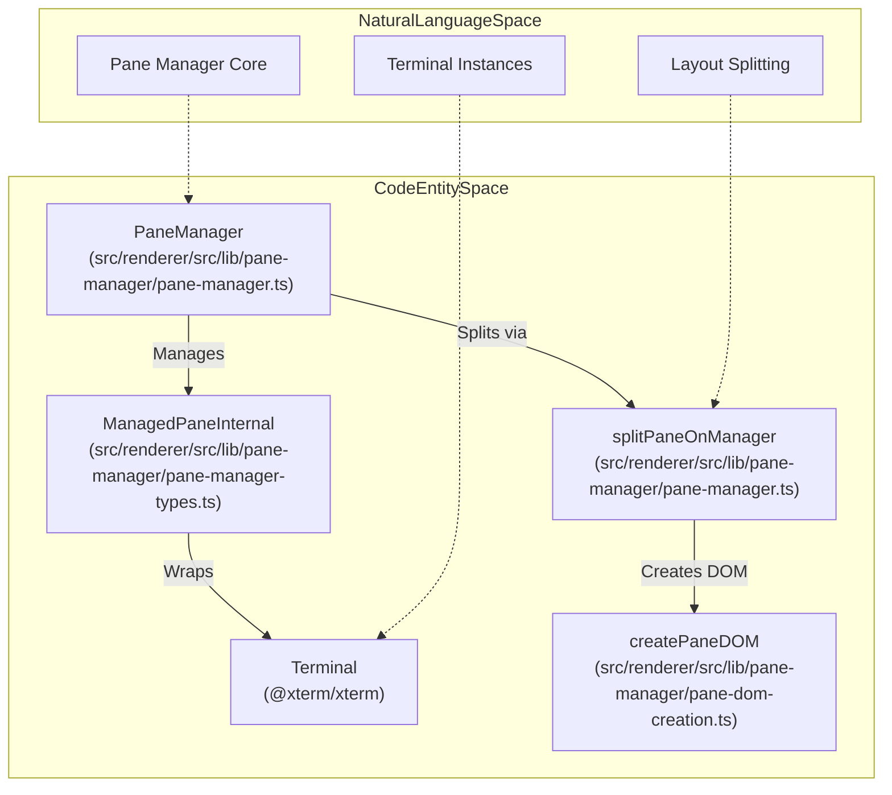
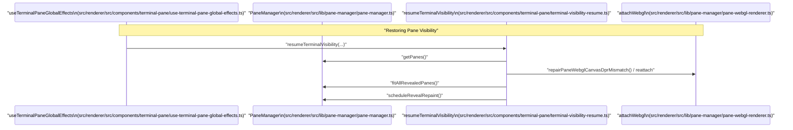

# Pane Manager & Terminal Pane Lifecycle

This page provides an in-depth technical overview of the pane manager subsystem in Orca, detailing how terminal panes are created, split, merged, reordered, themed, and managed through their lifecycle. The focus lies on the `PaneManager` class, terminal pane lifecycle hooks, global effects for visibility and resource management, integration of `xterm.js` addons, output scheduling, and layout serialization for persistence.

---

## Pane Manager Engine

The `PaneManager` class is the core orchestrator of terminal pane layout and lifecycle in Orca's renderer process. It is a non-React, DOM-driven system managing panes as DOM containers, split dividers, and embedded `xterm.js` terminals [src/renderer/src/lib/pane-manager/pane-manager.ts:73-121]().

### Key Responsibilities

- **Pane Creation and Initialization**  
  The method `createInitialPane` creates a terminal pane and its corresponding DOM nodes via `createInitialManagedPane`, instantiates and opens an `xterm.js` terminal with essential addons (WebGL, Fit, Search, Serialize, Unicode11, WebLinks), and mounts the pane container inside a root element [src/renderer/src/lib/pane-manager/pane-manager.ts:123-125]() and [src/renderer/src/lib/pane-manager/pane-dom-creation.ts:33-162](). The terminal is opened into a dedicated `xtermContainer` and configured with lifecycle hooks [src/renderer/src/lib/pane-manager/pane-lifecycle.ts:34-133]().

- **Splitting and Merging Panes**  
  Splitting is implemented via `splitPane` (routing to `splitPaneOnManager`), which wraps the current pane container in a new split container (vertical or horizontal) and creates a new sibling pane beside it [src/renderer/src/lib/pane-manager/pane-manager.ts:127-133]() and [src/renderer/src/lib/pane-manager/pane-manager-tree-mutations.ts](). This involves creating a draggable splitter divider for user-adjustable split sizes [src/renderer/src/lib/pane-manager/pane-manager.ts:108](). Merging is performed by closing panes (`closePane`), promoting sibling containers to replace merged splits, and cleaning redundant DOM wrappers [src/renderer/src/lib/pane-manager/pane-manager.ts:150-152]().

- **Drag Reordering**  
  Drag-to-reorder operations are supported by hook-based drag state management, initiated via pointer events (`beginPaneDragFromPointerDown`), tracked by `createDragReorderState`, and resolved with `handlePaneDrop` [src/renderer/src/lib/pane-manager/pane-manager.ts:18,87]().

- **Rendering & GPU Resource Control**  
  The manager applies GPU acceleration selectively per pane, attaching the WebGL addon if enabled and supported (`shouldUseTerminalWebgl`), and suspends terminal rendering when panes are hidden to conserve GPU resources [src/renderer/src/lib/pane-manager/pane-manager.ts:94](), [src/renderer/src/lib/pane-manager/pane-rendering-control.ts](), and [src/renderer/src/lib/pane-manager/pane-webgl-renderer.ts:89-97](). WebGL is disposed and rebuilt as needed on visibility toggles and context loss events [src/renderer/src/lib/pane-manager/pane-webgl-renderer.ts:128-160,162-176]().

- **ID and Identity Management**  
  A `PaneIdentityRegistry` assigns durable numeric IDs to panes keyed by their stable leaf UUIDs (`TerminalLeafId`). This enables persistent pane identity through React re-renders or remounts and consistency in layout serialization [src/renderer/src/lib/pane-manager/pane-manager.ts:83]() and [src/renderer/src/lib/pane-manager/pane-manager-types.ts:115-121]().

### Diagram: Pane Manager and Code Entities

Title: "Pane Manager and Code Entities"

Sources: [src/renderer/src/lib/pane-manager/pane-manager.ts:73-133](), [src/renderer/src/lib/pane-manager/pane-manager-types.ts:115-128](), [src/renderer/src/lib/pane-manager/pane-dom-creation.ts:23-31]()

---

## Terminal Pane Lifecycle & Visibility

Managing terminal panes involves tracking UI visibility and resource constraints, particularly Chromium's WebGL context limits. These effects are orchestrated globally via `useTerminalPaneGlobalEffects` [src/renderer/src/components/terminal-pane/use-terminal-pane-global-effects.ts:64-183]().

### Visibility Lifecycle

- **`hideTerminalVisibility`**  
  Invoked when panes become hidden (`isVisible` or `isWorktreeActive` drops), this function captures viewport positions, suspends terminal rendering and GPU resources, and marks the pane hidden reason (e.g., `'surface'` or `'tab'`) [src/renderer/src/components/terminal-pane/terminal-visibility-resume.ts:142-162]().

- **`resumeTerminalVisibility`**  
  On pane reveal, clears stale link hover caches, synchronizes viewport scroll intents, restores scrollback buffers, reattaches WebGL rendering, fits pane size, and triggers repaint [src/renderer/src/components/terminal-pane/terminal-visibility-resume.ts:62-140](). Two paths exist: a "light" resume for intra-worktree tab switches (`shouldUseLightTabResume`) and a "heavy" resume for full reattachment [src/renderer/src/components/terminal-pane/terminal-visibility-resume.ts:85-112]().

- **`recoverVisibleTerminalWindowWake`**  
  Handles system-level wake events by forcing flushes, refreshing scroll state, and resetting glyph atlases on all visible panes to maintain consistent rendering after OS sleep [src/renderer/src/components/terminal-pane/terminal-visibility-resume.ts:55-60]().

### Diagram: Terminal Visibility Recovery Sequence

Title: "Terminal Visibility Recovery Sequence"

Sources: [src/renderer/src/components/terminal-pane/terminal-visibility-resume.ts:62-140](), [src/renderer/src/components/terminal-pane/use-terminal-pane-global-effects.ts:64-183]()

---

## xterm.js Addon Configuration & Management

Orca adds multiple `xterm.js` addons to terminal panes to enhance capabilities and performance.

### Addons Loaded on Terminal Open (Function: `openTerminal`)

- **FitAddon**: Dynamically fits terminal size based on container changes [src/renderer/src/lib/pane-manager/pane-lifecycle.ts:59]().
- **SearchAddon**: Enables text search within the terminal buffer [src/renderer/src/lib/pane-manager/pane-lifecycle.ts:60]().
- **SerializeAddon**: Allows capturing terminal content for restoration [src/renderer/src/lib/pane-manager/pane-lifecycle.ts:61]().
- **Unicode11Addon**: Correctly handles complex CJK and emoji wide characters [src/renderer/src/lib/pane-manager/pane-lifecycle.ts:62]().
- **WebLinksAddon**: Auto-detects URLs for clickable interaction [src/renderer/src/lib/pane-manager/pane-lifecycle.ts:63]().
- **WebglAddon**: Conditionally attaches GPU-accelerated rendering [src/renderer/src/lib/pane-manager/pane-lifecycle.ts:119-121]().

### Additional Addon Features and Lifecycle

- **LigaturesAddon**: Supports runtime toggling of font ligatures. Enabling ligatures triggers a WebGL atlas rebuild to incorporate new glyph shapes [src/renderer/src/lib/pane-manager/pane-lifecycle.ts:112-114]().
- **Terminal IME Candidate Anchor**: Synchronizes the IME candidate window's position with the terminal cursor [src/renderer/src/lib/pane-manager/pane-lifecycle.ts:106]().
- **Mouse Wheel Sensitivity**: Applies multipliers, configurable via settings, for smooth scrolling [src/renderer/src/lib/pane-manager/pane-lifecycle.ts:64-66]().

Sources: [src/renderer/src/lib/pane-manager/pane-lifecycle.ts:34-133]()

---

## Output Scheduler

The `pane-terminal-output-scheduler.ts` module manages how terminal output is written to `xterm.js` instances, optimizing for performance and responsiveness, especially when terminals are hidden or have large backlogs.

### Key Functions

- **`writeTerminalOutput`**: The primary entry point for writing data to a terminal. It queues output and dispatches it based on foreground/background status and latency sensitivity [src/renderer/src/lib/pane-manager/pane-terminal-output-scheduler.ts:51-57]().
- **`flushTerminalOutput`**: Forces queued output to be written to the terminal immediately, optionally with a character limit. This is crucial for visibility resume and recovery scenarios [src/renderer/src/lib/pane-manager/pane-terminal-output-scheduler.ts:59-64]().
- **`requestTerminalBacklogRecovery`**: Initiates a recovery process for terminals with pending output, ensuring that hidden output eventually renders [src/renderer/src/lib/pane-manager/pane-terminal-output-scheduler.ts:66-69]().
- **`waitForTerminalOutputParsed`**: Returns a Promise that resolves when all pending output for a terminal has been parsed by `xterm.js`. This is used to ensure the terminal state is settled before further operations, such as serialization or rendering updates [src/renderer/src/lib/pane-manager/pane-terminal-output-scheduler.ts:71-105]().

### Scheduling Logic

The scheduler distinguishes between foreground and background writes:
- **Background writes**: Coalesced and drained periodically to avoid overwhelming the renderer, especially for hidden terminals [src/renderer/src/lib/pane-manager/pane-terminal-output-scheduler.test.ts:34-47]().
- **Foreground writes**: Prioritized and drained more frequently to maintain responsiveness for visible terminals [src/renderer/src/lib/pane-manager/pane-terminal-output-scheduler.test.ts:117-138]().

The scheduler also includes mechanisms to detect and recover from stalled write pipelines, ensuring terminal output eventually appears even under adverse conditions [src/renderer/src/lib/pane-manager/pane-terminal-output-scheduler.ts:1-5]().

Sources: [src/renderer/src/lib/pane-manager/pane-terminal-output-scheduler.ts:1-105](), [src/renderer/src/lib/pane-manager/pane-terminal-output-scheduler.test.ts:34-47,117-138]()

---

## Layout Serialization & Recovery

### Layout Serialization

The pane manager serializes the tree structure of pane splits into a layout snapshot preserving:
- The tree shape of splits (vertical/horizontal).
- The flex ratio of sibling panes for size persistence.
- Leaf pane IDs (`leafId`) used to restore persistent state [src/renderer/src/lib/pane-manager/pane-manager-types.ts:115-121]().

### Scroll State Persistence

`ScrollState` records the current buffer type, viewport position, and logical line anchors [src/renderer/src/lib/pane-manager/pane-manager-types.ts:147-155](). Recovery helpers ensure that scroll positions are maintained even after terminal resizing (reflow) by using markers to track specific content.

Sources: [src/renderer/src/lib/pane-manager/pane-manager-types.ts:115-121,147-155]()

---

## Summary Table of Key Code Entities

| Feature                      | Code Entity / File                                       | Description                                                  |
|-----------------------------|----------------------------------------------------------|--------------------------------------------------------------|
| Pane Manager Class           | `PaneManager` — `src/renderer/src/lib/pane-manager/pane-manager.ts`                       | Core layout, creation/destruction, split & drag logic        |
| Pane Lifecycle Hooks         | `openTerminal()` — `src/renderer/src/lib/pane-manager/pane-lifecycle.ts` | Imperative DOM and addon setup/teardown                      |
| Split Tree Ops               | `splitPane()` — `src/renderer/src/lib/pane-manager/pane-manager.ts` | Low-level DOM split manipulation                             |
| Visibility Control           | `resumeTerminalVisibility()`, `hideTerminalVisibility()` — `src/renderer/src/components/terminal-pane/terminal-visibility-resume.ts`| Rendering suspension and resource recovery logic             |
| Output Scheduling            | `writeTerminalOutput()`, `flushTerminalOutput()` — `src/renderer/src/lib/pane-manager/pane-terminal-output-scheduler.ts` | Manages efficient terminal output to `xterm.js` instances |
| GPU Rendering                | `attachWebgl()`, `disposeWebgl()` — `src/renderer/src/lib/pane-manager/pane-webgl-renderer.ts`               | WebGL lifecycle and texture atlas management                 |

Sources: [src/renderer/src/lib/pane-manager/pane-manager.ts:73-121](), [src/renderer/src/lib/pane-manager/pane-lifecycle.ts:34-133](), [src/renderer/src/components/terminal-pane/terminal-visibility-resume.ts:62-162](), [src/renderer/src/lib/pane-manager/pane-terminal-output-scheduler.ts:51-64](), [src/renderer/src/lib/pane-manager/pane-webgl-renderer.ts:128-160]()
