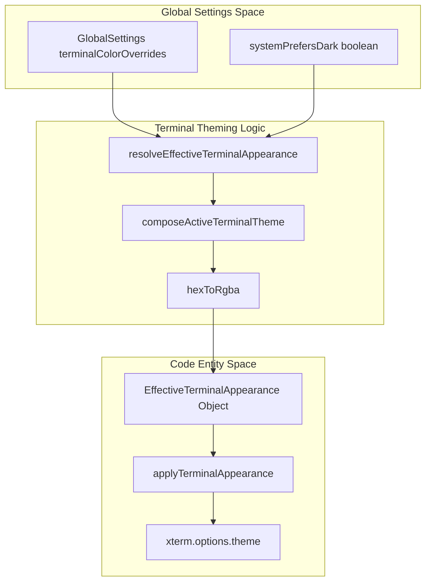
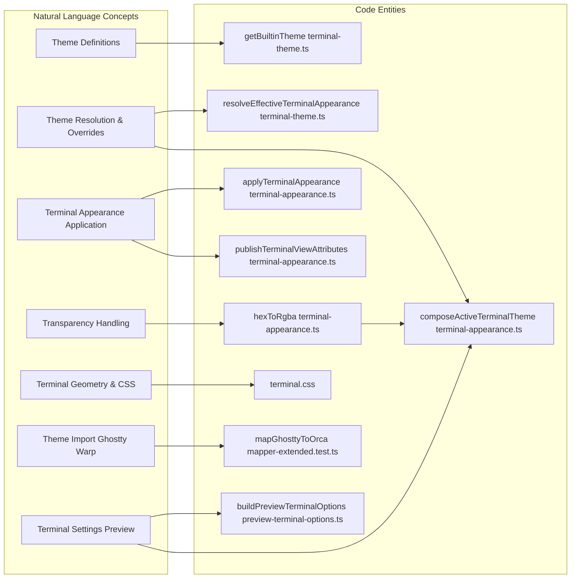

# Terminal Themes & Appearance

The terminal theming system in Orca provides a comprehensive framework for managing the appearance of integrated terminal panes using `xterm.js` (`src/renderer/src/lib/terminal-theme.ts` [src/renderer/src/lib/terminal-theme.ts:7-26](), `src/renderer/src/components/terminal-pane/terminal-appearance.ts` [src/renderer/src/components/terminal-pane/terminal-appearance.ts:35-177]()). It supports a broad catalog of built-in themes while prioritizing system-aware dark/light mode switching. The system enables granular control over typography, cursor styles, color overrides, and background transparency per user preferences.

This page details the implementation of the theming system, including theme definitions, resolution logic, previews, and application to running terminals. It also notes relevant integration with external theme import workflows such as Ghostty and Warp.

---

## Theme Data & Catalog

### Overview

Orca includes an extensive collection of terminal themes structured as `ITheme` objects compatible with `xterm.js`. The theme catalog and resolution logic are implemented primarily in the shared terminal theme library and the terminal appearance layer.

Themes are grouped into predefined categories such as:

| Category     | Description                               | Examples                                    |
|--------------|------------------------------------------|---------------------------------------------|
| **Defaults** | Core Orca default dark and light themes | "Ghostty Default Style Dark", "Builtin Tango Light" |
| **Built-in** | Standard dark/light, classic, extended themes | Popular collections and legacy favorites  |

These theme groups are exposed by the `getBuiltinTheme()` function and enumerated in the terminal-theme resolver [src/renderer/src/lib/terminal-theme.ts:7-10]().

### Custom Theme Overrides

Users can customize colors at a granular level by overriding specific color slots, such as cursor or background, through settings (`terminalColorOverrides`). These overrides are layered atop the base theme objects during composition to produce the final active theme [src/renderer/src/components/terminal-pane/terminal-appearance.ts:72-76]().

Sources: [src/renderer/src/lib/terminal-theme.ts:7-10](), [src/renderer/src/components/terminal-pane/terminal-appearance.ts:54-92]()

---

## Theme Resolution Logic

### Effective Appearance Resolution

The theme resolution pipeline produces the effective terminal appearance by combining:

- The current theme name or explicit theme object from settings or system fallback.
- User overrides for colors, cursor opacity, and background opacity.
- Alignment with the system's dark or light mode using the `systemPrefersDark` flag.

The central resolving function is `resolveEffectiveTerminalAppearance()`, which returns the resolved theme along with appearance mode metadata [src/renderer/src/lib/terminal-theme.ts:25-26](). When no theme is explicitly set, the system falls back to a built-in theme using `getBuiltinTheme()` [src/renderer/src/components/terminal-pane/terminal-appearance.ts:104-106]().

### Color and Transparency Composition

`composeActiveTerminalTheme()` merges the base theme with user overrides and applies opacity transforms to background and cursor colors. Hex color codes are converted to `rgba()` strings to allow `xterm.js` to render with transparency [src/renderer/src/components/terminal-pane/terminal-appearance.ts:77-83](). Named CSS colors are preserved for the cursor unless they match a hex pattern [src/renderer/src/components/terminal-pane/terminal-appearance.ts:85-90](). The `hexToRgba` utility [src/renderer/src/components/terminal-pane/terminal-appearance.ts:35-47]() handles this conversion.

### DEC Mode 2031 Color Scheme Protocol

Orca supports the DEC mode 2031 protocol that allows terminal UIs to detect light/dark mode changes dynamically. This involves:

- Tracking subscriptions per-pane via `paneMode2031` [src/renderer/src/components/terminal-pane/terminal-appearance.ts:144-144]().
- Sending CSI sequences to notify the TUI of mode flips via `maybePushMode2031Flip` [src/renderer/src/components/terminal-pane/terminal-appearance.ts:31-31](). This function ensures that mode changes are only pushed when the resolved mode actually flips, preventing redundant emissions [src/renderer/src/components/terminal-pane/terminal-appearance.test.ts:63-75]().
- Recording subscriptions when a TUI requests the mode via `recordPaneMode2031Subscription` [src/renderer/src/components/terminal-pane/pty-connection-types.ts:123-126]().

Sources: [src/renderer/src/components/terminal-pane/terminal-appearance.ts:35-110](), [src/renderer/src/components/terminal-pane/pty-connection-types.ts:123-127](), [src/renderer/src/components/terminal-pane/terminal-appearance.test.ts:63-75]()

---

## Data Flow: Terminal Theme Resolution & Application

Terminal appearance is managed as a reactive pipeline that flows from user settings into the `xterm.js` instance.

Sources: [src/renderer/src/components/terminal-pane/terminal-appearance.ts:54-110](), [src/renderer/src/components/terminal-pane/terminal-appearance.ts:137-177]()

---

## Theming Components & Application

### Terminal Appearance Application

The `applyTerminalAppearance()` function integrates theming into runtime terminal panes managed by `PaneManager` (`src/renderer/src/lib/pane-manager/pane-manager.ts` [src/renderer/src/lib/pane-manager/pane-manager.ts:73-121]()). It performs:

- Composing the base theme with overrides and opacity transforms [src/renderer/src/components/terminal-pane/terminal-appearance.ts:148-150]().
- Publishing terminal view attributes for external queries (OSC 10/11) via `publishTerminalViewAttributes` [src/renderer/src/components/terminal-pane/terminal-appearance.ts:151-153]().
- Assigning theme objects to `pane.terminal.options.theme` while using `composedTerminalThemesEqual` to avoid redundant palette rebuilds [src/renderer/src/components/terminal-pane/terminal-appearance.ts:113-136]().
- Setting font weights and ligatures based on `GlobalSettings` [src/renderer/src/components/terminal-pane/terminal-appearance.ts:155-162]().

### Terminal CSS & Geometry

The `terminal.css` file [src/renderer/src/assets/terminal.css:1-234]() defines the visual layout and styling for terminal components. Key aspects include:

- **`terminal-container`**: The main flex container for the terminal, ensuring it fills available space [src/renderer/src/assets/terminal.css:3-7]().
- **`pane-manager-root`**: Ensures the pane manager fills its container and resets global border/outline rules within terminal panes [src/renderer/src/assets/terminal.css:15-26]().
- **`xterm` and `xterm-viewport`**: Styles for the `xterm.js` instance, including scrollbar behavior and background transparency handling [src/renderer/src/assets/terminal.css:28-48]().
- **`pane-divider`**: Styling for the draggable dividers between terminal panes, including hover and drag states [src/renderer/src/assets/terminal.css:76-116]().
- **`pane-drag-handle`**: Visuals for the drag handle used to reorder panes [src/renderer/src/assets/terminal.css:120-156]().
- **`pane-drop-overlay`**: Visual feedback for drag-and-drop operations within the pane manager [src/renderer/src/assets/terminal.css:220-234]().
- **`pane-focus-rim-flash`**: Animation for highlighting a focused pane [src/renderer/src/assets/terminal.css:163-175]().

The geometry ensures that elements like the link tooltip do not interfere with the fitted terminal height [src/renderer/src/assets/terminal-container-geometry.test.ts:7-16](). Cursor blink repaints are contained to the terminal surface to prevent visual artifacts [src/renderer/src/assets/terminal-container-geometry.test.ts:18-22]().

### Terminal Settings Preview

The `TerminalSettingsPreview` component [src/renderer/src/components/settings/TerminalSettingsPreview.tsx:52-60]() provides a live preview of terminal appearance settings. It:

- Renders a `xterm.js` instance with current settings, including font, size, line height, cursor style, and theme [src/renderer/src/components/settings/TerminalSettingsPreview.tsx:128-145]().
- Uses `composeActiveTerminalTheme` to apply theme changes [src/renderer/src/components/settings/TerminalSettingsPreview.tsx:100-109]().
- Supports a theme toggle to switch between dark and light preview modes [src/renderer/src/components/settings/TerminalSettingsPreview.tsx:71-73]().
- Integrates `LigaturesAddon` for font ligature previews [src/renderer/src/components/settings/TerminalSettingsPreview.tsx:158-159]().
- Ensures that the preview terminal options, such as `minimumContrastRatio`, mirror those of a live pane to accurately represent the agent's TUI [src/renderer/src/components/dashboard-popout/preview-terminal-options.test.ts:63-78]().

### Theme Import Pipelines: Ghostty & Warp

Orca supports importing terminal color schemes from external tools. The main process handles the parsing of these formats, while the renderer applies them as `terminalColorOverrides`.

- **Ghostty Import:** The codebase contains logic to map Ghostty numeric config values and extended color palettes to Orca's theme structure [src/main/ghostty/mapper-extended.test.ts:4-27](). This includes handling `split-divider-color`, `unfocused-split-opacity`, `window-padding-x`, `window-padding-y`, and `adjust-cell-height` [src/main/ghostty/mapper-extended.test.ts:4-166](). Numeric values are strictly parsed to prevent absurd values [src/main/ghostty/numeric-config-values.ts:1-11](), and padding values are averaged if provided as pairs [src/main/ghostty/numeric-config-values.ts:13-30]().
- **Warp Import:** Similar workflows allow importing Warp YAML themes, converting their color definitions into the `ITheme` format.

Sources: [src/renderer/src/components/terminal-pane/terminal-appearance.ts:137-177](), [src/renderer/src/components/terminal-pane/terminal-appearance.ts:113-136](), [src/renderer/src/assets/terminal.css:1-234](), [src/renderer/src/assets/terminal-container-geometry.test.ts:7-22](), [src/renderer/src/components/settings/TerminalSettingsPreview.tsx:52-145](), [src/renderer/src/components/settings/TerminalSettingsPreview.tsx:158-159](), [src/renderer/src/components/dashboard-popout/preview-terminal-options.test.ts:63-78](), [src/main/ghostty/mapper-extended.test.ts:4-166](), [src/main/ghostty/numeric-config-values.ts:1-30]()

---

## Implementation Details

### Key Functions

| Name                              | Location                                      | Description                                                                                 |
|----------------------------------|-----------------------------------------------|---------------------------------------------------------------------------------------------|
| `composeActiveTerminalTheme`     | `terminal-appearance.ts:54-92`                 | Merges a base theme with user overrides (colors, opacity) producing an xterm.js `ITheme`.   |
| `resolveEffectiveTerminalAppearance` | `lib/terminal-theme.ts:25-26`                  | Determines final theme based on settings, system preference, and fallback logic.           |
| `applyTerminalAppearance`         | `terminal-appearance.ts:137-177`               | Applies the resolved theme and typography settings to all terminal panes via `PaneManager`. |
| `hexToRgba`                      | `terminal-appearance.ts:35-47`                 | Converts hex color strings to CSS `rgba()` with alpha for opacity support.                  |
| `publishTerminalViewAttributes`  | `terminal-appearance.ts:151-153`               | Syncs the current theme state to the main process for PTY-side OSC query responses.         |
| `composedTerminalThemesEqual`    | `terminal-appearance.ts:113-136`               | Value equality check to prevent unnecessary xterm theme reloads.                            |
| `buildPreviewAppearanceOptions`  | `preview-terminal-options.ts:17-46`            | Constructs `xterm.js` options for the settings preview, mirroring live pane behavior.       |
| `buildPreviewTerminalOptions`    | `preview-terminal-options.ts:54-87`            | Provides a full set of `xterm.js` options for the preview, including host compatibility.    |
| `mapGhosttyToOrca`               | `mapper-extended.test.ts:4-166`                | Maps Ghostty theme properties to Orca's `GlobalSettings`.                                   |
| `parseStrictInt`                 | `numeric-config-values.ts:4-11`                | Safely parses integer values from Ghostty config, preventing malformed inputs.              |
| `parsePaddingValue`              | `numeric-config-values.ts:16-30`               | Parses and averages Ghostty padding values (e.g., "10,8") for Orca's single-value settings. |

Sources: [src/renderer/src/components/terminal-pane/terminal-appearance.ts:35-177](), [src/renderer/src/lib/terminal-theme.ts:7-26](), [src/renderer/src/components/dashboard-popout/preview-terminal-options.ts:17-87](), [src/main/ghostty/numeric-config-values.ts:1-30]()

---

## Entity Mapping: Terminal Theming System

This diagram bridges the conceptual theming requirements to the specific code entities responsible for their execution.

Sources: [src/renderer/src/components/terminal-pane/terminal-appearance.ts:35-177](), [src/renderer/src/lib/terminal-theme.ts:7-26](), [src/renderer/src/assets/terminal.css:1-234](), [src/main/ghostty/mapper-extended.test.ts:4-166](), [src/renderer/src/components/dashboard-popout/preview-terminal-options.ts:54-87]()

---

## Summary

Orca's terminal theme system ensures a high-performance, visually consistent terminal experience by:

- Providing a robust catalog of built-in themes and supporting external imports.
- Implementing a reactive resolution pipeline that respects system-wide dark mode and user-specific color overrides.
- Using specialized conversion utilities like `hexToRgba` to support modern UI features like background transparency.
- Optimizing performance by value-gating theme updates to avoid flickering or TUI state loss in `xterm.js`.
- Syncing the renderer's visual state with the main process to ensure PTY-side ANSI escape sequence compatibility.
- Providing a live preview in settings to immediately reflect changes to typography and theme.

Complete Sources:
- [src/renderer/src/assets/terminal.css:1-234]()
- [src/renderer/src/assets/terminal-container-geometry.test.ts:1-22]()
- [src/renderer/src/components/dashboard-popout/preview-terminal-options.test.ts:1-135]()
- [src/renderer/src/components/dashboard-popout/preview-terminal-options.ts:1-87]()
- [src/renderer/src/components/settings/TerminalAdvancedTypographyControls.tsx:1-175]()
- [src/renderer/src/components/settings/TerminalSettingsPreview.lifecycle.test.tsx:1-228]()
- [src/renderer/src/components/settings/TerminalSettingsPreview.tsx:1-162]()
- [src/renderer/src/components/settings/TerminalWindowSection.tsx:1-172]()
- [src/renderer/src/components/terminal-pane/terminal-appearance.test.ts:1-164]()
- [src/renderer/src/components/terminal-pane/terminal-appearance.ts:1-160]()
- [src/main/ghostty/mapper-extended.test.ts:1-166]()
- [src/main/ghostty/numeric-config-values.ts:1-30]()
