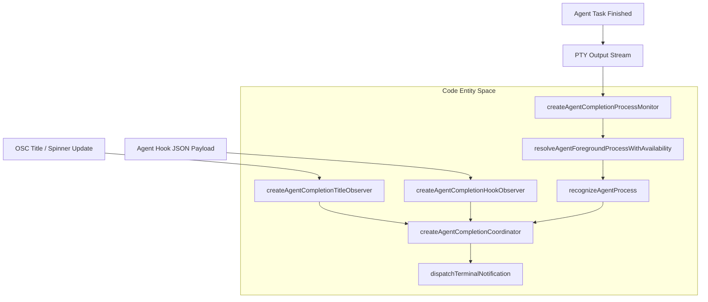
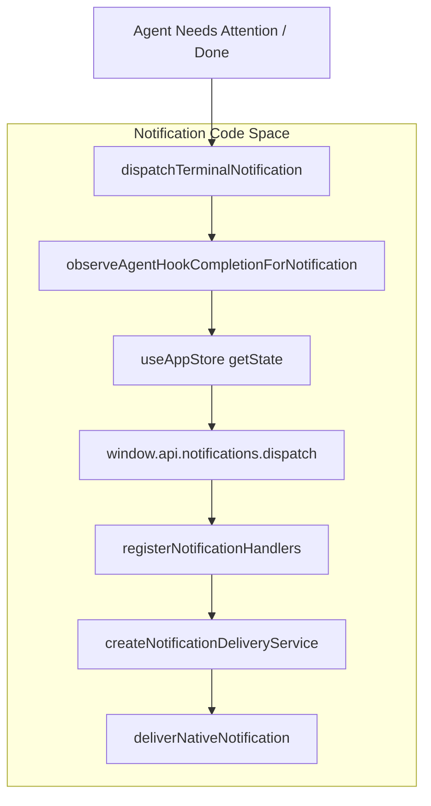

# Agent Completion & Notifications

## Purpose and Scope
This page details the implementation of agent completion detection, terminal process inspection monitors, notification dispatching, and floating terminal attention UX in Orca. It covers how the renderer and main process coordinate multi-source evidence (PTY output, hook events, and process table snapshots) to alert users when AI agent turns finish or require attention.

---

## Agent Completion Coordinator & Process Monitoring

The `createAgentCompletionCoordinator()` function acts as the central renderer-side controller for tracking AI agent lifecycle states within a terminal pane [src/renderer/src/components/terminal-pane/agent-completion-coordinator.ts:27-29](). It aggregates inputs from terminal titles, structured agent hooks, and process inspection monitors.

### Adaptive Polling & Evidence Tracking
The coordinator manages a mutable `CompletionState` object tracking current turns, working statuses, completion tokens, and completion sources [src/renderer/src/components/terminal-pane/agent-completion-coordinator.ts:34-47](). Concurrently, the process state tracks inspection cadences, process sessions, and background evidence:
- **Active / Idle / Hidden Tiers:** Process monitoring coordinates polling frequencies based on pane visibility and agent run evidence [src/renderer/src/components/terminal-pane/agent-completion-coordinator.ts:49-62]().
- **Process Snapshots:** Process table snapshot helpers (`[src/shared/process-table-snapshot.ts:22-50]()`) and parser functions like `parseShellForegroundRows()` [src/shared/process-table-snapshot.ts:60-80]() capture cheap and full process states to verify active descendant processes.
- **Foreground Resolution:** `resolveAgentForegroundProcessWithAvailability()` [src/main/providers/agent-foreground-process.ts:127-131]() and `confirmShellForegroundProcess()` [src/main/providers/agent-foreground-process.ts:71-76]() determine whether an expected agent binary is running in the PTY foreground or has exited.

Sources: [src/renderer/src/components/terminal-pane/agent-completion-coordinator.ts:27-69](), [src/shared/process-table-snapshot.ts:22-50](), [src/shared/process-table-snapshot.ts:60-80](), [src/main/providers/agent-foreground-process.ts:71-76](), [src/main/providers/agent-foreground-process.ts:127-131]()

---

## Agent Status & Process Recognition

Orca identifies agent states and binaries using strict configuration schemas and command-line pattern matching [src/shared/agent-status-types.ts:51-52]() [src/shared/agent-process-recognition.test.ts:1-12]().

### Status States and Recognition
- **Agent Status States:** Recognized states include `working`, `blocked`, `waiting`, and `done` [src/shared/agent-status-types.ts:51-52](). `AgentStatusEntry` maintains timestamps (`stateStartedAt`, `updatedAt`), prompt text, tool metadata, and historical state transitions [src/shared/agent-status-types.ts:76-120]().
- **Process Recognition:** Functions like `recognizeAgentProcess()` and `recognizeAgentProcessFromCommandLine()` map process binaries (such as `codex-aarch64-ap` or `claude`) while excluding non-interactive headless invocations (e.g., `--print` or `-p` runs) [src/shared/agent-process-recognition.test.ts:1-12]().

Sources: [src/shared/agent-status-types.ts:51-52](), [src/shared/agent-status-types.ts:76-120](), [src/shared/agent-process-recognition.test.ts:1-12]()

---

## Notification Dispatch & Attention UX

When an agent completes a task or transitions into an attention state (`waiting` or `blocked`), notification hooks and dispatchers handle alerting.

### Notification Pipeline & IPC Integration
- **Hook Integration:** `observeAgentHookCompletionForNotification()` listens to hook updates and decides when to trigger completion notifications based on user settings and quiet-window timers [src/renderer/src/hooks/agent-hook-completion-notifications.test.ts:103-120]().
- **Terminal Notifications:** `dispatchTerminalNotification()` validates event sources (such as `'agent-task-complete'` or `'terminal-bell'`), checks liveness, and dispatches OS-level notification requests through the IPC bridge [src/renderer/src/components/terminal-pane/pty-connection-types.ts:117-124]().

Sources: [src/renderer/src/components/terminal-pane/pty-connection-types.ts:117-124](), [src/renderer/src/hooks/agent-hook-completion-notifications.test.ts:103-120]()

---

## Data Flow & Entity Space

### Diagram: Natural Language to Code Entity Space (Completion & Process Detection)
This diagram bridges high-level agent runtime events to concrete codebase entities responsible for detection and inspection.

Sources: [src/renderer/src/components/terminal-pane/agent-completion-coordinator.ts:27-69](), [src/main/providers/agent-foreground-process.ts:127-131](), [src/shared/agent-process-recognition.test.ts:1-12]()

### Diagram: Natural Language to Code Entity Space (Notification Delivery)
This diagram maps user-facing attention requests to the store and IPC notification dispatch subsystem.

Sources: [src/renderer/src/components/terminal-pane/pty-connection-types.ts:117-124](), [src/renderer/src/hooks/agent-hook-completion-notifications.test.ts:103-120]()

---

## Summary
- **createAgentCompletionCoordinator()** unifies PTY process monitoring, OSC title observers, and hook events [src/renderer/src/components/terminal-pane/agent-completion-coordinator.ts:27-29]().
- **Process Recognition & Foreground Inspection** track TUI agents across platforms using process table snapshots [src/shared/process-table-snapshot.ts:22-50](), [src/main/providers/agent-foreground-process.ts:127-131]().
- **dispatchTerminalNotification** and hook observers manage deduplication, focus suppression, tray attention, and multi-platform delivery [src/renderer/src/components/terminal-pane/pty-connection-types.ts:117-124](), [src/renderer/src/hooks/agent-hook-completion-notifications.test.ts:103-120]().

Sources: [src/renderer/src/components/terminal-pane/agent-completion-coordinator.ts:27-29](), [src/shared/process-table-snapshot.ts:22-50](), [src/main/providers/agent-foreground-process.ts:127-131](), [src/renderer/src/components/terminal-pane/pty-connection-types.ts:117-124](), [src/renderer/src/hooks/agent-hook-completion-notifications.test.ts:103-120]()
