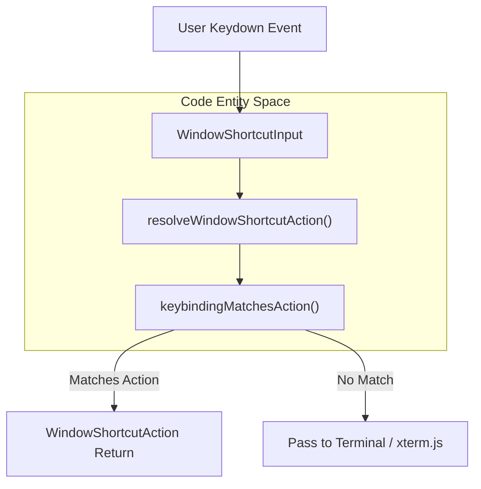
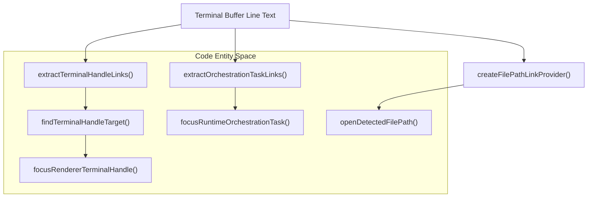

# Keyboard, IME & Terminal Links

This page details the implementation of keyboard input handling, Input Method Editor (IME) composition, window shortcut policies, and terminal link detection/routing within Orca's integrated terminal and desktop shell. It covers how keyboard shortcuts are processed, how IME input is managed, and how file paths, terminal handles, and task links displayed in the terminal are identified and routed.

Sources:
* [src/shared/window-shortcut-policy.ts:1-216]()
* [src/renderer/src/components/terminal-pane/terminal-link-handlers.ts:79-165]()
* [src/renderer/src/components/terminal-pane/terminal-file-open-routing.ts:115-181]()

## Keyboard Handlers and Shortcut Policy

Orca's terminal and desktop shell process keyboard events through a structured policy layer that resolves shortcut overrides, manages command execution, and arbitrates conflicts between terminal application bindings and Orca workspace commands.

The core logic for resolving window-level and terminal shortcut actions resides in `resolveWindowShortcutAction` [src/shared/window-shortcut-policy.ts:169-216]() and related policy helpers [src/shared/window-shortcut-policy.ts:1-168](). This function accepts a `WindowShortcutInput` [src/shared/window-shortcut-policy.ts:13-28]() event payload and evaluates matching keybindings against user configuration overrides.

**Figure 1: Window Shortcut Resolution Flow and Code Mapping**

Sources:
* [src/shared/window-shortcut-policy.ts:1-216]()

## IME Composition Handling

Input Method Editors (IMEs) are critical for composing complex character sets, especially for East Asian languages. Orca's terminal integrates specialized guards and event handlers to ensure composition sessions remain uninterrupted by terminal shortcut dispatchers.

During active IME composition, key sequences such as candidate selection digits or preedit modifiers are preserved and routed directly to the native IME layer or renderer composition target before any custom terminal shortcut evaluation occurs.

Sources:
* [src/shared/window-shortcut-policy.ts:1-126]()

## Terminal Link Detection, Handles & Routing

Orca's terminal provides robust detection and routing for file paths, terminal handles (`term_...`), and orchestration tasks (`task_...`), allowing users to click or trigger actions directly from terminal output buffers.

### File Link Providers and Path Routing

The `createFilePathLinkProvider` function [src/renderer/src/components/terminal-pane/terminal-link-handlers.ts:79-165]() instantiates an `ILinkProvider` for `xterm.js`. It extracts file paths from logical lines, checks existence caches, and binds activation callbacks.

When a file link is activated, `handleTerminalFileLink` [src/renderer/src/components/terminal-pane/terminal-file-link-actions.ts:37-59]() delegates to `openDetectedFilePath` [src/renderer/src/components/terminal-pane/terminal-file-open-routing.ts:115-181]() to load files into the editor, browser tabs, or external applications.

### Terminal Handles and Orchestration Tasks

Specialized link providers scan for prefixed tokens such as terminal handles (`term_...`) using `extractTerminalHandleLinks` [src/renderer/src/components/terminal-pane/terminal-handle-links.ts:56-62]() and orchestration tasks (`task_...`) using `extractOrchestrationTaskLinks` [src/renderer/src/components/terminal-pane/terminal-orchestration-task-links.ts:14-48](). Activating a terminal handle invokes `findTerminalHandleTarget` and `focusRendererTerminalHandle` [src/renderer/src/components/terminal-pane/terminal-handle-links.ts:108-154]() to switch active tabs and focus the corresponding PTY pane.

**Figure 2: Terminal Link Detection, Parsing, and Navigation Routing**

Sources:
* [src/renderer/src/components/terminal-pane/terminal-link-handlers.ts:79-165]()
* [src/renderer/src/components/terminal-pane/terminal-file-open-routing.ts:115-181]()
* [src/renderer/src/components/terminal-pane/terminal-file-link-actions.ts:37-59]()
* [src/renderer/src/components/terminal-pane/terminal-handle-links.ts:56-154]()
* [src/renderer/src/components/terminal-pane/terminal-orchestration-task-links.ts:14-48]()
