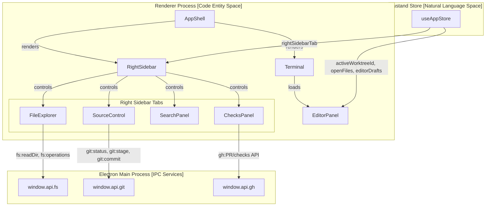
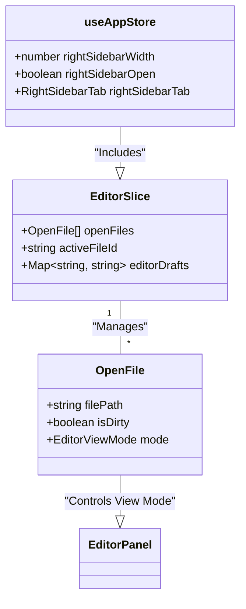

# Editor & Right Sidebar

The **Editor & Right Sidebar** subsystem forms the core interactive environment in Orca for editing code and managing repository-related tasks. The foundation is a Monaco-based editor panel centered on code editing experiences with rich diffing, conflict resolution, and markdown support. Alongside it, the right sidebar hosts utility tabs that provide access to file browsing, source control management, workspace search, and continuous integration/pull request checks. These UI regions communicate closely with the application’s state store, IPC services, and Git/GitHub integration to enable a seamless developer workflow inside the desktop Orca app [src/renderer/src/store/slices/editor.ts:22-42]().

---

### System Layout and High-Level Interaction

Orca’s main UI arranges the workspace across major vertical zones: the Terminal panel, the Monaco Editor Panel, and the Right Sidebar panels. The application shell orchestrates rendering these zones and controlling their visibility, layout, and active context based on user preferences and the active worktree [src/renderer/src/hooks/useEditorExternalWatch.ts:30-83]().

The Right Sidebar introduces multiple utility tabs that can be toggled and loaded on demand. Each tab interfaces with core IPC services to reflect and modify repository and workspace state including the file system, Git status, GitHub pull request data, search indices, and checks run statuses [src/renderer/src/store/slices/editor.ts:2-5]().

**Natural Language to Code Entity Space Mapping**

**Sources:**
[src/renderer/src/store/slices/editor.ts:2-42](),
[src/renderer/src/hooks/useEditorExternalWatch.ts:30-83]()

---

## 6.1 Monaco Editor Panel

At the heart of Orca’s editing capabilities is the editor panel infrastructure (`EditorPanel`), which leverages the Monaco Editor framework for a full-featured code editor experience [src/renderer/src/components/editor/EditorPanel.tsx:1-45](). File states, dirty detection, autosave coordination via `attachEditorAutosaveController`, and external file watching are orchestrated by Zustand slices and helper modules [src/renderer/src/store/slices/editor.ts:22-23](), [src/renderer/src/components/editor/editor-autosave.ts:82-93](), [src/renderer/src/components/editor/editor-autosave-controller.ts:23-27]().

### Key Features
- **View Modes:** Supports `edit`, `diff`, and combined diff modes, along with specialized conflict resolution views [src/renderer/src/store/slices/editor.ts:10-20]().
- **Dirty State & Autosave:** Tracks unsaved changes via `editorDrafts` and manages robust autosave schedules, external file watching, and self-write throttling [src/renderer/src/hooks/useEditorExternalWatch.ts:30-121](), [src/renderer/src/components/editor/editor-autosave.ts:82-114]().
- **Language Detection & Viewers:** Automatically detects file types for syntax highlighting via `detectLanguage` and provides specialized support such as the Jupyter notebook (`.ipynb`) viewer [src/renderer/src/components/editor/EditorPanel.tsx:1-5](), [src/renderer/src/components/editor/EditorPanelShell.tsx:98-133]().

For details, see [Monaco Editor Panel](#6.1).

**Sources:**
[src/renderer/src/store/slices/editor.ts:1-42](),
[src/renderer/src/hooks/useEditorExternalWatch.ts:30-121](),
[src/renderer/src/components/editor/editor-autosave.ts:82-114](),
[src/renderer/src/components/editor/EditorPanel.tsx:1-45](),
[src/renderer/src/components/editor/editor-autosave-controller.ts:23-27]()

---

## 6.2 Right Sidebar Panels

The Right Sidebar consolidates several essential utility tabs aiding navigation, version control, searching, and status monitoring.

### Sidebar Tabs Overview

| Panel | Component / Module | Primary Role |
| :--- | :--- | :--- |
| **File Explorer** | `FileExplorer` | Virtualized tree for file operations (CRUD, drag-and-drop) with cross-platform path helpers [src/renderer/src/store/slices/editor.ts:2-5]() |
| **Source Control** | `SourceControl` | Git UI for staging, committing, and conflict resolution [src/renderer/src/store/slices/editor.ts:2-5]() |
| **Search** | `SearchPanel` | Workspace-wide text search with debounced results [src/renderer/src/store/slices/editor.ts:2-5]() |
| **Checks** | `ChecksPanel` | CI/CD status, PR comments, and GitHub Actions integration [src/renderer/src/store/slices/editor.ts:2-5]() |

For details, see [Right Sidebar Panels](#6.2).

**Sources:**
[src/renderer/src/store/slices/editor.ts:1-5]()

---

## 6.3 GitHub PR & Checks Integration

Orca tightly integrates GitHub’s pull request and checks APIs into its environment, handled primarily through store slices and main process clients [src/renderer/src/store/slices/editor.ts:1-5]().

### Highlights
- **State Caching:** Manages caches for PRs, issues, checks, and comments.
- **PR Actions:** Supports merging, auto-merging, and review thread resolution.
- **Checks Polling:** Maintains data freshness with adaptive backoff and polling hooks.

For details, see [GitHub PR & Checks Integration](#6.3).

**Sources:**
[src/renderer/src/store/slices/editor.ts:1-5]()

---

## 6.4 Rich Markdown & Image Editors

Orca provides a sophisticated environment for authoring and previewing Markdown documents, moving beyond plain text editing [src/renderer/src/components/editor/editor-autosave.ts:62-68]().

### Capabilities
- **Rich Editor & Preview:** Supports serialization, round-trip normalization, and GFM / Mermaid diagrams [src/renderer/src/components/editor/EditorPanelShell.tsx:134-164]().
- **Internal Linking & Images:** Resolves document links and handles local image picking within the workspace [src/renderer/src/components/editor/editor-autosave.ts:62-68]().

For details, see [Rich Markdown & Image Editors](#6.4).

**Sources:**
[src/renderer/src/components/editor/editor-autosave.ts:62-68](),
[src/renderer/src/components/editor/EditorPanelShell.tsx:134-164]()

---

## 6.5 Task Trackers: Linear, Jira & Integrations

Orca integrates with popular task tracking systems like Linear and Jira to streamline workflow management directly within the application [src/renderer/src/store/slices/editor.ts:1-5]().

### Highlights
- **Store Slices & Clients:** Integrations maintain state within Zustand store slices while main-process clients communicate with external APIs.
- **Settings & Tasks Surfaces:** Users can configure integrations through settings cards and view work items in dedicated task page surfaces.

For details, see [Task Trackers: Linear, Jira & Integrations](#6.5).

**Sources:**
[src/renderer/src/store/slices/editor.ts:1-5]()

---

## Workspace Layout & State Persistence

Editor and right sidebar visibility, sizing, and tab state are persisted via the `EditorSlice` Zustand store slice [src/renderer/src/store/slices/editor.ts:22-23]().

**Natural Language to Code Entity Space Mapping**

**Sources:**
[src/renderer/src/store/slices/editor.ts:7-23]()
