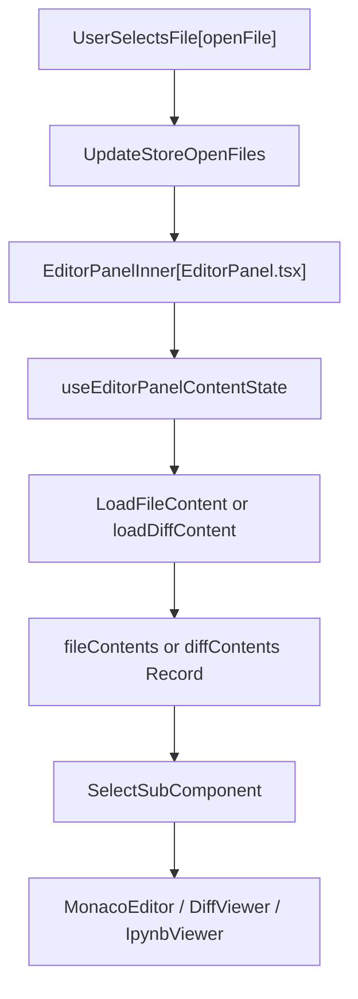
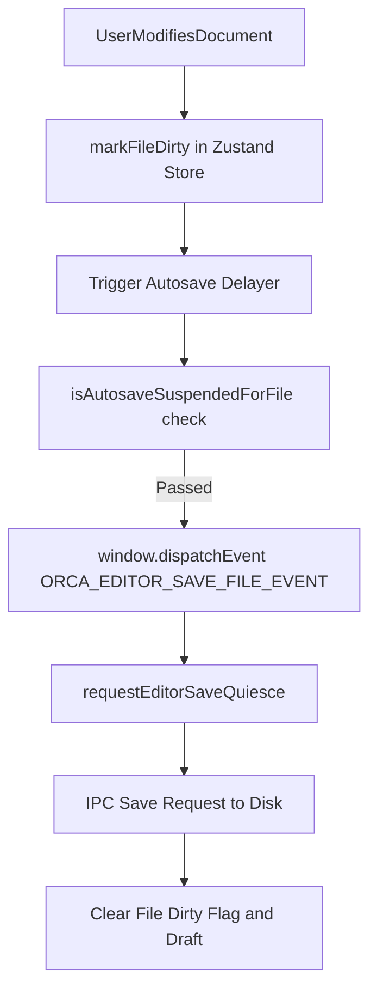

# Monaco Editor Panel

The Monaco Editor Panel is the central editor surface within Orca’s renderer process, built upon the Visual Studio Code Monaco Editor framework. It provides a robust set of viewing and editing modes—including single-file editing, individual file diffs, combined multi-file diffs, interactive conflict review, and rich markdown authoring. This component coordinates view modes, dirty-state tracking, save flows, language detection, IPython notebook viewing, and inline diff annotations.

---

## EditorPanel View Modes

The central React component driving this view is `EditorPanelInner` (`src/renderer/src/components/editor/EditorPanel.tsx`), which inspects the active file's metadata (`OpenFile.mode` and `diffSource`) to select the correct sub-surface [src/renderer/src/components/editor/EditorPanel.tsx:29-50]().

| Mode | Component | Description |
| :--- | :--- | :--- |
| **Edit** | `MonacoEditor` | Single-file editor supporting syntax highlighting, code editing, and cursor preservation. |
| **Diff** | `DiffViewer` | Side-by-side or inline diff viewer comparing original and modified revisions. |
| **Combined Diff** | `CombinedDiffViewer` | Unified multi-file scrollable diff mimicking pull request review layouts. |
| **Conflict Review** | `EditorConflictReviewSurface` | Interactive merge conflict resolution surface. |
| **Markdown Preview** | `MarkdownPreview` | Rendered markdown surface supporting math, Mermaid diagrams, and internal links. |
| **Changes Mode** | Inline diff surface (`EditorPanel.tsx`) | Allows direct inline modifications on staged or unstaged file revisions. |

Sources:
- `src/renderer/src/components/editor/EditorPanel.tsx:29-50`
- `src/renderer/src/store/slices/editor.ts:1-25`

---

## Data Flow: Content Loading and Synchronization

File and diff contents are fetched and managed asynchronously via `useEditorPanelContentState` (`src/renderer/src/components/editor/useEditorPanelContentState.ts`), which coordinates content loaders, read generations, and cache states [src/renderer/src/components/editor/useEditorPanelContentState.ts:34-41]().

Key mechanisms include:
- **`fileContents` & `diffContents`**: Record lookups mapping file IDs to loaded content payloads or diff structures [src/renderer/src/components/editor/useEditorPanelContentState.ts:28-30]().
- **Read Generations**: Per-tab generation counters (`fileReadGenerationRef`) ensure that slower, older in-flight promises cannot overwrite newer explicit or external reloads [src/renderer/src/components/editor/useEditorPanelContentState.ts:46-51]().
- **External Watch Sync**: `useEditorExternalWatch` (`src/renderer/src/hooks/useEditorExternalWatch.ts`) maintains filesystem subscriptions across worktrees, dispatching change events when files mutate externally [src/renderer/src/hooks/useEditorExternalWatch.ts:24-33]().

Sources:
- `src/renderer/src/components/editor/useEditorPanelContentState.ts:34-53`
- `src/renderer/src/hooks/useEditorExternalWatch.ts:24-77`

### Diagram 1: Content Loading to Component Rendering

Sources:
- `src/renderer/src/components/editor/EditorPanel.tsx:29-50`
- `src/renderer/src/components/editor/useEditorPanelContentState.ts:34-41`

---

## Monaco Editor Setup and Language Detection

### Monaco Environment and Language Extensions

Monaco is initialized globally in `src/renderer/src/lib/monaco-setup.ts`:
- **Worker Environment**: `MonacoEnvironment.getWorker()` dynamically resolves workers for JSON, CSS/SCSS/LESS, HTML, and TypeScript/JavaScript [src/renderer/src/lib/monaco-setup.ts:25-44]().
- **Disabled Diagnostics**: To prevent false-positive errors (such as missing project import resolutions or partial parse errors inside diff hunks), semantic, suggestion, and syntax validation are explicitly disabled for TS/JS [src/renderer/src/lib/monaco-setup.ts:59-64]().
- **Custom Languages**: Registrations extend Monaco with support for Vue, Svelte, Astro, Nim, Typst, JSONL, and Quarto [src/renderer/src/lib/monaco-setup.ts:82-90]().
- **IPC Clipboard Integration**: Context-menu paste is routed through trusted IPC channels to bypass sandboxed clipboard restrictions [src/renderer/src/lib/monaco-setup.ts:94-97]().

### Language Detection Logic

File types are identified via `detectLanguage(filePath)` (`src/renderer/src/lib/language-detect.ts`), which maps exact filenames and extensions to Monaco language IDs [src/renderer/src/lib/language-detect.ts:152-173]():
- Exact filename matches handle configuration files like `Dockerfile`, `Makefile`, and `.env` [src/renderer/src/lib/language-detect.ts:153-162]().
- Extension maps cover common source formats (e.g., `.ts`, `.tsx`, `.py`, `.rs`, `.go`, `.ipynb`, `.jsonl`) [src/renderer/src/lib/language-detect.ts:12-122]().
- Unrecognized files fall back gracefully to `plaintext` [src/renderer/src/lib/language-detect.ts:168-172]().

Sources:
- `src/renderer/src/lib/monaco-setup.ts:25-100`
- `src/renderer/src/lib/language-detect.ts:152-173`

---

## Dirty State Tracking and Save Flows

Dirty-state and autosave behaviors are managed through `src/renderer/src/components/editor/editor-autosave.ts`:
- **Autosave Eligibility**: `canAutoSaveOpenFile(file)` ensures single-file edits and unstaged single-file diffs autosave, while read-only vaults or multi-file conflict views remain excluded [src/renderer/src/components/editor/editor-autosave.ts:72-83]().
- **Suspension Checks**: Autosave is suspended during external mutations, baseline verifications, or owner migrations via `isAutosaveSuspendedForFile` [src/renderer/src/components/editor/editor-autosave.ts:89-104]().
- **Quiescence & Save Requests**: Custom DOM events (`ORCA_EDITOR_QUIESCE_FILE_SAVES_EVENT`, `ORCA_EDITOR_SAVE_FILE_EVENT`) coordinate active save transactions across components and the main process [src/renderer/src/components/editor/editor-autosave.ts:12-18], [src/renderer/src/components/editor/editor-autosave.ts:157-190]().

Sources:
- `src/renderer/src/components/editor/editor-autosave.ts:12-104`, `157-190`

### Diagram 2: Editor Autosave and Save Request Architecture

Sources:
- `src/renderer/src/components/editor/editor-autosave.ts:72-104`, `157-190`

---

## IPython Notebook (`.ipynb`) Viewer and Diff Comments

- **Notebook Viewer**: Notebook files (`.ipynb`) are detected with the `notebook` language ID [src/renderer/src/lib/language-detect.ts:31]() and rendered via `IpynbViewer`, parsing JSON structures into interactive cell elements.
- **Diff Comments**: Inline comments on diff views are anchored using custom view zones and decoration hooks, enabling review interactions directly inside `DiffViewer` and `DiffSectionItem` components.

Sources:
- `src/renderer/src/lib/language-detect.ts:31`
- `src/renderer/src/components/editor/EditorContent.tsx:113`
