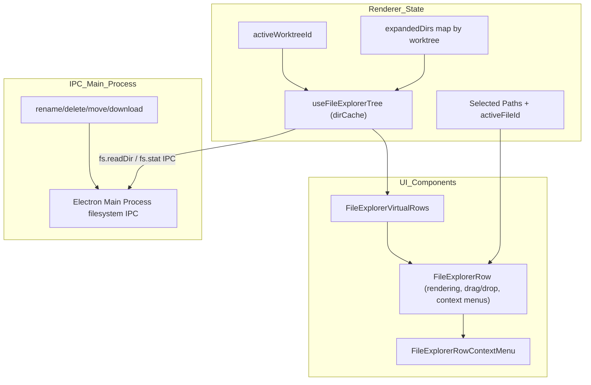
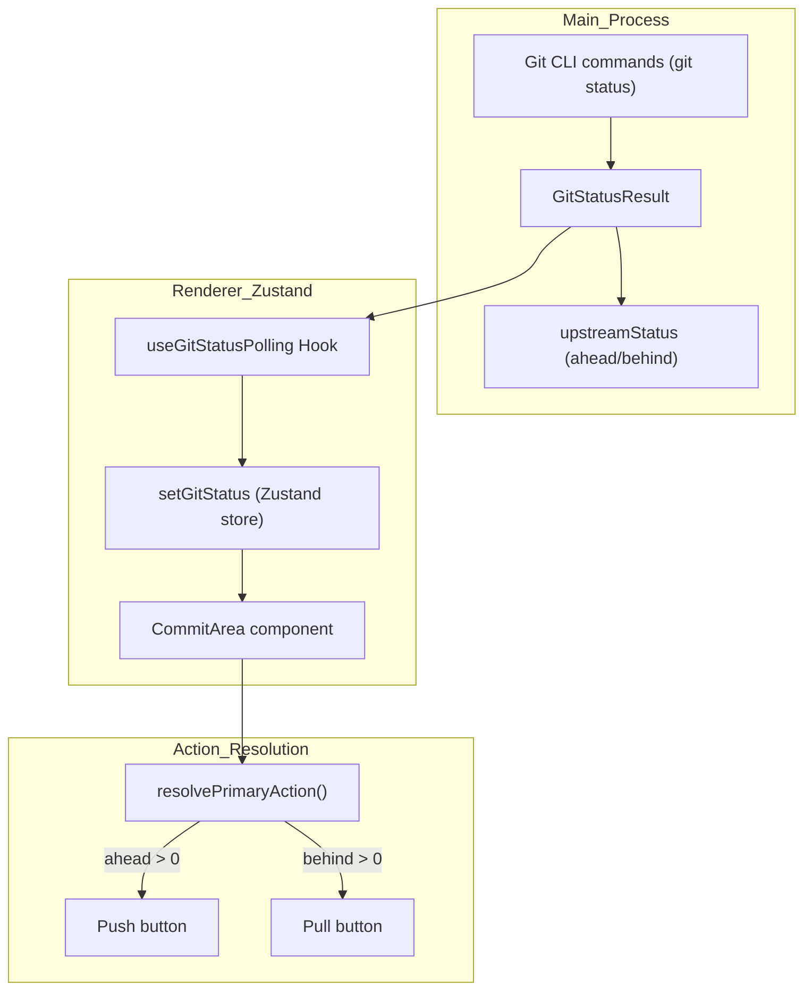
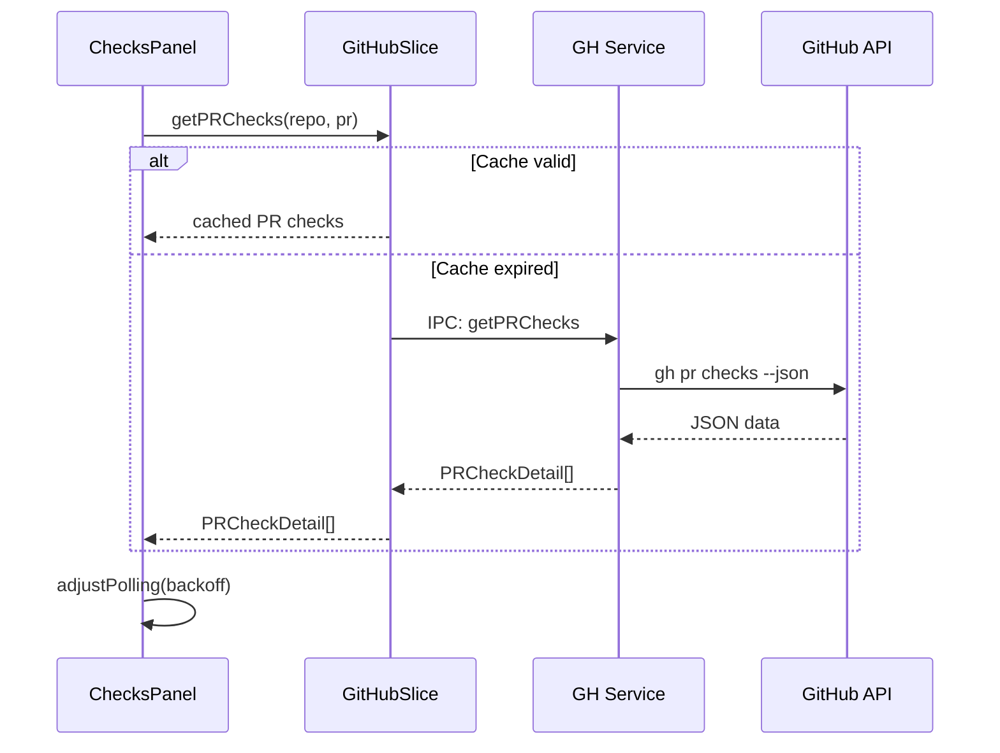

# Right Sidebar Panels

The Right Sidebar in Orca provides a suite of utility tabs tailored to the currently active worktree context. It comprises four main panels:

- **File Explorer**: A virtualized directory tree for navigation and file operations.
- **Source Control**: Git status, staging, and commit interface.
- **Search**: Full-text search integration with scoped filters.
- **Checks Panel**: GitHub CI checks, status, and PR interaction including polling and adaptive backoff.

All panels integrate tightly with the renderer's global Zustand store (`useAppStore`) for shared client-side state and communicate asynchronously via IPC channels to the Electron main process for filesystem and Git interactions.

The sidebar remains mounted even when closed to optimize performance and state retention, using CSS techniques (`overflow-hidden` on the container) to prevent UI bleeding when width collapses to zero.

---

## File Explorer

The **File Explorer** panel displays the active worktree's filesystem hierarchy as an interactive, virtualized file tree.

### Implementation Details

- **Tree Data & Virtualization**:
  - The directory tree is managed by multiple custom hooks combined in `FileExplorer.tsx` [src/renderer/src/components/right-sidebar/FileExplorer.tsx:21-27]().
  - It uses virtualized rendering to handle large directory structures efficiently [src/renderer/src/components/right-sidebar/FileExplorer.tsx:113-167]().
  - The tree state includes expanded folder paths per worktree ID, tracked globally in the Zustand store under `expandedDirs` [src/renderer/src/components/right-sidebar/FileExplorer.tsx:39-63]().

- **Directory Loading and Caching**:
  - The `useFileExplorerTree` hook fetches folder contents asynchronously via IPC filesystem calls managed by the main process [src/renderer/src/components/right-sidebar/FileExplorer.tsx:65-65]().
  - It maintains a `dirCache` mapping folder paths to loaded directory nodes, enabling quick refresh and incremental updates [src/renderer/src/components/right-sidebar/FileExplorer.tsx:97-97]().

- **Selection and Operations**:
  - Selection state and active file highlighting are synchronized with the global store [src/renderer/src/components/right-sidebar/FileExplorer.tsx:41-43]().
  - Inline operations such as rename and new file/folder creation use the `FileExplorerRow` component [src/renderer/src/components/right-sidebar/FileExplorerRow.tsx:48-50]().
  - File deletion is handled with confirmation dialogs, coordinated to save dirty editor buffers before permitting deletes.

- **Drag and Drop Support**:
  - Implements drag and drop within the file tree for moving files and folders using `useFileExplorerRowDrag` [src/renderer/src/components/right-sidebar/FileExplorerRow.tsx:107-118]().
  - Supports native OS file imports and multi-select drag ghosts [src/renderer/src/components/right-sidebar/FileExplorerRow.tsx:159-167]().

### Data Flow and Component Structure

Diagram: File Explorer Architecture and IPC Data Flow

Sources: [src/renderer/src/components/right-sidebar/FileExplorer.tsx:1-176](), [src/renderer/src/components/right-sidebar/FileExplorerRow.tsx:1-200]()

---

## Source Control Panel

The **Source Control** tab surfaces the Git status of the active worktree repository, showing staged, unstaged, and untracked changes, along with commit staging and push/pull controls [src/renderer/src/components/right-sidebar/SourceControl.tsx:1-61]().

### Git Status Polling and Refresh

- Polling for Git status is managed inside the renderer by the `useGitStatusPolling` hook, which orchestrates refresh requests via IPC calls to the main process Git utilities.
- Polling adapts intelligently, respecting app window visibility and applying exponential backoff on slow or failing queries.
- SSH connection status affects polling: for SSH-connected repos, polling suspends until the SSH connection enters a `connected` state.

### UI Integration

- The Source Control UI components consume the store's Git status to update file listings and commit message editors [src/renderer/src/components/right-sidebar/SourceControl.tsx:20-36]().
- The `CommitArea` component derives its primary actions (commit, push, pull, sync) from Git status, upstream, and conflict data [src/renderer/src/components/right-sidebar/SourceControl.tsx:20-20]().
- AI integration provides prompts for resolving conflicts and fixing commit/push failures [src/renderer/src/components/right-sidebar/SourceControl.tsx:42-51]().

### Source Control Status Data Flow

Diagram: Source Control Status and Action Resolution

Sources: [src/renderer/src/components/right-sidebar/SourceControl.tsx:1-61](), [src/renderer/src/components/right-sidebar/CommitArea.test.tsx:1-198]()

---

## Search and Quick-Open

The **Search** tab provides workspace-scoped full-text search capabilities with advanced filters.

### Functional Highlights

- Activated by the Zustand actions `showRightSidebarSearch` and `showRightSidebarFiles` [src/renderer/src/components/right-sidebar/FileExplorer.tsx:32-35]().
- Search results are presented in a dedicated `SearchResultsPane` [src/renderer/src/components/right-sidebar/FileExplorer.tsx:15-15]().
- The UI includes `SearchFilters` and `SearchQueryRow` for refining queries [src/renderer/src/components/right-sidebar/FileExplorer.tsx:13-14]().
- It integrates with `ripgrep` or `git grep` via the main process to perform the actual search operations. The `listFilesWithGit` function [src/relay/fs-handler-git-fallback.ts:41-197]() and related `quick-open-filter` utilities [src/shared/quick-open-filter.ts:1-17]() are used as fallbacks when `ripgrep` is not available.

Sources: [src/renderer/src/components/right-sidebar/FileExplorer.tsx:13-16, 32-35, 77-87](), [src/relay/fs-handler-git-fallback.ts:41-197](), [src/shared/quick-open-filter.ts:1-17]()

---

## Checks Panel

The **Checks** panel integrates GitHub CI status and Pull Request (PR) feedback, including conflict detection, comments, and triage actions.

### Implementation and State

- The panel uses a multi-layered controller architecture including `useChecksPanelControllerState`, `useChecksPanelReviewState`, and `useChecksPanelPolling` [src/renderer/src/components/right-sidebar/ChecksPanel.tsx:151-155]().
- GitHub check statuses are fetched and cached within the `GitHubSlice` of the Zustand store [src/renderer/src/store/slices/github.ts:31, 80]().
- The panel supports both GitHub and GitLab providers, mapping PR/MR states to specific icons and colors [src/renderer/src/components/right-sidebar/ChecksPanel.tsx:63-65, 97-101]().
- Localization for the Checks panel is available, with specific translations for extended actions [src/renderer/src/components/right-sidebar/ChecksPanel.tsx:68-70]().

### Polling and Backoff

- The panel polls GitHub for PR check results using IPC calls through the `window.api.gh` namespace [src/main/ipc/github.ts:6-7]().
- Caching with TTL is handled in the `GitHubSlice` to avoid excessive API calls [src/renderer/src/store/slices/github.ts:91-104]().
- Poll intervals use adaptive backoff managed by `useChecksPanelPolling` [src/renderer/src/components/right-sidebar/ChecksPanel.tsx:27-27]().

### Checks Panel Data Flow Sequence

Diagram: Checks Panel Polling and Caching Sequence

Sources: [src/renderer/src/components/right-sidebar/ChecksPanel.tsx:1-160](), [src/renderer/src/store/slices/github.ts:1-104](), [src/main/github/client.ts:16-17](), [src/main/ipc/github.ts:1-21](), [src/renderer/src/i18n/locales/en.json:123-124]()
