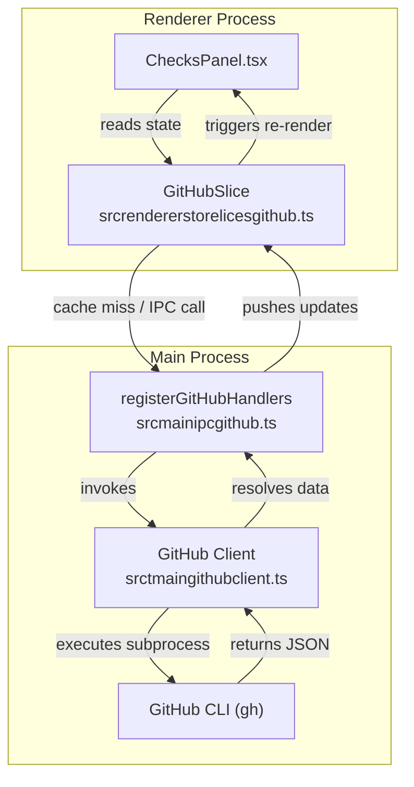
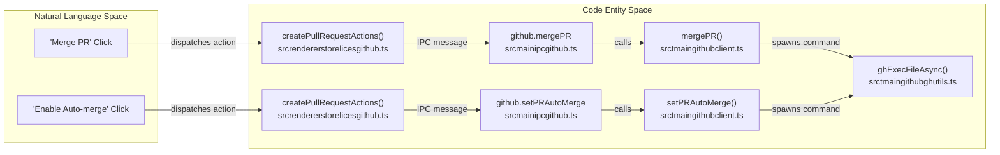
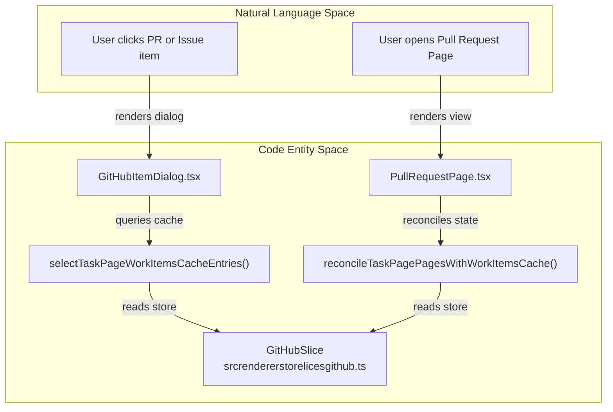

# GitHub PR & Checks Integration

This page provides a technical explanation of how Orca integrates with GitHub and GitLab, focusing on Pull Requests (PRs), Merge Requests (MRs), Checks, and related UI components. It covers the architecture of the GitHub client, renderer state slices, polling and backoff logic, merge actions, and the item dialog / PR page surfaces.

---

## Purpose and Scope

The GitHub and Checks subsystem bridges local worktree contexts with remote code-hosting platforms (GitHub and GitLab). Its responsibilities include:
- Spawns and manages CLI (`gh`) execution with concurrency limiting and error classification.
- Manages caching, TTL, and state synchronization inside the renderer `GitHubSlice` [src/renderer/src/store/slices/github.ts:1-106]().
- Orchestrates background polling, visibility tracking, and exponential backoff for CI/CD checks via `pr-refresh-coordinator.ts`.
- Exposes interactive surfaces such as `ChecksPanel` [src/renderer/src/components/right-sidebar/ChecksPanel.tsx:1-150](), `GitHubItemDialog`, and `PullRequestPage`.

Sources:
- [src/renderer/src/store/slices/github.ts:1-106]()
- [src/renderer/src/components/right-sidebar/ChecksPanel.tsx:1-150]()

---

## GitHub CLI Client Architecture

Orca’s GitHub integration in the main process centers on a modular CLI client and utility layer that executes GitHub CLI (`gh`) commands with structured JSON output, concurrency control, and rate-limit guardrails.

### Concurrency Limiting and Execution

To prevent spawning excessive parallel GitHub CLI invocations and hitting platform rate limits, Orca uses concurrency control functions (`acquire()` and `release()`) [src/main/gitlab/gl-utils.test.ts:20-21]() that bound parallel GitHub operations and queue excess requests. Subprocess execution runs via `ghExecFileAsync` [src/main/git/runner.ts:43-43](), which supports WSL fallback routing and process environment configuration.

### Data Retrieval Strategy

- **Command-Based Fetching:** Metadata such as PR lists, state changes, and branch lookups are retrieved via specialized functions wrapping `gh pr` commands [src/main/github/client.ts:1-49]().
- **GraphQL Bundled Queries:** For complex UI components, the client executes bundled GraphQL queries to fetch issues, comments, reviews, and assignees in a single round-trip.
- **Work Item Counting:** Specialized methods like `countWorkItems` tally open items across repositories for dashboard badges and overview summaries [src/main/github/client.ts:12-12]().

### Merge Queue & Repository Metadata Caching

Repository-level metadata regarding merge queue requirements and auto-merge availability are cached to enhance UI responsiveness. These caches live under `repository-merge-metadata-cache` and determine valid merge strategies for a given PR [src/main/github/client.ts:2-4]().

Sources:
- [src/main/github/client.ts:1-49]()
- [src/main/git/runner.ts:43-43]()
- [src/main/gitlab/gl-utils.test.ts:20-21]()

---

## GitHub State Management Slice (`GitHubSlice`)

The renderer process maintains its GitHub-related state using a Zustand slice defined in `src/renderer/src/store/slices/github.ts` [src/renderer/src/store/slices/github.ts:1-106](). This slice centralizes caching, request coordination, and mutation dispatching for PRs, issues, project views, checks, and comments.

### Cache Design and TTL

The slice manages multiple scoped caches:
- `prCache`: Stores Pull Request details and mergeability states [src/renderer/src/store/slices/github.ts:29-29]().
- `issueCache`: Stores Issue payloads [src/renderer/src/store/slices/github.ts:30-30]().
- `checksCache`: Stores CI/CD check suites and run results [src/renderer/src/store/slices/github.ts:31-31]().
- `commentsCache`: Stores PR and issue conversation threads [src/renderer/src/store/slices/github.ts:32-32]().

### Refresh State and Expiration

Active refreshes use sequence tokens (`prRefreshSequences` and `prRefreshStates`) to prevent race conditions. The `expireGitHubPRRefreshState` method manages token expiration, pruning stale or timed-out refresh states [src/renderer/src/store/slices/github.ts:45-74]().

### Persistence

On startup, `initGitHubCache` hydrates the store from disk via `window.api.cache.getGitHub()` [src/renderer/src/store/slices/github.ts:93-105](). Stale entries are evicted automatically using `evictStaleEntries` [src/renderer/src/store/slices/github.ts:98-98]().

Sources:
- [src/renderer/src/store/slices/github.ts:1-106]()

---

## Checks Panel & Polling Behavior

The `ChecksPanel` component [src/renderer/src/components/right-sidebar/ChecksPanel.tsx:150-150]() provides the primary UI surface for inspecting PR status, reviewing CI checks, and triggering workflow actions.

### Polling, Pacing, and Backoff

Polling and backoff logic reside in the main process under `pr-refresh-coordinator.ts`:
- **Queue & Pacing:** `PRRefreshQueue` enqueues candidates, while `PRRefreshPacing` manages request rate limits and bursts.
- **Retry State:** `PRRefreshRetryState` implements exponential backoff for failed network or upstream errors.
- **Manual Refresh:** `refreshPRNow()` bypasses standard pacing queues to immediately query `getPRForBranchOutcome()`.
- **Visibility Tracking:** `reportVisiblePRRefreshCandidates()` ensures only active, visible worktrees participate in background polling loops.

### UI Presentation and Localization

- **Status Presentation:** Status pills use `prStateColor` to indicate `OPEN`, `MERGED`, `CLOSED`, or `CONFLICTING` states [src/renderer/src/components/right-sidebar/ChecksPanel.tsx:94-101]().
- **Multi-Provider Support:** Headers dynamically switch icons and labels between GitHub (`#`) and GitLab (`!`) based on `review.provider` [src/renderer/src/components/right-sidebar/ChecksPanel.tsx:63-65]().

Sources:
- [src/renderer/src/components/right-sidebar/ChecksPanel.tsx:53-150]()

---

## PR Actions: Merge & Auto-Merge

Users can manage PR lifecycles directly from the `ChecksPanel` and source control views.

### Merge Operations and Mutations

- `mergePR()` executes the final merge operation supporting various strategies (merge, squash, rebase) [src/main/github/client.ts:32-32]().
- `setPRAutoMerge()` schedules auto-merging once required CI checks pass [src/main/github/client.ts:36-36]().
- Review interactions include `addPRReviewComment()` [src/main/github/client.ts:10-10](), `resolveReviewThread()` [src/main/github/client.ts:35-35](), and `requestPRReviewers()` [src/main/github/client.ts:33-33]().

Sources:
- [src/main/github/client.ts:10-36]()
- [src/renderer/src/store/slices/github.ts:1-106]()

---

## GitHub/GitLab Item Dialogs and PR Page

Orca provides dedicated dialogs and full pages for inspecting work items across multiple repository origins.

### Item Dialogs and PR Pages

- **`GitHubItemDialog`:** Renders work item details, comments, and review threads.
- **`PullRequestPage`:** Offers a dedicated tabbed interface for managing PR discussions, file diffs, and review approvals.

### Work Item Reconciliation

The task page cache selectors coordinate item cache states:
- `selectTaskPageWorkItemsCacheEntries`: Fetches cache entries scoped by repository and query parameters.
- `buildTaskPageRepoSourceState`: Aggregates issue and PR fetch sources.
- `reconcileTaskPagePagesWithWorkItemsCache`: Keeps pagination lists synchronized with updated cache entries.

Sources:
- [src/renderer/src/store/slices/github.ts:1-106]()
