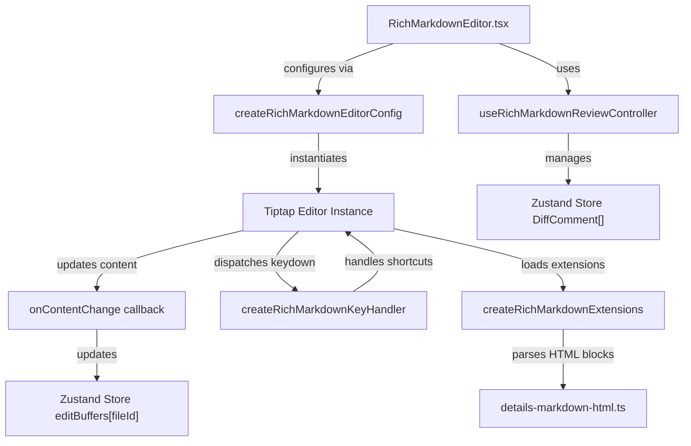
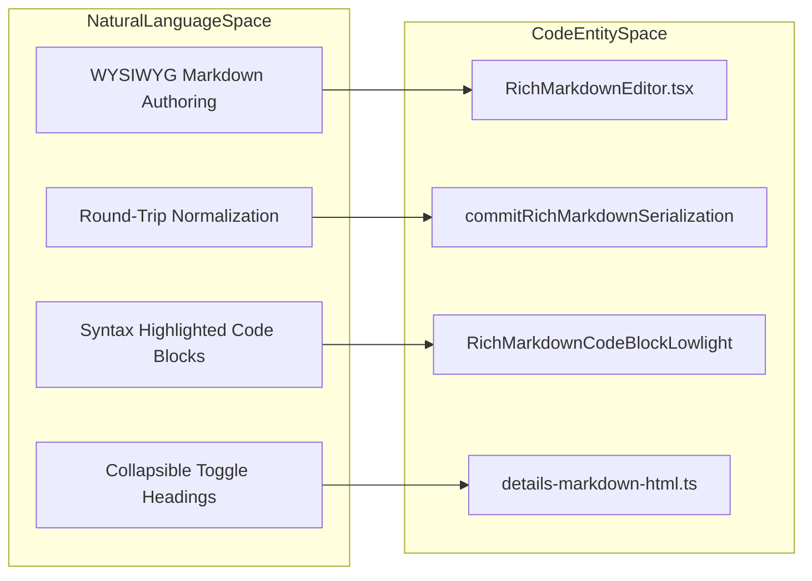
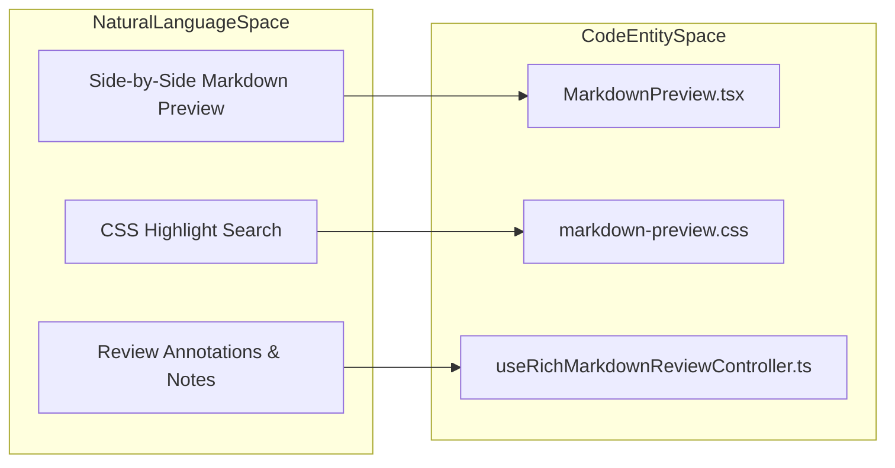

# Rich Markdown & Image Editors

The Orca editor panel supports a comprehensive suite of rich media editors and viewers that extend beyond the standard Monaco text editor. These editors facilitate robust Markdown authoring, real-time previewing, round-trip normalization, diff-aware views, code block widgets, and complex review workflows involving annotations and comments. Additionally, specialized viewers serve images, CSVs, Mermaid diagrams, and Jupyter notebooks. This page details the architecture, data flows, core components, and supporting hooks underlying the rich Markdown and image editing experience used throughout Orca's review and documentation flows.

---

## Rich Markdown Editor (Tiptap)

The `RichMarkdownEditor` component delivers a WYSIWYG Markdown authoring experience built on top of the [Tiptap](https://tiptap.dev/) framework, which itself is a wrapper around ProseMirror. It excels at supporting feature-rich Markdown editing with advanced interactions such as inline diff comments, link bubbles, embedded images, and a table of contents synchronized with document headings.

### Implementation Details

- **Core Component**: `RichMarkdownEditor.tsx` is the React component rendering the Tiptap editor surface, handling content updates, serialization, and interaction with the global app state. It maintains references to the editor instance and handles throttled serialization to Markdown for the outer environment [src/renderer/src/components/editor/RichMarkdownEditor.tsx:36-148]().
- **Data Flow and Synchronization**: The editor receives Markdown source content and creates a Tiptap/ProseMirror editor instance using extensions defined in `rich-markdown-extensions.ts` that parse and render Markdown elements while supporting custom interactive features. Changes update an internal document model, and serialization is optimized to minimize diff noise by preserving original formatting in unchanged regions using a reconciliation step (`commitRichMarkdownSerialization`) [src/renderer/src/components/editor/RichMarkdownEditor.tsx:19-20](), [src/renderer/src/components/editor/rich-markdown-extensions.ts:55-65]().
- **Editor Extensions**: Extensions include GitHub-flavored Markdown features such as task lists, tables, superscript links, raw HTML blocks, details blocks, and detailed review annotation highlights. They support rich node views, coerced updates, and link interaction customization [src/renderer/src/components/editor/rich-markdown-extensions.ts:69-157](). The `details-markdown-html.ts` file defines types and utilities for handling `
` HTML blocks, including parsing attributes and rendering them back to Markdown [src/renderer/src/components/editor/details-markdown-html.ts:1-94]().
- **Local Image Handling**: The editor supports inserting and displaying local images via a custom Image node view that wraps images in inline-block spans to prevent native drag conflicts [src/renderer/src/components/editor/rich-markdown-extensions.ts:114-135](). Local file paths are resolved to blob URLs via IPC to Electron's main process for secure and consistent access [src/renderer/src/components/editor/rich-markdown-extensions.ts:140-157]().
- **Throttled Serialization**: To improve performance and UX, serialization to Markdown source is throttled using a timer that flushes edits into a canonical form. Explicit save operations or component unmount flush immediately to persist final state [src/renderer/src/components/editor/RichMarkdownEditor.tsx:95-96]().
- **Table of Contents**: The `useRichMarkdownTableOfContents` hook extracts heading structure from the Markdown content, facilitating synchronized navigation and display of the table of contents, which can be toggled independently [src/renderer/src/components/editor/RichMarkdownEditor.tsx:13-13](), [src/renderer/src/components/editor/RichMarkdownEditor.tsx:123-128]().
- **Key Handling**: The `createRichMarkdownKeyHandler` function defines custom keyboard shortcuts and behaviors for the editor, including handling list continuations, table navigation, search triggers, save shortcuts, review note chords, and specific Markdown formatting [src/renderer/src/components/editor/rich-markdown-key-handler.ts:80-176]().

### Review Mode Integration

This editor tightly integrates with Orca’s review infrastructure:

- Displays inline review comments anchored to text ranges, rendered as diff comment cards embedded in the editor view.
- Manages lifecycle and selection of review comments through `useRichMarkdownReviewController`, which orchestrates adding, modifying, and deleting diff comments within the editor context [src/renderer/src/components/editor/RichMarkdownEditor.tsx:109-122]().
- Communicates with the global store callbacks (`addDiffComment`, `updateDiffComment`, `deleteDiffComment`) to synchronize comment state across the UI [src/renderer/src/components/editor/RichMarkdownEditor.tsx:63-65]().

### Diagram: Rich Markdown Editor Data Flow

Sources:
[src/renderer/src/components/editor/RichMarkdownEditor.tsx:36-148]()
[src/renderer/src/components/editor/RichMarkdownEditor.tsx:19-20]()
[src/renderer/src/components/editor/rich-markdown-extensions.ts:55-157]()
[src/renderer/src/components/editor/details-markdown-html.ts:1-94]()
[src/renderer/src/components/editor/RichMarkdownEditor.tsx:95-96]()
[src/renderer/src/components/editor/RichMarkdownEditor.tsx:13-13]()
[src/renderer/src/components/editor/RichMarkdownEditor.tsx:123-128]()
[src/renderer/src/components/editor/rich-markdown-key-handler.ts:80-176]()
[src/renderer/src/components/editor/RichMarkdownEditor.tsx:109-122]()
[src/renderer/src/components/editor/RichMarkdownEditor.tsx:63-65]()

---

## Round-Trip Normalization & Diff-Aware Views

Orca guarantees lossless round-trip serialization between ProseMirror document nodes and raw Markdown source files via specialized codec and normalization modules tested extensively in `markdown-round-trip.test.ts` [src/renderer/src/components/editor/markdown-round-trip.test.ts:1-27]().

### Key Normalization Principles

- **Preservation of Inline and Block HTML**: Raw HTML tags inside paragraphs, MDX-like tags, block comments, and custom HTML attributes (such as `
`) are preserved across edits without unintended canonicalization [src/renderer/src/components/editor/markdown-round-trip.test.ts:130-185]().
- **Three-Way Source Reconciliation**: Edits patch onto original source baselines rather than regenerating the entire document tree from scratch, preserving user-defined indentation, whitespace, and formatting styles in unmodified sections [src/renderer/src/components/editor/RichMarkdownEditor.tsx:78-83]().
- **List and Toggle Repairs**: Empty lists, trailing paragraph nodes, and nested list items are automatically normalized on mount and during editing to prevent schema validation errors or dirty-state flagging [src/renderer/src/components/editor/RichMarkdownEditor.tsx:96-104](), [src/renderer/src/components/editor/rich-markdown-extensions.ts:41-44]().

Sources:
[src/renderer/src/components/editor/markdown-round-trip.test.ts:1-27]()
[src/renderer/src/components/editor/RichMarkdownEditor.tsx:78-84]()
[src/renderer/src/components/editor/rich-markdown-extensions.ts:41-44]()

---

## Markdown Preview & FrontMatter

The `MarkdownPreview` component provides performant side-by-side Markdown rendering with enhanced features:

### Features

- The `MarkdownPreview` component [src/renderer/src/components/editor/MarkdownPreview.tsx:25-84]() is the entry point for rendering Markdown documents. It orchestrates several hooks to manage its state and behavior.
- **Foundation**: `useMarkdownPreviewFoundation` sets up the core data for the preview, including content, file path, source worktree, and whether annotations are enabled [src/renderer/src/components/editor/MarkdownPreview.tsx:39-48]().
- **Viewport**: `useMarkdownPreviewViewport` manages scroll state and initial anchor navigation [src/renderer/src/components/editor/MarkdownPreview.tsx:49-55]().
- **Annotation Renderers**: `useMarkdownPreviewAnnotationRenderers` prepares the rendering logic for annotations, integrating with review actions [src/renderer/src/components/editor/MarkdownPreview.tsx:57-63]().
- **Components**: `useMarkdownPreviewComponents` assembles the various sub-components for the preview, including those for rendering the content and handling document interactions [src/renderer/src/components/editor/MarkdownPreview.tsx:64-71]().
- **FrontMatter & Document Routing**: Resolves source worktrees, relative paths, and opened edit files across multi-worktree contexts [src/renderer/src/components/editor/MarkdownPreview.tsx:16-21]().
- **Search Highlighting**: Search hits within previews are painted using the CSS Custom Highlight API (`::highlight(markdown-preview-search-match)`), avoiding DOM mutation overhead [src/renderer/src/assets/markdown-preview.css:240-251]().

Sources:
[src/renderer/src/components/editor/MarkdownPreview.tsx:16-84]()
[src/renderer/src/assets/markdown-preview.css:240-251]()

---

## Code Block Widgets & Details Blocks

Specialized widgets enhance code blocks and toggle sections within Markdown documents:

- **Code Block Lowlight (`RichMarkdownCodeBlockLowlight`)**: Integrates syntax highlighting using `lowlight` with common language definitions [src/renderer/src/components/editor/rich-markdown-extensions.ts:43-47]().
- **Position-Stable Node Views**: `RichMarkdownCodeBlock` utilizes `safeReactNodeViewRenderer` with position-stable updates (`positionStableNodeViewUpdate`) to prevent re-rendering code blocks when surrounding document edits shift their positions [src/renderer/src/components/editor/rich-markdown-extensions.ts:84-91]().
- **Interactive Details / Toggle Blocks**: `
` blocks support toggle headings at scales 1–5 (`heading-1` through `heading-5`), parsed and serialized cleanly via `details-markdown-html.ts` [src/renderer/src/components/editor/details-markdown-html.ts:1-25](), [src/renderer/src/components/editor/details-markdown-html.ts:57-92]().

Sources:
[src/renderer/src/components/editor/rich-markdown-extensions.ts:43-95]()
[src/renderer/src/components/editor/details-markdown-html.ts:1-92]()

---

## Natural Language Space to Code Entity Space

### Diagram 1: Rich Markdown Authoring & Rendering Pipeline
This diagram maps conceptual editing features to their corresponding files and functions in the codebase.

Sources:
[src/renderer/src/components/editor/RichMarkdownEditor.tsx]()
[src/renderer/src/components/editor/rich-markdown-extensions.ts]()
[src/renderer/src/components/editor/details-markdown-html.ts]()

### Diagram 2: Markdown Preview & Annotation Pipeline
This diagram connects preview rendering and review annotation workflows to their underlying implementation files.

Sources:
[src/renderer/src/components/editor/MarkdownPreview.tsx]()
[src/renderer/src/assets/markdown-preview.css]()
[src/renderer/src/components/editor/useRichMarkdownReviewController.ts]()

---

## Technical Summary

- Orca's rich Markdown editing utilizes Tiptap/ProseMirror with an extensive extension stack enabling task lists, tables, superscript links, local images, code blocks, and review annotations.
- Round-trip serialization preserves inline HTML, MDX tags, and collapsible details blocks without introducing diff noise.
- Markdown preview employs a modular hook architecture (`useMarkdownPreviewFoundation`, `useMarkdownPreviewViewport`, etc.) with CSS Custom Highlight search matching.
- Code block widgets use position-stable node views combined with lowlight syntax highlighting.
- All components integrate tightly with global Zustand slices for open files, edit buffers, and diff comments.

Sources:
[src/renderer/src/components/editor/RichMarkdownEditor.tsx]()
[src/renderer/src/components/editor/MarkdownPreview.tsx]()
[src/renderer/src/components/editor/rich-markdown-extensions.ts]()
[src/renderer/src/components/editor/details-markdown-html.ts]()
[src/renderer/src/components/editor/markdown-round-trip.test.ts]()
[src/renderer/src/assets/rich-markdown-editor.css]()
[src/renderer/src/assets/markdown-preview.css]()
