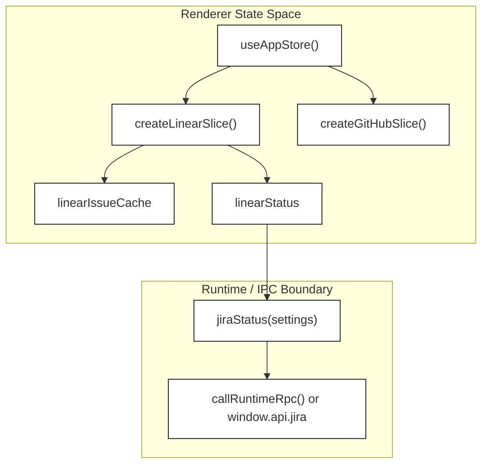
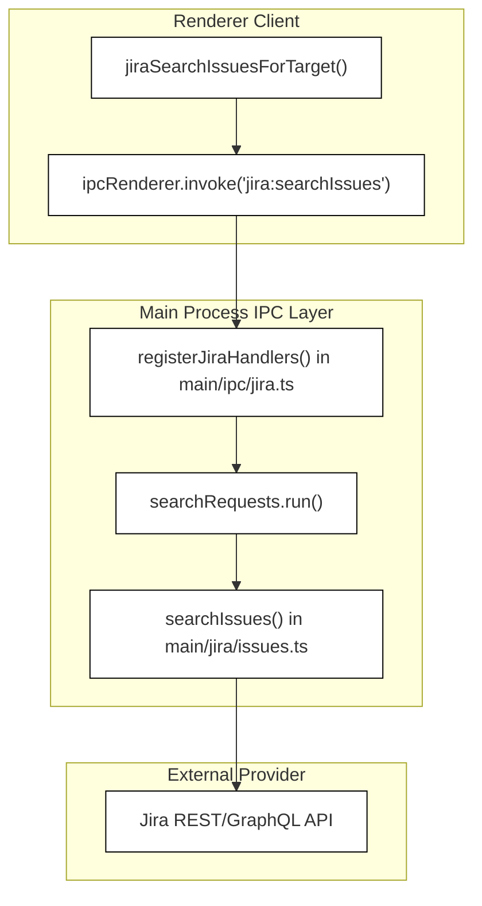
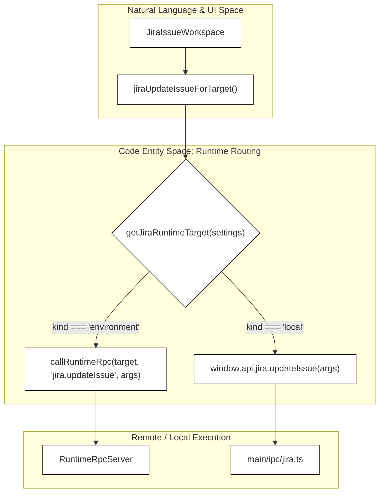
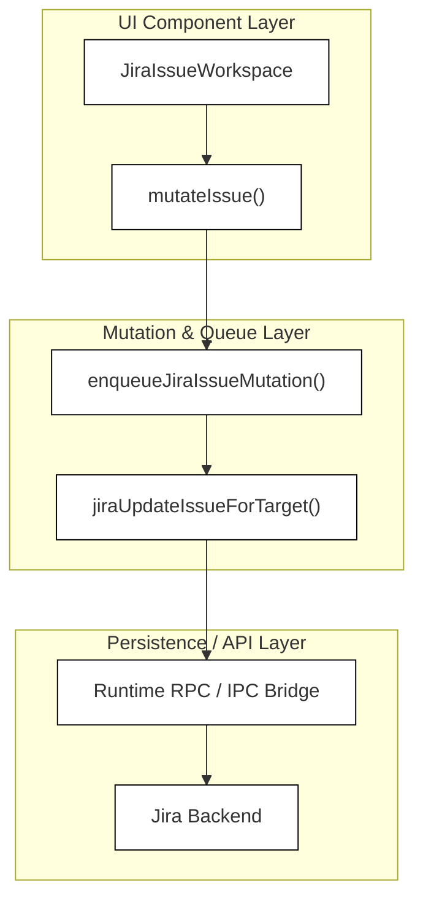

# Task Trackers: Linear, Jira & Integrations

This page details Orca's integration with external task tracking systems like Linear and Jira. It covers the architecture of these integrations, including how data is managed in the renderer process via Zustand slices, how the main process and remote runtime clients interact with Linear and Jira APIs through IPC and runtime RPC, the settings integration UI cards, and the tasks page surfaces and issue drawer/workspace components (`LinearItemDrawer`, `LinearIssueWorkspace`, `JiraIssueWorkspace`) used to start work with linked context.

## Renderer Process: Zustand Slices for Linear & Jira

The renderer process manages the state for task tracking integrations using dedicated Zustand stores and slices initialized by `createLinearSlice` [src/renderer/src/store/slices/linear.ts:28-58]() and associated GitHub/Jira slices [src/renderer/src/store/slices/github.ts:28-40](). These slices coordinate connection status, issue caches, team lists, projects, and comment mutation queues.

### Slice Structures & State Composition

The `LinearSlice` contract [src/renderer/src/store/slices/linear.ts:18-18]() defines state shapes and actions:
- `linearStatus`: Connection status and viewer profile data (`connected`, `viewer`, `workspaces`).
- `linearStatusChecked`: Boolean indicating whether the connection probe has completed.
- Entity caches: `linearIssueCache`, `linearSearchCache`, `linearListCache`, `linearTeamCache`, `linearProjectCache`, and `linearCustomViewCache`.
- `linearListInvalidationToken`: Token used to invalidate cached issue and project lists [src/renderer/src/store/slices/linear.ts:43-43]().

Similarly, Jira integration state flows through runtime-aware read coordination (`getJiraReadIdentity`) and optimistic mutation queues (`enqueueJiraIssueMutation`) [src/renderer/src/components/JiraIssueWorkspace.tsx:23-46]().

**Diagram: Zustand Store Slice Composition for Task Trackers**

Sources:
- [src/renderer/src/store/slices/linear.ts:28-58]()
- [src/renderer/src/store/slices/github.ts:28-40]()
- [src/renderer/src/components/JiraIssueWorkspace.tsx:23-46]()

---

## Main Process: Linear and Jira Clients & IPC Handlers

The main process hosts the core logic for communicating with external APIs (Linear GraphQL and Jira REST/GraphQL endpoints) and exposes these capabilities to the renderer via Electron IPC handlers registered in `registerJiraHandlers()` [src/main/ipc/jira.ts:43-46]() and corresponding Linear IPC modules.

### Jira IPC Handlers & Parameter Normalization

IPC channels under the `jira:` namespace handle remote communication securely across the Electron bridge:
- `jira:connect`: Validates site URL, email, and API token, establishing authenticated sessions [src/main/ipc/jira.ts:44-62]().
- `jira:disconnect`: Clears active site states and resets preflight caches [src/main/ipc/jira.ts:64-67]().
- `jira:searchIssues`: Executes cancellable JQL searches via `JiraCancellableRequests` [src/main/ipc/jira.ts:85-103]().
- `jira:updateIssue`: Normalizes issue fields and dispatches updates through `updateIssue()` [src/main/ipc/jira.ts:193-202]().

**Diagram: Jira IPC Handler Routing and Execution**

Sources:
- [src/main/ipc/jira.ts:43-167]()
- [src/renderer/src/runtime/runtime-jira-client.ts:121-149]()

---

## Runtime RPC & Provider Routing for Work Items

Orca supports remote runtime environments (such as SSH targets or daemon-managed remote servers). When an active remote environment is configured, Linear and Jira calls proxy through the Runtime RPC subsystem rather than local IPC.

### Target Resolution & Method Dispatch

The `runtime-jira-client.ts` module checks `getJiraRuntimeTarget(settings)` [src/renderer/src/runtime/runtime-jira-client.ts:28-76]() to determine whether to execute local IPC (`window.api.jira.*`) or remote calls via `callRuntimeRpc<T>()`.

**Diagram: Work Item Runtime RPC vs Local IPC Dispatch**

Sources:
- [src/renderer/src/runtime/runtime-jira-client.ts:65-119]()
- [src/main/ipc/jira.ts:193-202]()

---

## Settings Integration Cards

The `IntegrationsPane` component renders dedicated configuration cards for managing external service credentials and connection states.

### Integration Card Architecture

- `LinearIntegrationCard`: Manages Linear API keys, workspace selection, and connection testing flows.
- `JiraIntegrationCard`: Manages Jira Cloud or self-hosted site instances, API tokens, site verification tests, and explicit disconnect actions [src/renderer/src/components/settings/jira-integration-card.tsx:21-76]().

Both components integrate with `IntegrationCardShell` and `ProviderHostScopeControl` to clearly indicate whether credentials are stored locally on the client or synchronized with a managed remote runtime environment.

Sources:
- [src/renderer/src/components/settings/jira-integration-card.tsx:21-76]()
- [src/renderer/src/store/slices/github.ts:93-105]()

---

## Tasks Page Surfaces, Drawers & Workspaces

To inspect, edit, and initiate work items without leaving Orca, the application provides specialized drawer and modal workspace components.

### Jira Issue Workspace & Optimistic Mutations

The `JiraIssueWorkspace` component provides a sheet-based slide-over interface (`SheetContent`) for inspecting and updating Jira issues [src/renderer/src/components/JiraIssueWorkspace.tsx:34-190](). It coordinates:
- Comment authoring and optimistic injection via `useJiraIssueCommentSubmission` [src/renderer/src/components/JiraIssueWorkspace.tsx:84-94]().
- Field patch execution with rollback safety via `enqueueJiraIssueMutation` [src/renderer/src/components/JiraIssueWorkspace.tsx:128-141]().
- Reactive state updates synchronized through `useJiraIssueMutationState` [src/renderer/src/components/JiraIssueWorkspace.tsx:95-105]().

**Diagram: Jira Issue Mutation and Optimistic Update Flow**

Sources:
- [src/renderer/src/components/JiraIssueWorkspace.tsx:34-182]()
- [src/renderer/src/runtime/runtime-jira-client.ts:106-120]()
- [src/renderer/src/components/JiraIssueWorkspace.optimistic-edit.test.tsx:26-74]()
