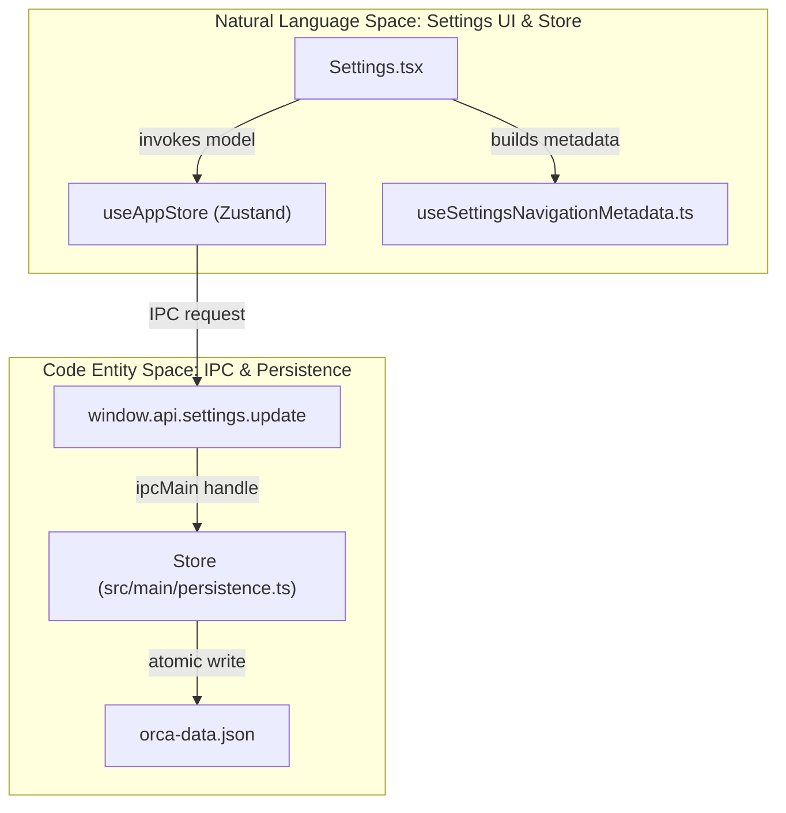
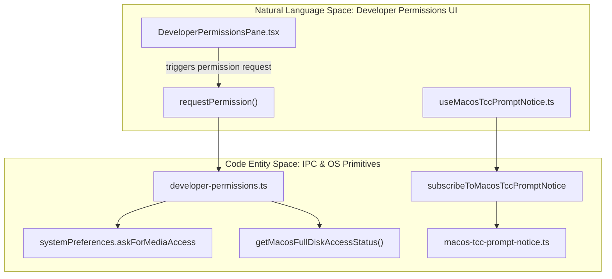

# Settings

The Settings panel in Orca provides a centralized interface for configuring application behavior, appearance, terminal defaults, repository configurations, AI agents, and integration features. These settings are persisted locally through the main process persistence layer, ensuring durable storage and synchronization between the React renderer UI and the Electron main process.

---

## Configuration Architecture

Orca uses a unified `GlobalSettings` object to manage user preferences [src/renderer/src/lib/settings-navigation-types.ts:7](). The Settings UI is orchestrated by `Settings.tsx` [src/renderer/src/components/settings/Settings.tsx:11-34](), organizing panes via navigation metadata generated by `buildSettingsNavigationMetadata` [src/renderer/src/hooks/useSettingsNavigationMetadata.ts:39-108]().

This index handles grouping and conditional pane visibility based on platform (macOS vs. Windows) and environment (Desktop vs. Web) [src/renderer/src/hooks/useSettingsNavigationMetadata.ts:39-108]().

### Settings Data Flow Pattern

Sources: [src/renderer/src/components/settings/Settings.tsx:11-34](), [src/renderer/src/hooks/useSettingsNavigationMetadata.ts:39-108]()

---

## Settings Panes Overview

Orca’s Settings UI is composed of specialized panes grouped in the sidebar. Major groups defined in `SETTINGS_NAV_TARGETS` [src/renderer/src/lib/settings-navigation-types.ts:15-53]() include:

| Pane Group | Description | Key Sections |
| :--- | :--- | :--- |
| **Capabilities** | AI and Workflow features | `agents`, `orchestration`, `computer-use`, `voice`, `linear` |
| **Set Up** | Core application configuration | `orca-account`, `setup-guide`, `general`, `integrations`, `mobile` |
| **Workflows** | Developer productivity tools | `automations`, `artifacts`, `share-skills`, `floating-workspace`, `shortcuts` |
| **Interface** | Visual and UX preferences | `appearance`, `terminal`, `browser`, `notifications` |
| **Remote** | Connection and environment management | `ssh`, `servers`, `developer-permissions`, `advanced` |

Sources: [src/renderer/src/hooks/useSettingsNavigationMetadata.ts:101-107](), [src/renderer/src/lib/settings-navigation-types.ts:15-53]()

---

## Appearance & General Settings

This pane governs preferences related to the general UI and workspace environment. 

For details on UI themes, zoom, language, version display, update/restart UX, and the experimental pane, see [Appearance & General Settings](#7.1).

Sources: [src/renderer/src/hooks/useSettingsNavigationMetadata.ts:105]()

---

## Terminal & Repository Settings

The Terminal system allows deep configuration of integrated `xterm.js` instances, hook editors, worktree defaults, and mobile pairing.

For details on terminal settings, repository configuration, hook editors, and the mobile pairing pane, see [Terminal & Repository Settings](#7.2).

Sources: [src/renderer/src/hooks/useSettingsNavigationMetadata.ts:104]()

---

## Agent & AI Settings

Manages agent platform settings, agent catalogs, skill discovery, managed account services, and rate-limit displays.

For details, see [Agent & AI Settings](#7.3).

Sources: [src/renderer/src/hooks/useSettingsNavigationMetadata.ts:102]()

---

## Voice, Dictation, and Speech Models

This section covers speech subsystem configuration, model catalogs, STT worker architecture, and dictation UI.

For details, see [Voice, Dictation, and Speech Models](#7.4).

Sources: [src/renderer/src/lib/settings-navigation-types.ts:34]()

---

## Developer Permissions & Security

Orca manages OS-level permissions required for developer tools, particularly on macOS. The `DeveloperPermissionsPane` component tracks and requests access across multiple developer subsystems [src/renderer/src/components/settings/DeveloperPermissionsPane.tsx:44-215]() via `developer-permissions.ts` IPC handlers [src/main/ipc/developer-permissions.ts:28-38]().

The `useMacosTccPromptNotice` hook displays toast notifications to guide users through granting Full Disk Access if macOS prompts them about Orca accessing protected files [src/renderer/src/hooks/useMacosTccPromptNotice.ts:19-76](), backed by tally metrics in `macos-tcc-prompt-notice.ts` [src/main/macos-tcc-prompt-notice.ts:15-24]().

### Permission Lifecycle Mapping

Sources: [src/renderer/src/components/settings/DeveloperPermissionsPane.tsx:44-215](), [src/main/ipc/developer-permissions.ts:28-38](), [src/renderer/src/hooks/useMacosTccPromptNotice.ts:19-76](), [src/main/macos-tcc-prompt-notice.ts:15-24]()

---

## Onboarding Checklist

Orca includes a setup guide tracked via settings navigation metadata. This guide surfaces at the top of the Settings sidebar until all setup milestones are completed.

Sources: [src/renderer/src/hooks/useSettingsNavigationMetadata.ts:103]()

---

For in-depth technical details on each domain, please see the dedicated child pages:

- [Appearance & General Settings](#7.1)
- [Terminal & Repository Settings](#7.2)
- [Agent & AI Settings](#7.3)
- [Voice, Dictation, and Speech Models](#7.4)

Sources:
[src/renderer/src/components/settings/Settings.tsx:11-34](),
[src/renderer/src/hooks/useSettingsNavigationMetadata.ts:39-108](),
[src/renderer/src/lib/settings-navigation-types.ts:15-53](),
[src/renderer/src/components/settings/DeveloperPermissionsPane.tsx:44-215](),
[src/renderer/src/hooks/useMacosTccPromptNotice.ts:19-76](),
[src/main/ipc/developer-permissions.ts:28-38](),
[src/main/macos-tcc-prompt-notice.ts:15-24]()
