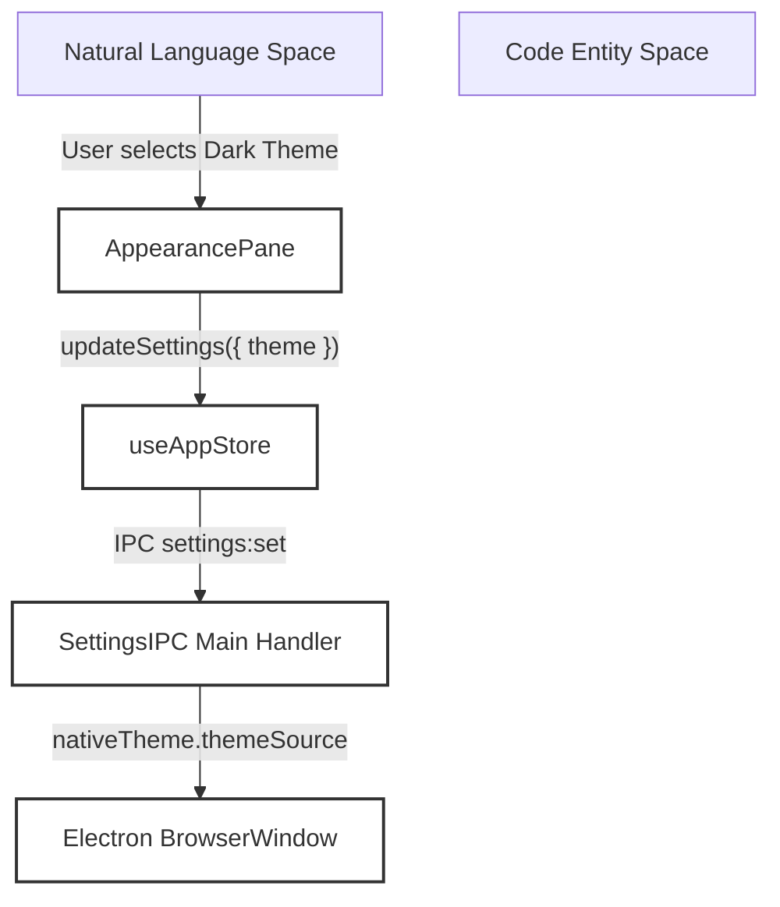
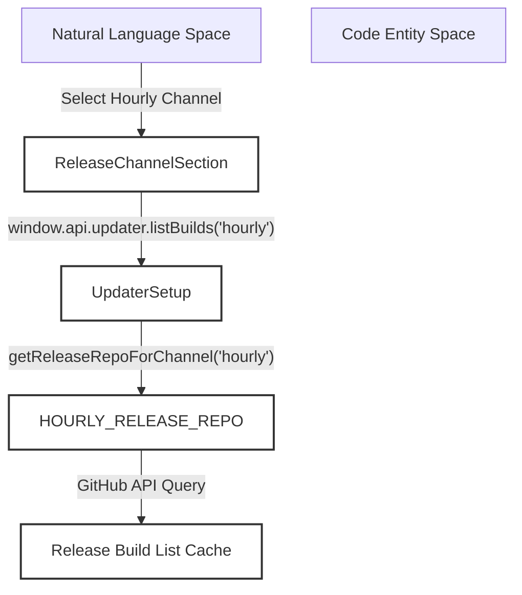
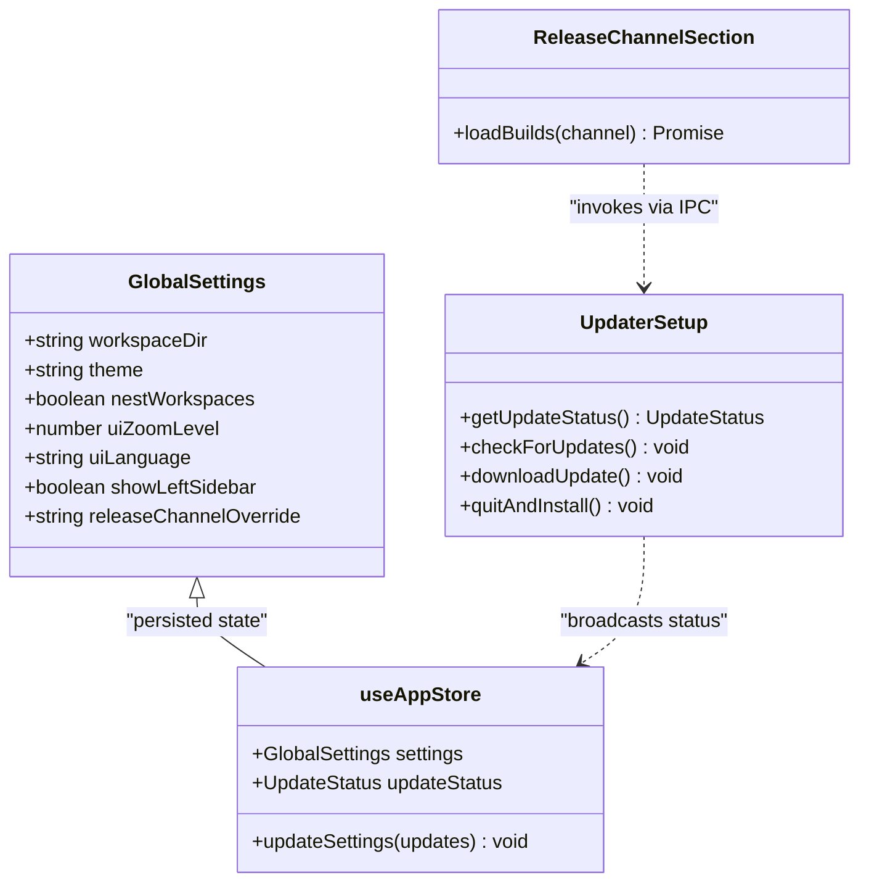

# Appearance & General Settings

This page details the configuration, persistence, and execution flow of global user preferences, interface themes, release channels, update/restart UX, and experimental capabilities within Orca.

---

## 1. Purpose and Scope

Orca’s configuration layer is organized around global settings models and segmented settings panes. The primary entry point for the settings UI is rendered via `Settings.tsx`, which composes models, navigation rules, and interactions [src/renderer/src/components/settings/Settings.tsx:11-34](). Navigation metadata for settings sections and search entries is centrally compiled in `useSettingsNavigationMetadata.ts` to ensure consistency between the settings sidebar and the command palette [src/renderer/src/hooks/useSettingsNavigationMetadata.ts:39-108]().

Sources:
[src/renderer/src/components/settings/Settings.tsx:11-34]()
[src/renderer/src/hooks/useSettingsNavigationMetadata.ts:39-108]()

---

## 2. Appearance Settings

The UI appearance is managed by the appearance settings components and stored persistently within global settings objects.

### Theme Management

Orca supports three primary UI theme modes: `system`, `dark`, and `light`. Theme resolution synchronizes with Electron's `nativeTheme` APIs in the main process.

*Diagram 1: Theme selection workflow bridging natural language selection to main process native bindings.*

Sources:
[src/renderer/src/components/settings/Settings.tsx:11-34]()
[src/main/ipc/settings.ts:120-160]()

### UI Zoom and Interface Scaling

Interface scaling controls adjust global zoom levels outside of terminal-specific font configurations:
- Zoom entries provide discrete scaling presets.
- Commands are mapped to native application menus (`View > Zoom In/Zoom Out/Reset Size`) via `register-app-menu.ts`.

Sources:
[src/renderer/src/components/settings/AppearancePane.tsx:80-150]()
[src/main/menu/register-app-menu.ts:28-48]()

### Language Selection

Internationalization catalogs support multiple locales (English, Simplified Chinese, Korean, Japanese, Spanish, French, Portuguese) stored under `uiLanguage` [src/renderer/src/i18n/locales/en.json:113-123](). Normalization and validation occur centrally during IPC persistence [src/main/ipc/settings.ts:120-160]().

Sources:
[src/renderer/src/i18n/locales/en.json:113-123]()
[src/main/ipc/settings.ts:120-160]()

---

## 3. General Settings & Release Channels

General settings manage workspace defaults, editor preferences, and update channels.

### Release Channel Architecture

Orca supports multiple release channels: `stable`, `rc`, `hourly`, `daily`, and `adhoc` [src/shared/release-channel.ts:3-11](). Dev channels (`hourly`, `daily`, `adhoc`) publish to dedicated release repositories (`stablyai/orca-hourly`, etc.) to prevent eviction of stable/RC entries from the main repository's release feed [src/shared/release-channel.ts:24-40]().

The `ReleaseChannelSection` component manages channel overrides and fetches available builds via `window.api.updater.listBuilds` [src/renderer/src/components/settings/ReleaseChannelSection.tsx:79-153]().

*Diagram 2: Release channel build lookup architecture.*

Sources:
[src/shared/release-channel.ts:3-40]()
[src/renderer/src/components/settings/ReleaseChannelSection.tsx:79-153]()

---

## 4. Update Lifecycle and User Experience

Application updates are handled via `electron-updater` wrapped by `UpdaterSetup` in the main process [src/main/updater.ts:14-101]() and event listeners registered in `registerAutoUpdaterHandlers` [src/main/updater-events.ts:23-63]().

- **Update Checks**: Periodic background checks or user-initiated checks via settings and menus [src/main/updater.ts:53-67]().
- **Download & Install**: Progress tracking via IPC events (`checking-for-update`, `update-available`, `update-downloaded`) leading to `quitAndInstall()` execution [src/main/updater.ts:65-67]() [src/main/updater-events.ts:76-173]().
- **Platform Constraints**: Windows dev builds omit publisher names due to SignPath approval cadences, handled by `requiresManualDevChannelInstall()` logic [src/shared/release-channel.ts:101-111]().

Sources:
[src/main/updater.ts:14-101]()
[src/main/updater-events.ts:23-63]()
[src/shared/release-channel.ts:101-111]()

---

## 5. Experimental Pane

The experimental pane groups unreleased or beta features behind user toggles (e.g., native chat, terminal attention highlights, background agent hibernation) [src/renderer/src/components/settings/DeveloperPermissionsPane.tsx:1-410]().

Sources:
[src/renderer/src/components/settings/DeveloperPermissionsPane.tsx:1-410]()

---

## 6. Code Entity Architecture

*Diagram 3: Class architecture for settings and update coordination.*

Sources:
[src/main/updater/updater-setup.ts]()
[src/renderer/src/store/index.ts]()
[src/shared/release-channel.ts]()
