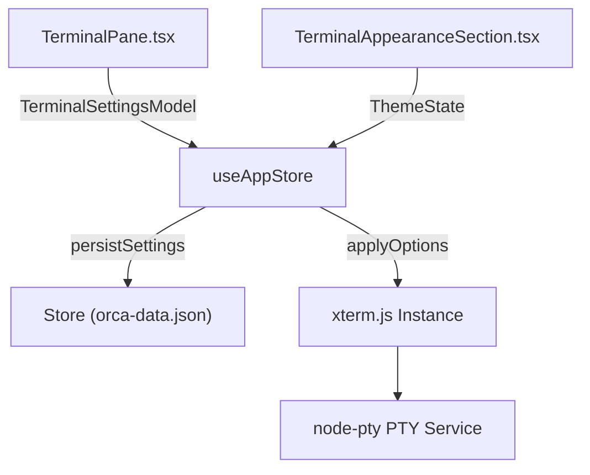
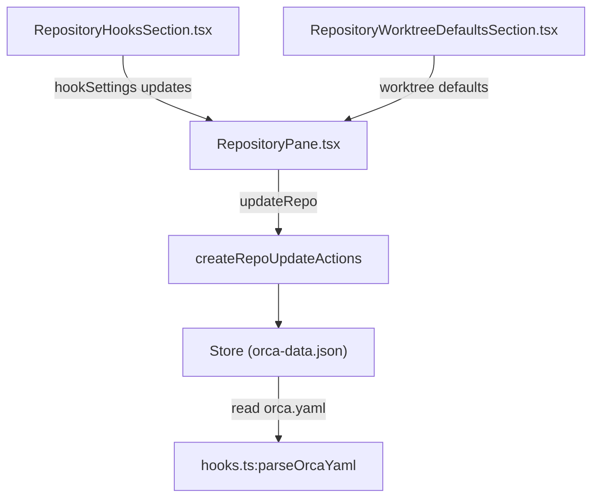
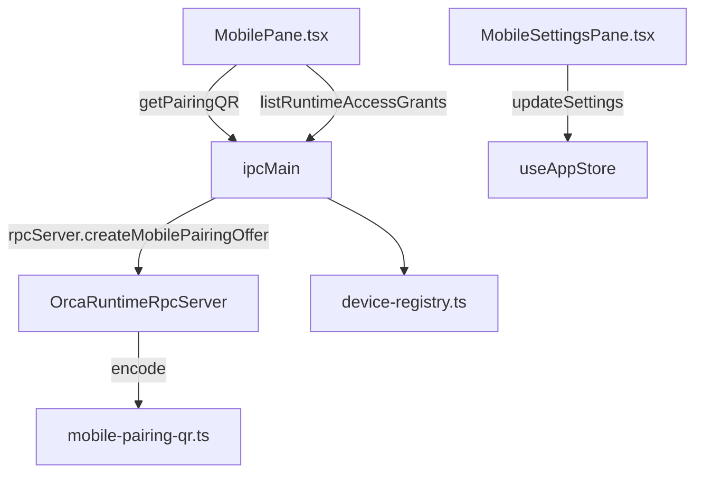

# Terminal & Repository Settings

This page covers the technical implementation of terminal configuration (font/size/scrollback/theme), repository configuration, hook editors, new-workspace defaults, and the mobile pairing pane. It bridges renderer UI components, Zustand stores, and main-process Electron services.

---

## Terminal Settings

Terminal settings control the embedded `xterm.js` terminal emulator and its underlying `node-pty` process integration. These settings reside within `GlobalSettings` [src/renderer/src/components/settings/TerminalPane.tsx:35-51]() and sync across the renderer and main process.

### Configuration Aspects
- **Font & Size**: Configured via `terminalFontFamily`, `terminalFontSize`, and `terminalFontWeight`. Platform-specific fallbacks apply (e.g., `"SF Mono"` on macOS, `"Consolas"` on Windows) [src/renderer/src/components/settings/TerminalPane.tsx:53-78]().
- **Scrollback Buffer**: Managed through `terminalScrollbackRows` (default 5,000 lines), toggleable via preset or custom modes [src/renderer/src/components/settings/TerminalPane.tsx:37-38]().
- **Theme & Appearance**: Supported via `terminalThemeDark` and `terminalThemeLight`. Opacity, cursor styles, blinking, and font ligatures are composed via `terminal-appearance` utilities [src/renderer/src/components/settings/TerminalAppearanceSection.tsx:15-100]().
- **Interaction Behavior**: Includes right-click paste (`terminalRightClickToPaste`), clipboard on select, and OSC 52 remote clipboard writes [src/renderer/src/components/settings/TerminalPane.tsx:15-25]().

### Implementation & Data Flow

Sources:
[src/renderer/src/components/settings/TerminalPane.tsx:34-78](),
[src/renderer/src/components/settings/terminal-search.ts:1-25](),
[src/shared/default-global-settings.ts:100-120]()

---

## Repository Settings

Repository settings configure individual Git or folder repositories, including badge colors, icon pickers, default branches, worktree defaults, and WSL/Windows runtime preferences [src/renderer/src/components/settings/RepositoryPane.tsx:38-71]().

### Key Features
- **Badge Colors & Icons**: Stored per project/repo to identify repositories across sidebars and worktree cards [src/renderer/src/components/settings/RepositoryPane.tsx:21-23]().
- **Worktree Defaults**: Base branch strategies and prefix settings combine with global worktree settings [src/renderer/src/components/settings/RepositoryWorktreeDefaultsSection.tsx:15-32]().
- **Project Removal**: Protected by confirmation workflows and state cascades cleaning associated project objects [src/renderer/src/components/settings/RepositoryPane.tsx:119-154]().

### Hook Editor UX & Hook Settings
- **Lifecycle Hooks**: Repositories support declarative lifecycle hooks (`setup`, `archive`) via `orca.yaml` or local overrides (`RepoHookSettings`) [src/renderer/src/components/settings/RepositoryHooksSection.tsx:1-15]() [src/main/hooks.ts:119-131]().
- **Policies**: Execution policies include `ask`, `run-by-default`, and `skip-by-default` [src/renderer/src/lib/new-workspace.ts:145-184]().

#### Repository Settings Data Flow

Sources:
[src/renderer/src/components/settings/RepositoryPane.tsx:38-160](),
[src/renderer/src/components/settings/RepositoryHooksSection.tsx:1-50](),
[src/main/hooks.ts:119-138]()

---

## New Workspace Defaults

New workspaces leverage repository settings and global configuration to pre-populate environment contexts and agent execution plans [src/renderer/src/lib/new-workspace.ts:55-86]().

- **Default Tabs & Setup**: `orca.yaml` defines `defaultTabs` and `scripts.setup`, parsed via `getSetupConfig()` to run shell commands or spawn terminal tabs on initialization [src/renderer/src/lib/new-workspace.ts:61-86,145-184]().
- **Issue Templates**: Fallbacks like `DEFAULT_ISSUE_COMMAND_TEMPLATE` (`Complete {{artifact_url}}`) interpolate linked work items into agent prompts [src/renderer/src/lib/new-workspace.ts:53-54,93-106]().

Sources:
[src/renderer/src/lib/new-workspace.ts:55-184]()

---

## Mobile Pairing Pane & Mobile Settings

The mobile pairing pane (`MobilePane.tsx`) and `MobileSettingsPane.tsx` permit users to connect the mobile companion app to the desktop host for remote terminal streaming and companion features [src/renderer/src/components/settings/MobilePane.tsx:31-40]() [src/renderer/src/components/settings/MobileSettingsPane.tsx:17-98]().

### Key Features
- **QR Code Generation**: Minting pairing offerings via `window.api.mobile.getPairingQR()` [src/renderer/src/components/settings/MobilePane.tsx:33-40]() [src/renderer/src/components/mobile/MobilePage.tsx:92-106]().
- **Network Interface Selection**: Binds pairing to specific LAN IP addresses, VPNs, or Tailscale interfaces [src/renderer/src/components/settings/MobilePane.tsx:42-44,105-116]().
- **Connection Modes**: Supports `automatic` (relay fallback) and `local-only` modes [src/renderer/src/components/settings/MobilePane.tsx:47-48]().
- **Device Management**: Revocation of runtime access grants for paired devices [src/renderer/src/components/settings/MobilePane.tsx:64-69]().
- **App Store & APK Distribution**: Links directly to public App Store channels, TestFlight previews, and pinned APK assets via `mobile-platform-copy.ts` [src/renderer/src/components/settings/MobileSettingsPane.tsx:38-62]() [src/renderer/src/components/mobile/mobile-platform-copy.ts:12-30]().

#### Mobile Pairing Data Flow

Sources:
[src/renderer/src/components/settings/MobilePane.tsx:31-145](),
[src/renderer/src/components/settings/MobileSettingsPane.tsx:17-98](),
[src/renderer/src/components/mobile/MobilePage.tsx:27-106](),
[src/renderer/src/components/mobile/mobile-platform-copy.ts:1-30]()

---

## References

- **Terminal Settings**: [src/renderer/src/components/settings/TerminalPane.tsx:34-78](), [src/renderer/src/components/settings/terminal-search.ts:1-25]()
- **Repository Settings**: [src/renderer/src/components/settings/RepositoryPane.tsx:38-160](), [src/main/hooks.ts:119-138]()
- **New Workspaces**: [src/renderer/src/lib/new-workspace.ts:55-184]()
- **Mobile Pairing**: [src/renderer/src/components/settings/MobilePane.tsx:31-145](), [src/renderer/src/components/settings/MobileSettingsPane.tsx:17-98](), [src/renderer/src/components/mobile/MobilePage.tsx:27-106]()
