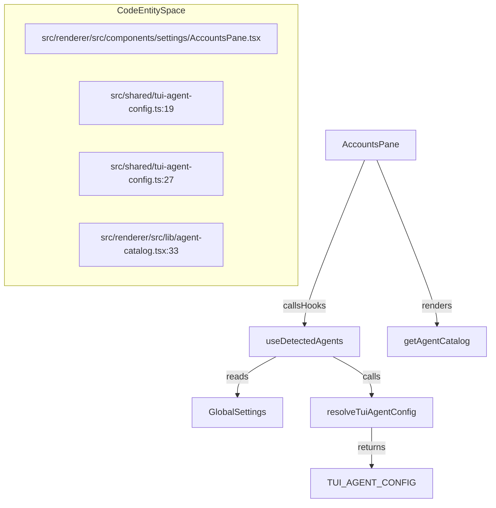
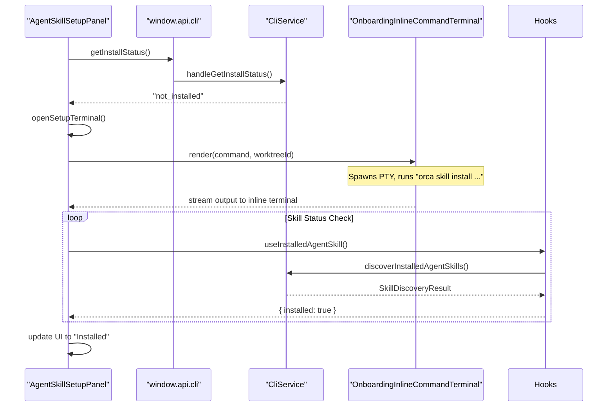
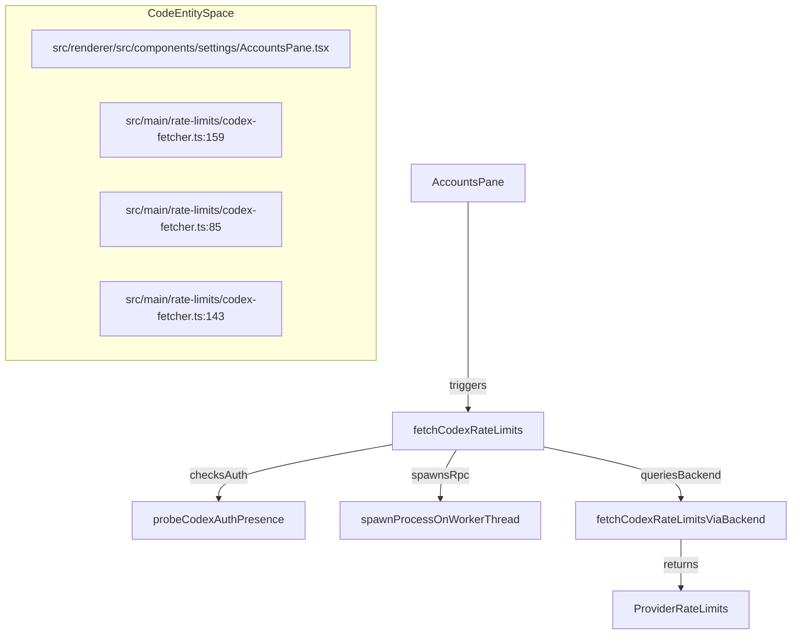
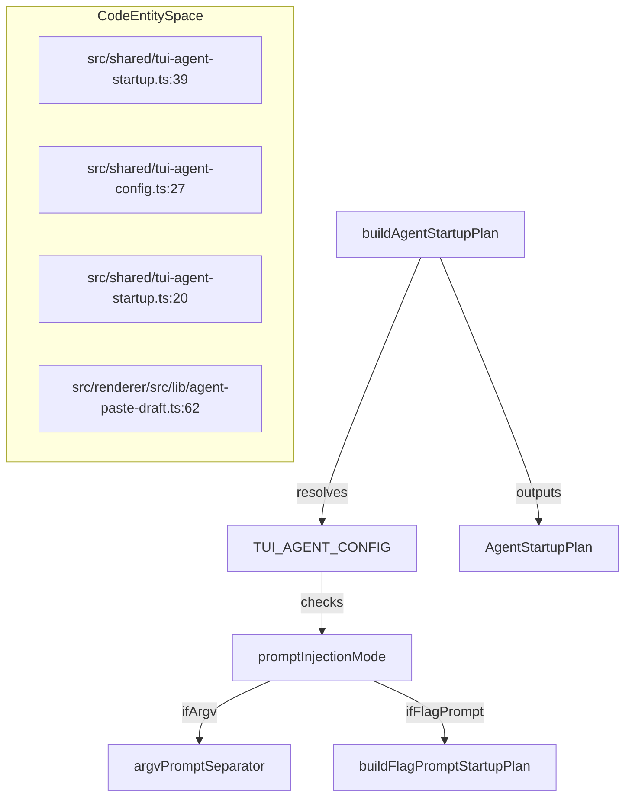

# Agent & AI Settings

The Agent & AI Settings subsystem in Orca manages the configuration, runtime environment selection, skill discovery and installation, managed account integrations, and usage/rate-limit displays for AI agents. It provides a unified platform for handling multiple AI providers such as Codex, Claude, Gemini, and others by coordinating managed account services, runtime selection (host vs. WSL on Windows), skill installation UX via PTY terminals, and comprehensive usage reporting surfaced in both Settings UI and Status Bar.

---

## Agents Configuration (`AgentsPane`)

The `AgentsPane` React component is the central UI surface for configuring AI agents [src/renderer/src/components/settings/AccountsPane.tsx](). It supports:

- **Agent detection and catalog**: Detects installed TUI (terminal UI) agents locally or scoped to a remote runtime.
- **Runtime selection on Windows**: Enables choice between native Windows host vs. WSL distro for agent execution.
- **Agent enable/disable toggles**: Controls which agents are enabled, and command overrides.
- **User-focused settings**: Exposes controls like keeping the computer awake during agent runs.

### Agent Catalog and Detection

Orca maintains a catalog of supported AI agents with detailed metadata specifying prompt injection methods, detection criteria, and UI details:

- Prompt injection modes are defined by `AgentPromptInjectionMode` [src/shared/tui-agent-config.ts:4-11]() and include:
  - `argv`: prompt passed as process argument.
  - `flag-prompt`: dedicated prompt flag after launch.
  - `stdin-after-start`: interactive stdin input.
  
- Each agent is identified with default executable names and fallback commands for detection on the system PATH, defined in `TuiAgentConfig` [src/shared/tui-agent-config.ts:27-162]() and resolved via `resolveTuiAgentConfig` [src/shared/tui-agent-config.ts:19-25](). For example, `claude` uses `detectCmd: 'claude'` and `promptInjectionMode: 'argv'` [src/shared/tui-agent-config.ts:28-35](). `codex` also uses `argv` injection but has specific `windowsInputRecordPasteNewline` and `preflightTrust` settings [src/shared/tui-agent-config.ts:64-72]().

- UI metadata for agents, such as `label`, `cmd`, `iconUrl`, `faviconDomain`, and `homepageUrl`, is defined in `AgentCatalogEntry` [src/renderer/src/lib/agent-catalog.tsx:19-31]() and populated by `getAgentCatalog` [src/renderer/src/lib/agent-catalog.tsx:33](). Mobile companion shares matching fallback definitions via `MOBILE_TUI_AGENT_AUTO_PICK_ORDER` and `MOBILE_TUI_AGENT_FAVICON_DOMAINS` [mobile/src/tasks/mobile-tui-agents.ts:13-55]().

The detection system uses detection hooks which consider the selected runtime environment (`local` vs. `runtime` with environmentId) for precision detection. Agent detection logic also involves `TuiAgentDetectionRuntime` [src/shared/tui-agent-config.ts:10]() to specify unsupported runtimes for certain agents, like `claude-agent-teams` not being supported on `win32` or `wsl` [src/shared/tui-agent-config.ts:43]().

Sources:
[src/shared/tui-agent-config.ts:4-11]()
[src/shared/tui-agent-config.ts:19-25]()
[src/shared/tui-agent-config.ts:27-162]()
[src/shared/tui-agent-config.ts:28-35]()
[src/shared/tui-agent-config.ts:43]()
[src/shared/tui-agent-config.ts:64-72]()
[src/renderer/src/lib/agent-catalog.tsx:19-31]()
[src/renderer/src/lib/agent-catalog.tsx:33]()
[mobile/src/tasks/mobile-tui-agents.ts:13-55]()
[src/shared/tui-agent-config.ts:10]()

---

## Agent Skill Setup (`AgentSkillSetupPanel`)

AI agents can be augmented with specialized "skills" that extend capabilities into desktop automation, web browser control, remote operations, etc. Skills live as CLI tools managed per runtime environment.

### CLI Registration & Runtime Setup

Each skill requires the Orca CLI installed in the respective runtime environment:

- `ensureOrcaCliAvailableForAgentSkillTerminal` ensures the CLI is available and registered in native runtimes [src/renderer/src/components/settings/CliSection.tsx:13-15]().
- For Windows WSL runtimes, WSL CLI availability is registered inside WSL distros [src/renderer/src/components/settings/CliSkillRuntimeSetup.tsx]() via `buildSkillCommandForRuntime` [src/renderer/src/components/settings/CliSkillRuntimeSetup.tsx:81-100]().

This ensures skill commands invoked by the UI or PTY terminal execute correctly. The `CliSection` component manages the Orca CLI installation status and provides UI for installation and updates [src/renderer/src/components/settings/CliSection.tsx:75-190]().

### Skill Installation Flow

Skill installation is performed via an interactive terminal session driven by the Orca CLI.

- The `AgentSkillSetupPanel` component [src/renderer/src/components/settings/AgentSkillSetupPanel.tsx:21-55]() manages a terminal UI component (`OnboardingInlineCommandTerminal`) that spawns a PTY running the install command asynchronously [src/renderer/src/components/settings/AgentSkillSetupPanel.tsx:62-63]().
- The `openSetupTerminal` function handles the logic for opening the terminal, setting up snapshots via `createTerminalSnapshot`, and managing readiness states [src/renderer/src/components/settings/AgentSkillSetupPanel.tsx:82-112]().
- The UI streams installation progress and allows recheck or update triggers after installation. The `handleSetupCommandFinished` callback processes the exit code from the terminal command and triggers surface rechecks [src/renderer/src/components/settings/AgentSkillSetupPanel.tsx:115-129]().
- Terminal exit codes are tracked to detect success or failure of the install command and refresh UI state.
- Installation and update labels are customizable via `installLabel` and `installedInstallLabel` props [src/renderer/src/components/settings/AgentSkillSetupPanel.tsx:47-48](), and the panel exposes copy-to-clipboard features for the install command [src/renderer/src/components/settings/AgentSkillSetupPanel.tsx:185-189]().
- The `useInstalledAgentSkill` hook [src/renderer/src/hooks/useInstalledAgentSkills.ts:115-120]() is used to determine the installation status of a skill, providing `installed`, `loading`, and `error` states [src/renderer/src/hooks/useInstalledAgentSkills.ts:48-60]().

Sources:
[src/renderer/src/components/settings/CliSection.tsx:13-15]()
[src/renderer/src/components/settings/CliSkillRuntimeSetup.tsx]()
[src/renderer/src/components/settings/CliSkillRuntimeSetup.tsx:81-100]()
[src/renderer/src/components/settings/CliSection.tsx:75-190]()
[src/renderer/src/components/settings/AgentSkillSetupPanel.tsx:21-55]()
[src/renderer/src/components/settings/AgentSkillSetupPanel.tsx:62-63]()
[src/renderer/src/components/settings/AgentSkillSetupPanel.tsx:82-112]()
[src/renderer/src/components/settings/AgentSkillSetupPanel.tsx:115-129]()
[src/renderer/src/components/settings/AgentSkillSetupPanel.tsx:47-48]()
[src/renderer/src/components/settings/AgentSkillSetupPanel.tsx:185-189]()
[src/renderer/src/hooks/useInstalledAgentSkills.ts:115-120]()
[src/renderer/src/hooks/useInstalledAgentSkills.ts:48-60]()

---

## Managed AI Accounts & Rate Limit Services

Orca integrates credential and usage management for multiple managed AI providers including Claude, Codex, Gemini, Kimi, Grok, MiniMax, and OpenCode Go.

### Claude Runtime Authentication Service

- Manages Claude credentials scoped per runtime environment (host or WSL).
- On macOS, stores credentials in user keychain scoped to runtime home directory to avoid CLI conflicts.
- Supports injecting credentials as encoded environment variables and installs inside WSL filesystems if needed.
- Proactively refreshes OAuth tokens to maintain live sessions.

### Codex Hook and Trust Management

- Codex requires trusted lifecycle hooks to be declared in its `config.toml`.
- Orca generates trusted hashes and applies them by editing the `config.toml` file byte-wise to add or replace `trusted_hash` entries under the hooks section.
- The service writes JSON hook files (`permissions_request.json`, `post_tool_use.json`) to enable Orca to receive webhook callbacks for Codex events.

### Rate Limit Service

- `fetchCodexRateLimits` centralizes polling AI providers’ usage and quota endpoints in the main process [src/main/rate-limits/codex-fetcher.ts:159-172]().
- It caches results, debounces refreshes, and handles transient errors or throttled responses via `fetchViaRpc` [src/main/rate-limits/codex-fetcher.ts:85-115]() and backend usage queries [src/main/rate-limits/codex-fetcher.ts:143-157]().
- Updated usage snapshots are pushed via IPC to all renderer windows to update UI surfaces.

Sources:
[src/main/claude-accounts/runtime-auth-service.ts]()
[src/main/claude-accounts/service.ts]()
[src/main/codex/hook-service.ts]()
[src/main/codex/config-toml-trust.ts]()
[src/main/rate-limits/codex-fetcher.ts:85-115]()
[src/main/rate-limits/codex-fetcher.ts:143-157]()
[src/main/rate-limits/codex-fetcher.ts:159-172]()
[src/renderer/src/components/settings/AccountsPane.tsx]()

---

## Specialized Settings Panes for Agent Skills and Orchestration

Orca includes additional panes for managing skill-specific flows and agent orchestration:

- **Browser Use Pane**: Manages setup of the `browser-use` skill for Chromium and Firefox browsers including skill CLI install and native cookie import [src/renderer/src/components/settings/BrowserUsePane.tsx]().
- **Orchestration Pane**: Enables the `orca-orchestration` skill, providing UI for lifecycle and readiness monitoring of agent orchestration tasks [src/renderer/src/components/settings/OrchestrationPane.tsx](). The `ORCHESTRATION_SKILL_NAME` constant is used to identify this skill [src/renderer/src/hooks/useInstalledAgentSkills.ts:9]().
- **Computer Use Pane**: Manages desktop automation skills with permission checks (e.g., macOS accessibility) and native helper installation [src/renderer/src/components/settings/ComputerUsePane.tsx]().
- **Mobile Emulator Agent Control Row**: Provides controls for agents interacting with mobile emulators [src/renderer/src/components/settings/MobileEmulatorAgentControlRow.tsx]().

These panes use the `AgentSkillSetupPanel` and related UI patterns for terminal-driven install commands and status feedback.

Sources:
[src/renderer/src/components/settings/BrowserUsePane.tsx]()
[src/renderer/src/components/settings/OrchestrationPane.tsx]()
[src/renderer/src/hooks/useInstalledAgentSkills.ts:9]()
[src/renderer/src/components/settings/ComputerUsePane.tsx]()
[src/renderer/src/components/settings/MobileEmulatorAgentControlRow.tsx]()

---

## Agent Detection and Status in Terminal Tabs

Orca actively detects and displays the status of AI agents running within terminal tabs. This involves analyzing terminal titles, process information, and agent-specific signals.

### Agent Type Resolution

The `useTabAgent` hook is central to determining the active agent in a terminal tab. It leverages several signals:
- **Launch Agent**: The agent initially launched in the tab.
- **Hook Agent**: An agent detected via runtime hooks.
- **Terminal Title**: The current title of the terminal, which can explicitly indicate an agent.
- **Process Information**: The foreground process in the terminal.

The `resolveTabAgentFromSignals` function combines these signals to determine the most accurate agent type, mapping specific titles like "OpenClaude" or "Codex" to their distinct agent types.

### Agent Status Detection

The `detectAgentStatusFromTitle` function analyzes terminal titles to infer the agent's current status (e.g., `working`, `idle`, `permission`). Working agent status counts and mappings are managed via working agent getters and visual status mappers.

### Agent Startup and Prompt Injection

The `tui-agent-startup` module handles the complex process of launching TUI agents and injecting prompts:
- `buildAgentStartupPlan` creates a plan for launching an agent, considering the agent type, prompt, platform, and shell [src/shared/tui-agent-startup.ts:39-53]().
- `promptInjectionMode` from `TuiAgentConfig` [src/shared/tui-agent-config.ts:4-11]() dictates how the prompt is delivered (e.g., `argv`, `flag-prompt`, `stdin-after-start`).
- The system correctly handles shell-specific quoting for arguments and prompts across POSIX, PowerShell, and CMD [src/shared/tui-agent-startup.test.ts:37-104]().
- Special handling exists for agents like `grok` to terminate options before flag-shaped prompts using `--` [src/shared/tui-agent-startup.test.ts:119-152]().
- Draft paste orchestration is handled by `pasteDraftWhenAgentReady` and `pasteDraftToAgentPtyWhenReady`, which wait for DECSET 2004 bracketed paste readiness signals before injecting content [src/renderer/src/lib/agent-paste-draft.ts:62-136]().

Sources:
[src/shared/tui-agent-startup.ts:39-53]()
[src/shared/tui-agent-config.ts:4-11]()
[src/shared/tui-agent-startup.test.ts:37-104]()
[src/shared/tui-agent-startup.test.ts:119-152]()
[src/renderer/src/lib/agent-paste-draft.ts:62-136]()
[src/shared/tui-agent-startup.ts:20]()

---

## Usage & Rate Limit Displays in Settings and Status Bar

Orca surfaces dynamic AI account usage and rate limit information via:

- **Status Bar Components**: Compositional React components provide rich usage progress bars, error messages, and reset timers for each AI account and provider on all runtime targets.
- **Settings Pane Accounts View**: Comprehensive usage displays with detailed charts, troubleshooting hints, and managed account status [src/renderer/src/components/settings/AccountsPane.tsx]().
- **Rate Limit Fetching**: The rate limit services in the main process orchestrate refresh cycles, debounces, and stale-data handling for all supported providers and push updates to the UI [src/main/rate-limits/codex-fetcher.ts:159-172]().

Sources:
[src/renderer/src/components/settings/AccountsPane.tsx]()
[src/main/rate-limits/codex-fetcher.ts:159-172]()
