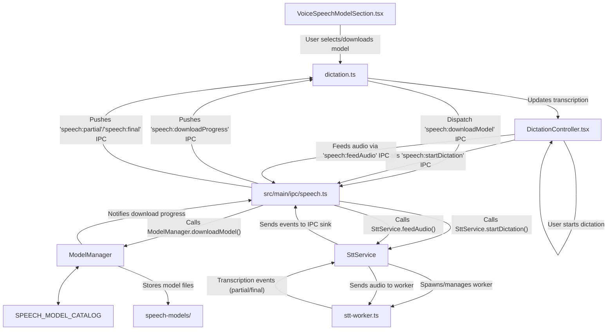
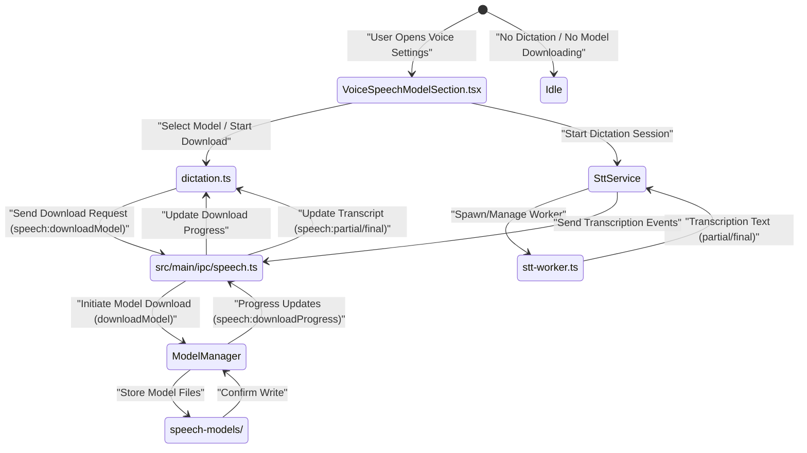

# Voice, Dictation, and Speech Models

This page documents the speech subsystem within Orca, focusing on voice and dictation features. It details the architecture of the model catalog, model downloading and management, explains the Speech-to-Text (STT) worker design, and describes how dictation and voice settings are configured and surfaced in the user interface.

---

## Overview

Orca integrates advanced voice and dictation capabilities by managing local speech models that enable offline Speech-to-Text (STT) processing. This subsystem includes:

- A catalog of available speech models with metadata and download capabilities.
- A model manager responsible for tracking model state, downloading, storing, and readiness.
- An STT worker running in a separate thread that performs real-time transcription on audio input.
- State slices and UI components enabling users to configure voice/dictation settings and control speech sessions.

Together, these form a tightly coordinated speech subsystem spanning Electron main and renderer processes.

---

## 1. Speech Model Catalog and Management

### 1.1 Model Catalog

The speech model catalog is defined in [src/main/speech/model-catalog.ts:4-152](). It exports the constant `SPEECH_MODEL_CATALOG`, an array of `SpeechModelManifest` objects. Each manifest contains:

- **Identification and description**: fields `id`, `label`, `description`.
- **Model type** such as `transducer`, `paraformer`, `whisper`, `senseVoice`, `nemo-ctc`, or cloud-based `openai` [src/shared/speech-types.ts:1-7]().
- **Provider**: either `"local"` (models downloaded and run locally) or `"openai"` (cloud transcription) [src/shared/speech-types.ts:8]().
- **Supported languages**: specific or multilingual.
- **Download metadata**: download URLs, expected file names, SHA256 hashes, and sizes to verify integrity [src/shared/speech-types.ts:12-17]().
- **Attributes**: sample rate, streaming support, modeling unit (e.g., BPE or CJK characters) [src/shared/speech-types.ts:10-10]().
- **Recommended flag** to highlight preferred models.

Utility functions facilitate catalog access:

- `getCatalogModel(id: string)` looks up a speech model manifest by its identifier [src/main/speech/model-catalog.ts:149-151]().
- `isLocalSpeechModel(manifest)` checks if the model is for local use [src/main/speech/model-catalog.ts:153-155]().

Sources:
- [src/main/speech/model-catalog.ts]()
- [src/shared/speech-types.ts]()

### 1.2 Model Manager (`ModelManager`)

The `ModelManager` class, implemented in [src/main/speech/model-manager.ts:29-47](), is responsible for:

- Preparing the persistent model cache directory, defaulting to Electron's user data path `app.getPath('userData')/speech-models` [src/main/speech/model-manager.ts:39]().
- Migrating older cache formats asynchronously without blocking UI responsiveness [src/main/speech/model-manager.ts:43-47]().
- Tracking per-model download states (`not-downloaded`, `downloading`, `extracting`, `ready`, `error`) [src/shared/speech-types.ts:35-35]().
- Downloading model files with HTTPS, using Electron's `net.request` [src/main/speech/model-manager.test.ts:93-106]().
- Verifying every downloaded file's SHA256 checksum before final installation [src/main/speech/model-manager.test.ts:76-87]().
- Download staging with `.partial` directories ensuring atomic moves into the final directory [src/main/speech/model-manager.ts:173-173]().
- Managing active downloads with abort capability [src/main/speech/model-manager.ts:33]().
- Reporting progress via registered callbacks [src/main/speech/model-manager.ts:35]().
- Deleting installed models on request [src/main/ipc/speech.ts:72-79]().
- Integrating OpenAI API key presence for cloud model readiness gating [src/main/speech/model-manager.ts:103-104]().

**Key methods and properties:**

| Method                              | Description                                                             |
|-----------------------------------|-------------------------------------------------------------------------|
| `constructor(customModelsDir?)`   | Prepares model storage directory and triggers cache migration [src/main/speech/model-manager.ts:37-47]().          |
| `setProgressCallback(cb)`          | Register/unregister progress event callbacks [src/main/speech/model-manager.ts:50-56]().                           |
| `getModelsDir()`                   | Get absolute path to model directory [src/main/speech/model-manager.ts:58-60]().                                  |
| `getModelState(modelId)`           | Resolves current state for a specified model asynchronously [src/main/speech/model-manager.ts:88-115]().            |
| `downloadModel(modelId)`           | Starts secure download of model files, verifies & atomically installs [src/main/speech/model-manager.ts:148-200]().  |
| `deleteModel(modelId)`             | Deletes local files and resets the model state [src/main/ipc/speech.ts:72-79]().                         |
| `getModelDir(modelId)`             | Returns model directory path for a given ID [src/main/speech/model-manager.ts:117-119]().                           |

The class enforces strict validation of model IDs to prevent path escapes [src/main/speech/model-manager.ts:121-133]() and leverages retry logic and abort signals during download [src/main/speech/model-manager.ts:186-192]().

Sources:
- [src/main/speech/model-manager.ts]()
- [src/main/speech/model-manager.test.ts]()
- [src/shared/speech-types.ts]()
- [src/main/ipc/speech.ts]()

---

## 2. STT Worker Architecture

### 2.1 STT Worker Thread (`stt-worker.ts`)

STT inference is executed in a dedicated Node.js worker thread, implemented in [src/main/speech/stt-worker.ts:1-330]():

- Loads platform-specific `sherpa-onnx` native addon for speech decoding [src/main/speech/stt-worker.ts:34-40]().
- Supports multiple model architectures (e.g., transducer, paraformer, whisper, nemo-ctc, senseVoice) [src/main/speech/stt-worker.ts:54-167]().
- Differentiates between streaming and offline recognition modes [src/main/speech/stt-worker.ts:47]().
- Initializes recognizer and streaming/offline streams based on model type [src/main/speech/stt-worker.ts:74-75]().
- Accepts audio samples via `feed` messages with raw float32 PCM [src/main/speech/stt-worker.ts:18-18]().
- Decodes audio chunks into text transcriptions [src/main/speech/stt-worker.ts:177-189]().
- Sends transcription events (partial, final, error) to the main thread [src/main/speech/stt-worker.ts:171-171]().
- Implements offline chunk buffering for non-streaming models [src/main/speech/stt-worker.ts:48]().
- Resets offline state on stop to avoid residuals on warm reuse [src/main/speech/stt-worker.ts:193-195]().
- Listens to lifecycle messages: `init`, `feed`, `stop`, and `teardown` [src/main/speech/stt-worker.ts:8-21]().

Sources:
- [src/main/speech/stt-worker.ts]()

### 2.2 STT Service (`SttService`)

The `SttService` class, located in [src/main/speech/stt-service.ts:17-71](), orchestrates STT sessions:

- Manages the lifecycle of one active dictation session, enforcing exclusive ownership [src/main/speech/stt-service.ts:37-43]().
- Handles starting dictation sessions with a specified model and sink for transcription events [src/main/speech/stt-service.ts:24-31]().
- Accepts audio samples and routes them either to the STT worker or to an OpenAI cloud session transparently [src/main/speech/stt-service.ts:33-51]().
- Caches a reusable STT worker instance to reduce startup latency [src/main/speech/stt-service.test.ts:167-178]().
- Implements an idle teardown timeout (default 1 hour) to release unused resources [src/main/speech/stt-service.test.ts:180-201]().
- Supports stopping/canceling dictations safely and waiting for confirmation [src/main/speech/stt-service.ts:53-58]().
- Notifies event sinks with transcription partials, finals, ready, stopped, and error events [src/main/speech/stt-service.ts:8-14]().
- Provides methods to prepare models for deletion before cleanup [src/main/speech/stt-service.ts:68-70]().

The class ensures correct concurrency behavior by tracking "owners" (usually `"desktop"`) and denies conflicting starts [src/main/speech/stt-service.ts:37-43]().

Sources:
- [src/main/speech/stt-service.ts]()
- [src/main/speech/stt-service.test.ts]()

---

## 3. Speech and Dictation State Management (Renderer)

Speech state is managed primarily in the renderer process through Zustand state slices. The `dictation` slice in `src/renderer/src/store/slices/dictation.ts` manages:

- `dictationState`: Current state of dictation (`idle`, `starting`, `listening`, `stopping`, `error`) [src/shared/speech-types.ts:58-58]().
- `partialTranscript`: The current partial transcription text.
- `speechModelStates`: A map of model IDs to their `SpeechModelState` (status, progress, error) [src/shared/speech-types.ts:37-42]().
- `voiceSettings`: User-configurable settings for voice dictation, including enabled status, selected STT model, language, dictation mode, microphone device, and OpenAI API key status [src/shared/speech-types.ts:69-82]().

Bi-directional IPC streams update the main process and propagate changes back to renderer state.

Sources:
- `src/renderer/src/store/slices/dictation.ts`
- [src/shared/speech-types.ts]()

---

## 4. UI Configuration and Surface

### 4.1 Voice & Dictation Settings UI

The `VoicePane` React component exposes the voice settings interface. It integrates with:

- `VoiceSpeechModelSection.tsx`: Displays the speech model catalog, including download buttons and progress indicators. It handles model download, cancellation, and deletion [src/renderer/src/components/settings/VoiceSpeechModelSection.tsx:35-152]().
- `VoiceDictationSettingsSection.tsx`: Enables toggling voice dictation on/off, and configures dictation mode (toggle/hold) and terminal insertion behavior [src/renderer/src/components/settings/VoiceDictationSettingsSection.tsx]().
- `VoiceMicrophoneSetting.tsx`: Manages microphone device selection, permissions with prompts, and user feedback [src/renderer/src/components/settings/VoiceMicrophoneSetting.tsx]().
- OpenAI API key input dialogs for cloud transcription service activation.

These components listen to download progress events for live UI updates and call internal handlers to orchestrate starting or stopping voice dictation with user permission requests and toasts notifications.

Sources:
- [src/renderer/src/components/settings/VoiceSpeechModelSection.tsx]()
- `src/renderer/src/components/settings/VoiceDictationSettingsSection.tsx`
- `src/renderer/src/components/settings/VoiceMicrophoneSetting.tsx`

### 4.2 Related UI Components

Other UI elements tightly integrated into the speech subsystem include:

- `DictationController.tsx`: Manages microphone audio capture, encoding, and feeding into the STT service; updates transcript state.
- `DictationIndicator.tsx`: Displays the current microphone/dictation state iconography and allows quick toggling.

These components integrate via global Zustand state and IPC calls to the main process speech APIs.

Sources:
- `src/renderer/src/components/dictation/DictationController.tsx`
- `src/renderer/src/components/dictation/DictationIndicator.tsx`

---

## 5. Data Flow Diagram: Speech Model Management and Usage

Title: "Speech Model Management and Usage Data Flow"

Sources:
- [src/main/speech/model-manager.ts]()
- [src/main/speech/model-catalog.ts]()
- [src/main/speech/stt-worker.ts]()
- [src/main/speech/stt-service.ts]()
- [src/main/ipc/speech.ts]()
- [src/renderer/src/components/settings/VoiceSpeechModelSection.tsx]()

---

## 6. Speech Subsystem IPC Interface

Speech IPC handlers expose methods in the main process (defined under [src/main/ipc/speech.ts:15-212]()). They provide:

- Access to the speech model catalog (`speech:getCatalog`) [src/main/ipc/speech.ts:16-18]().
- Download (`speech:downloadModel`) and delete (`speech:deleteModel`) model commands [src/main/ipc/speech.ts:38-70](), [src/main/ipc/speech.ts:72-79]().
- Start (`speech:startDictation`) and stop dictation sessions [src/main/ipc/speech.ts:91-181]().
- Feed audio data from the renderer to the STT service (`speech:feedAudio`).
- Emit transcription events back to the renderer (`speech:ready`, `speech:partial`, `speech:final`, `speech:stopped`, `speech:error`) [src/main/ipc/speech.ts:158-172]().
- Manage OpenAI API key status (`speech:getOpenAiApiKeyStatus`, `speech:saveOpenAiApiKey`, `speech:clearOpenAiApiKey`) [src/main/ipc/speech.ts:24-36]().

This IPC layer bridges the renderer UI and main process speech engine.

Sources:
- [src/main/ipc/speech.ts]()

---

## 7. Overall Summary Diagram: Voice & Dictation Code Entity Mapping

Title: "Voice and Dictation Code Entity Subsystem State Machine"

Sources:
- [src/main/speech/model-manager.ts]()
- [src/main/speech/stt-worker.ts]()
- [src/main/speech/stt-service.ts]()
- [src/main/ipc/speech.ts]()
- [src/renderer/src/components/settings/VoiceSpeechModelSection.tsx]()
- [src/shared/speech-types.ts]()

---

## 8. References for Code Entities

| System Name               | Code Entity & Location                                           |
|--------------------------|-----------------------------------------------------------------|
| Speech Model Catalog      | [src/main/speech/model-catalog.ts]()                            |
| Speech Model Manager      | [src/main/speech/model-manager.ts]()                            |
| STT Worker                | [src/main/speech/stt-worker.ts]()                               |
| STT Service               | [src/main/speech/stt-service.ts]()                              |
| Speech IPC Handlers       | [src/main/ipc/speech.ts]()                                        |
| Voice Speech Model Section| [src/renderer/src/components/settings/VoiceSpeechModelSection.tsx]() |
| Dictation Zustand Slice   | `src/renderer/src/store/slices/dictation.ts`                    |

Sources:
- [src/main/speech/model-catalog.ts]()
- [src/main/speech/model-manager.ts]()
- [src/main/speech/stt-worker.ts]()
- [src/main/speech/stt-service.ts]()
- [src/main/ipc/speech.ts]()
- [src/renderer/src/components/settings/VoiceSpeechModelSection.tsx]()
- [src/shared/speech-types.ts]()
