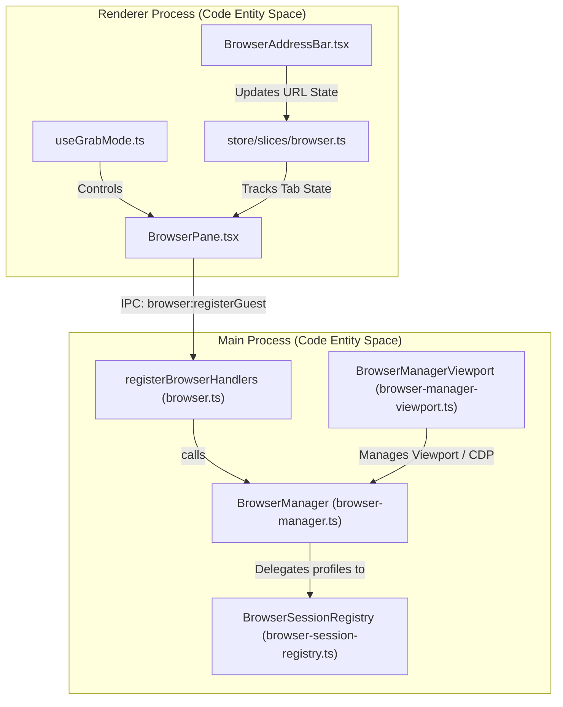
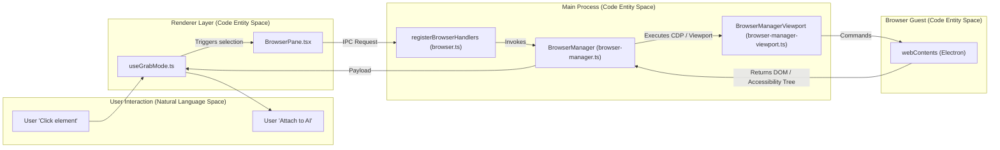

# Browser Pane & AI Agent Features

Orca integrates a full-featured browser pane with advanced AI agent tracking capabilities. This combined system enables seamless in-IDE web browsing with session isolation and element "grab" functionality while simultaneously monitoring AI agent activity across multiple products and platforms. It supports rich developer workflows including OAuth authorization, contextual AI assistance, computer and mobile automation, and persistent session analysis.

This page provides a high-level overview of these capabilities and links to dedicated child pages covering the system internals, lifecycle, UI, and integrations.

---

## Integrated Browser Pane

The Browser Pane is a core UI component embedded within each worktree that hosts Chromium-based web content via Electron’s `WebContentsView` or `webview` tags. It aims to keep developers within Orca’s interface while enabling:

- **Isolated Browser Sessions:** Leveraging `BrowserSessionProfile`s in `BrowserSessionRegistry`, the browser supports persistent, partitioned sessions that allow multiple account profiles, cookie import from installed browsers, and strict partition isolation preventing cross-contamination of data [src/main/browser/browser-session-registry.ts:52](). The main process manages this via `BrowserManager` which handles lifecycle, navigation guards, popup management, and session persistence [src/main/browser/browser-manager.ts:11](). Renderer state tracking resides in browser-related slices [src/renderer/src/store/slices/browser.ts:9]().
- **Design & Grab Mode:** A special interaction mode (`useGrabMode`) lets users visually select DOM elements in the browser guest UI. Orca extracts rich context, including the accessibility tree, computed styles, screen snapshots, and raw HTML snippets, to enrich AI prompt payloads. This contextual injection improves AI-driven code assistance relevance [src/renderer/src/store/slices/browser.test.ts:3]().
- **Security & Navigation Safeguards:** The `BrowserManager` and partition policy modules enforce navigation policies to support OAuth flows securely, blocking unsafe or prohibited navigations such as local file URLs or unauthorized redirects [src/main/browser/browser-manager.ts:11](), [src/main/browser/browser-session-permission-policy.ts:32]().
- **Keyboard and Shortcut Handling:** Keyboard inputs inside embedded browser guests are carefully handled to enable toggling of grab mode, forwarding commands, and blocking unsafe shortcuts without breaking native browser security or functionality [tests/e2e/browser-tab.spec.ts:1]().

The browser pane lifecycle involves renderer components (`BrowserPane.tsx` and the browser slice) managing UI state, synchronizing with the main process’s `BrowserManager`, injecting helper scripts, and performing IPC calls for DOM interaction and session management [src/main/ipc/browser.ts:38](), [src/main/browser/browser-manager.ts:11]().

For full technical detail on UI workflows, browser session lifecycle, cookie import, and design/grab modes, see the child page **[Integrated Browser Pane](#8.1)**.

### Browser Architecture: UI and Main Process Integration

Sources:
[src/renderer/src/components/browser-pane/BrowserPane.tsx:1](),
[src/main/browser/browser-manager.ts:11](),
[src/main/browser/browser-session-registry.ts:52](),
[src/main/browser/browser-manager-viewport.ts:15](),
[src/main/ipc/browser.ts:38]()

---

## AI Agent Tracking, Accounts & Usage

Orca monitors AI agent activity running inside integrated terminal panes through a combination of terminal title parsing and native hooks:

- **Terminal Title Parsing:** Terminal titles are scanned for recognizable prefixes, spinner patterns, and special tokens to infer agent status such as 'working', 'processing', or 'idle'. This heuristic allows non-intrusive detection of agent activity.
- **Explicit Agent Hooks:** Native hooks can emit detailed asynchronous events about AI progress, including errors and task completion, enabling more fine-grained agent state tracking.

The UI uses this data to show real-time agent activity indicators and status badges, enhancing developer awareness of AI operations for agents embedded in terminal sessions.

Orca also manages platform accounts with dedicated services that handle:
- Account hot-swapping, login state management, and environment setup.
- Usage and rate-limit tracking surfaced in Settings and the Status Bar for transparency.
- Runtime "home" provisioning delivering authenticated environments for agent-enabled worktrees.

The `BrowserManager` coordinates visibility and rendering paint leases for browser tabs used in headless or background AI workflows, preventing failures in automation due to hidden webviews [src/main/browser/browser-manager.ts:11]().

Main process validations protect against unsafe agent payloads by redacting fields resembling secrets (API keys, passwords) and imposing strict size constraints on extracted HTML and text.

For deeper details on agent detection expressions, lifecycle hooks, and account integration, refer to **[AI Agent Tracking, Accounts & Usage](#8.2)**.

### Grab Operation Flow: From User Interaction to AI Context

Sources:
[src/renderer/src/store/slices/browser.test.ts:3](),
[src/main/browser/browser-manager.ts:11](),
[src/main/browser/browser-manager-viewport.ts:15](),
[src/main/ipc/browser.ts:38](),
[src/main/browser/browser-manager-viewport-test-fixtures.ts:52]()

---

## Computer Use & Desktop Automation

Orca extends AI agent capabilities into desktop automation, particularly via native macOS, Windows, and Linux providers:

- The `orca computer` CLI and underlying native accessibility APIs (such as macOS `AXUIElement` and platform equivalents) enable traversal of the accessibility tree, allowing agents to perceive GUI widget hierarchy and properties.
- Agents can capture screenshots, simulate keyboard and mouse inputs, and execute sidecar-based transport for remote desktop interaction.
- Permission flows for accessibility privileges are carefully integrated to obtain and maintain user consent without friction.

These capabilities empower AI agents to operate desktop applications autonomously, automate user workflows, and interact with native UI elements on the user’s machine.

See **[Computer Use & Desktop Automation](#8.3)** for details on accessibility tree traversal, input action synthesis, sidecar transport mechanics, and permission management flows.

---

## Mobile Emulator Pane

Orca integrates a mobile emulator pane supporting iOS Simulator (macOS) and Android Emulator or `scrcpy` workflows:

- This pane streams live video of the emulator or device screen.
- Supports sending gestures, taps, scrolls, and keyboard input programmatically.
- Maintains a session registry to monitor emulation states and manage lifecycle events.

AI agents interact with the emulator surface through CLI-based skills and runtime RPC, enabling automated mobile app testing and development assistance.

Refer to **[Mobile Emulator Pane](#8.4)** for full coverage of emulator UI, video streaming, gesture injection, session registration, and agent integrations.

---

## AI Vault & Session Scanner

The AI Vault subsystem performs persistent session scanning and parsing across multiple AI agent products:

- It scans agent conversations and interaction histories, extracting rich structured data.
- Data and metadata are stored in discovery databases.
- Provides session data feeds to dashboard UI and persistent retained agents, enabling historical context recall and session restoration.

The scanning mechanism supports parsing diverse AI formats and integrates tightly with agent activity surfaces.

For comprehensive details on the AI Vault, session extraction logic, and cross-agent session management, see **[AI Vault & Session Scanner](#8.5)**.

---

## Summary Table: Browser & AI Agent Core Components

| Aspect | Browser Pane | AI Agent Tracking |
|---|---|---|
| **Primary Code Files** | `BrowserPane.tsx` [renderer] | `browser-manager.ts` [main process] |
| **Main Process Role** | Manages webview lifecycle & navigation guards | Maintains async agent selection state & status hooks |
| **Renderer Role** | Renders browser UI, toolbar, address bar | Drives Grab Mode, status display, and confirmation |
| **Data Source** | Chromium engine DOM + IPC | Terminal title parsing, native hooks, agent services |
| **Security Features** | Session isolation, cookie import | Payload validation, secret redaction |
| **Integration Points** | Electron webview, IPC, `BrowserManager` | Account services, runtime home |

---

This page serves as the high-level orientation for Orca’s integrated browser pane and AI agent tracking features. Each subcomponent is documented extensively in its own child page:

- [Integrated Browser Pane](#8.1)
- [AI Agent Tracking, Accounts & Usage](#8.2)
- [Computer Use & Desktop Automation](#8.3)
- [Mobile Emulator Pane](#8.4)
- [AI Vault & Session Scanner](#8.5)

Sources:
[src/renderer/src/components/browser-pane/BrowserPane.tsx:1](),
[src/main/browser/browser-manager.ts:11](),
[src/renderer/src/store/slices/browser.ts:16](),
[src/main/ipc/browser.ts:38](),
[src/main/browser/browser-session-registry.ts:52]()
