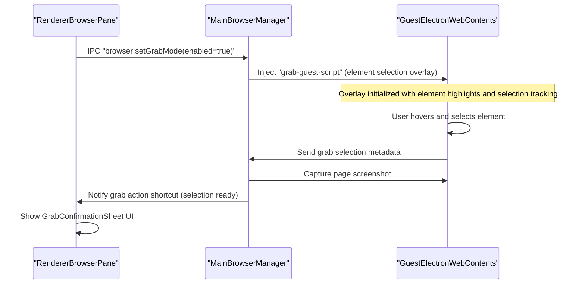
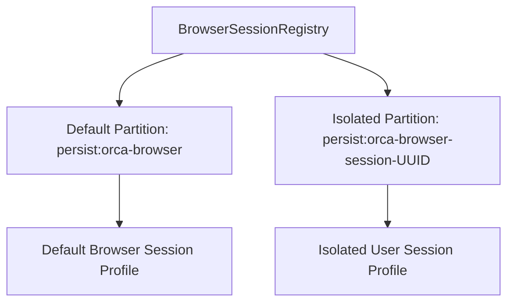
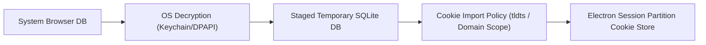
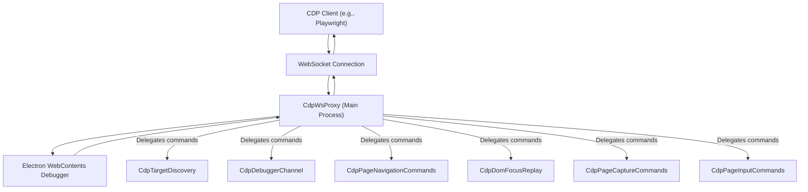

# Integrated Browser Pane

The Integrated Browser Pane embeds a Chromium-based web browser directly inside Orca's interface. This pane enables developers to preview web content, access documentation, and perform structured "AI Grabs" — selecting DOM elements, extracting metadata and screenshots, and injecting this contextual information into AI agents.

This page covers the core implementation of the `BrowserPane` UI component [src/renderer/src/components/browser-pane/BrowserPane.tsx:1-2](), the `BrowserManager` lifecycle [src/main/browser/browser-manager.ts:7-13]() and its security model, session profile management via partitions in `BrowserSessionRegistry` [src/main/browser/browser-session-registry.ts:52-79](), mechanisms for importing and enforcing cookie policies from external browsers [src/main/browser/browser-cookie-import.ts:26-67](), the `AgentBrowserBridge` [src/main/browser/agent-browser-bridge.ts:13-20](), and IPC bridge handlers [src/main/ipc/browser.ts:38-47]().

---

## Architecture Overview

The browser system comprises distinct yet cooperating layers running across the Electron main and renderer processes:

| Component | Code Entity | Responsibility |
|---|---|---|
| **Main Process Manager** | `BrowserManager` | Manages `<webview>` lifecycle, guest registration, security policies, and downloads [src/main/browser/browser-manager.ts:11-13](). |
| **Session Registry** | `BrowserSessionRegistry` | Orchestrates Electron session partitions, persistence metadata, and profile isolation [src/main/browser/browser-session-registry.ts:52-79](). |
| **Renderer UI** | `BrowserPane` | React component managing browser UI, webview elements, address bar, and overlays [src/renderer/src/components/browser-pane/BrowserPane.tsx:1-2](). |
| **Agent Bridge** | `AgentBrowserBridge` | Routes automation commands to the browser guest registered for the selected tab [src/main/browser/agent-browser-bridge.ts:13-20](). |
| **Cookie Import & Policy** | `importCookiesFromBrowser` | Handles detection, decryption, staging, and domain-scoped replacement of system browser cookies [src/main/browser/browser-cookie-import.ts:60-67](). |

### Data Flow: Browser Navigation and Grab Mode Interaction

Sources: `[src/renderer/src/components/browser-pane/BrowserPane.tsx:1-2]()`, `[src/main/browser/browser-manager.ts:11-13]()`

---

## BrowserManager, Session Profiles & Partitions

`BrowserManager` is a singleton class running in the Electron Main process that controls the full lifecycle of browser guest views (`<webview>` tags) and enforces security boundaries [src/main/browser/browser-manager.ts:11-13]().

### Session Profiles and Partitioning

Orca leverages Electron’s `partition` mechanism to isolate browser tabs into separate session contexts:

- **Default Partition:**
  The global default session uses the `persist:orca-browser` partition constant (`ORCA_BROWSER_PARTITION`) [src/main/browser/browser-session-registry.ts:4-56](). Tabs without explicit profiles share this partition, isolating cookies and storage from system browsers.
- **Profile-Based Partitions:**
  User-selectable browser session profiles map to distinct partitions (e.g., isolated scopes prefixed with `persist:orca-browser-session-`) [src/main/browser/browser-session-registry.test:100-108](). These profiles are orchestrated by `BrowserSessionRegistry`, managing allowlists, profile metadata, and cookie imports [src/main/browser/browser-session-registry.ts:52-79]().

Sources: `[src/main/browser/browser-session-registry.ts:4-79]`, `[src/main/browser/browser-session-registry.test.ts:100-108]()`

---

## BrowserPane UI: Address Bar, Tabs, and Overlay Layers

The `BrowserPane` React component is the central UI hosting embedded Chromium `<webview>` elements [src/renderer/src/components/browser-pane/BrowserPane.tsx:1-2]().

- **Tab and Page Management:**
  `BrowserPane` manages multiple tabs and pages per worktree, synchronizing URLs, navigation states, loading indicators, and annotations.
- **Address Bar & Navigation Controls:**
  The address bar allows user URL input, navigation controls, and search engine integration. URL normalization handles file paths and query rewriting.
- **Webview Element Management:**
  Each `BrowserPage` owns an Electron `<webview>`, managing lifecycle attachments, viewport sizes, and error telemetry via IPC handlers registered in `src/main/ipc/browser.ts:38-47`().

Sources: `[src/renderer/src/components/browser-pane/BrowserPane.tsx:1-2]`, `[src/main/ipc/browser.ts:38-47]()`

---

## Design Mode & Grab Mode for Context Injection

Orca supports two distinct interaction modes in the browser pane for injecting context into AI agents:

- **Grab Mode:**
  Users or AI agents visually select DOM elements on a web page to inject element metadata and screenshots into AI prompts. `BrowserManager` injects the `grab-guest-script` to establish the grab session and overlay for element selection.
- **Design Mode:**
  Overlays enable AI agents or users to inject markup, graphical annotations, or other augmented content atop the browser webview.

Sources: `[src/main/browser/browser-manager.ts:11-13]()`

---

## Cookie Import Pipeline & Policy

To create realistic session contexts and support authenticated browsing, Orca supports importing cookies from installed system browsers via `importCookiesFromBrowser` [src/main/browser/browser-cookie-import.ts:60-67]().

### Key Pipeline Steps

1.  **Browser & Profile Detection:** Detects Chromium, Firefox, and Safari family browsers and their profiles [src/main/browser/browser-cookie-import.ts:26-67]().
2.  **Decryption:** Decrypts persistent browser cookies using OS-specific facilities (macOS Keychain, Windows DPAPI) [src/main/browser/browser-cookie-import.ts:56-58]().
3.  **Staging & Atomic Swapping:** Cookies are staged in temporary SQLite databases and written into Electron session partitions via policy rules defined in `browser-cookie-import-policy.ts` [src/main/browser/browser-cookie-import-policy.ts:15-166](). The `summarizeCookieImportError` function provides a bounded error preview for import failures [src/main/browser/browser-cookie-import.ts:20-23]().

Sources: `[src/main/browser/browser-cookie-import.ts:26-72]`, `[src/main/browser/browser-cookie-import-policy.ts:15-166]()`, `[src/main/browser/browser-cookie-import.ts:20-23]()`

---

## Agent Browser Bridge

The `AgentBrowserBridge` class extends `AgentBrowserBridgeStateCommands` to route automation commands from AI agents directly to the browser guest registered for the selected tab [src/main/browser/agent-browser-bridge.ts:1-20]().

-   **Command Routing & Queuing:** Commands like `goto`, `click`, `fill`, and `snapshot` are serialized through command queues tied to web contents IDs [src/main/browser/cdp-bridge.ts:45-71]().
-   **Keypress Input:** The `keypress` method handles dispatching keyboard events. For printable keys, it dispatches directly over CDP. For embedded guests, it uses `wc.sendInputEvent` to avoid taking user focus. It also correctly handles modifiers and special keys [src/main/browser/agent-browser-bridge-interaction-commands.ts:172-191](), [src/main/browser/agent-browser-bridge-keypress-input.test.ts:95-140]().
-   **Process Swapping:** When Chromium swaps a guest's renderer process during navigation or crash recovery, `AgentBrowserBridge.onProcessSwap()` handles re-registration and session mapping updates [src/main/ipc/browser.ts:89-91]().

### CDP WebSocket Proxy

The `CdpWsProxy` class provides a WebSocket proxy for the Chrome DevTools Protocol (CDP) [src/main/browser/cdp-ws-proxy.ts:16-30](). This proxy allows external tools, such as Playwright, to interact with the Electron `WebContents` instance as if it were a standard Chromium browser.

The proxy handles:
-   **Debugger Attachment:** Attaches the debugger to the `WebContents` on start [src/main/browser/cdp-ws-proxy.ts:67-67]().
-   **Message Routing:** Routes CDP commands and events between the client and the `WebContents` debugger [src/main/browser/cdp-ws-proxy.ts:169-177]().
-   **Synthetic Sessions:** Manages synthetic CDP sessions for nested browser and page targets, allowing Playwright to interact with specific contexts [src/main/browser/cdp-ws-proxy.test.ts:92-185]().
-   **Command Handling:** Delegates specific CDP commands to specialized handlers like `CdpTargetDiscovery`, `CdpDebuggerChannel`, `CdpPageNavigationCommands`, `CdpDomFocusReplay`, `CdpPageCaptureCommands`, and `CdpPageInputCommands` [src/main/browser/cdp-ws-proxy.ts:36-63]().

Sources: `[src/main/browser/agent-browser-bridge.ts:1-20]`, `[src/main/browser/cdp-bridge.ts:45-71]`, `[src/main/ipc/browser.ts:89-91]()`, `[src/main/browser/agent-browser-bridge-interaction-commands.ts:172-191]()`, `[src/main/browser/agent-browser-bridge-keypress-input.test.ts:95-140]()`, `[src/main/browser/cdp-ws-proxy.ts:16-30]`, `[src/main/browser/cdp-ws-proxy.ts:67-67]`, `[src/main/browser/cdp-ws-proxy.ts:169-177]`, `[src/main/browser/cdp-ws-proxy.test.ts:92-185]`, `[src/main/browser/cdp-ws-proxy.ts:36-63]()`

---

# Sources

- `src/renderer/src/components/browser-pane/BrowserPane.tsx:1-2`
- `src/main/browser/agent-browser-bridge.ts:1-20`
- `src/main/browser/agent-browser-bridge-interaction-commands.ts:172-191`
- `src/main/browser/agent-browser-bridge-keypress-input.test.ts:95-140`
- `src/main/browser/browser-cookie-import.ts:20-23`
- `src/main/browser/browser-cookie-import.ts:26-72`
- `src/main/browser/browser-cookie-import.ts:56-58`
- `src/main/browser/browser-cookie-import.ts:60-72`
- `src/main/browser/browser-cookie-import-policy.ts:15-166`
- `src/main/browser/browser-manager.ts:7-13`
- `src/main/browser/browser-manager.ts:11-13`
- `src/main/browser/browser-session-registry.ts:4-56`
- `src/main/browser/browser-session-registry.ts:52-79`
- `src/main/browser/browser-session-registry.test.ts:100-108`
- `src/main/browser/cdp-bridge.ts:45-71`
- `src/main/browser/cdp-ws-proxy.ts:16-30`
- `src/main/browser/cdp-ws-proxy.ts:36-63`
- `src/main/browser/cdp-ws-proxy.ts:67-67`
- `src/main/browser/cdp-ws-proxy.ts:169-177`
- `src/main/browser/cdp-ws-proxy.test.ts:92-185`
- `src/main/ipc/browser.ts:38-47`
- `src/main/ipc/browser.ts:89-91`
