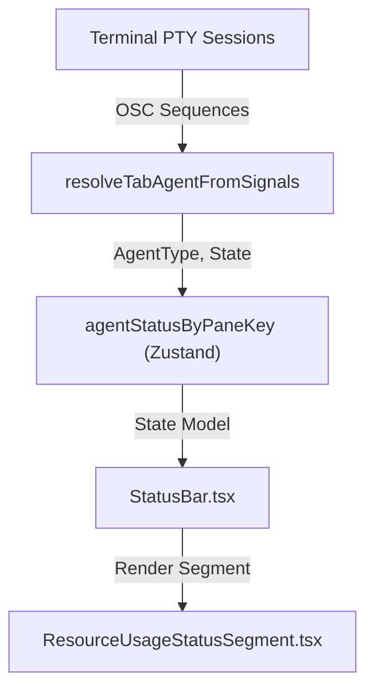
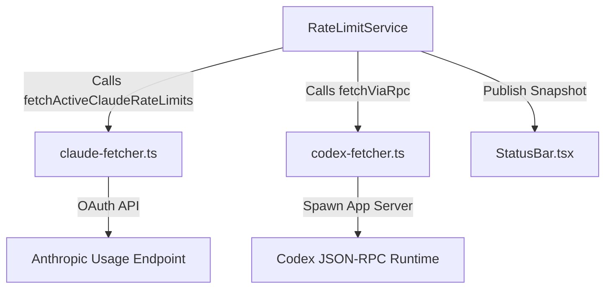

# AI Agent Tracking, Accounts & Usage

Orca provides a comprehensive subsystem that covers AI agent status detection and tracking, the management of Codex, Claude, and Grok accounts as managed AI service identities, runtime home materialization for these managed accounts, and usage/rate-limit tracking. This system enables runtime credential isolation, active status indicators for AI agents, user-driven account switching, and precise usage and rate-limit visibility both programmatically and within the UI.

---

## Agent Status Detection

Agent status detection tracks AI agents running inside terminal PTY sessions by analyzing terminal output, specifically using OSC (Operating System Command) terminal title sequences and hook events to infer live agent activity states.

### Implementation

- The renderer process holds an `agent-status` Zustand slice that maps terminal panes (identified by pane keys) to live and retained agent status entries. This slice tracks metadata such as agent type, current state (`working`, `waiting`, `done`, etc.), timing, orchestration context, and routing info. [src/renderer/src/store/slices/agent-status.ts:95-106]()
- Terminal PTY sessions emit OSC title escape sequences, intercepted by the renderer terminal subsystem. Functions like `resolveTabAgentFromSignals` [src/renderer/src/lib/use-tab-agent.ts:73-86]() parse these signals and title attributes to determine the active agent type and lifecycle state.
- Status updates flow into the agent-status slice in real time, enabling UI components like workspace cards or status bar segments to render live progress indicators.
- When a PTY ends or an agent session closes, its live status entry is migrated into a "retained" snapshot queue to preserve the last visible status until explicitly cleared.
- A monotonic epoch counter advances to track the freshness of agent status entries and triggers periodic expiration of stale statuses.

### Agent States and UI Indications

| State | Description | UI Indicator |
| :---------- | :---------------------------------------- | :---------------------------------------- |
| `working` | Agent actively processing requests | Pulsing blue or green dot |
| `blocked` | Agent encountered blocking condition/error | Red alert icon |
| `waiting` | Agent awaiting input or approval | Amber pulsing dot |
| `done` | Agent task completed successfully | Green checkmark |
| `idle` | Agent CLI open but inactive | Gray dot |

### Data Flow Diagram: Natural Language Space to Code Entity Space (`resolveTabAgentFromSignals`)



Sources:
[src/renderer/src/lib/use-tab-agent.ts:1-155](),
[src/renderer/src/components/status-bar/StatusBar.tsx:1-30](),
[src/renderer/src/components/status-bar/ResourceUsageStatusSegment.tsx:1-158](),
[src/renderer/src/store/slices/agent-status.ts:95-106]()

---

## Managed Codex and Claude Account Services

Orca supports full lifecycle management of multiple Codex and Claude AI accounts within its settings, enabling users to switch active accounts that serve as billing and credential identities in runtime AI interactions.

### Account Models and Persistence

- Managed Codex and Claude accounts are declared arrays stored in global app settings: `codexManagedAccounts` and `claudeManagedAccounts`.
- Each account object contains identifiers, email, workspace labels, creation/update timestamps, and associated managed home paths.
- The active selected account per service is tracked via properties like `activeCodexManagedAccountId` and `activeClaudeManagedAccountId`.

### Runtime Home Materialization and Isolation

- To maintain credential and runtime environment isolation, each Codex managed account is provisioned a dedicated **runtime home directory** under the app's user data folder.
- The `CodexRuntimeHomeService` [src/main/codex-accounts/runtime-home-service.ts:9-19]() is responsible for creating or updating these runtime homes on account switches or startup.
- The service mirrors or rewrites authentication files such as `auth.json` and configuration files from the canonical or managed home into isolated, account-specific locations.
- Managed account runtime homes contain only the credentials and sanitized config relevant to the selected account, preventing credential cross-contamination between sessions.

Sources:
[src/renderer/src/components/status-bar/StatusBar.tsx:1-30](),
[src/main/codex-accounts/runtime-home-service.ts:9-19]()

---

## AI Usage & Rate Limit Tracking

Orca centralizes AI usage and rate-limit tracking across multiple provider types (Codex, Claude, Gemini, Grok, Kimi, MiniMax) in the main process's `RateLimitService` [src/main/rate-limits/service.ts:10-10]().

### Provider-specific Fetching Strategies

- **Claude:**
  - Primary source is the OAuth token-backed API fetching usage metrics via `fetchActiveClaudeRateLimits` [src/main/rate-limits/claude-fetcher.ts:14-18]().
  - Fallback PTY scraper runs the CLI `claude /usage` command to parse usage from TUI output via `fetchManagedAccountUsage` [src/main/rate-limits/claude-fetcher.ts:20-25]().
- **Codex:**
  - Queries the Codex Runtime JSON-RPC API for snippets of usage data via `fetchViaRpc` [src/main/rate-limits/codex-fetcher.ts:103-133]().
  - Uses a reset credit system to handle temporary soft rate limits via `consumeCodexRateLimitResetCredit` [src/main/rate-limits/codex-fetcher.ts:157-162]().

### Data Flow Diagram: Rate-Limit Service to Provider Fetchers



Sources:
[src/main/rate-limits/service.ts:1-10](),
[src/main/rate-limits/codex-fetcher.ts:1-168](),
[src/main/rate-limits/claude-fetcher.ts:1-25]()

---

## AI Agent Hooks

Orca provides a robust system for managing AI agent hooks, allowing the application to inject custom commands into the agent's environment at specific lifecycle events. The `AgentHookServer` [src/main/agent-hooks/server.ts:29-29]() in the main process acts as the central dispatcher for these hooks.

### Hook Services

- **`CodexHookService`** [src/main/codex/hook-service.ts:20-20](): Manages hooks for Codex agents. It handles legacy cleanup, script generation, WSL runtime integration, and trust management.
- **`OpenCodeHookService`** [src/main/opencode/hook-service.ts:31-31](): Manages plugin sources and endpoint routing for OpenCode sessions. It handles the installation of status plugins and configuration overlays for OpenCode 1 and 2. [src/main/opencode/hook-service.ts:124-149]()
- **`PiHookService`**: Manages hooks for Pi agents, generating source code for agent status handlers and extensions. [src/main/pi/agent-status-handler-source.ts:18-19]()

### Hook Definition and Installation

- **`HookCommandConfig`** [src/main/agent-hooks/installer-utils.ts:22-30](): Defines a command to be executed, including optional arguments, timeout, and asynchronous execution.
- **`HookDefinition`** [src/main/agent-hooks/installer-utils.ts:32-39](): Represents a hook, which can be a command, bash script, or PowerShell script.
- **`HooksConfig`** [src/main/agent-hooks/installer-utils.ts:41-44](): The overall configuration structure for hooks, typically stored in a `hooks.json` file.
- **`writeHooksJson`** [src/main/agent-hooks/installer-utils.test.ts:100-112](): Writes the `HooksConfig` to a JSON file, handling backups and symlinks.
- The `normalizeHookPayload` function [src/shared/agent-hook-listener.ts:38-53]() is a canonical transport-agnostic normalization entry shared by main and relay listeners, processing raw hook payloads into structured `AgentHookEventPayload` objects.

### Data Flow Diagram: Agent Hook Processing

```mermaid
graph TD
  AgentRuntime["Agent Runtime (e.g., Codex, OpenCode, Pi)"] -->|Emits Hook Event (HTTP POST)| AgentHookServer["AgentHookServer (main process)"]
  AgentHookServer -->|Calls normalizeHookPayload| HookPayloadNormalizer["normalizeHookPayload (shared/agent-hook-listener.ts)"]
  HookPayloadNormalizer -->|AgentHookEventPayload| AgentStatusSlice["agent-status Zustand slice (renderer)"]
  AgentStatusSlice -->|Updates UI| StatusBar["StatusBar.tsx"]
  AgentHookServer -->|Dispatches to specific service| CodexHookService["CodexHookService"]
  AgentHookServer -->|Dispatches to specific service| OpenCodeHookService["OpenCodeHookService"]
  AgentHookServer -->|Dispatches to specific service| PiHookService["PiHookService"]
  CodexHookService -->|Installs/Manages| CodexHooks["Codex Agent Hooks"]
  OpenCodeHookService -->|Installs/Manages| OpenCodePlugins["OpenCode Status Plugins"]
  PiHookService -->|Generates/Installs| PiExtensions["Pi Agent Extensions"]
```

Sources:
[src/main/codex/hook-service.ts:1-28](),
[src/main/opencode/hook-service.ts:31-31](),
[src/main/opencode/hook-service.ts:124-149](),
[src/main/pi/agent-status-handler-source.ts:18-19](),
[src/main/agent-hooks/installer-utils.ts:1-44](),
[src/main/agent-hooks/installer-utils.test.ts:100-132](),
[src/main/agent-hooks/server.ts:29-29](),
[src/shared/agent-hook-listener.ts:38-53]()

---

## Hook Trust Management (Codex)

For Codex agents, a trust system is in place to manage the execution of hooks, ensuring security and integrity.

- **`CodexTrustEntry`** [src/main/codex/config-toml-trust.ts:32-55](): Represents a single entry in the hook trust configuration, including source path, event label, command, and hash.
- **`computeTrustedHash`** [src/main/codex/config-toml-trust.ts:64-66](): Computes a hash for a hook entry to verify its integrity.
- **`upsertHookTrustEntries`** [src/main/codex/config-toml-trust.ts:102-111](): Adds or updates hook trust entries in the configuration file.

Sources:
[src/main/codex/config-toml-trust.ts:1-197]()

---

## Usage and Rate-Limit UI Components

Orca exposes live usage, rate limit, and account information in the renderer via specialized UI components:

- **`StatusBar`** [src/renderer/src/components/status-bar/StatusBar.tsx:30-30](): Displays active accounts, usage percentage bars, and quick switcher menus.
- **`InlineUsageBars`** [src/renderer/src/components/status-bar/StatusBar.tsx:26-26](): Renders usage bars for various providers.
- **`ProviderDetailsMenu`** [src/renderer/src/components/status-bar/StatusBar.tsx:27-27](): Provides a menu for detailed provider information.
- **`ResourceUsageStatusSegment`** [src/renderer/src/components/status-bar/ResourceUsageStatusSegment.tsx:24-158](): Provides detailed resource tracking and popover summaries for background processes and agent states.
- **`WorkspaceCleanupDialog`** [src/renderer/src/renderer/src/components/workspace-cleanup/WorkspaceCleanupDialog.tsx:48-54](): Manages workspace cleanup scans and candidate removal workflows.

Sources:
[src/renderer/src/components/status-bar/StatusBar.tsx:1-30](),
[src/renderer/src/components/status-bar/ResourceUsageStatusSegment.tsx:1-158](),
[src/renderer/src/components/workspace-cleanup/WorkspaceCleanupDialog.tsx:1-54]()
